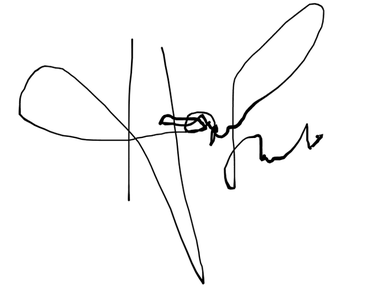
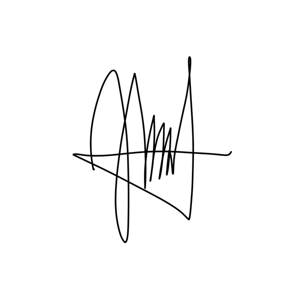

# Deklarasi Penggunaan AI

## Tugas Besar IF2150 - Rekayasa Perangkat Lunak

| Informasi | Keterangan |
|---|---|
| Kelas | K02 |
| Nomor Kelompok | G09 |
| Nama Kelompok | Cumlaude |
| Nama Perangkat Lunak | SEHATI (Sistem Elektronik Pelayanan Kesehatan Terintegrasi) |

**Anggota Kelompok:**

| NIM | Nama |
|---|---|
| 13525008 | Malik Arsyafiandra Madani |
| 13525032 | Ahmad Humam Isma |
| 13525044 | Steven Vanako |
| 13525071 | Muhammad Adnan Kurniawan |
| 13525074 | Axeleon Justin Algianto |
| 13525110 | Fachry Azriel Fajdwani |

---

### Daftar Isi
* [Milestone 1](#milestone-1)
* [Milestone 2](#milestone-2)
* [Milestone 3](#milestone-3)
* [Milestone 4](#milestone-4)
* [Milestone 5](#milestone-5)
* [Milestone 6](#milestone-6)
* [Milestone 7](#milestone-7)
* [Milestone 8](#milestone-8)
* [Milestone 9](#milestone-9)

---

### Log Penggunaan AI per Milestone

Silakan catat penggunaan AI yang berdampak signifikan pada pengerjaan tugas (misal: *generate* fungsi algoritma yang kompleks, *generate* draf dokumen SKPL/DPPL, atau *debugging* error utama). 
*Penggunaan sepele seperti memperbaiki *typo* atau auto-complete satu baris kode tidak perlu dicatat.*

### Milestone 1
| Tool AI | Tujuan Penggunaan | Contoh Prompt Utama | Modifikasi & Validasi Manusia |
| :--- | :--- | :--- | :--- |
| *Claude (Claude Code)* | *Meminta ide outline dan struktur poin-poin utama Bab 1 sampai Bab 3 berdasarkan topik SDG 3* | *"Berikan usulan struktur dokumen dan poin-poin utama yang perlu dibahas untuk Bab 1 sampai Bab 3. Kelompok kami memilih SDG 3 (Good Health and Well-being) dengan konsep sistem manajemen puskesmas/klinik."* | *Outline yang diberikan AI dijadikan panduan kasar. Seluruh isi paragraf draf diketik manual oleh anggota kelompok disesuaikan dengan konteks puskesmas dan penomoran kesenjangan (G-01 s.d. G-07).* |
| *Claude (Claude Code)* | *Menelusuri data statistik pendukung latar belakang masalah* | *"Carikan data Riskesdas 2018 mengenai prevalensi hipertensi dan proporsi yang terdiagnosis, jumlah puskesmas menurut Profil Kesehatan Indonesia terbaru, serta AKI hasil Long Form SP2020."* | *Seluruh angka yang dikutip ditelusuri kembali ke sumber primer (Laporan Nasional Riskesdas 2018, Profil Kesehatan Indonesia 2024, dan tabel BPS Long Form SP2020), lalu dicantumkan pada bagian Referensi. Angka yang tidak dapat diverifikasi ke sumber primer tidak dimasukkan ke dokumen.* |
| *Claude (Claude Code)* | *Meminta referensi tahapan proses pelayanan rawat jalan sebagai acuan pembuatan activity diagram* | *"Berikan contoh tahapan proses pelayanan rawat jalan yang umum di puskesmas mulai dari pendaftaran hingga penyerahan obat."* | *Urutan aktivitas yang diberikan AI didiskusikan ulang dan dirombak. Kelompok menggambar sendiri activity diagram swimlane berdasarkan kesepakatan final, memperhatikan notasi UML yang tepat.* |
| *Claude (Claude Code)* | *Meminta contoh dasar user story sebagai referensi brainstorming* | *"Berikan beberapa contoh user story untuk sistem klinik dengan format 'Sebagai [Aktor], saya ingin [Aktivitas], sehingga [Tujuan]' untuk aktor Perawat dan Dokter."* | *Contoh AI hanya dijadikan referensi format. Kelompok merumuskan seluruh user story secara manual agar benar-benar terhubung dengan kesenjangan pada Subbab 1.2 dan sesuai batasan ruang lingkup (BL-01 s.d. BL-07).* |
| *Gemini* | *Meminta tinjauan (review) tata bahasa dan saran parafrase pada beberapa paragraf agar lebih lugas* | *"Tolong tinjau paragraf berikut, apakah ada kalimat yang terlalu bertele-tele? Berikan saran perbaikannya agar lebih lugas dan teknis untuk laporan akademik."* | *Kelompok meninjau saran dari AI dan hanya menggunakan perbaikan untuk menghilangkan metafora berlebihan serta memperbaiki tanda baca. Substansi kalimat tetap sepenuhnya merupakan hasil pemikiran kelompok.* |

> **Catatan pengisian.** Kolom *Modifikasi & Validasi Manusia* di atas harus dibaca ulang dan disesuaikan oleh masing-masing anggota agar benar-benar mencerminkan validasi yang dilakukan, karena tabel ini merupakan bagian dari pernyataan integritas yang ditandatangani.

### Milestone 2
| Tool AI | Tujuan Penggunaan | Contoh Prompt Utama | Modifikasi & Validasi Manusia |
| :--- | :--- | :--- | :--- |
| *Claude (Claude Code)* | *Meminta referensi struktur pengkategorian kebutuhan sistem (User, Business, System Requirement) berdasarkan aktivitas operasional* | *"Berikan contoh pemetaan kebutuhan sistem dari aktivitas operasional klinik ke dalam kategori User Requirement, Business Requirement, dan System Requirement."* | *Contoh dari AI hanya dijadikan acuan pemahaman taksonomi kebutuhan. Seluruh rincian kebutuhan spesifik SEHATI dirumuskan secara mandiri berdasarkan 27 aktivitas dan alur pelayanan puskesmas yang telah disepakati pada Milestone 1.* |
| *Claude (Claude Code)* | *Brainstorming aspek kebutuhan non-fungsional (KNF) yang relevan untuk aplikasi kesehatan fasilitas primer* | *"Apa saja parameter kebutuhan non-fungsional yang krusial untuk sistem rekam medis puskesmas dengan arsitektur desktop dan sinkronisasi berkala?"* | *Saran aspek non-fungsional dari AI disaring dan disesuaikan dengan batasan teknis puskesmas. Nilai batas/metrik kuantitatif (kecepatan respons < 2 detik, enkripsi AES-256 untuk basis data lokal, mekanisme rollback transaksi) ditetapkan sendiri oleh kelompok.* |
| *Gemini* | *Memeriksa konsistensi matriks keterlacakan (traceability) antara Kebutuhan Fungsional dengan User Story dan Aktivitas* | *"Tolong periksa apakah ada ID aktivitas atau user story dari daftar berikut yang belum tercakup atau terlewat pada pemetaan kebutuhan fungsional."* | *Hasil pengecekan AI ditinjau ulang secara manual baris demi baris pada draf dokumen. Penyesuaian pemetaan akhir dan penggabungan kebutuhan fungsional tetap diputuskan sendiri oleh anggota kelompok.* |
| *Gemini* | *Review tata bahasa dan saran perbaikan formulasi kalimat kebutuhan fungsional agar tidak ambigu* | *"Tinjau formulasi kalimat kebutuhan fungsional berikut, berikan saran agar menggunakan pola pernyataan yang baku ('Sistem harus...') dan tidak bermakna ganda."* | *Saran perbaikan redaksional dari AI hanya diadopsi pada pemilihan kata kerja operasional yang lebih lugas. Makna klinis, batasan fitur, dan alur kerja puskesmas tetap sepenuhnya hasil rumusan kelompok.* |

### Milestone 3
| Tool AI | Tujuan Penggunaan | Contoh Prompt Utama | Modifikasi & Validasi Manusia |
| :--- | :--- | :--- | :--- |
| *Claude (Claude Code)* | *Memeriksa kelengkapan penelusuran antara Bab 2, tabel use case, skenario, dan diagram* | *"Periksa apakah ada ID KF yang belum tercakup use case mana pun, dan apakah aktor pada tabel use case sama dengan asosiasi pada diagram."* | *Hasil pemeriksaan dicocokkan ulang secara manual pada dokumen sebelum dikumpulkan, khususnya kesesuaian ID KF pada tabel Subbab 3.2 dengan rumusan KF pada Bab 2.* |

### Milestone 4
| Tool AI | Tujuan Penggunaan | Contoh Prompt Utama | Modifikasi & Validasi Manusia |
| :--- | :--- | :--- | :--- |
| *Claude (Claude Code)* | *Menyusun draf identifikasi kelas beserta atribut, metode, dan relasinya dari skenario use case Milestone 3* | *"Turunkan kandidat kelas dari skenario use case pada dokumen UC, lengkap dengan atribut, metode, dan jenis relasi antarkelasnya."* | *Draf AI dipakai sebagai titik awal. Kelompok memeriksa tiap kelas terhadap skenario Subbab 3.4, membuang kelas yang tidak berpangkal pada KF mana pun, dan menetapkan sendiri jenis relasi yang dipakai.* |
| *Claude (Claude Code)* | *Menggambar ulang 13 diagram kelas setelah model disusun ulang mengikuti kerangka ECB hasil asistensi* | *"Gambar ulang diagram kelas tiap use case memakai stereotip boundary, control, dan entity, dengan boundary hanya berhubungan lewat control."* | *Pembagian kelas ke dalam stereotip ECB dan pola penamaannya ditetapkan kelompok berdasarkan catatan asistensi. Tata letak dan hasil gambar diperiksa satu per satu, dan diagram yang garisnya menembus kotak kelas digambar ulang.* |
| *Claude (Claude Code)* | *Memeriksa kelengkapan penelusuran KF, aturan ECB, dan konsistensi antara diagram dengan tabel* | *"Periksa apakah ada KF yang belum tercakup kelas mana pun, apakah ada garis dari boundary langsung ke entity, dan apakah nomor gambar berurutan."* | *Hasil pemeriksaan dicocokkan ulang pada dokumen. Satu temuan ditindaklanjuti, yaitu KodeICD10Entity yang belum tersambung ke control; relasinya ke PemeriksaanManager ditambahkan setelah kelompok memastikan pencarian kode ICD-10 memang dijalankan manager tersebut.* |

### Milestone 5
| Tool AI | Tujuan Penggunaan | Contoh Prompt Utama | Modifikasi & Validasi Manusia |
| :--- | :--- | :--- | :--- |
| *Claude (Claude Code)* | *Meminta pendapat kedua soal pilihan DBMS setelah asisten meminta DBMS dikunci pada satu pilihan* | *"Untuk aplikasi desktop puskesmas dengan beberapa komputer yang berbagi satu basis data di LAN, apa kelebihan dan kekurangan PostgreSQL dibanding MySQL dari sisi konkurensi dan penyimpanan data JSON?"* | *Jawaban AI hanya dipakai sebagai bahan diskusi. Kelompok memutuskan sendiri PostgreSQL 15 setelah mencocokkan alasannya dengan KF20, KF23, dan KNF11, lalu menulis alasan pada Subbab 2.5 dengan kalimat sendiri.* |
| *Claude (Claude Code)* | *Bertukar pikiran soal rumusan lingkungan operasi yang dinilai ambigu oleh asisten* | *"Kalau di dokumen tertulis 'Windows atau Linux', apakah pembaca bisa salah tangkap bahwa kami belum memutuskan? Bagaimana cara menulisnya supaya jelas bahwa keduanya didukung?"* | *AI memberi beberapa contoh rumusan. Kelompok memilih rumusan "didukung keduanya" yang sesuai KNF10 dan menerapkannya sendiri pada Subbab 2.5.* |
| *Gemini* | *Meminta daftar jenis referensi yang biasanya dicantumkan pada dokumen SKPL sistem kesehatan* | *"Jenis referensi apa saja yang biasanya dirujuk dokumen spesifikasi kebutuhan untuk sistem informasi puskesmas yang terhubung ke SATUSEHAT?"* | *Daftar dari AI hanya dipakai sebagai pengingat kategori (standar teknis, regulasi, buku). Setiap referensi dicari dan dibaca sendiri dari sumber resminya, dan hanya referensi yang benar-benar dirujuk subbab tertentu yang dicantumkan.* |

### Milestone 6
| Tool AI | Tujuan Penggunaan | Contoh Prompt Utama | Modifikasi & Validasi Manusia |
| :--- | :--- | :--- | :--- |
| *Claude (Claude Code)* | *Meminta pendapat kedua soal pemilihan style arsitektur setelah asisten menyebut MVC terlalu dangkal bila dipakai sendirian* | *"Kelas kami sudah dibagi boundary, control, dan entity. Kalau dibandingkan antara MVC dan Layered Architecture, mana yang lebih nyambung dengan ECB, dan apa kekurangan masing-masing?"* | *Jawaban AI dipakai sebagai salah satu bahan diskusi. Kelompok memutuskan Layered Architecture empat lapisan dan menyusun sendiri enam alasan pada BAB 1 yang dikaitkan ke KF dan KNF SEHATI.* |
| *Claude (Claude Code)* | *Bertukar pikiran soal view yang paling cocok untuk BAB 3* | *"Untuk sistem dengan 65 komponen dan aturan antarlapisan yang ketat, view 4+1 mana yang paling membantu pembaca memahami relasi antarkomponen?"* | *AI menyebut Logical View dan Physical View sebagai kandidat. Kelompok memutuskan memakai keduanya dan membagi pengerjaannya ke anggota yang berbeda.* |
| *Claude (Claude Code)* | *Meminta saran cara menggambar block diagram dengan banyak komponen agar tetap terbaca* | *"Diagram logical view kami berisi 65 kotak dan puluhan garis. Ada ide supaya garisnya tidak saling tumpang tindih?"* | *Dari beberapa saran AI, kelompok memakai ide jalur bersama dengan titik percabangan untuk relasi Manager ke DataBoundary. Penempatan komponen, label relasi, dan diagramnya dikerjakan sendiri, lalu relasinya dicocokkan ulang dengan Tabel 2.2 dan diagram kelas SKPL.* |
| *Gemini* | *Memeriksa ulang apakah seluruh komponen Tabel 2.1 sudah muncul pada diagram* | *"Ini daftar komponen di Tabel 2.1 dan daftar kotak pada diagram. Apakah ada yang terlewat atau namanya berbeda?"* | *Hasil pemeriksaan AI dicek ulang secara manual satu per satu terhadap Tabel 2.1 sebelum diagram dimasukkan ke dokumen.* |

### Milestone 7
| Tool AI | Tujuan Penggunaan | Contoh Prompt Utama | Modifikasi & Validasi Manusia |
| :--- | :--- | :--- | :--- |
| *Claude (Claude Code)* | *Meminta pendapat kedua soal letak metode penyimpanan pada kelas perancangan* | *"Di SKPL, entity kami punya metode simpan(). Di APL kami sudah punya DataBoundary di Data Access Layer. Lebih baik simpan() tetap di entity atau dipindah ke DataBoundary? Apa untung-ruginya?"* | *Jawaban AI dipakai sebagai bahan diskusi. Kelompok memutuskan memindahkan penyimpanan ke DataBoundary agar Business Layer tidak bergantung pada basis data, lalu mencatat alasan perubahan ini sendiri pada BAB 4 DPPL.* |
| *Claude (Claude Code)* | *Bertukar pikiran soal cara menggambarkan skenario konkurensi pada sequence diagram* | *"Skenario alternatif kami ada yang berupa dua petugas menekan tombol bersamaan. Bagaimana cara yang lazim menggambarkannya di sequence diagram supaya penguncian barisnya terlihat?"* | *Dari beberapa ide AI, kelompok memilih dua lifeline instans Manager dan note penguncian baris. Urutan pesan dan titik COMMIT pada UC03 dan UC07 disusun sendiri sesuai transaksi PostgreSQL yang dirancang.* |
| *Claude (Claude Code)* | *Meminta perbandingan perkakas untuk menggambar 42 sequence diagram dan 13 diagram kelas secara konsisten* | *"Kami perlu membuat puluhan sequence diagram dan diagram kelas yang nama metodenya harus konsisten. Lebih praktis pakai draw.io, StarUML, PlantUML, atau Mermaid?"* | *Kelompok memilih Mermaid karena diagram ditulis sebagai teks dan dapat ditinjau lewat Git. Seluruh isi diagram, yaitu kelas, metode, dan urutan pesan, ditulis sendiri dari skenario Subbab 4.4 SKPL.* |
| *Gemini* | *Memeriksa ulang konsistensi nama metode antara sequence diagram dan diagram kelas* | *"Ini daftar pesan pada sequence diagram dan daftar metode tiap kelas. Apakah ada pesan yang metodenya tidak ada di kelas tujuan?"* | *Temuan AI dicocokkan ulang secara manual pada dokumen. Kelompok sendiri yang memutuskan perbaikannya, yaitu menambah metode yang kurang atau mengganti nama pesan.* |

---
### Milestone 8
| Tool AI | Tujuan Penggunaan | Contoh Prompt Utama | Modifikasi & Validasi Manusia |
| :--- | :--- | :--- | :--- |
| *Claude (Claude Code)* | *Menyusun draf kerangka DPPL2 dari DPPL Tugas 7 dan draf rincian 13 kelas Manager beserta pseudocode-nya* | *"Kerjakan sebagian draf Tugas 8: bawa BAB 1 sampai BAB 4 dari DPPL Tugas 7 lalu rinci kelas Manager pada BAB 5, sisanya dikerjakan anggota lain."* | *Pembagian bagian ditentukan kelompok. Operasi dan atribut dicocokkan otomatis dengan Tabel 4.1 dan pseudocode dicocokkan dengan sequence diagram BAB 3 sebelum dipakai.* |
| *Claude (Claude Code)* | *Memeriksa keseragaman nama kelas, atribut, dan metode pada seluruh pseudocode sesuai saran asistensi* | *"Cek semuanya, termasuk tampilan visual dan SQL-nya, lalu perbaiki yang masih kurang."* | *Temuan dibaca ulang satu per satu; nama kolom SQL dan metode yang sengaja dihapus pada BAB 4 tidak diubah.* |
| *Claude (Claude Code)* | *Menguji 78 kueri SQL pada PostgreSQL sementara dan mengukur waktu pencarian pasien* | *"Cek SQL-nya juga."* | *Satu kueri (Q-C61-08) diperbaiki setelah gagal di-PREPARE. Skema uji hanya alat bantu dan tidak dimasukkan ke dokumen.* |
| *Claude (Claude Code)* | *Merender 15 rancangan antarmuka untuk memeriksa tampilan visualnya* | *"Cek tampilan visualnya."* | *Penanda nomor objek yang menutupi teks, bilah aplikasi yang bertumpuk, dan data contoh yang tidak konsisten antarlayar diperbaiki pada gen_ui.py lalu seluruh layar dibuat ulang dan diperiksa kembali.* |

---
### Milestone 9
| Tool AI | Tujuan Penggunaan | Contoh Prompt Utama | Modifikasi & Validasi Manusia |
| :--- | :--- | :--- | :--- |
| *Claude (Claude Code)* | *Menyusun UC12 Konfigurasi dan Basis Data (#21): akun, data master, pencadangan pg_dump, dan layar I-15* | *"Lanjut ke UC12 sesuai DPPL Subbab 5.16, 5.29, 5.55, 5.64, dan I-15. Tambahkan data master obat dan poli, lalu uji pencadangannya di kontainer postgres:15."* | *Axeleon mencocokkan hasilnya dengan DPPL dan menjalankan `mvn test` termasuk uji basis data. Setelah review Steven di PR #46, Axeleon menambah detik pada nama arsip agar pencadangan tidak saling menimpa.* |
| *Claude (Claude Code)* | *Meninjau implementasi UC01 Masuk ke Aplikasi (#10): autentikasi, hak akses, dan batas diam sesi* | *"Review AutentikasiManager dan LoginForm untuk UC01. Apakah validasi peran dan batas diam 15 menit sudah sesuai DPPL, dan ada edge case yang terlewat?"* | *Axeleon menyesuaikan penanganan sesi dengan Subbab 5.1, 5.17, 5.31, dan I-01, lalu memastikan `mvn test` lulus dengan postgres:15. Steven meng-approve PR #44.* |
| *Claude (Claude Code)* | *Menyusun cangkang aplikasi JavaFX (#3): navigasi, bilah aplikasi, tema, pintasan, dan komponen peringatan* | *"Bikin cangkang JavaFX untuk #3: Navigasi ke 15 layar DPPL BAB 6, bilah aplikasi, tema, pintasan global, PanelPeringatan, dan PenandaKolom."* | *Axeleon menjalankan `mvn test` dan `mvn javafx:run`. Setelah review Steven di PR #28, Axeleon menampilkan bilah aplikasi selama sesi aktif.* |
| *Claude (Claude Code)* | *Menyusun DataKlinisBoundary bagian skrining dan risiko (#6) serta entity C38 s.d. C41* | *"Selesaikan bagianku: entity C38 s.d. C41 dan DataKlinisBoundary bagian skrining sesuai Q-C59-01 s.d. Q-C59-10 dan Algo-C59-01."* | *Humam mencocokkan kueri dengan Subbab 5.59 dan menguji entity lewat `mvn test`. Atas review Adnan di PR #29, Humam menambah atribut `waktu` pada TandaVitalEntity.* |
| *Claude (Claude Code)* | *Menyusun UC04 Skrining (#13): SkriningManager, RisikoManager, dua layar skrining, dan unit test* | *"Kerjakan #13 UC04 sesuai Algo-C20-01 s.d. C20-03, C21-01, dan C05-01, termasuk F2 memanggil dan F3 melewati antrean."* | *Humam menguji validasi rentang dan evaluasi risiko lewat `mvn test`. Atas review Adnan di PR #31, Humam memperbaiki urutan antrean dan tombol Lewati.* |
| *Claude (Claude Code)* | *Menyusun DataPasienBoundary dan DataKunjunganBoundary (#5) menggantikan Steven* | *"Kerjakan #5 sesuai Q-C57 dan Q-C58 di DPPL, cocokkan dengan uji-kueri.sql milik Malik, dan buat unit test dengan pengganti JDBC."* | *Humam mencocokkan kueri dengan Subbab 5.57 dan 5.58 dan menguji transaksi serta pemetaan galat lewat `mvn test`.* |
| *Claude (Claude Code)* | *Menyusun DataFarmasiBoundary dan uji JUnit-nya (#8)* | *"Kerjakan #8 dengan 15 kueri Tabel 5.61.3, FOR UPDATE untuk resep, obat, dan bets, serta Algo-C61-01 untuk bets ganda."* | *Malik mencocokkan kueri dengan schema.sql dan menjalankan `mvn test` untuk uji tanpa basis data.* |
| *Claude (Claude Code)* | *Menyusun UC02 Mengelola Data Pasien (#11): PasienEntity, PasienManager, layar I-02, dan unit test* | *"Kerjakan #11 UC02: validasi NIK, pencarian, pendaftaran, pembaruan, audit, dan layar I-02 dengan pintasan Ctrl+S, Ctrl+F, dan Ctrl+N."* | *Steven mencocokkan operasi dengan DPPL Subbab 5.18, 5.33, dan 6.2, lalu membaca ulang setiap file sebelum commit. CI menjalankan `mvn -B test` pada PR.* |
| *Claude (Claude Code)* | *Menyusun schema.sql, seed.sql, dan docker-compose.yml dari kueri DPPL (#2)* | *"Turunkan skema dari 78 kueri DPPL Subbab 5.56 s.d. 5.64, lengkap dengan constraint dan peran sehati_app, plus seed data fiktif."* | *Malik mencocokkan tabel dan kolom dengan atribut entity DPPL. Saran review Fachry di PR #33 Malik tindak lanjuti lewat PR #43.* |
| *Claude (Claude Code)* | *Menyusun UC09 Daftar Pantau (#18): DataPantauBoundary, PantauManager, DaftarPantauForm, dan unit test* | *"Kerjakan #18 UC09 sesuai Q-C60-01 s.d. Q-C60-06 dan layar I-12, lalu isi baris B.1 dan B.5 milikku."* | *Humam menguji penyaringan dan tindak lanjut lewat `mvn test`. Atas review Adnan di PR #32, Humam menampilkan saringan aktif dan menolak rekam medis kosong.* |
| *Claude (Claude Code)* | *Menyusun kerangka Maven, stub 64 kelas DPPL, CI, dan pembacaan .env (#1, PR #27 dan #34)* | *"Review pembagian tugas di GitHub berdasarkan hasil asistensi, lalu buat kerangka Maven, stub 64 kelas DPPL, dan CI. Cek ulang sebelum commit."* | *Cek ulang menemukan stub tanpa konstruktor kosong, dan Adnan memperbaikinya sebelum commit. Adnan menindaklanjuti review Malik di PR #34.* |
| *Claude (Claude Code)* | *Menyusun UC05 Pemeriksaan Medis dan DataKlinisBoundary bagian pemeriksaan (#7, #14)* | *"Kerjakan UC05 sesuai C06, C07, dan C22: ringkasan rekam medis, grafik tren, pencarian ICD-10, simpan draf dan final. Tanya aku kalau ada yang nggak diatur DPPL."* | *Adnan memutuskan dua celah DPPL dan mencatatnya di Tabel B.1. Atas review Malik di PR #39, Adnan memperbaiki jadwal kontrol ganda dan pemuatan draf, lalu menguji dengan PostgreSQL lokal.* |
| *Claude (Claude Code)* | *Menyusun UC06 Resep Elektronik (#15): ResepForm, ResepManager, dan unit test* | *"Kerjakan UC06 sesuai Algo-C08-01, C23-01, dan C23-02. Tombol Kirim ke Apotek hanya aktif kalau semua stok cukup."* | *Atas review Malik di PR #40, Adnan mengubah cek stok agar menghitung total per obat. Adnan menguji dengan PostgreSQL lokal dan menyimpan tangkapan layar di docs/M9/assets/uc06.* |
| *Claude (Claude Code)* | *Meninjau PR Humam #29, #31, dan #32 sebagai reviewer* | *"Review PR Humam terhadap DPPL, jalankan alurnya ke PostgreSQL dan layarnya, lalu pisahkan temuan wajib dan saran. Tampilkan drafnya sebelum dikirim."* | *Adnan membaca tiap draf, memilih Request Changes untuk #29 dan #31, lalu menguji ulang revisinya sebelum approve dan merge.* |
| *Claude (Claude Code)* | *Memperbaiki PR #31 dan #32 sesuai review Adnan (AntreanEntity, urutan antrean, tombol Lewati, pengeluaran dari antrean, saringan daftar pantau) dan menyelesaikan konflik dengan develop* | *"Coba Jelaskan Review dari Adnan dan Tunjukkan letak kesalahannya"* | *Perubahan dicocokkan dengan Algo-C37-01 dan butir review Adnan. `mvn clean test` lulus pada kedua branch, dan Adnan menguji hasilnya ke PostgreSQL lalu menyatakan semua temuan selesai. Penanda konflik diperiksa ulang karena sempat tersisa pada satu berkas.* |
| *Claude (Claude Code)* | *Menyusun draf laporan implementasi (#25): Tabel B.1 dari seluruh PR, Tabel B.2, B.3, B.4, dan tujuh baris B.5 milik Fachry* | *"Tinjau laporan implementasi dengan kondisi yang ada di Repo"* | *Setiap baris B.1 dicocokkan dengan bagian "Perubahan dari DPPL" pada PR asalnya. Empat baris yang ternyata sesuai DPPL dihapus setelah dicek ke teks DPPL. Tautan, jumlah commit, issue, dan test dihitung dari GitHub dan `mvn clean test`. Baris B.5 milik Fachry dicocokkan dengan kodenya. Persentase B.4 masih usulan dan perlu disepakati anggota.* |

---

### Pernyataan Integritas dan Persetujuan

Kami yang bertanda tangan di bawah ini menyatakan bahwa seluruh log penggunaan AI di atas adalah benar. Kami telah memvalidasi seluruh hasil AI dan bertanggung jawab penuh atas orisinalitas, keamanan, dan kebenaran hasil akhir dari tugas ini.

| Tanda Tangan | Nama Anggota |
| :---: | :--- |
|  | **13525008 - Malik Arsyafiandra Madani** |
|  | **13525032 - Ahmad Humam Isma** |
|  | **13525044 - Steven Vanako** |
|  | **13525071 - Muhammad Adnan Kurniawan** |
|  | **13525074 - Axeleon Justin Algianto** |
|  | **13525110 - Fachry Azriel Fajdwani** |
