<h1>
IF2150 REKAYASA PERANGKAT LUNAK
<br>
TUGAS 10
<br>
HASIL IMPLEMENTASI DAN UJI PERANGKAT LUNAK (HIUPL)
</h1>
<br>

## SEHATI - Sistem Elektronik Pelayanan Kesehatan Terintegrasi

<p align="center">

</p>

### Untuk: Made Branenda Jordhy

Dipersiapkan oleh:
| Informasi | Keterangan |
| --- | --- |
| Kelas | K02 |
| Kelompok | G09 |
| Nama Kelompok | Cumlaude |

| NIM | Nama |
|---|---|
| 13525008 | Malik Arsyafiandra Madani |
| 13525032 | Ahmad Humam Isma |
| 13525044 | Steven Vanako |
| 13525071 | Muhammad Adnan Kurniawan |
| 13525074 | Axeleon Justin Algianto |
| 13525110 | Fachry Azriel Fajdwani |

---

## Daftar Isi

- [BAB 1: Pendahuluan](#bab-1-pendahuluan)
  - [1.1 Tujuan Penulisan Dokumen](#11-tujuan-penulisan-dokumen)
  - [1.2 Lingkup Masalah](#12-lingkup-masalah)
  - [1.3 Definisi, Istilah, dan Singkatan](#13-definisi-istilah-dan-singkatan)
  - [1.4 Aturan Penomoran](#14-aturan-penomoran)
  - [1.5 Referensi](#15-referensi)
  - [1.6 Deskripsi Umum Dokumen (Ikhtisar)](#16-deskripsi-umum-dokumen-ikhtisar)
- [BAB 2: Deskripsi Umum Perangkat Lunak](#bab-2-deskripsi-umum-perangkat-lunak)
- [BAB 3: Implementasi](#bab-3-implementasi)
  - [3.1 Lingkungan Implementasi](#31-lingkungan-implementasi)
  - [3.2 Implementasi Modul](#32-implementasi-modul)
  - [3.3 Implementasi Antarmuka](#33-implementasi-antarmuka)
  - [3.4 File Lain](#34-file-lain)
- [BAB 4: Hasil Pengujian](#bab-4-hasil-pengujian)
  - [4.1 Strategi dan Kedalaman Pengujian Kelas](#41-strategi-dan-kedalaman-pengujian-kelas)
  - [4.2 Pengujian Unit Kelas](#42-pengujian-unit-kelas)
  - [4.3 Pengujian Integrasi](#43-pengujian-integrasi)
  - [4.4 Pengujian Use Case](#44-pengujian-use-case)
  - [4.5 Pengujian Kebutuhan Non-Fungsional (KNF)](#45-pengujian-kebutuhan-non-fungsional-knf)
  - [4.6 Tangkapan Layar dan Bukti Hasil Pengujian](#46-tangkapan-layar-dan-bukti-hasil-pengujian)
- [BAB 5: Traceability](#bab-5-traceability)

---

## Daftar Perubahan

| Revisi | Deskripsi |
| :--- | :--- |
| A | Versi pertama HIUPL. BAB 1 dan BAB 2 disusun dari DPPL Tugas 8 dan SKPL Tugas 5, ditambah istilah dan pola ID pengujian. BAB 3 merangkum implementasi pada tag `v9.0` (Tugas 9) beserta perbaikan kode hasil pengujian (Tabel 3.5). BAB 4 dan BAB 5 berisi hasil pengujian dan matriks kerunutan yang baru disusun pada dokumen ini. |

---

# BAB 1: Pendahuluan

## 1.1 Tujuan Penulisan Dokumen
Dokumen ini memuat Hasil Implementasi dan Uji Perangkat Lunak (HIUPL) SEHATI. HIUPL melanjutkan DPPL (Tugas 7 dan 8) dan Laporan Implementasi (Tugas 9): dokumen ini mencatat elemen perangkat lunak yang sudah dibangun, lalu membuktikan lewat pengujian unit, integrasi, *use case*, dan kebutuhan non-fungsional bahwa hasilnya sesuai dengan SKPL dan DPPL. Setiap hasil pengujian disertai bukti, dan setiap KF ditelusuri sampai ke kelas, berkas, dan *test case* yang memverifikasinya. Pembaca dokumen ini adalah asisten dan dosen IF2150 yang menilai kesesuaian implementasi, anggota kelompok yang memperbaiki temuan pengujian, serta pengembang lanjutan yang perlu mengetahui bagian SEHATI yang sudah teruji.

## 1.2 Lingkup Masalah
SEHATI adalah aplikasi *desktop* untuk pelayanan rawat jalan puskesmas, dari pendaftaran di loket sampai penyerahan obat di apotek. Riwayat pasien yang tersebar di berkas kertas dihimpun ke satu rekam medis elektronik, hasil pengukuran pasien dibandingkan antar-kunjungan, dan pasien yang mengarah ke hipertensi, obesitas, atau diabetes dimasukkan ke daftar pantau. Data disimpan di basis data PostgreSQL lokal puskesmas agar pelayanan tetap berjalan tanpa internet. SEHATI berhubungan dengan dua sistem di luarnya: platform SATUSEHAT milik Kementerian Kesehatan, yang menerima bundel HL7 FHIR ketika koneksi tersedia, dan media penyimpanan terpisah tempat arsip pencadangan `pg_dump` disimpan.

## 1.3 Definisi, Istilah, dan Singkatan

Tabel 1.3. Definisi Istilah dan Singkatan

| Singkatan, Akronim, atau Istilah | Penjelasan |
| :--- | :--- |
| P/L | Perangkat Lunak. |
| SKPL | Spesifikasi Kebutuhan Perangkat Lunak (Tugas 5), dokumen yang merangkum kebutuhan yang harus dipenuhi SEHATI. |
| APL | Arsitektur Perangkat Lunak (Tugas 6). |
| DPPL | Deskripsi Perancangan Perangkat Lunak (Tugas 7 dan 8), dokumen yang menjelaskan rancangan arsitektur, kelas, algoritma, kueri, dan antarmuka SEHATI. |
| HIUPL | Hasil Implementasi dan Uji Perangkat Lunak, dokumen ini. |
| KF / KNF | Kebutuhan Fungsional / Kebutuhan Non-Fungsional. |
| UC | *Use Case*. |
| TC | *Test Case*, satu kasus uji dengan prosedur, masukan, dan hasil yang diharapkan untuk satu skenario. |
| UT | *Unit Test*, *test case* tingkat kelas yang menguji satu operasi. |
| INT | *Integration Test*, *test case* yang menguji interaksi antarkomponen melewati batas lapisan, misalnya `Manager` ke `DataBoundary` ke basis data. |
| IK | Antarmuka Komponen, titik pertemuan dua komponen yang diuji pada pengujian integrasi. Dipisahkan dari I-XX yang sudah dipakai untuk layar. |
| Normal / Batas / Negatif | Jenis kasus uji unit. Normal memakai masukan biasa, batas memakai nilai tepat di ambang aturan (misalnya stok sama dengan jumlah), negatif memakai masukan yang harus ditolak. |
| *Boundary* | Kasus uji pada nilai batas masukan, misalnya nilai minimum, maksimum, atau tepat di ambang aturan. Berbeda dengan kelas `DataBoundary` pada arsitektur SEHATI. |
| *Coverage* | Persentase baris (*line*) dan cabang (*branch*) kode yang dieksekusi oleh pengujian, diukur dengan JaCoCo. |
| Mendalam / Sedang / Tidak perlu | Tingkat kedalaman pengujian kelas pada Subbab 4.1. |
| *Mock* | Objek tiruan pengganti komponen asli. Pengujian integrasi SEHATI tidak memakai *mock*. |
| Basis data uji | Basis data PostgreSQL yang dibuat dari `src/db/schema.sql` dan `src/db/seed.sql` khusus untuk pengujian, terpisah dari basis data pemakaian. |
| JUnit 5 | Kerangka pengujian unit untuk Java yang dipakai seluruh test SEHATI. |
| JaCoCo | *Java Code Coverage*, alat pengukur *coverage* yang terpasang pada `pom.xml`. |
| JDBC | *Java Database Connectivity*, antarmuka Java untuk menjalankan kueri SQL ke DBMS. |
| Transaksi | Rangkaian kueri yang dijalankan sebagai satu kesatuan: seluruhnya disimpan (COMMIT) atau seluruhnya dibatalkan (ROLLBACK). |
| FEFO | *First Expired, First Out*, aturan pengeluaran obat yang mendahulukan bets dengan tanggal kedaluwarsa paling dekat. |
| bcrypt | Fungsi *hash* kata sandi yang sengaja lambat dan memakai *salt*, dipakai untuk memenuhi KNF04. |
| SATUSEHAT | Platform integrasi data kesehatan nasional milik Kemenkes RI. |
| HL7 FHIR | *Health Level Seven Fast Healthcare Interoperability Resources*, standar pertukaran data kesehatan yang dipakai SATUSEHAT. |
| ICD-10 | *International Classification of Diseases, 10th Revision*, sistem kode diagnosis standar WHO. |
| NIK | Nomor Induk Kependudukan, nomor identitas 16 digit pada KTP. |

## 1.4 Aturan Penomoran
Dokumen ini memakai pola ID yang sama dengan SKPL, APL, dan DPPL. Pola pengujian baru muncul pada dokumen ini. ID *test case* unit memuat ID kelasnya dan ID *test case* use case memuat ID *use case*-nya, sehingga nomor tidak bertabrakan walaupun bagian yang berbeda dikerjakan terpisah. Antarmuka antarkomponen untuk pengujian integrasi diberi pola IK-XX karena pola I-XX sudah dipakai untuk layar pada DPPL BAB 6.

Tabel 1.4. Aturan Penomoran

| Hal/Bagian | Penomoran | Keterangan |
| :--- | :--- | :--- |
| Kebutuhan Fungsional | KFXX | Sesuai SKPL |
| Kebutuhan Non-Fungsional | KNFXX | Sesuai SKPL |
| Aktor | AXX | Sesuai SKPL |
| *Use Case* | UCXX | Sesuai SKPL |
| Kelas | CXX | Sesuai DPPL; C01 sampai C55 dari SKPL, C56 sampai C64 untuk kelas akses data |
| Algoritma | Algo-CXX-YY | Sesuai DPPL |
| Kueri | Q-CXX-YY | Sesuai DPPL |
| Layar antarmuka | I-XX | Sesuai DPPL BAB 6 |
| Antarmuka antarkomponen | IK-XX | XX adalah nomor urut antarmuka pada Tabel 4.3.1 |
| *Test Case* Unit | CXX-UTYY | XX adalah nomor kelas, YY adalah nomor urut *test case* unit pada kelas tersebut |
| *Test Case* Integrasi | INT-TCYY | YY adalah nomor urut *test case* integrasi. Setiap IK mendapat nomor berurutan pada Tabel 4.3.1 |
| *Test Case* Use Case | UCXX-TCYY | XX adalah nomor *use case*, YY adalah nomor urut *test case* pada *use case* tersebut |
| *Test Case* KNF | KNFXX-TCYY | XX adalah nomor KNF, YY adalah nomor urut *test case* pada KNF tersebut |

## 1.5 Referensi
1. Kelompok K02-G09. (2026). *Spesifikasi Kebutuhan Perangkat Lunak SEHATI* (Tugas 5), `docs/M5/K02_G09_SKPL.md`. Sumber KF, KNF, *use case*, dan skenario yang diuji pada Subbab 4.4 dan 4.5.
2. Kelompok K02-G09. (2026). *Arsitektur Perangkat Lunak SEHATI* (Tugas 6), `docs/M6/K02_G09_APL.md`. Sumber *Layered Architecture*, *Logical View*, dan *Physical View*.
3. Kelompok K02-G09. (2026). *Deskripsi Perancangan Perangkat Lunak SEHATI* (Tugas 8), `docs/M8/K02_G09_DPPL2.md`. Sumber Tabel 2.3 komponen, Tabel 4.1 kelas perancangan, algoritma, kueri, dan rancangan antarmuka I-01 sampai I-15.
4. Kelompok K02-G09. (2026). *Implementasi Perangkat Lunak SEHATI* (Tugas 9), `docs/M9/K02_G09_Implementasi.md`. Sumber Tabel B.1 perubahan dari DPPL dan Tabel B.5 kerunutan kelas ke berkas implementasi.
5. Sommerville, I. (2016). *Software Engineering* (10th ed.). Pearson. Bab 8 (*Software Testing*).
6. JUnit Team. *JUnit 5 User Guide*. https://junit.org/junit5/docs/current/user-guide/. Acuan anotasi `@Test`, `@Nested`, `@DisplayName`, dan `@TestMethodOrder`.
7. Mountainminds GmbH & Co. KG dan kontributor. *JaCoCo Documentation*. https://www.jacoco.org/jacoco/trunk/doc/. Acuan definisi *line* dan *branch coverage*.
8. Apache Software Foundation. *Maven Surefire Plugin*. https://maven.apache.org/surefire/maven-surefire-plugin/. Menjalankan test dan menyusun laporannya.
9. Dokumentasi teknologi: OpenJFX, *JavaFX 21 Documentation* (https://openjfx.io/); Oracle, *Java SE 21 API Specification* (https://docs.oracle.com/en/java/javase/21/docs/api/); PostgreSQL Global Development Group, *PostgreSQL 15 Documentation* (https://www.postgresql.org/docs/15/); HL7, *FHIR R4* (https://hl7.org/fhir/R4/); Kemenkes RI, *SATUSEHAT Platform* (https://satusehat.kemkes.go.id/platform/docs/id/fhir/).

## 1.6 Deskripsi Umum Dokumen (Ikhtisar)
HIUPL ini terdiri atas lima bab. BAB 1 memuat tujuan, lingkup, istilah, aturan penomoran termasuk pola ID pengujian, dan referensi. BAB 2 menggambarkan SEHATI beserta batasnya terhadap SATUSEHAT dan media cadangan, lalu memodelkan dua belas *use case*-nya. BAB 3 mencatat lingkungan implementasi, 64 kelas perancangan, 15 layar, dan berkas pendukung beserta lokasinya. BAB 4 menetapkan tingkat kedalaman pengujian setiap kelas, lalu melaporkan hasil pengujian unit, integrasi, *use case*, dan KNF beserta buktinya. BAB 5 menelusuri setiap KF dan KNF ke *use case*, kelas, berkas, dan *test case* sehingga terlihat KF mana yang sudah terbukti terpenuhi.

<br>

---

# BAB 2: Deskripsi Umum Perangkat Lunak

SEHATI adalah aplikasi *desktop offline-first* untuk pelayanan rawat jalan puskesmas. Puskesmas memasangnya pada komputer loket, ruang periksa, dan apotek, dan seluruhnya memakai satu basis data PostgreSQL pada komputer server di jaringan lokal. Pasien melewati empat tahap layanan: pendaftaran di loket oleh Petugas Administrasi, skrining tanda vital oleh perawat, pemeriksaan dan peresepan oleh dokter, lalu penyerahan obat oleh Petugas Farmasi. Di luar jam pelayanan, petugas menyusun laporan periodik, mencatat obat masuk, menindaklanjuti pasien di daftar pantau, dan mengelola akun serta data master.

Gambar 2.1 memperlihatkan batas sistem SEHATI. Bagian di dalam batas adalah tiga jenis komputer *client* yang menjalankan aplikasi JavaFX dan satu komputer server yang menjalankan PostgreSQL 15, seluruhnya terhubung lewat LAN puskesmas. Pelayanan hanya membutuhkan LAN, sehingga tetap berjalan ketika internet putus (KF22, KNF09). Di luar batas ada dua sistem eksternal yang digambar dengan garis putus-putus. Pertama, platform SATUSEHAT yang hanya dihubungi `SATUSEHATGateway` lewat HTTPS saat sinkronisasi (KF20). Kedua, media penyimpanan terpisah tempat `DataPencadanganBoundary` menulis arsip `pg_dump` (KF21). Selama pengujian, SATUSEHAT dijalankan dalam mode simulasi karena kelompok belum memiliki kredensial *sandbox*. Mode ini aktif bila `SATUSEHAT_URL` kosong (Tabel B.1 nomor 63 Laporan Implementasi).

<p align="center">

</p>
<p align="center">
<i>Gambar 2.1. System Overview SEHATI: komputer client, server basis data, dan sistem eksternal (Physical View DPPL)</i>
</p>

Gambar 2.2 memodelkan dua belas *use case* SEHATI dengan tiga aktor manusia: Petugas Administrasi (A01), Tenaga Klinis yang mencakup perawat dan dokter (A02), serta Petugas Farmasi (A03). Diagram ini digambar ulang dari Gambar 3 SKPL tanpa mengubah aktor maupun *use case*-nya, lalu ditambah SATUSEHAT sebagai sistem eksternal («system», kotak putus-putus) di luar batas SEHATI. SATUSEHAT hanya terhubung ke UC11 karena hanya sinkronisasi yang mengirim data ke luar. UC03 Mengelola Kunjungan Pasien selalu menjalankan UC02 Mengelola Data Pasien («include») karena kunjungan tidak dapat dibuka tanpa pasiennya. UC06 Menyusun Resep Elektronik memperluas UC05 Melakukan Pemeriksaan Medis («extend») karena resep hanya disusun bila pasien butuh obat. Kotak sistem membatasi *use case* yang dijalankan SEHATI dari aktor di luarnya.

<p align="center">
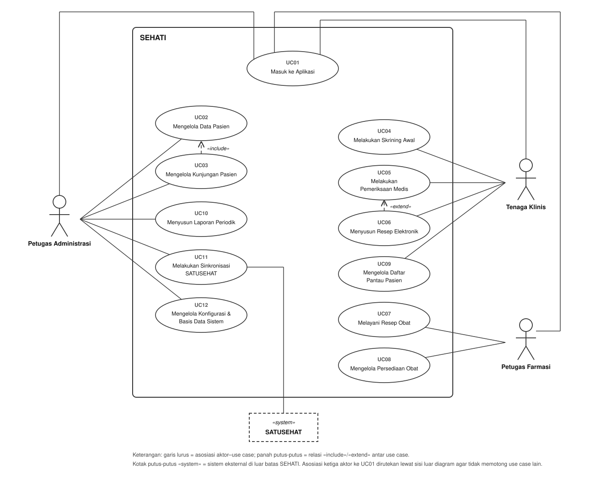
</p>
<p align="center">
<i>Gambar 2.2. Use Case Diagram SEHATI</i>
</p>

<br>

---

# BAB 3: Implementasi

Bab ini mencatat elemen SEHATI yang dibangun pada Tugas 9: lingkungan, kelas, layar, dan berkas pendukung. Seluruhnya mengacu pada tag `v9.0` (commit `4777977`). Perbedaan implementasi dari rancangan DPPL sudah dicatat lengkap pada Tabel B.1 Laporan Implementasi Tugas 9 (95 baris), sehingga tidak diulang di sini. Setelah `v9.0` ada dua jenis perubahan. Pertama, berkas pengujian dan `pom.xml` (JaCoCo dan pelapor test berbasis ID) untuk BAB 4. Kedua, perbaikan kode atas temuan `Fail` pada BAB 4, yang dicatat pada Tabel 3.5 karena salah satunya menambah objek pada rancangan antarmuka I-06.

## 3.1 Lingkungan Implementasi

Lingkungan implementasi sama dengan Subbab 2.1 DPPL. Perbedaannya hanya pada versi pustaka yang kini sudah pasti dan alat pengujian yang ditambahkan untuk HIUPL.

Tabel 3.1. Lingkungan Implementasi

| Aspek | Keterangan |
| :--- | :--- |
| *Hardware* | Komputer pengembangan dan pengujian: Intel Core i5-12450H (12 *thread*), RAM 16 GB. Target pemakaian tetap sesuai KNF10: RAM 4 GB dan ruang kosong 2 GB. |
| *Operating System* | Pengujian HIUPL dijalankan pada Ubuntu 26.04 LTS 64-bit. Target pemakaian Windows 10/11 64-bit dan Linux 64-bit (KNF10). |
| *Bahasa Pemrograman* | Java 21 LTS (OpenJDK 21.0.13), FXML dan CSS untuk tata letak layar JavaFX, serta SQL dialek PostgreSQL. |
| *Framework/Library* | JavaFX 21.0.5 (`javafx-controls`, `javafx-fxml`), PostgreSQL JDBC Driver 42.7.4, Apache PDFBox 3.0.3 untuk laporan PDF, jBCrypt 0.4 untuk *hash* kata sandi. |
| *DBMS* | PostgreSQL 15 (citra Docker `postgres:15`, versi 15.19 saat pengujian) lewat `src/docker-compose.yml`. |
| *Development Tools* | Apache Maven 3.9 dengan `maven-compiler-plugin` 3.13.0 dan `javafx-maven-plugin` 0.0.8, IntelliJ IDEA Community Edition, pgAdmin 4 dan `psql`, Docker Compose. |
| *Version Control* | Git dan GitHub (`angseleong/IF2150-RPL-K02-G09`), *branch* `main`, `develop`, dan *branch* fitur, dengan GitHub Actions yang menjalankan `mvn test` pada setiap PR. |
| *Testing Tools* | JUnit Jupiter 5.11.3; Maven Surefire 3.5.2 dengan `maven-surefire-junit5-tree-reporter` 1.4.0 agar keluaran test menampilkan ID *test case*; JaCoCo 0.8.14 untuk *coverage* baris dan cabang; basis data uji PostgreSQL 15 dari `schema.sql` dan `seed.sql`; `psql` untuk memeriksa isi basis data; `EXPLAIN (ANALYZE)` PostgreSQL dan data `seed_besar.sql` (50.000 rekam medis) untuk pengukuran KNF. |

## 3.2 Implementasi Modul

Tabel berikut memuat seluruh 64 kelas perancangan DPPL Tabel 4.1 dengan ID dan nama yang sama, konsisten dengan Tabel B.5 Laporan Implementasi. Lokasi berkas ditulis relatif terhadap `src/src/main/java/sehati/`, sedangkan berkas FXML berada di `src/src/main/resources/sehati/fxml/`. Seluruh kelas dikemas Maven menjadi satu berkas `sehati-9.0.jar` (perintah `mvn package` dari folder `src/`), dan aplikasi dijalankan dengan `mvn javafx:run` yang memanggil kelas utama `sehati.Main`. Kelas pendukung di luar DPPL dicantumkan pada Subbab 3.4.

Tabel 3.2. Implementasi Modul

| No | ID Kelas | Nama Modul/Kelas | Nama File Fisik | Nama File Executable |
| :--- | :--- | :--- | :--- | :--- |
| 1 | C01 | LoginForm | `presentation/LoginForm.java`, `LoginForm.fxml` | `sehati-9.0.jar` |
| 2 | C02 | PasienForm | `presentation/PasienForm.java`, `PasienForm.fxml` | `sehati-9.0.jar` |
| 3 | C03 | KunjunganForm | `presentation/KunjunganForm.java`, `KunjunganForm.fxml` | `sehati-9.0.jar` |
| 4 | C04 | AntreanSkriningForm | `presentation/AntreanSkriningForm.java`, `AntreanSkriningForm.fxml` | `sehati-9.0.jar` |
| 5 | C05 | SkriningForm | `presentation/SkriningForm.java`, `SkriningForm.fxml` | `sehati-9.0.jar` |
| 6 | C06 | RekamMedisForm | `presentation/RekamMedisForm.java`, `RekamMedisForm.fxml` | `sehati-9.0.jar` |
| 7 | C07 | PemeriksaanForm | `presentation/PemeriksaanForm.java`, `PemeriksaanForm.fxml` | `sehati-9.0.jar` |
| 8 | C08 | ResepForm | `presentation/ResepForm.java`, `ResepForm.fxml` | `sehati-9.0.jar` |
| 9 | C09 | AntreanResepForm | `presentation/AntreanResepForm.java`, `AntreanResepForm.fxml` | `sehati-9.0.jar` |
| 10 | C10 | PenyerahanObatForm | `presentation/PenyerahanObatForm.java`, `PenyerahanObatForm.fxml` | `sehati-9.0.jar` |
| 11 | C11 | PersediaanForm | `presentation/PersediaanForm.java`, `PersediaanForm.fxml` | `sehati-9.0.jar` |
| 12 | C12 | DaftarPantauForm | `presentation/DaftarPantauForm.java`, `DaftarPantauForm.fxml` | `sehati-9.0.jar` |
| 13 | C13 | LaporanForm | `presentation/LaporanForm.java`, `LaporanForm.fxml` | `sehati-9.0.jar` |
| 14 | C14 | SinkronisasiForm | `presentation/SinkronisasiForm.java`, `SinkronisasiForm.fxml` | `sehati-9.0.jar` |
| 15 | C15 | SATUSEHATGateway | `dataaccess/SATUSEHATGateway.java` | `sehati-9.0.jar` |
| 16 | C16 | KonfigurasiForm | `presentation/KonfigurasiForm.java`, `KonfigurasiForm.fxml` | `sehati-9.0.jar` |
| 17 | C17 | AutentikasiManager | `business/control/AutentikasiManager.java` | `sehati-9.0.jar` |
| 18 | C18 | PasienManager | `business/control/PasienManager.java` | `sehati-9.0.jar` |
| 19 | C19 | KunjunganManager | `business/control/KunjunganManager.java` | `sehati-9.0.jar` |
| 20 | C20 | SkriningManager | `business/control/SkriningManager.java` | `sehati-9.0.jar` |
| 21 | C21 | RisikoManager | `business/control/RisikoManager.java` | `sehati-9.0.jar` |
| 22 | C22 | PemeriksaanManager | `business/control/PemeriksaanManager.java` | `sehati-9.0.jar` |
| 23 | C23 | ResepManager | `business/control/ResepManager.java` | `sehati-9.0.jar` |
| 24 | C24 | ApotekManager | `business/control/ApotekManager.java` | `sehati-9.0.jar` |
| 25 | C25 | PersediaanManager | `business/control/PersediaanManager.java` | `sehati-9.0.jar` |
| 26 | C26 | PantauManager | `business/control/PantauManager.java` | `sehati-9.0.jar` |
| 27 | C27 | LaporanManager | `business/control/LaporanManager.java` | `sehati-9.0.jar` |
| 28 | C28 | SinkronisasiManager | `business/control/SinkronisasiManager.java` | `sehati-9.0.jar` |
| 29 | C29 | KonfigurasiManager | `business/control/KonfigurasiManager.java` | `sehati-9.0.jar` |
| 30 | C30 | PenggunaEntity | `business/entity/PenggunaEntity.java` | `sehati-9.0.jar` |
| 31 | C31 | SesiEntity | `business/entity/SesiEntity.java` | `sehati-9.0.jar` |
| 32 | C32 | AuditEntity | `business/entity/AuditEntity.java` | `sehati-9.0.jar` |
| 33 | C33 | PasienEntity | `business/entity/PasienEntity.java` | `sehati-9.0.jar` |
| 34 | C34 | RekamMedisEntity | `business/entity/RekamMedisEntity.java` | `sehati-9.0.jar` |
| 35 | C35 | KunjunganEntity | `business/entity/KunjunganEntity.java` | `sehati-9.0.jar` |
| 36 | C36 | PoliEntity | `business/entity/PoliEntity.java` | `sehati-9.0.jar` |
| 37 | C37 | AntreanEntity | `business/entity/AntreanEntity.java` | `sehati-9.0.jar` |
| 38 | C38 | SkriningEntity | `business/entity/SkriningEntity.java` | `sehati-9.0.jar` |
| 39 | C39 | TandaVitalEntity | `business/entity/TandaVitalEntity.java` | `sehati-9.0.jar` |
| 40 | C40 | AmbangRisikoEntity | `business/entity/AmbangRisikoEntity.java` | `sehati-9.0.jar` |
| 41 | C41 | PenandaRisikoEntity | `business/entity/PenandaRisikoEntity.java` | `sehati-9.0.jar` |
| 42 | C42 | PemeriksaanEntity | `business/entity/PemeriksaanEntity.java` | `sehati-9.0.jar` |
| 43 | C43 | DiagnosisEntity | `business/entity/DiagnosisEntity.java` | `sehati-9.0.jar` |
| 44 | C44 | KodeICD10Entity | `business/entity/KodeICD10Entity.java` | `sehati-9.0.jar` |
| 45 | C45 | JadwalKontrolEntity | `business/entity/JadwalKontrolEntity.java` | `sehati-9.0.jar` |
| 46 | C46 | ResepEntity | `business/entity/ResepEntity.java` | `sehati-9.0.jar` |
| 47 | C47 | ItemResepEntity | `business/entity/ItemResepEntity.java` | `sehati-9.0.jar` |
| 48 | C48 | ObatEntity | `business/entity/ObatEntity.java` | `sehati-9.0.jar` |
| 49 | C49 | BetsObatEntity | `business/entity/BetsObatEntity.java` | `sehati-9.0.jar` |
| 50 | C50 | PenerimaanObatEntity | `business/entity/PenerimaanObatEntity.java` | `sehati-9.0.jar` |
| 51 | C51 | DaftarPantauEntity | `business/entity/DaftarPantauEntity.java` | `sehati-9.0.jar` |
| 52 | C52 | TindakLanjutEntity | `business/entity/TindakLanjutEntity.java` | `sehati-9.0.jar` |
| 53 | C53 | LaporanEntity | `business/entity/LaporanEntity.java` | `sehati-9.0.jar` |
| 54 | C54 | BundelFHIREntity | `business/entity/BundelFHIREntity.java` | `sehati-9.0.jar` |
| 55 | C55 | PencadanganEntity | `business/entity/PencadanganEntity.java` | `sehati-9.0.jar` |
| 56 | C56 | DataAkunBoundary | `dataaccess/DataAkunBoundary.java` | `sehati-9.0.jar` |
| 57 | C57 | DataPasienBoundary | `dataaccess/DataPasienBoundary.java` | `sehati-9.0.jar` |
| 58 | C58 | DataKunjunganBoundary | `dataaccess/DataKunjunganBoundary.java` | `sehati-9.0.jar` |
| 59 | C59 | DataKlinisBoundary | `dataaccess/DataKlinisBoundary.java` | `sehati-9.0.jar` |
| 60 | C60 | DataPantauBoundary | `dataaccess/DataPantauBoundary.java` | `sehati-9.0.jar` |
| 61 | C61 | DataFarmasiBoundary | `dataaccess/DataFarmasiBoundary.java` | `sehati-9.0.jar` |
| 62 | C62 | DataLaporanBoundary | `dataaccess/DataLaporanBoundary.java` | `sehati-9.0.jar` |
| 63 | C63 | DataSinkronisasiBoundary | `dataaccess/DataSinkronisasiBoundary.java` | `sehati-9.0.jar` |
| 64 | C64 | DataPencadanganBoundary | `dataaccess/DataPencadanganBoundary.java` | `sehati-9.0.jar` |

## 3.3 Implementasi Antarmuka

Kelima belas layar memakai ID dan nama layar DPPL BAB 6. Setiap layar terdiri atas satu berkas FXML untuk tata letak dan satu kelas `Form` sebagai pengendalinya. Bilah aplikasi yang sama di setiap layar dibangun oleh `presentation/BilahAplikasi.java`.

Tabel 3.3. Implementasi Antarmuka

| No | ID Antarmuka | Nama Antarmuka | Nama File Fisik | Nama File Executable |
| :--- | :--- | :--- | :--- | :--- |
| 1 | I-01 | Masuk dan Dasbor | `src/src/main/resources/sehati/fxml/LoginForm.fxml`, `src/src/main/java/sehati/presentation/LoginForm.java` | `sehati-9.0.jar` |
| 2 | I-02 | Pendaftaran Pasien | `src/src/main/resources/sehati/fxml/PasienForm.fxml`, `src/src/main/java/sehati/presentation/PasienForm.java` | `sehati-9.0.jar` |
| 3 | I-03 | Kunjungan Pasien | `src/src/main/resources/sehati/fxml/KunjunganForm.fxml`, `src/src/main/java/sehati/presentation/KunjunganForm.java` | `sehati-9.0.jar` |
| 4 | I-04 | Antrean Skrining | `src/src/main/resources/sehati/fxml/AntreanSkriningForm.fxml`, `src/src/main/java/sehati/presentation/AntreanSkriningForm.java` | `sehati-9.0.jar` |
| 5 | I-05 | Formulir Skrining | `src/src/main/resources/sehati/fxml/SkriningForm.fxml`, `src/src/main/java/sehati/presentation/SkriningForm.java` | `sehati-9.0.jar` |
| 6 | I-06 | Rekam Medis Pasien | `src/src/main/resources/sehati/fxml/RekamMedisForm.fxml`, `src/src/main/java/sehati/presentation/RekamMedisForm.java` | `sehati-9.0.jar` |
| 7 | I-07 | Formulir Pemeriksaan | `src/src/main/resources/sehati/fxml/PemeriksaanForm.fxml`, `src/src/main/java/sehati/presentation/PemeriksaanForm.java` | `sehati-9.0.jar` |
| 8 | I-08 | Resep Elektronik | `src/src/main/resources/sehati/fxml/ResepForm.fxml`, `src/src/main/java/sehati/presentation/ResepForm.java` | `sehati-9.0.jar` |
| 9 | I-09 | Antrean Resep Apotek | `src/src/main/resources/sehati/fxml/AntreanResepForm.fxml`, `src/src/main/java/sehati/presentation/AntreanResepForm.java` | `sehati-9.0.jar` |
| 10 | I-10 | Penyerahan Obat | `src/src/main/resources/sehati/fxml/PenyerahanObatForm.fxml`, `src/src/main/java/sehati/presentation/PenyerahanObatForm.java` | `sehati-9.0.jar` |
| 11 | I-11 | Persediaan Obat | `src/src/main/resources/sehati/fxml/PersediaanForm.fxml`, `src/src/main/java/sehati/presentation/PersediaanForm.java` | `sehati-9.0.jar` |
| 12 | I-12 | Daftar Pantau Pasien | `src/src/main/resources/sehati/fxml/DaftarPantauForm.fxml`, `src/src/main/java/sehati/presentation/DaftarPantauForm.java` | `sehati-9.0.jar` |
| 13 | I-13 | Laporan Periodik | `src/src/main/resources/sehati/fxml/LaporanForm.fxml`, `src/src/main/java/sehati/presentation/LaporanForm.java` | `sehati-9.0.jar` |
| 14 | I-14 | Sinkronisasi SATUSEHAT | `src/src/main/resources/sehati/fxml/SinkronisasiForm.fxml`, `src/src/main/java/sehati/presentation/SinkronisasiForm.java` | `sehati-9.0.jar` |
| 15 | I-15 | Konfigurasi dan Basis Data | `src/src/main/resources/sehati/fxml/KonfigurasiForm.fxml`, `src/src/main/java/sehati/presentation/KonfigurasiForm.java` | `sehati-9.0.jar` |

## 3.4 File Lain

Tabel 3.4. File Lain

| No | Nama File | Keterangan |
| :--- | :--- | :--- |
| 1 | `src/pom.xml` | Konfigurasi Maven: versi Java 21, dependensi, kelas utama, Surefire dengan pelapor pohon, dan JaCoCo |
| 2 | `src/.env.example` | Contoh variabel lingkungan (koneksi basis data, SATUSEHAT, frasa sandi ekspor, lokasi media cadangan, jam pencadangan). Salinannya `src/.env` tidak masuk repositori |
| 3 | `src/docker-compose.yml` | Menjalankan PostgreSQL 15 dan memuat skema serta seed saat volume kosong |
| 4 | `src/db/schema.sql` | Skema basis data: 28 tabel beserta *foreign key*, `UNIQUE`, `CHECK`, indeks, dan peran `sehati_app` |
| 5 | `src/db/seed.sql` | Data fiktif untuk setiap tahap pelayanan, dengan tanggal relatif terhadap hari volume dibuat. Dipakai seluruh pengujian BAB 4 |
| 6 | `src/db/seed_besar.sql` | 50.000 rekam medis sintetis untuk profiling dan pengukuran KNF01 |
| 7 | `src/db/uji-kueri.sql` | Uji cepat 78 kueri DPPL terhadap skema |
| 8 | `src/db/sandi-aplikasi.sh` | Mengatur kata sandi peran `sehati_app` dari `.env` saat basis data pertama kali dibuat |
| 9 | `src/src/main/resources/sehati/css/sehati.css` | Tema seluruh layar, termasuk warna peringatan merah dan lencana stok |
| 10 | `src/src/main/java/sehati/Main.java` | Kelas utama aplikasi JavaFX yang membuka Navigasi dan penjadwal pencadangan |
| 11 | `src/src/main/java/sehati/common/KoneksiBasisData.java`, `PengaturanAplikasi.java`, `SesiAktif.java` | Pembuka koneksi JDBC, pembaca `.env`, dan pemegang sesi beserta pemeriksa peran `wajibPeran()` |
| 12 | `src/src/main/java/sehati/presentation/Navigasi.java`, `BilahAplikasi.java`, `LatarBelakang.java`, `LogoSehati.java`, `PanelPeringatan.java`, `PenandaKolom.java`, `TabelPintasan.java` | Pendukung lapisan presentasi: perpindahan layar dan cek hak akses, bilah aplikasi, tugas latar, logo, panel peringatan merah, penanda kolom bermasalah, dan layar bantuan pintasan |
| 13 | `src/src/main/java/sehati/business/control/PenyusunBundelFHIR.java` | Penyusun isi bundel HL7 FHIR R4 yang dipakai `ApotekManager` dan `PemeriksaanManager` (Tabel B.1 nomor 47) |
| 14 | `src/src/main/java/sehati/dataaccess/ResponsKirim.java` | Record hasil pengiriman bundel dari `SATUSEHATGateway` |
| 15 | `src/tests/sehati/**/*Test.java` (48 kelas test) | Test JUnit per kelas pada paket yang sama dengan kelas yang diuji, test integrasi pada `src/tests/sehati/integrasi/`, serta `AlurUtamaTest` dan `KonkurensiTest` |
| 16 | `src/tests/sehati/dataaccess/JdbcPalsu.java`, `src/tests/sehati/DataUjiAlur.java`, `src/tests/sehati/PratinjauLayar.java` | Pendukung test: pengganti JDBC untuk uji tanpa basis data, penyiap data alur, dan pembuka satu layar tanpa masuk |
| 17 | `src/README.md` | Cara memasang, menjalankan aplikasi, dan menjalankan test |
| 18 | `.github/workflows/` | CI GitHub Actions yang menjalankan `mvn test` pada setiap PR |

Tabel 3.5. Perubahan Implementasi setelah `v9.0` dari Hasil Pengujian

| No | Bagian DPPL | Rancangan / Implementasi `v9.0` | Implementasi Akhir | Alasan |
| :--- | :--- | :--- | :--- | :--- |
| 1 | C22 `jadwalkanKontrol()`, C59 (kueri baru Q-C59-20) | Jadwal pasien pada tanggal yang sama dicari lewat `ambilJadwalKontrol()` (Q-C59-17), yang hanya memuat jadwal yang belum memicu entri daftar pantau | Dicari lewat `DataKlinisBoundary.jadwalPadaTanggal()` dengan kueri baru Q-C59-20: jadwal "terjadwal" berdasarkan `id_pasien` dan `tanggal_rencana`, tanpa syarat daftar pantau | Temuan C22-UT37 dan UC05-TC08: jadwal kontrol dan entri daftar pantau dapat ganda (KF12) |
| 2 | C06 RekamMedisForm, I-06 (DPPL Subbab 6.6) | I-06 hanya memuat panel data diri, penanda risiko, diagnosis lampau, dan riwayat obat | Panel "Skrining hari ini" ditambahkan di bawah data diri, berisi keluhan awal dan tanda vital dari `RekamMedisEntity.getSkriningHariIni()` | Temuan UC05-TC01: SKPL UC05 langkah 1 meminta hasil skrining hari itu tampil pada ringkasan (KF09) |
| 3 | C17 `periksaHakAkses()` (Algo-C17-02) | `layarPeran.contains(layar)` langsung dipanggil pada himpunan `Set.of()`, yang melempar `NullPointerException` bila `layar` bernilai `null` | Layar `null` langsung menghasilkan `false` sebelum `contains()` dipanggil | Temuan C17-UT17: DPPL Subbab 5.17 menyatakan operasi mengembalikan `true` hanya bila peran boleh membuka layar, jadi masukan tidak sah harus `false`, bukan pengecualian (KF16) |

<br>

---

# BAB 4: Hasil Pengujian

Bab ini melaporkan hasil pengujian SEHATI pada level unit, integrasi, dan sistem. Pengujian dijalankan pada kode tag `v9.0` (commit `4777977`). Hanya berkas test yang ditambah atau diubah. Hasil aktual diisi dari pengamatan saat pengujian. Kesimpulan diisi `Pass` atau `Fail`, dan setiap `Fail` dilengkapi penyebab serta usulan perbaikan. Hasil pada `v9.0` tetap dicatat apa adanya. Bila temuan `Fail` sudah diperbaiki, baris yang sama juga memuat hasil uji ulang setelah perbaikan (Tabel 3.5), lengkap dengan bukti sebelum dan sesudahnya.

Seluruh pengujian memakai basis data uji yang dibuat dari `src/db/schema.sql` dan `src/db/seed.sql`. Data seed bertanggal relatif terhadap hari basis data dibuat. Basis data uji untuk bagian modul pemeriksaan dan resep dibuat pada 18 November 2026, sehingga "hari ini" pada hasil pengujian adalah 18-11-2026. Pengujian otomatis (unit dan integrasi) dijalankan dengan Maven, sedangkan pengujian *use case* dan sebagian KNF dijalankan pada aplikasi dan dibuktikan dengan tangkapan layar.

## 4.1 Strategi dan Kedalaman Pengujian Kelas

Setiap kelas perancangan pada Tabel 4.1 DPPL diklasifikasikan ke dalam tiga tingkat kedalaman pengujian berdasarkan isi kelasnya:

- **Mendalam** untuk kelas yang memuat logika bisnis, perhitungan, aturan status atau transisi, algoritma bercabang pada BAB 5 DPPL, keamanan, atau integrasi dengan sistem di luar proses aplikasi. Setiap operasi public diuji minimal dengan kasus normal, batas, dan negatif, dan *coverage* baris serta cabang kelas minimal 70%.
- **Sedang** untuk kelas yang mendelegasikan atau menjalankan operasi baca-tulis standar (seluruh `DataBoundary` kecuali yang menangani enkripsi atau proses eksternal) dan entity yang hanya memeriksa masukan kosong. Operasi public utama diuji minimal dengan kasus normal dan negatif, boleh melalui pengujian integrasi.
- **Tidak perlu** untuk kelas tampilan (`Form`) dan entity yang hanya menyimpan data atau berisi satu perbandingan tanpa percabangan. Kelas ini tidak memiliki test unit khusus dan teruji tidak langsung lewat *test case use case*.

Dari 64 kelas, 34 kelas bertingkat Mendalam, 12 kelas Sedang, dan 18 kelas Tidak perlu.

Tabel 4.1.1. Identifikasi Tingkat Pengujian Kelas

| ID Kelas | Nama Kelas | Tingkat | Alasan | Test Case Terkait |
| :--- | :--- | :--- | :--- | :--- |
| C01 | LoginForm | Tidak perlu | Kelas tampilan layar I-01, meneruskan kredensial ke AutentikasiManager | - (teruji lewat UC01-TC01 s.d. UC01-TC04) |
| C02 | PasienForm | Tidak perlu | Kelas tampilan layar I-02, meneruskan pencarian dan isian ke PasienManager | - (teruji lewat UC02) |
| C03 | KunjunganForm | Tidak perlu | Kelas tampilan layar I-03, meneruskan pilihan poli ke KunjunganManager | - (teruji lewat UC03) |
| C04 | AntreanSkriningForm | Tidak perlu | Kelas tampilan layar I-04, menampilkan antrean dari SkriningManager | - (teruji lewat UC04) |
| C05 | SkriningForm | Tidak perlu | Kelas tampilan layar I-05; validasi rentang dijalankan SkriningManager | - (teruji lewat UC04) |
| C06 | RekamMedisForm | Tidak perlu | Kelas tampilan layar I-06, menampilkan ringkasan dan tren dari PemeriksaanManager | - (teruji lewat UC05-TC01, UC05-TC02, UC05-TC04, UC05-TC06, UC05-TC07) |
| C07 | PemeriksaanForm | Tidak perlu | Kelas tampilan layar I-07, meneruskan isian ke PemeriksaanManager | - (teruji lewat UC05-TC03, UC05-TC05, UC05-TC06, UC05-TC08) |
| C08 | ResepForm | Tidak perlu | Kelas tampilan layar I-08, meneruskan item ke ResepManager | - (teruji lewat UC06-TC01, UC06-TC02) |
| C09 | AntreanResepForm | Tidak perlu | Kelas tampilan layar I-09, menampilkan antrean dari ApotekManager | - (teruji lewat UC07) |
| C10 | PenyerahanObatForm | Tidak perlu | Kelas tampilan layar I-10, meneruskan konfirmasi ke ApotekManager | - (teruji lewat UC07) |
| C11 | PersediaanForm | Tidak perlu | Kelas tampilan layar I-11, meneruskan penerimaan ke PersediaanManager | - (teruji lewat UC08) |
| C12 | DaftarPantauForm | Tidak perlu | Kelas tampilan layar I-12, meneruskan penyaring dan tindak lanjut ke PantauManager | - (teruji lewat UC09) |
| C13 | LaporanForm | Tidak perlu | Kelas tampilan layar I-13, meneruskan rentang dan ekspor ke LaporanManager | - (teruji lewat UC10) |
| C14 | SinkronisasiForm | Tidak perlu | Kelas tampilan layar I-14, meneruskan perintah ke SinkronisasiManager | - (teruji lewat UC11) |
| C15 | SATUSEHATGateway | Mendalam | Integrasi eksternal ke REST API SATUSEHAT, termasuk mode simulasi dan penanganan galat jaringan (Algo-C15-01, Algo-C15-02) | *[C15-UT01 s.d. C15-UT.., diisi Fachry]* |
| C16 | KonfigurasiForm | Tidak perlu | Kelas tampilan layar I-15, meneruskan perubahan ke KonfigurasiManager | - (teruji lewat UC12-TC01 s.d. UC12-TC05) |
| C17 | AutentikasiManager | Mendalam | Keamanan: verifikasi kredensial bcrypt, sesi, batas diam 15 menit, dan hak akses peran (Algo-C17-01, Algo-C17-02) | C17-UT01 s.d. C17-UT17, INT-TC01, INT-TC02 |
| C18 | PasienManager | Mendalam | Validasi NIK 16 digit dan keunikannya serta penerbitan nomor rekam medis (Algo-C18-01, Algo-C18-02) | C18-UT01 s.d. C18-UT24 |
| C19 | KunjunganManager | Mendalam | Penolakan kunjungan ganda dan penerbitan nomor antrean per poli per hari dalam transaksi (Algo-C19-01, Algo-C19-02) | C19-UT01 s.d. C19-UT11 |
| C20 | SkriningManager | Mendalam | Validasi rentang fisiologis tanpa jalan pintas dan alur antrean skrining (Algo-C20-01 s.d. Algo-C20-03) | *[C20-UT01 s.d. C20-UT.., diisi Humam]* |
| C21 | RisikoManager | Mendalam | Perhitungan risiko terhadap ambang dan riwayat tiga kunjungan (Algo-C21-01, Algo-C21-02) | *[C21-UT01 s.d. C21-UT.., diisi Humam]* |
| C22 | PemeriksaanManager | Mendalam | Validasi diagnosis ICD-10 dan tanggal kontrol, pembatasan peran Dokter, serta transaksi penguncian rekam medis (Algo-C22-01, Algo-C22-02) | C22-UT01 s.d. C22-UT37, INT-TC17 s.d. INT-TC20 |
| C23 | ResepManager | Mendalam | Validasi kecukupan stok per obat (termasuk bets kedaluwarsa) dan transaksi pengiriman resep (Algo-C23-01, Algo-C23-02) | C23-UT01 s.d. C23-UT25, INT-TC21, INT-TC22 |
| C24 | ApotekManager | Mendalam | Transaksi penyerahan obat: potong stok FEFO, tutup kunjungan, dan susun bundel FHIR (Algo-C24-01, Algo-C24-02) | *[C24-UT01 s.d. C24-UT.., diisi Malik]* |
| C25 | PersediaanManager | Mendalam | Validasi penerimaan obat, penambahan stok, dan peringatan stok serta kedaluwarsa (Algo-C25-01 s.d. Algo-C25-03) | *[C25-UT01 s.d. C25-UT.., diisi Malik]* |
| C26 | PantauManager | Mendalam | Penyaringan daftar pantau dan perubahan status tindak lanjut (Algo-C26-01) | *[C26-UT01 s.d. C26-UT.., diisi Humam]* |
| C27 | LaporanManager | Mendalam | Perhitungan rekapitulasi dan validasi rentang tanggal (Algo-C27-01, Algo-C27-02) | *[C27-UT01 s.d. C27-UT.., diisi Fachry]* |
| C28 | SinkronisasiManager | Mendalam | Aturan kirim saat daring serta tahan dan ekspor saat luring (Algo-C28-01, Algo-C28-02) | *[C28-UT01 s.d. C28-UT.., diisi Fachry]* |
| C29 | KonfigurasiManager | Mendalam | Validasi akun (nama unik, sandi minimal 8 karakter, peran), data master, dan pencadangan (Algo-C29-01 s.d. Algo-C29-03) | C29-UT01 s.d. C29-UT37, INT-TC03 s.d. INT-TC06 |
| C30 | PenggunaEntity | Mendalam | Keamanan: pencocokan kata sandi bcrypt dan status aktif akun (Algo-C30-01) | C30-UT01 s.d. C30-UT11 |
| C31 | SesiEntity | Mendalam | Keamanan: batas diam sesi pada habisWaktu() (Algo-C31-01) | C31-UT01 s.d. C31-UT07 |
| C32 | AuditEntity | Sedang | buat() hanya menolak deskripsi kosong lalu membentuk catatan (Algo-C32-01) | C32-UT01 s.d. C32-UT03 |
| C33 | PasienEntity | Sedang | perbarui() hanya menolak data kosong lalu menyalin atribut (Algo-C33-01) | C33-UT01 s.d. C33-UT02 |
| C34 | RekamMedisEntity | Sedang | tambahEntri() hanya menolak catatan kosong (Algo-C34-01) | C34-UT01 s.d. C34-UT03 |
| C35 | KunjunganEntity | Mendalam | Aturan transisi status kunjungan dan penguncian status selesai (Algo-C35-01) | C35-UT01 s.d. C35-UT08 |
| C36 | PoliEntity | Mendalam | Perhitungan nomor antrean berikutnya yang dimulai ulang saat hari berganti (Algo-C36-01) | C36-UT01 s.d. C36-UT04 |
| C37 | AntreanEntity | Mendalam | Aturan urutan antrean: terdepan, pindah ke belakang, dan keluarkan (Algo-C37-01) | C37-UT01 s.d. C37-UT12 |
| C38 | SkriningEntity | Sedang | lampirkanTandaVital() hanya menolak tanda vital kosong | *[C38-UT.. atau INT-TC.., diisi Humam]* |
| C39 | TandaVitalEntity | Mendalam | Perhitungan IMT dan penolakan tinggi badan kosong (Algo-C39-01) | *[C39-UT01 s.d. C39-UT.., diisi Humam]* |
| C40 | AmbangRisikoEntity | Mendalam | Perbandingan nilai terhadap ambang klinis tepat di nilai batas (Algo-C40-01) | *[C40-UT01 s.d. C40-UT.., diisi Humam]* |
| C41 | PenandaRisikoEntity | Mendalam | Aturan status: penanda yang sudah dicabut tidak dapat dicabut lagi | *[C41-UT01 s.d. C41-UT.., diisi Humam]* |
| C42 | PemeriksaanEntity | Mendalam | Aturan status: pemeriksaan yang sudah dikunci tidak dapat dikunci lagi | C42-UT01 s.d. C42-UT03 |
| C43 | DiagnosisEntity | Tidak perlu | Hanya menyimpan diagnosis; ringkas() menggabungkan kode dan deskripsi tanpa percabangan | - (teruji lewat UC05-TC01, UC05-TC03) |
| C44 | KodeICD10Entity | Mendalam | Pencocokan kata kunci ICD-10 tanpa membedakan huruf (Algo-C44-01) | C44-UT01 s.d. C44-UT05 |
| C45 | JadwalKontrolEntity | Mendalam | Aturan status: hanya jadwal terjadwal yang dapat ditandai selesai | C45-UT01 s.d. C45-UT03 |
| C46 | ResepEntity | Mendalam | Aturan transisi status resep menunggu, selesai dilayani, dan dikembalikan (Algo-C46-01) | C46-UT01 s.d. C46-UT04 |
| C47 | ItemResepEntity | Sedang | cukupStok() berisi satu aturan stok ≥ jumlah tanpa percabangan; aturan lengkapnya diuji pada C23 | C47-UT01 s.d. C47-UT03, INT-TC21 |
| C48 | ObatEntity | Mendalam | Validasi pengurangan dan penambahan stok serta ambang minimum (Algo-C48-01) | *[C48-UT01 s.d. C48-UT.., diisi Malik]* |
| C49 | BetsObatEntity | Mendalam | Pengurangan bets dan batas 90 hari menjelang kedaluwarsa (Algo-C49-01) | *[C49-UT01 s.d. C49-UT.., diisi Malik]* |
| C50 | PenerimaanObatEntity | Mendalam | Perhitungan total jumlah seluruh bets (Algo-C50-01) | *[C50-UT01 s.d. C50-UT.., diisi Malik]* |
| C51 | DaftarPantauEntity | Mendalam | Aturan transisi status tindak lanjut (Algo-C51-01) | *[C51-UT01 s.d. C51-UT.., diisi Humam]* |
| C52 | TindakLanjutEntity | Tidak perlu | Hanya menyimpan data tindak lanjut; terhubung() membandingkan satu atribut | - (teruji lewat UC09) |
| C53 | LaporanEntity | Mendalam | kosong() mengurai ringkasan rekapitulasi dengan beberapa cabang (Algo-C53-01) | *[C53-UT01 s.d. C53-UT.., diisi Fachry]* |
| C54 | BundelFHIREntity | Mendalam | Aturan status kirim: bundel terkirim tidak dapat ditandai ulang (Algo-C54-01) | *[C54-UT01 s.d. C54-UT.., diisi Fachry]* |
| C55 | PencadanganEntity | Tidak perlu | Hanya menyimpan catatan pencadangan; berhasil() membaca satu status | - (teruji lewat UC12-TC02, UC12-TC05) |
| C56 | DataAkunBoundary | Sedang | Kueri akun, sesi, dan audit (Q-C56-01 s.d. Q-C56-10) | C56-UT01 s.d. C56-UT10, INT-TC01 s.d. INT-TC03 |
| C57 | DataPasienBoundary | Sedang | Kueri pasien dan pencarian parsial (Q-C57-01 s.d. Q-C57-12, Algo-C57-01) | C57-UT01 s.d. C57-UT19 |
| C58 | DataKunjunganBoundary | Sedang | Kueri kunjungan, poli, dan antrean dengan penguncian baris (Q-C58-01 s.d. Q-C58-13) | C58-UT01 s.d. C58-UT21 |
| C59 | DataKlinisBoundary | Sedang | Kueri skrining, risiko, pemeriksaan, ICD-10, dan jadwal kontrol (Q-C59-01 s.d. Q-C59-20) | C59-UT21 s.d. C59-UT32, INT-TC17 s.d. INT-TC20 (bagian pemeriksaan); *[C59-UT01 s.d. C59-UT20 bagian skrining, diisi Humam]* |
| C60 | DataPantauBoundary | Sedang | Kueri daftar pantau dan tindak lanjut (Q-C60-01 s.d. Q-C60-07) | *[C60-UT.. atau INT-TC.., diisi Humam]* |
| C61 | DataFarmasiBoundary | Sedang | Kueri obat, bets, dan resep dengan penguncian stok (Q-C61-01 s.d. Q-C61-19) | *[C61-UT.. atau INT-TC.., diisi Malik]* |
| C62 | DataLaporanBoundary | Sedang | Kueri agregasi dan penulisan berkas PDF/CSV (Q-C62-01 s.d. Q-C62-04); logika rekapitulasi diuji pada C27 | *[C62-UT.. atau INT-TC.., diisi Fachry]* |
| C63 | DataSinkronisasiBoundary | Mendalam | Keamanan: enkripsi arsip ekspor bundel (Algo-C63-01) di samping penyimpanan bundel | *[C63-UT01 s.d. C63-UT.., diisi Fachry]* |
| C64 | DataPencadanganBoundary | Mendalam | Integrasi proses eksternal pg_dump dan verifikasi arsip (Algo-C64-01, Algo-C64-02) | C64-UT01 s.d. C64-UT16, INT-TC05, INT-TC06 |

## 4.2 Pengujian Unit Kelas

Pengujian unit dilakukan pada kelas bertingkat Mendalam dan Sedang. Kelas Mendalam diuji pada seluruh operasi public dengan kasus normal, batas, dan negatif, serta mencapai *coverage* minimal 70%. Kelas Sedang diuji minimal dengan satu kasus normal dan satu kasus negatif pada operasi public utama.

Setiap method test diberi anotasi `@DisplayName` yang diawali ID *test case*, misalnya `C22-UT04`, sehingga keluaran *test runner* langsung menunjukkan ID yang sama dengan tabel pada subbab ini. Kelas `Manager` membuka koneksinya sendiri lewat `KoneksiBasisData`, jadi operasi yang membaca atau menyimpan data diuji terhadap basis data uji. Setiap test menghapus atau me-*rollback* data yang dibuatnya agar test lain tidak terpengaruh. Kasus yang ditolak sebelum basis data disentuh (validasi masukan dan pemeriksaan peran) diuji tanpa basis data. *Coverage* diukur JaCoCo dari seluruh test (`mvn test`).

Cara menjalankan unit test, dari folder `src/` dengan basis data uji menyala (`docker compose up -d`):

```bash
export DB_UJI_URL="jdbc:postgresql://localhost:5432/sehati?user=sehati_admin&password=<DB_ADMIN_PASSWORD>"
mvn test                                  # seluruh test, laporan coverage di target/site/jacoco/index.html
mvn test -Dtest=PemeriksaanManagerTest    # satu kelas test
```

Tanpa `DB_UJI_URL`, test yang membutuhkan basis data dilewati.

Lokasi file test: `src/tests/`, dengan paket yang sama dengan kelas yang diuji (misalnya `src/tests/sehati/business/control/PemeriksaanManagerTest.java` untuk C22).

### 4.2.1 Kelas SATUSEHATGateway

**ID Kelas:** C15  
**Nama Kelas:** SATUSEHATGateway  
**Tingkat:** Mendalam

*[Diisi Fachry: tabel hasil pengujian unit dan tabel ringkasan cakupan, mengikuti pola Subbab 4.2.7.]*

### 4.2.2 Kelas AutentikasiManager

**ID Kelas:** C17  
**Nama Kelas:** AutentikasiManager  
**Tingkat:** Mendalam

Berkas test: `src/tests/sehati/business/control/AutentikasiManagerTest.java`. Test yang membutuhkan basis data membuat akun uji `uji.autentikasi` (Perawat, aktif, sandi `rahasia123`) sebelum setiap test, lalu menghapus akun, sesi, dan audit miliknya setelah test.

Tabel 4.2.2. Hasil Pengujian Unit Kelas C17

| ID Pengujian | Operasi yang Diuji | Jenis Kasus | Prosedur/Masukan | Hasil yang Diharapkan | Hasil Pengujian | Kesimpulan |
| :--- | :--- | :--- | :--- | :--- | :--- | :--- |
| C17-UT01 | `autentikasi(nama: String, sandi: String): SesiEntity` | Normal | `uji.autentikasi`, `rahasia123` | Sesi aktif dikembalikan, `SesiAktif` berisi pengguna dan peran Perawat, satu baris `sesi` aktif dan audit "Masuk ke aplikasi" | Sesi aktif, `SesiAktif.peran()` = "Perawat", baris `sesi` dan audit ada | Pass |
| C17-UT02 | `autentikasi(nama: String, sandi: String): SesiEntity` | Batas | Sandi salah, lalu sandi benar, lalu sandi salah lagi | Masuk berhasil mengatur ulang hitungan percobaan, sehingga kegagalan setelahnya dicatat lagi sebagai "percobaan ke-1" | Dua audit "Masuk gagal, percobaan ke-1" dan tidak ada "percobaan ke-2" | Pass |
| C17-UT03 | `autentikasi(nama: String, sandi: String): SesiEntity` | Negatif | `uji.autentikasi`, sandi "salah" | `null`, tanpa sesi, audit "Masuk gagal, percobaan ke-1" berpelaku akun itu | `null`, tidak ada baris `sesi`, satu audit sesuai | Pass |
| C17-UT04 | `autentikasi(nama: String, sandi: String): SesiEntity` | Negatif | Sandi salah, lalu nama `uji.tidak.ada` | `null`, audit berpelaku 0 "Masuk gagal: nama 'uji.tidak.ada' tidak dikenal, percobaan ke-2" | `null` dan audit sesuai | Pass |
| C17-UT05 | `autentikasi(nama: String, sandi: String): SesiEntity` | Negatif | Akun uji diubah menjadi nonaktif, sandi benar | `IllegalStateException` "Akun nonaktif, hubungi Petugas Administrasi", tanpa sesi | Pengecualian dan pesan sesuai, tidak ada baris `sesi` | Pass |
| C17-UT06 | `autentikasi(nama: String, sandi: String): SesiEntity` | Batas | Sandi "" dan `null` | `null` tanpa pengecualian dan tanpa sesi | `null` untuk keduanya, tidak ada baris `sesi` | Pass |
| C17-UT07 | `periksaHakAkses(peran: String, layar: String): boolean` | Normal | Admin-PasienForm, Admin-KonfigurasiForm, Perawat-SkriningForm, Dokter-ResepForm, Farmasi-PersediaanForm | `true` untuk kelimanya | `true` | Pass |
| C17-UT08 | `periksaHakAkses(peran: String, layar: String): boolean` | Batas | RekamMedisForm untuk Perawat dan Dokter, PemeriksaanForm untuk Dokter dan Perawat | Layar bersama boleh untuk keduanya, PemeriksaanForm hanya Dokter | `true`, `true`, `true`, `false` | Pass |
| C17-UT09 | `periksaHakAkses(peran: String, layar: String): boolean` | Negatif | Perawat-ResepForm, Farmasi-PasienForm, Dokter-KonfigurasiForm, Admin-PemeriksaanForm | `false` untuk keempatnya | `false` | Pass |
| C17-UT10 | `periksaHakAkses(peran: String, layar: String): boolean` | Negatif | Peran `null`, "Pemilik Layar", "dokter" (huruf kecil), dan Admin-LoginForm | `false` untuk semuanya | `false` | Pass |
| C17-UT17 | `periksaHakAkses(peran: String, layar: String): boolean` | Negatif | Dokter dengan layar `null`, serta peran dan layar `null` | `false` (DPPL 5.17: `true` hanya bila peran boleh membuka layar) | Pada `v9.0`: `NullPointerException` dari `ImmutableCollections$SetN.contains()`. Setelah perbaikan: `false` untuk keduanya | Fail pada `v9.0`, Pass setelah perbaikan. Penyebab: daftar layar per peran dibuat dengan `Set.of()`, yang melempar `NullPointerException` untuk `contains(null)`. Seluruh pemanggil saat ini (`LoginForm`, `Navigasi`, `RekamMedisForm`) selalu mengirim nama layar, jadi cacat ini tidak terlihat di aplikasi, tetapi operasi melanggar kontraknya. Perbaikan: layar `null` langsung ditolak sebelum `contains()` (Tabel 3.5 nomor 3). Bukti sebelum dan sesudah pada Subbab 4.6 |
| C17-UT11 | `tutupSesi(habisWaktu: boolean): void` | Normal | Masuk, lalu `tutupSesi(false)` (tombol Keluar) | Sesi di memori dan basis data tidak aktif, audit "Keluar dari aplikasi" | `SesiAktif.ambil()` `null`, `status_aktif` false, audit ada | Pass |
| C17-UT12 | `tutupSesi(habisWaktu: boolean): void` | Batas | Masuk, lalu `tutupSesi(true)` (batas diam 15 menit) | Sesi ditutup dengan audit "Sesi berakhir setelah diam 15 menit" | Sesi ditutup dan audit sesuai | Pass |
| C17-UT13 | `tutupSesi(habisWaktu: boolean): void` | Negatif | Tanpa sesi (tanpa basis data) | Tidak terjadi apa pun dan tidak ada pengecualian | Tidak ada pengecualian, `SesiAktif.ambil()` tetap `null` | Pass |
| C17-UT14 | `sesiDiputus(): boolean` | Normal | Masuk, lalu `status_aktif` sesi diubah menjadi false dari koneksi lain (akun dinonaktifkan di komputer lain) | `true` | `true` | Pass |
| C17-UT15 | `sesiDiputus(): boolean` | Batas | Masuk, sesi masih aktif di basis data | `false` | `false` | Pass |
| C17-UT16 | `sesiDiputus(): boolean` | Negatif | Tanpa sesi (tanpa basis data) | `false` tanpa membuka koneksi | `false` | Pass |

C17-UT17 ditambahkan setelah nomor C17-UT16, sehingga barisnya diletakkan bersama operasi yang sama. `tutupSesi()` dan `sesiDiputus()` adalah operasi public tambahan implementasi (Tabel B.1 nomor 23 dan 80). Operasi private `bukaSesi()` teruji lewat C17-UT01.

Tabel 4.2.2b. Ringkasan Cakupan Kelas C17

| Informasi | Keterangan |
| :--- | :--- |
| Daftar operasi public pada DPPL | `autentikasi()`, `periksaHakAkses()` (ditambah `bukaSesi()` yang private) |
| Operasi yang diuji | Kedua operasi public DPPL (2 dari 2) dengan kasus normal, batas, dan negatif, ditambah operasi tambahan `tutupSesi()` dan `sesiDiputus()` dengan ketiga jenis kasus |
| ID Algoritma yang tercakup | Algo-C17-01 (autentikasi: C17-UT01 s.d. C17-UT06), Algo-C17-02 (hak akses peran: C17-UT07 s.d. C17-UT10, C17-UT17), Algo-C31-01 bagian penutupan sesi (C17-UT11 s.d. C17-UT13) |
| Coverage (wajib ≥ 70%) | 85,7% baris (48 dari 56) dan 92,3% cabang (24 dari 26), diukur setelah perbaikan Tabel 3.5 dengan JaCoCo 0.8.14 dari seluruh `mvn test`. Baris yang tidak tercakup adalah penanganan `SQLException` saat basis data tidak dapat dihubungi. Bukti pada Subbab 4.6 |

### 4.2.3 Kelas PasienManager

**ID Kelas:** C18  
**Nama Kelas:** PasienManager  
**Tingkat:** Mendalam

Berkas test: `src/tests/sehati/business/control/PasienManagerTest.java`. Test yang membutuhkan basis data membuat pasien fiktif lewat `nikFiktif()` dan membersihkannya setelah test.

Tabel 4.2.3. Hasil Pengujian Unit Kelas C18

| ID Pengujian | Operasi yang Diuji | Jenis Kasus | Prosedur/Masukan | Hasil yang Diharapkan | Hasil Pengujian | Kesimpulan |
| :--- | :--- | :--- | :--- | :--- | :--- | :--- |
| C18-UT01 | `validasiNIK(nik: String): boolean` | Normal | NIK "9999010101010001" | `true` | `true` | Pass |
| C18-UT02 | `validasiNIK(nik: String): boolean` | Batas | NIK "999901010101001" (15 digit) | `false` | `false` | Pass |
| C18-UT03 | `validasiNIK(nik: String): boolean` | Batas | NIK "99990101010100017" (17 digit) | `false` | `false` | Pass |
| C18-UT04 | `validasiNIK(nik: String): boolean` | Negatif | NIK "999901010101000A" | `false` | `false` | Pass |
| C18-UT05 | `validasiNIK(nik: String): boolean` | Negatif | `null` | `false` | `false` | Pass |
| C18-UT06 | `cariPasien(kataKunci: String): List<PasienEntity>` | Normal | Kunci "   " dan `null` | Daftar kosong | Daftar kosong | Pass |
| C18-UT07 | `cariPasien(kataKunci: String): List<PasienEntity>` | Normal | Kunci "  budi " | Daftar berisi Budi Santoso | Sesuai | Pass |
| C18-UT08 | `cariPasien(kataKunci: String): List<PasienEntity>` | Normal | Kunci "%" dan "_" | Daftar kosong | Daftar kosong | Pass |
| C18-UT09 | `cariPasien(kataKunci: String): List<PasienEntity>` | Normal | Kunci "zzzz-tidak-ada" | Daftar kosong | Daftar kosong | Pass |
| C18-UT10 | `daftarkanPasien(data: PasienEntity): PasienEntity` | Normal | NIK fiktif baru, data opsional kosong | Pasien tersimpan, satu nomor RM, audit tercatat | Sesuai | Pass |
| C18-UT11 | `daftarkanPasien(data: PasienEntity): PasienEntity` | Batas | `nomorTelepon` kosong | `null` | `null` | Pass |
| C18-UT12 | `daftarkanPasien(data: PasienEntity): PasienEntity` | Negatif | NIK 15 digit | `IllegalArgumentException` "NIK tidak valid" | Pengecualian dan pesan sesuai | Pass |
| C18-UT13 | `daftarkanPasien(data: PasienEntity): PasienEntity` | Negatif | Data pasien `null` | `IllegalArgumentException` "Data pasien kosong" | Pengecualian dan pesan sesuai | Pass |
| C18-UT14 | `daftarkanPasien(data: PasienEntity): PasienEntity` | Negatif | NIK sudah terdaftar | `IllegalArgumentException` "NIK sudah terdaftar", satu baris | Pengecualian dan pesan sesuai, tetap satu baris | Pass |
| C18-UT15 | `daftarkanPasien(data: PasienEntity): PasienEntity` | Negatif | Tanpa sesi masuk | `IllegalStateException` "Sesi sudah berakhir, silakan masuk kembali" | Pengecualian dan pesan sesuai | Pass |
| C18-UT16 | `perbaruiPasien(data: PasienEntity): void` | Normal | Update data dengan NIK baru | Data diubah, nomor RM tidak berubah, audit tercatat | Sesuai | Pass |
| C18-UT17 | `perbaruiPasien(data: PasienEntity): void` | Normal | Update dengan NIK tidak berubah | Data diubah | Sesuai | Pass |
| C18-UT18 | `perbaruiPasien(data: PasienEntity): void` | Negatif | Data pasien `null` | `IllegalArgumentException` "Data pasien kosong" | Pengecualian dan pesan sesuai | Pass |
| C18-UT19 | `perbaruiPasien(data: PasienEntity): void` | Negatif | NIK 3 digit | `IllegalArgumentException` "NIK tidak valid" | Pengecualian dan pesan sesuai | Pass |
| C18-UT20 | `perbaruiPasien(data: PasienEntity): void` | Negatif | Pasien ID 999999 | `IllegalArgumentException` "Pasien tidak ditemukan" | Pengecualian dan pesan sesuai | Pass |
| C18-UT21 | `perbaruiPasien(data: PasienEntity): void` | Negatif | NIK milik pasien lain | `IllegalArgumentException` "NIK sudah terdaftar" | Pengecualian dan pesan sesuai | Pass |
| C18-UT22 | `pasienTerbaru(): List<PasienEntity>` | Normal | Panggil tanpa masukan | Daftar terurut baru ke lama, maksimal 50 | Sesuai | Pass |
| C18-UT23 | `pasienTerbaru(): List<PasienEntity>` | Batas | Panggil tanpa masukan | Tercapai batas 50 baris | Tercapai 50 | Pass |
| C18-UT24 | `pasienTerbaru(): List<PasienEntity>` | Negatif | Hak baca tabel `pasien` dicabut sementara | `IllegalStateException` "Basis data tidak dapat dihubungi" | Pengecualian dan pesan sesuai | Pass |

`pasienTerbaru()` adalah operasi public tambahan implementasi (Tabel B.1), sehingga ikut diuji. Kasus yang ditolak sebelum basis data disentuh (validasi masukan) diuji tanpa basis data.

Tabel 4.2.3b. Ringkasan Cakupan Kelas C18

| Informasi | Keterangan |
| :--- | :--- |
| Daftar operasi public pada DPPL | `validasiNIK()`, `cariPasien()`, `daftarkanPasien()`, `perbaruiPasien()`, `terbitkanNomorRM()` (private), dan `pasienTerbaru()` (operasi tambahan, Tabel B.1) |
| Operasi yang diuji | Lima operasi `validasiNIK`/`cariPasien`/`daftarkanPasien`/`perbaruiPasien`/`pasienTerbaru` dengan kasus normal, batas, dan negatif |
| ID Algoritma yang tercakup | Algo-C18-01 (C18-UT12 s.d. C18-UT15), Algo-C18-02 (C18-UT16 s.d. C18-UT21) |
| Coverage (wajib ≥ 70%) | 84,2% baris (52 dari 62) dan 91,3% cabang (21 dari 23), JaCoCo 0.8.14 dari seluruh `mvn test`. Bukti pada Subbab 4.6 |

### 4.2.4 Kelas KunjunganManager

**ID Kelas:** C19  
**Nama Kelas:** KunjunganManager  
**Tingkat:** Mendalam

Berkas test: `src/tests/sehati/business/control/KunjunganManagerTest.java`. Test yang membutuhkan basis data memakai sesi Petugas Administrasi dan data seed.

Tabel 4.2.4. Hasil Pengujian Unit Kelas C19

| ID Pengujian | Operasi yang Diuji | Jenis Kasus | Prosedur/Masukan | Hasil yang Diharapkan | Hasil Pengujian | Kesimpulan |
| :--- | :--- | :--- | :--- | :--- | :--- | :--- |
| C19-UT01 | `daftarPoli(): List<PoliEntity>` | Normal | Panggil tanpa masukan | Seluruh poli seed terurut nama | Sesuai | Pass |
| C19-UT02 | `daftarPoli(): List<PoliEntity>` | Normal | Poli baru disimpan lewat `DataKunjunganBoundary` | Poli baru muncul pada daftar | Sesuai | Pass |
| C19-UT03 | `daftarPoli(): List<PoliEntity>` | Negatif | Basis data tidak dapat dihubungi | `IllegalStateException` | Pengecualian dan pesan sesuai | Pass |
| C19-UT04 | `cegahKunjunganGanda(idPasien: int)` | Normal | Sebelum kunjungan dibuka | `null` | `null` | Pass |
| C19-UT05 | `cegahKunjunganGanda(idPasien: int)` | Normal | Sesudah kunjungan dibuka | Kunjungan aktif | Sesuai | Pass |
| C19-UT06 | `cegahKunjunganGanda(idPasien: int)` | Normal | Kunjungan sudah selesai | Tidak aktif | Sesuai | Pass |
| C19-UT07 | `bukaKunjungan(idPasien: int, idPoli: int): KunjunganEntity` | Normal | Kunjungan baru dengan poli tujuan | Nomor antrean berurutan, audit tercatat | Sesuai | Pass |
| C19-UT08 | `bukaKunjungan(idPasien: int, idPoli: int): KunjunganEntity` | Normal | Pasien sudah punya kunjungan aktif hari ini | Kunjungan aktif lama, tanpa nomor baru | Sesuai | Pass |
| C19-UT09 | `bukaKunjungan(idPasien: int, idPoli: int): KunjunganEntity` | Negatif | Poli tidak ditemukan | `IllegalArgumentException` | Pengecualian dan pesan sesuai | Pass |
| C19-UT10 | `bukaKunjungan(idPasien: int, idPoli: int): KunjunganEntity` | Negatif | Pasien tanpa rekam medis | `IllegalArgumentException` "Pasien belum memiliki rekam medis", transaksi dibatalkan | Pengecualian dan pesan sesuai, tidak tersimpan | Pass |
| C19-UT11 | `bukaKunjungan(idPasien: int, idPoli: int): KunjunganEntity` | Negatif | Tanpa sesi masuk | `IllegalStateException` | Pengecualian dan pesan sesuai | Pass |

Tabel 4.2.4b. Ringkasan Cakupan Kelas C19

| Informasi | Keterangan |
| :--- | :--- |
| Daftar operasi public pada DPPL | `daftarPoli()`, `bukaKunjungan()`; `cegahKunjunganGanda()` dan `terbitkanNomorAntrean()` private |
| Operasi yang diuji | Dua operasi public (2 dari 2) dengan kasus normal, batas, dan negatif |
| ID Algoritma yang tercakup | Algo-C19-01 (C19-UT07 s.d. C19-UT11), Algo-C19-02 (C19-UT07) |
| Coverage (wajib ≥ 70%) | 86,4% baris (43 dari 50) dan 92,3% cabang (12 dari 13), JaCoCo 0.8.14 dari seluruh `mvn test`. Bukti pada Subbab 4.6 |

### 4.2.5 Kelas SkriningManager

**ID Kelas:** C20  
**Nama Kelas:** SkriningManager  
**Tingkat:** Mendalam

*[Diisi Humam: tabel hasil pengujian unit dan tabel ringkasan cakupan, mengikuti pola Subbab 4.2.7.]*

### 4.2.6 Kelas RisikoManager

**ID Kelas:** C21  
**Nama Kelas:** RisikoManager  
**Tingkat:** Mendalam

*[Diisi Humam: tabel hasil pengujian unit dan tabel ringkasan cakupan, mengikuti pola Subbab 4.2.7.]*

### 4.2.7 Kelas PemeriksaanManager

**ID Kelas:** C22  
**Nama Kelas:** PemeriksaanManager  
**Tingkat:** Mendalam

Berkas test: `src/tests/sehati/business/control/PemeriksaanManagerTest.java`. Test yang membutuhkan basis data memakai sesi Dokter (pengguna 1) dan kunjungan seed pertama yang belum diperiksa dan belum ditutup (kunjungan 2, pasien "menunggu skrining" hari ini), kecuali bila disebut lain.

Tabel 4.2.7. Hasil Pengujian Unit Kelas C22

| ID Pengujian | Operasi yang Diuji | Jenis Kasus | Prosedur/Masukan | Hasil yang Diharapkan | Hasil Pengujian | Kesimpulan |
| :--- | :--- | :--- | :--- | :--- | :--- | :--- |
| C22-UT01 | `susunRingkasan(idKunjungan: int): RekamMedisEntity` | Normal | Kunjungan seed pertama yang sudah diskrining (kunjungan 1) | Ringkasan memuat pasien pemilik kunjungan, skrining kunjungan itu, dan daftar penanda risiko | Pasien yang dimuat sama dengan `id_pasien` kunjungan 1, skrining dan daftar penanda terisi | Pass |
| C22-UT02 | `susunRingkasan(idKunjungan: int): RekamMedisEntity` | Batas | Kunjungan hari ini yang belum diskrining (kunjungan 2) | Ringkasan tetap tersusun dengan skrining `null` dan tanpa penanda | Pasien terisi, skrining `null`, daftar penanda kosong | Pass |
| C22-UT03 | `susunRingkasan(idKunjungan: int): RekamMedisEntity` | Negatif | `susunRingkasan(-1)` | `IllegalArgumentException` "Kunjungan tidak ditemukan: -1" | Pengecualian dan pesan sesuai | Pass |
| C22-UT04 | `susunTren(idPasien: int): List<TandaVitalEntity>` | Normal | Pasien dengan pengukuran terbanyak pada seed | Lebih dari satu titik, terurut dari waktu terlama | Lebih dari satu titik dan waktu setiap titik tidak lebih awal dari titik sebelumnya | Pass |
| C22-UT05 | `susunTren(idPasien: int): List<TandaVitalEntity>` | Batas | Pasien seed dengan tepat satu pengukuran (UC05 alternatif 4) | Tepat satu titik tetap dikembalikan | Satu titik | Pass |
| C22-UT06 | `susunTren(idPasien: int): List<TandaVitalEntity>` | Negatif | `susunTren(-1)` | Daftar kosong, tanpa pengecualian | Daftar kosong | Pass |
| C22-UT07 | `cariKodeICD10(kataKunci: String): List<KodeICD10Entity>` | Normal | Kata kunci "I1" | Kode berawalan "I1" didahulukan, I10 di urutan pertama | I10 di urutan pertama | Pass |
| C22-UT08 | `cariKodeICD10(kataKunci: String): List<KodeICD10Entity>` | Batas | Kata kunci "  hipertensi " (huruf kecil, berspasi tepi) | Spasi diabaikan dan pencarian tidak membedakan huruf, sehingga I10 ditemukan | Hasil memuat I10 | Pass |
| C22-UT09 | `cariKodeICD10(kataKunci: String): List<KodeICD10Entity>` | Negatif | Kata kunci "xyzzy" (UC05 alternatif 2) | Daftar kosong | Daftar kosong | Pass |
| C22-UT10 | `cariKodeICD10(kataKunci: String): List<KodeICD10Entity>` | Negatif | Kata kunci "  " dan `null`, tanpa basis data | Daftar kosong tanpa membuka koneksi | Daftar kosong untuk keduanya | Pass |
| C22-UT11 | `simpanPemeriksaan(idKunjungan: int, p: PemeriksaanEntity, d: DiagnosisEntity): void` | Normal | Kunjungan 2, anamnesis "Pusing", tindakan "Edukasi", diagnosis R51 | Baris pemeriksaan belum terkunci, diagnosis R51, dan audit "Pemeriksaan kunjungan 2 disimpan" oleh pengguna 1 | Ketiga baris ada di basis data | Pass |
| C22-UT12 | `simpanPemeriksaan(idKunjungan: int, p: PemeriksaanEntity, d: DiagnosisEntity): void` | Batas | Simpan dengan R51, lalu simpan ulang dengan tindakan "Edukasi dan obat" dan `d = null` | Tetap satu baris pemeriksaan, tindakan berubah, diagnosis lama tidak terhapus | Satu baris dengan tindakan baru, `muatDiagnosis()` tetap R51 | Pass |
| C22-UT13 | `simpanPemeriksaan(idKunjungan: int, p: PemeriksaanEntity, d: DiagnosisEntity): void` | Negatif | Diagnosis dengan kode " " (tanpa basis data) | `IllegalArgumentException` "Diagnosis harus dipilih dari kode ICD-10" sebelum koneksi dibuka | Pengecualian dan pesan sesuai | Pass |
| C22-UT14 | `simpanPemeriksaan(idKunjungan: int, p: PemeriksaanEntity, d: DiagnosisEntity): void` | Negatif | Pemeriksaan yang sudah dikunci disimpan ulang dengan tindakan lain | `IllegalStateException` "Rekam medis kunjungan ini sudah dikunci" dan isi lama tidak berubah | Pengecualian dan pesan sesuai, tindakan tetap "Edukasi" | Pass |
| C22-UT15 | `simpanPemeriksaan(idKunjungan: int, p: PemeriksaanEntity, d: DiagnosisEntity): void` | Negatif | Sesi berperan Perawat (UC05 alternatif 1) | `IllegalStateException` "Peran Perawat tidak berwenang menjalankan tindakan ini" | Pengecualian dan pesan sesuai | Pass |
| C22-UT16 | `jadwalkanKontrol(idPasien: int, tanggal: LocalDate): JadwalKontrolEntity` | Normal | Pasien kunjungan 2, tanggal 01-01-2099 | Jadwal baru dengan ID > 0 dan status "terjadwal" | Baris `jadwal_kontrol` baru berstatus "terjadwal" | Pass |
| C22-UT17 | `jadwalkanKontrol(idPasien: int, tanggal: LocalDate): JadwalKontrolEntity` | Batas | Tanggal besok (H+1), batas terdekat yang sah | Diterima dan tersimpan | Tersimpan dengan tanggal besok | Pass |
| C22-UT18 | `jadwalkanKontrol(idPasien: int, tanggal: LocalDate): JadwalKontrolEntity` | Batas | Tanggal 01-01-2099 dijadwalkan dua kali berturut-turut | ID jadwal kedua sama dengan yang pertama, hanya satu baris | ID sama, satu baris | Pass |
| C22-UT19 | `jadwalkanKontrol(idPasien: int, tanggal: LocalDate): JadwalKontrolEntity` | Negatif | Tanggal hari ini dan `null` | `IllegalArgumentException` untuk keduanya | Keduanya ditolak | Pass |
| C22-UT20 | `kunciRekamMedis(idKunjungan: int): void` | Normal | Draf berdiagnosis J00, kunjungan tanpa resep | Pemeriksaan terkunci, kunjungan "selesai", bundel FHIR berisi resource `Condition`, dan audit "Pemeriksaan kunjungan 2 dikunci" | Keempatnya terbaca dari basis data | Pass |
| C22-UT21 | `kunciRekamMedis(idKunjungan: int): void` | Batas | Kunjungan masih punya resep "menunggu" di apotek | Kunjungan "selesai diperiksa" dan belum dibundel, karena apotek yang akan menutupnya | Status "selesai diperiksa", tidak ada bundel | Pass |
| C22-UT22 | `kunciRekamMedis(idKunjungan: int): void` | Batas | Satu-satunya resep berstatus "dikembalikan" | Resep yang dikembalikan tidak menahan, sehingga kunjungan "selesai" dan dibundel | Status "selesai", satu bundel | Pass |
| C22-UT23 | `kunciRekamMedis(idKunjungan: int): void` | Batas | Pasien punya jadwal kontrol bertanggal hari ini beserta entri daftar pantau "kunjungan ulang" | Jadwal menjadi "selesai" dan entrinya "selesai ditindaklanjuti" | Keduanya berubah | Pass |
| C22-UT24 | `kunciRekamMedis(idKunjungan: int): void` | Negatif | Kunjungan tanpa pemeriksaan | `IllegalStateException` "Pemeriksaan belum disimpan" | Pengecualian dan pesan sesuai | Pass |
| C22-UT25 | `kunciRekamMedis(idKunjungan: int): void` | Negatif | Pemeriksaan tanpa diagnosis | `IllegalStateException` "Diagnosis ICD-10 belum diisi" dan pemeriksaan tidak terkunci | Pengecualian dan pesan sesuai, tidak terkunci | Pass |
| C22-UT26 | `kunciRekamMedis(idKunjungan: int): void` | Negatif | Penguncian kedua pada kunjungan yang sama | Ditolak dan audit penguncian tetap satu | Ditolak, satu audit | Pass |
| C22-UT27 | `kunciRekamMedis(idKunjungan: int): void` | Negatif | Tanpa sesi masuk | `IllegalStateException` "Sesi sudah berakhir, silakan masuk kembali" | Pengecualian dan pesan sesuai | Pass |
| C22-UT28 | `validasiTanggalKontrol(tanggal: LocalDate): void` | Normal | Tanggal besok | Tidak ada pengecualian | Tidak ada pengecualian | Pass |
| C22-UT29 | `validasiTanggalKontrol(tanggal: LocalDate): void` | Batas | Tanggal hari ini | `IllegalArgumentException` "Tanggal kontrol harus setelah hari ini" | Pengecualian dan pesan sesuai | Pass |
| C22-UT30 | `validasiTanggalKontrol(tanggal: LocalDate): void` | Negatif | `null` dan tanggal kemarin | `IllegalArgumentException` untuk keduanya | Keduanya ditolak | Pass |
| C22-UT31 | `muatPemeriksaan(idKunjungan: int): PemeriksaanEntity` | Normal | Setelah draf "Batuk pilek" disimpan | Draf dikembalikan dan belum terkunci | Anamnesis "Batuk pilek", `terkunci = false` | Pass |
| C22-UT32 | `muatPemeriksaan(idKunjungan: int): PemeriksaanEntity` | Negatif | Kunjungan tanpa pemeriksaan | `null` | `null` | Pass |
| C22-UT33 | `muatDiagnosis(idKunjungan: int): DiagnosisEntity` | Normal | Draf berdiagnosis J00 | Diagnosis J00 | J00 | Pass |
| C22-UT34 | `muatDiagnosis(idKunjungan: int): DiagnosisEntity` | Negatif | Pemeriksaan tanpa diagnosis | `null` | `null` | Pass |
| C22-UT35 | `muatKunjunganSiapPeriksa(): Map<KunjunganEntity, PasienEntity>` | Normal | Seed berisi kunjungan "siap diperiksa dokter" hari ini (kunjungan 9) | Kunjungan 9 tampil. Setiap kunjungan bertanggal hari ini dan dipasangkan dengan pasiennya | Sesuai | Pass |
| C22-UT36 | `muatKunjunganSiapPeriksa(): Map<KunjunganEntity, PasienEntity>` | Negatif | Kunjungan "menunggu skrining" hari ini (kunjungan 2) | Tidak tampil | Tidak tampil | Pass |
| C22-UT37 | `jadwalkanKontrol(idPasien: int, tanggal: LocalDate): JadwalKontrolEntity` | Batas | Pasien sudah punya jadwal 01-01-2099 yang sudah memicu entri daftar pantau (perawat sudah membuka daftar pantau), lalu dijadwalkan lagi pada tanggal yang sama | Jadwal lama dikembalikan dan tetap satu baris (Tabel B.1 nomor 53) | Pada `v9.0`: jadwal baru dibuat. Test mengharapkan ID 7 tetapi mendapat ID 8, sehingga ada dua jadwal pada tanggal yang sama. Setelah perbaikan: jadwal lama dikembalikan dan tetap satu baris | Fail pada `v9.0`, Pass setelah perbaikan. Penyebab: pencarian jadwal lama memakai `DataKlinisBoundary.ambilJadwalKontrol()` (Q-C59-17), yang hanya memuat jadwal "terjadwal" yang belum memicu entri daftar pantau, sehingga pasien muncul dua kali di daftar pantau (UC05-TC08). Perbaikan: pencarian memakai kueri baru Q-C59-20 per pasien dan tanggal (Tabel 3.5 nomor 1). Bukti sebelum dan sesudah pada Subbab 4.6 |

Operasi `validasiTanggalKontrol()`, `muatPemeriksaan()`, `muatDiagnosis()`, dan `muatKunjunganSiapPeriksa()` adalah operasi public tambahan implementasi (Tabel B.1 nomor 50, 52, dan 53), sehingga ikut diuji. Operasi private `selesaikanJadwalKontrol()` teruji lewat C22-UT23.

Tabel 4.2.7b. Ringkasan Cakupan Kelas C22

| Informasi | Keterangan |
| :--- | :--- |
| Daftar operasi public pada DPPL | `susunRingkasan()`, `susunTren()`, `cariKodeICD10()`, `simpanPemeriksaan()`, `jadwalkanKontrol()`, `kunciRekamMedis()` |
| Operasi yang diuji | Keenam operasi DPPL (6 dari 6), ditambah empat operasi public tambahan implementasi. Setiap operasi DPPL memiliki kasus normal, batas, dan negatif |
| ID Algoritma yang tercakup | Algo-C22-01 (penyimpanan pemeriksaan: C22-UT11 s.d. C22-UT15), Algo-C22-02 (penguncian rekam medis: C22-UT20 s.d. C22-UT27) |
| Coverage (wajib ≥ 70%) | 84,0% baris (105 dari 125) dan 91,3% cabang (42 dari 46), diukur setelah perbaikan Tabel 3.5 dengan JaCoCo 0.8.14 dari seluruh `mvn test`. Baris yang tidak tercakup adalah penanganan `SQLException` yang hanya terjadi saat basis data gagal. Bukti pada Subbab 4.6 |

### 4.2.8 Kelas ResepManager

**ID Kelas:** C23  
**Nama Kelas:** ResepManager  
**Tingkat:** Mendalam

Berkas test: `src/tests/sehati/business/control/ResepManagerTest.java`. Test memakai sesi Dokter dan data seed: obat 1 Parasetamol (stok 300), obat 5 Glibenklamid (stok 30), dan obat 12 Asam Mefenamat (stok 0). Kunjungan uji adalah kunjungan seed pertama yang belum ditutup. Resep, item, antrean apotek, dan audit yang dibuat dihapus setelah setiap test.

Tabel 4.2.8. Hasil Pengujian Unit Kelas C23

| ID Pengujian | Operasi yang Diuji | Jenis Kasus | Prosedur/Masukan | Hasil yang Diharapkan | Hasil Pengujian | Kesimpulan |
| :--- | :--- | :--- | :--- | :--- | :--- | :--- |
| C23-UT01 | `muatDataObat(): List<ObatEntity>` | Normal | Panggil tanpa masukan | Seluruh obat data master dimuat beserta stoknya | Jumlah obat sama dengan `count(*)` tabel `obat`, Parasetamol berstok 300 | Pass |
| C23-UT02 | `muatDataObat(): List<ObatEntity>` | Batas | Obat dengan stok 0 (Asam Mefenamat) | Tetap dimuat dengan stok 0 agar dokter melihat stok habis | Dimuat dengan stok 0 | Pass |
| C23-UT25 | `muatDataObat(): List<ObatEntity>` | Negatif | Hak baca tabel `obat` untuk akun aplikasi `sehati_app` dicabut sementara oleh akun pemilik, lalu dipulihkan setelah pemanggilan | Pemuatan ditolak dengan `IllegalStateException`, tanpa mengembalikan daftar kosong yang menyesatkan. Setelah hak baca dipulihkan, data obat kembali termuat | `IllegalStateException` "Gagal mengambil data obat" dari `DataFarmasiBoundary`, lalu pemanggilan berikutnya mengembalikan daftar obat | Pass |
| C23-UT03 | `tambahItem(idObat: int, jumlah: int, dosis: String, aturanPakai: String): ItemResepEntity` | Normal | Obat 1, jumlah 5, "500 mg", "3 x 1 sesudah makan" | Item dengan obat, jumlah, dosis, dan aturan pakai yang sama | Keempat nilai sesuai | Pass |
| C23-UT04 | `tambahItem(idObat: int, jumlah: int, dosis: String, aturanPakai: String): ItemResepEntity` | Batas | Jumlah 1 | Diterima | Item berjumlah 1 | Pass |
| C23-UT05 | `tambahItem(idObat: int, jumlah: int, dosis: String, aturanPakai: String): ItemResepEntity` | Batas | Obat 12 (stok 0), jumlah 1 | Item tetap dibuat, karena kecukupan stok dinilai ResepForm dan diperiksa ulang `kirimKeApotek()` | Item untuk obat 12 dibuat | Pass |
| C23-UT06 | `tambahItem(idObat: int, jumlah: int, dosis: String, aturanPakai: String): ItemResepEntity` | Negatif | Jumlah 0 (tanpa basis data) | `IllegalArgumentException` "Jumlah obat harus lebih dari nol" | Pengecualian dan pesan sesuai | Pass |
| C23-UT07 | `tambahItem(idObat: int, jumlah: int, dosis: String, aturanPakai: String): ItemResepEntity` | Negatif | Jumlah -3 (tanpa basis data) | `IllegalArgumentException` | Ditolak | Pass |
| C23-UT08 | `tambahItem(idObat: int, jumlah: int, dosis: String, aturanPakai: String): ItemResepEntity` | Negatif | Obat 9999 (tidak ada di data master) | `IllegalArgumentException` "Obat tidak ada pada data master" | Pengecualian dan pesan sesuai | Pass |
| C23-UT09 | `validasiStok(item: ItemResepEntity, dataFarmasi: DataFarmasiBoundary): boolean` | Normal | Parasetamol × 10 (stok 300) | `true` | `true` | Pass |
| C23-UT10 | `validasiStok(item: ItemResepEntity, dataFarmasi: DataFarmasiBoundary): boolean` | Batas | Parasetamol × 300 dan × 301 | `true` untuk 300 (sama dengan stok), `false` untuk 301 | `true` dan `false` | Pass |
| C23-UT11 | `validasiStok(item: ItemResepEntity, dataFarmasi: DataFarmasiBoundary): boolean` | Batas | Dalam transaksi yang di-*rollback*: Glibenklamid diberi bets kedaluwarsa kemarin sebanyak 10 sehingga saldo 40, lalu diuji × 30 dan × 31 | Bets kedaluwarsa tidak dihitung, jadi stok layak 30: `true` untuk 30, `false` untuk 31 | `true` dan `false` | Pass |
| C23-UT12 | `validasiStok(item: ItemResepEntity, dataFarmasi: DataFarmasiBoundary): boolean` | Negatif | Asam Mefenamat × 1 (stok 0) dan obat 9999 × 1 | `false` untuk keduanya | `false` untuk keduanya | Pass |
| C23-UT13 | `kirimKeApotek(idKunjungan: int, items: List<ItemResepEntity>): ResepEntity` | Normal | Parasetamol × 10 dan Amlodipin × 30 | Resep "menunggu" dengan dua item tersimpan dan masuk antrean apotek | Resep "menunggu", dua baris `item_resep`, satu entri antrean apotek | Pass |
| C23-UT14 | `kirimKeApotek(idKunjungan: int, items: List<ItemResepEntity>): ResepEntity` | Batas | Dua baris Glibenklamid × 15 (total 30 = stok) | Diterima | Resep tersimpan dengan dua item | Pass |
| C23-UT15 | `kirimKeApotek(idKunjungan: int, items: List<ItemResepEntity>): ResepEntity` | Batas | Dua baris Glibenklamid × 16 (masing-masing lolos, total 32 > stok) | Ditolak karena total per obat melebihi stok, pesan memuat "Glibenklamid", tidak ada resep tersimpan | Ditolak dengan nama obat, jumlah resep tidak berubah | Pass |
| C23-UT16 | `kirimKeApotek(idKunjungan: int, items: List<ItemResepEntity>): ResepEntity` | Negatif | Asam Mefenamat × 1 (stok 0) | `IllegalStateException` "Stok tidak cukup, perbaiki resep untuk: Asam Mefenamat 500 mg", tidak tersimpan | Pengecualian dan pesan sesuai, tidak tersimpan | Pass |
| C23-UT17 | `kirimKeApotek(idKunjungan: int, items: List<ItemResepEntity>): ResepEntity` | Negatif | Kunjungan berstatus "selesai" | `IllegalStateException`, tidak tersimpan | Ditolak, tidak tersimpan | Pass |
| C23-UT18 | `kirimKeApotek(idKunjungan: int, items: List<ItemResepEntity>): ResepEntity` | Negatif | Daftar item kosong dan `null` (tanpa basis data) | `IllegalArgumentException` "Resep belum berisi obat" | Keduanya ditolak dengan pesan sesuai | Pass |
| C23-UT19 | `kirimKeApotek(idKunjungan: int, items: List<ItemResepEntity>): ResepEntity` | Negatif | Resep kedua dikirim saat resep pertama kunjungan yang sama masih "menunggu" | Ditolak, hanya satu resep menunggu | Ditolak, satu resep | Pass |
| C23-UT20 | `kirimKeApotek(idKunjungan: int, items: List<ItemResepEntity>): ResepEntity` | Negatif | Kunjungan -1 (tidak ada) | `IllegalStateException`, tidak tersimpan | Ditolak, tidak tersimpan | Pass |
| C23-UT21 | `kirimKeApotek(idKunjungan: int, items: List<ItemResepEntity>): ResepEntity` | Negatif | Sesi berperan Petugas Farmasi (tanpa basis data) | `IllegalStateException` "Peran Petugas Farmasi tidak berwenang menjalankan tindakan ini" | Pengecualian dan pesan sesuai | Pass |
| C23-UT22 | `alasanDikembalikan(idKunjungan: int): String` | Normal | Resep "dikembalikan" dengan catatan "Stok amoksisilin rusak" | Catatan tersebut dikembalikan | "Stok amoksisilin rusak" | Pass |
| C23-UT23 | `alasanDikembalikan(idKunjungan: int): String` | Batas | Dua resep "dikembalikan" dengan catatan berbeda | Catatan resep terakhir | "Catatan kedua" | Pass |
| C23-UT24 | `alasanDikembalikan(idKunjungan: int): String` | Negatif | Hanya ada resep "menunggu" | `null` | `null` | Pass |

`muatDataObat()` tidak menerima masukan, jadi kasus negatifnya (C23-UT25) adalah basis data yang menolak akses. Kasus ini ditambahkan setelah nomor C23-UT24 sehingga barisnya diletakkan bersama operasi yang sama. `validasiStok()` bervisibilitas private pada DPPL dan package-private pada implementasi (Tabel B.1 nomor 56), lalu diuji langsung karena memuat inti Algo-C23-01. `alasanDikembalikan()` adalah operasi public tambahan (Tabel B.1 nomor 70).

Tabel 4.2.8b. Ringkasan Cakupan Kelas C23

| Informasi | Keterangan |
| :--- | :--- |
| Daftar operasi public pada DPPL | `muatDataObat()`, `tambahItem()`, `kirimKeApotek()` (ditambah `validasiStok()` yang private) |
| Operasi yang diuji | Ketiga operasi public DPPL (3 dari 3) masing-masing dengan kasus normal, batas, dan negatif, `validasiStok()`, dan operasi tambahan `alasanDikembalikan()` |
| ID Algoritma yang tercakup | Algo-C23-01 (penambahan item dan pemeriksaan stok: C23-UT03 s.d. C23-UT12), Algo-C23-02 (pengiriman resep ke apotek: C23-UT13 s.d. C23-UT21) |
| Coverage (wajib ≥ 70%) | 85,5% baris (59 dari 69) dan 95,8% cabang (23 dari 24), JaCoCo 0.8.14 dari seluruh `mvn test`. Bukti pada Subbab 4.6 |

### 4.2.9 Kelas ApotekManager

**ID Kelas:** C24  
**Nama Kelas:** ApotekManager  
**Tingkat:** Mendalam

*[Diisi Malik: tabel hasil pengujian unit dan tabel ringkasan cakupan, mengikuti pola Subbab 4.2.7.]*

### 4.2.10 Kelas PersediaanManager

**ID Kelas:** C25  
**Nama Kelas:** PersediaanManager  
**Tingkat:** Mendalam

*[Diisi Malik: tabel hasil pengujian unit dan tabel ringkasan cakupan, mengikuti pola Subbab 4.2.7.]*

### 4.2.11 Kelas PantauManager

**ID Kelas:** C26  
**Nama Kelas:** PantauManager  
**Tingkat:** Mendalam

*[Diisi Humam: tabel hasil pengujian unit dan tabel ringkasan cakupan, mengikuti pola Subbab 4.2.7.]*

### 4.2.12 Kelas LaporanManager

**ID Kelas:** C27  
**Nama Kelas:** LaporanManager  
**Tingkat:** Mendalam

*[Diisi Fachry: tabel hasil pengujian unit dan tabel ringkasan cakupan, mengikuti pola Subbab 4.2.7.]*

### 4.2.13 Kelas SinkronisasiManager

**ID Kelas:** C28  
**Nama Kelas:** SinkronisasiManager  
**Tingkat:** Mendalam

*[Diisi Fachry: tabel hasil pengujian unit dan tabel ringkasan cakupan, mengikuti pola Subbab 4.2.7.]*

### 4.2.14 Kelas KonfigurasiManager

**ID Kelas:** C29  
**Nama Kelas:** KonfigurasiManager  
**Tingkat:** Mendalam

Berkas test: `src/tests/sehati/business/control/KonfigurasiManagerTest.java`. Test memakai sesi Petugas Administrasi (pengguna 1) kecuali bila disebut lain. Akun `uji.konfigurasi`, poli "Poli Uji...", obat "Obat Uji", catatan pencadangan, arsip pencadangan, dan audit yang dibuat dihapus setelah setiap test, dan ambang hipertensi dikembalikan ke 140. Test pencadangan memakai `pg_dump` dan `pg_restore` asli sesuai `PG_DUMP`, `PG_RESTORE`, dan `LOKASI_MEDIA_CADANGAN` pada `.env`.

Tabel 4.2.14. Hasil Pengujian Unit Kelas C29

| ID Pengujian | Operasi yang Diuji | Jenis Kasus | Prosedur/Masukan | Hasil yang Diharapkan | Hasil Pengujian | Kesimpulan |
| :--- | :--- | :--- | :--- | :--- | :--- | :--- |
| C29-UT01 | `muatDataMaster(): DataMaster` | Normal | Panggil tanpa masukan | Jumlah akun, poli, obat, dan ambang sama dengan isi tabelnya | Keempat jumlah sama dengan `count(*)` tabel `pengguna`, `poli`, `obat`, dan `ambang_risiko` | Pass |
| C29-UT02 | `muatDataMaster(): DataMaster` | Batas | Akun seed `perawat.nonaktif` | Akun nonaktif tetap dimuat agar terlihat admin | Dimuat dengan `aktif()` false | Pass |
| C29-UT03 | `muatDataMaster(): DataMaster` | Negatif | Hak baca tabel `pengguna` untuk `sehati_app` dicabut sementara, lalu dipulihkan | `IllegalStateException` "Basis data tidak dapat dihubungi". Setelah dipulihkan, data kembali termuat | Pengecualian dan pesan sesuai, lalu daftar akun termuat lagi | Pass |
| C29-UT04 | `simpanAkun(p: PenggunaEntity, sandi: String): void` | Normal | Akun baru `uji.konfigurasi`, Perawat, sandi `rahasia123` | ID terisi, status "aktif", hash bcrypt `$2a$12$` yang cocok dengan sandi, audit "Akun baru uji.konfigurasi (Perawat)" | Seluruhnya sesuai | Pass |
| C29-UT05 | `simpanAkun(p: PenggunaEntity, sandi: String): void` | Batas | Sandi tepat 8 karakter `12345678` | Diterima | Satu akun tersimpan | Pass |
| C29-UT06 | `simpanAkun(p: PenggunaEntity, sandi: String): void` | Batas | Akun yang sudah ada disunting menjadi Dokter dengan sandi kosong | Peran berubah, sandi lama tetap berlaku, audit "Perubahan akun uji.konfigurasi" | Peran "Dokter", `rahasia123` masih cocok, audit ada | Pass |
| C29-UT07 | `simpanAkun(p: PenggunaEntity, sandi: String): void` | Negatif | Akun baru dengan nama yang sudah dipakai (UC12 alternatif 2) | `IllegalArgumentException` "Nama pengguna sudah dipakai", tidak ada akun maupun audit kedua | Pengecualian dan pesan sesuai, tetap satu akun dan satu audit | Pass |
| C29-UT08 | `simpanAkun(p: PenggunaEntity, sandi: String): void` | Negatif | Nama " " dan peran "Satpam" (tanpa basis data) | `IllegalArgumentException` "Nama pengguna wajib diisi" dan "Peran tidak dikenal" | Kedua pesan sesuai | Pass |
| C29-UT09 | `simpanAkun(p: PenggunaEntity, sandi: String): void` | Negatif | Sandi 7 karakter, "" dan `null` untuk akun baru, serta "pendek" untuk akun lama (tanpa basis data) | `IllegalArgumentException` "Kata sandi minimal 8 karakter" untuk keempatnya | Keempatnya ditolak | Pass |
| C29-UT10 | `simpanAkun(p: PenggunaEntity, sandi: String): void` | Negatif | Tanpa sesi, lalu sesi berperan Perawat (tanpa basis data) | `IllegalStateException` "Sesi sudah berakhir, silakan masuk kembali" dan "Peran Perawat tidak berwenang menjalankan tindakan ini" | Kedua pesan sesuai | Pass |
| C29-UT11 | `simpanAkun(p: PenggunaEntity, sandi: String): void` | Negatif | Admin uji yang sedang masuk mengubah perannya sendiri menjadi Perawat | `IllegalArgumentException` "Peran akun yang sedang dipakai tidak dapat diubah", peran tetap. Mengganti sandi sendiri dengan peran sama tetap boleh | Pengecualian dan pesan sesuai, peran tetap, ganti sandi berhasil | Pass |
| C29-UT12 | `simpanAkun(p: PenggunaEntity, sandi: String): void` | Negatif | Menyunting akun ID 999999 | `IllegalArgumentException` "Akun tidak ditemukan" | Pengecualian dan pesan sesuai | Pass |
| C29-UT13 | `nonaktifkanAkun(idPengguna: int): void` | Normal | Akun uji dengan satu sesi aktif (UC12 alternatif 3) | Status "nonaktif", sesi aktif ditutup, audit "Akun uji.konfigurasi dinonaktifkan" | Seluruhnya sesuai | Pass |
| C29-UT14 | `nonaktifkanAkun(idPengguna: int): void` | Batas | Akun yang sama dinonaktifkan dua kali | Panggilan kedua ditolak `IllegalStateException` "Akun sudah nonaktif" tanpa audit kedua | Ditolak, tetap satu audit | Pass |
| C29-UT15 | `nonaktifkanAkun(idPengguna: int): void` | Negatif | Admin (pengguna 7) menonaktifkan akunnya sendiri (tanpa basis data) | `IllegalStateException` "Akun yang sedang dipakai tidak dapat dinonaktifkan" | Pengecualian dan pesan sesuai | Pass |
| C29-UT16 | `nonaktifkanAkun(idPengguna: int): void` | Negatif | ID 999999 | `IllegalArgumentException` "Akun tidak ditemukan" | Pengecualian dan pesan sesuai | Pass |
| C29-UT17 | `simpanDataMaster(a: AmbangRisikoEntity): void` | Normal | Ambang hipertensi diubah menjadi 150 | Nilai tersimpan dan audit "Ambang hipertensi diubah menjadi 150.0" | Nilai 150 dan audit ada | Pass |
| C29-UT18 | `simpanDataMaster(a: AmbangRisikoEntity): void` | Batas | Nilai 0,1 (positif terkecil yang diuji) | Diterima | Tersimpan 0,1 | Pass |
| C29-UT19 | `simpanDataMaster(a: AmbangRisikoEntity): void` | Negatif | Nilai 0, -5, dan NaN (tanpa basis data) | `IllegalArgumentException` "Nilai ambang harus lebih dari nol" | Ketiganya ditolak | Pass |
| C29-UT20 | `simpanPoli(idPoli: int, namaPoli: String): void` | Normal | Poli baru "  Poli Uji  " | Tersimpan sebagai "Poli Uji" dengan audit "Poli baru Poli Uji" | Sesuai | Pass |
| C29-UT21 | `simpanPoli(idPoli: int, namaPoli: String): void` | Batas | Poli uji diberi `urutan_terakhir` 7, lalu diganti nama menjadi "Poli Uji KIA" | Nomor antrean terakhir tidak tertimpa, audit penggantian nama | `urutan_terakhir` tetap 7, audit ada | Pass |
| C29-UT22 | `simpanPoli(idPoli: int, namaPoli: String): void` | Negatif | Nama "  " dan `null` (tanpa basis data) | `IllegalArgumentException` "Nama poli wajib diisi" | Keduanya ditolak | Pass |
| C29-UT23 | `simpanPoli(idPoli: int, namaPoli: String): void` | Negatif | Nama yang sama dua kali, lalu poli ID 999999 | Nama ganda ditolak constraint UNIQUE, poli tidak ada ditolak "Poli tidak ditemukan". Hanya satu poli dan satu audit | Keduanya ditolak, satu poli, satu audit | Pass |
| C29-UT24 | `tambahObat(o: ObatEntity): void` | Normal | "Obat Uji", "tablet 5 mg", stok 99, minimum 20 | Tersimpan dengan stok 0 (stok hanya lewat UC08) dan minimum 20, audit "Obat baru Obat Uji (tablet 5 mg)" | Stok 0, minimum 20, audit ada | Pass |
| C29-UT25 | `tambahObat(o: ObatEntity): void` | Batas | Minimum 0, nama dan sediaan berspasi tepi | Diterima, spasi tepi dibuang | Tersimpan "Obat Uji", "sirup 60 ml", minimum 0 | Pass |
| C29-UT26 | `tambahObat(o: ObatEntity): void` | Negatif | Sediaan " ", nama `null`, dan minimum -1 (tanpa basis data) | `IllegalArgumentException` "Nama obat dan sediaan wajib diisi" dan "Stok minimum tidak boleh negatif" | Ketiganya ditolak dengan pesan sesuai | Pass |
| C29-UT27 | `tambahObat(o: ObatEntity): void` | Negatif | "obat uji" "Tablet 5 mg" setelah "Obat Uji" "tablet 5 mg" ada | Ditolak tanpa membedakan huruf: "Obat obat uji Tablet 5 mg sudah terdaftar" | Ditolak dengan pesan sesuai, tetap satu obat | Pass |
| C29-UT28 | `muatStatusPencadangan(): PencadanganEntity` | Normal | Catatan "berhasil" terbaru | Catatan itu dikembalikan | ID sama, `berhasil()` true | Pass |
| C29-UT29 | `muatStatusPencadangan(): PencadanganEntity` | Batas | Catatan "berhasil" lalu "gagal" yang lebih baru | Catatan gagal dikembalikan agar peringatan tampil (UC12 alternatif 4) | ID catatan gagal, `berhasil()` false | Pass |
| C29-UT30 | `muatStatusPencadangan(): PencadanganEntity` | Negatif | Tabel `pencadangan` dikosongkan sementara, lalu dipulihkan | `null` | `null` | Pass |
| C29-UT31 | `jalankanPencadangan(): PencadanganEntity` | Normal | `pg_dump` asli ke `LOKASI_MEDIA_CADANGAN` | Status "berhasil", arsip ada dan berukuran lebih dari 0, catatan tersimpan | Sesuai | Pass |
| C29-UT32 | `jalankanPencadangan(): PencadanganEntity` | Batas | Koneksi lain sedang memegang transaksi terbuka yang mengubah ambang hipertensi | Pencadangan tidak menunggu kunci baris dan tetap berhasil | "berhasil" dalam kurang dari 1 detik | Pass |
| C29-UT33 | `jalankanPencadangan(): PencadanganEntity` | Negatif | Hak baca tabel `pasien` untuk `sehati_app` dicabut sementara sehingga `pg_dump` gagal | Status "gagal", arsip setengah jadi dihapus, catatan "gagal" tetap disimpan | Sesuai | Pass |
| C29-UT34 | `jedaSampai(jam: int, sekarang: LocalDateTime): long` | Normal | Jam 21, sekarang 20.30 | 30 menit | 30 | Pass |
| C29-UT35 | `jedaSampai(jam: int, sekarang: LocalDateTime): long` | Batas | Jam 20 tepat pukul 20.00, jam 20 pukul 20.30, dan jam 0 pukul 20.30 | Jam yang sudah tiba atau lewat dijadwalkan besok: 1440, 1410, dan 210 menit | 1440, 1410, 210 | Pass |
| C29-UT36 | `jedaSampai(jam: int, sekarang: LocalDateTime): long` | Negatif | Jam 24 dan -1 | `DateTimeException` | Keduanya ditolak | Pass |
| C29-UT37 | `jadwalkanPencadangan(): void` | Negatif | `PENCADANGAN_JAM` kosong pada `.env` | Tidak ada penjadwal (thread "pencadangan") yang dibuat | Tidak ada thread "pencadangan" | Pass |

`simpanPoli()`, `tambahObat()`, dan `jadwalkanPencadangan()` adalah operasi public tambahan implementasi (Tabel B.1 nomor 27 dan 28). `jedaSampai()` bervisibilitas package-private dan diuji langsung karena menentukan waktu pencadangan terjadwal. Penjadwal yang benar-benar berjalan diuji lewat UC12-TC05.

Tabel 4.2.14b. Ringkasan Cakupan Kelas C29

| Informasi | Keterangan |
| :--- | :--- |
| Daftar operasi public pada DPPL | `muatDataMaster()`, `simpanAkun()`, `nonaktifkanAkun()`, `simpanDataMaster()`, `muatStatusPencadangan()`, `jalankanPencadangan()` |
| Operasi yang diuji | Keenam operasi public DPPL (6 dari 6) dengan kasus normal, batas, dan negatif, ditambah `simpanPoli()`, `tambahObat()`, `jedaSampai()`, dan `jadwalkanPencadangan()` |
| ID Algoritma yang tercakup | Algo-C29-01 (penyimpanan akun: C29-UT04 s.d. C29-UT12), Algo-C29-02 (penonaktifan akun: C29-UT13 s.d. C29-UT16), Algo-C29-03 (pencadangan: C29-UT28 s.d. C29-UT37) |
| Coverage (wajib ≥ 70%) | 81,1% baris (129 dari 159) dan 87,5% cabang (63 dari 72), JaCoCo 0.8.14 dari seluruh `mvn test`. Baris yang tidak tercakup adalah isi penjadwal harian (`jadwalkanPencadangan()` saat `PENCADANGAN_JAM` diisi, diuji lewat UC12-TC05) dan penanganan `SQLException` saat basis data tidak dapat dihubungi. Bukti pada Subbab 4.6 |

### 4.2.15 Kelas PenggunaEntity

**ID Kelas:** C30  
**Nama Kelas:** PenggunaEntity  
**Tingkat:** Mendalam

Berkas test: `src/tests/sehati/business/entity/PenggunaEntityTest.java`, tanpa basis data. Hash uji dibuat dari sandi `rahasia123` dengan faktor biaya 4 agar test cepat (`checkpw()` membaca faktor dari hash).

Tabel 4.2.15. Hasil Pengujian Unit Kelas C30

| ID Pengujian | Operasi yang Diuji | Jenis Kasus | Prosedur/Masukan | Hasil yang Diharapkan | Hasil Pengujian | Kesimpulan |
| :--- | :--- | :--- | :--- | :--- | :--- | :--- |
| C30-UT01 | `cocokkanSandi(sandi: String): boolean` | Normal | `rahasia123` | `true` | `true` | Pass |
| C30-UT02 | `cocokkanSandi(sandi: String): boolean` | Batas | `Rahasia123` (satu huruf kapital), `rahasia12` (kurang satu), `rahasia1234` (lebih satu) | `false` untuk ketiganya | `false` | Pass |
| C30-UT03 | `cocokkanSandi(sandi: String): boolean` | Negatif | "salah", "", dan `null` | `false` | `false` | Pass |
| C30-UT04 | `cocokkanSandi(sandi: String): boolean` | Negatif | Hash kosong dan `null` | `false` | `false` | Pass |
| C30-UT05 | `cocokkanSandi(sandi: String): boolean` | Negatif | Hash rusak: "x", `$2a$xx$bukanhash`, dan awalan `$9a$` | `false` tanpa pengecualian | `false` | Pass |
| C30-UT06 | `aktif(): boolean` | Normal | Status "aktif" | `true` | `true` | Pass |
| C30-UT07 | `aktif(): boolean` | Batas | Status "Aktif" (huruf kapital) dan `null` | `false` | `false` | Pass |
| C30-UT08 | `aktif(): boolean` | Negatif | Status "nonaktif" | `false` | `false` | Pass |
| C30-UT09 | `nonaktifkan(): void` | Normal | Akun aktif | Status menjadi "nonaktif" | "nonaktif" | Pass |
| C30-UT10 | `nonaktifkan(): void` | Batas | Akun baru dari konstruktor `PenggunaEntity(nama, hash, peran)` (ID 0, status "aktif") | Dapat dinonaktifkan | ID 0, aktif, lalu "nonaktif" | Pass |
| C30-UT11 | `nonaktifkan(): void` | Negatif | Akun yang sudah nonaktif | `IllegalStateException` "Akun sudah nonaktif", status tetap | Pengecualian dan pesan sesuai | Pass |

Tabel 4.2.15b. Ringkasan Cakupan Kelas C30

| Informasi | Keterangan |
| :--- | :--- |
| Daftar operasi public pada DPPL | `cocokkanSandi()`, `aktif()`, `nonaktifkan()` |
| Operasi yang diuji | Ketiga operasi (3 dari 3) dengan kasus normal, batas, dan negatif |
| ID Algoritma yang tercakup | Algo-C30-01 (C30-UT01 s.d. C30-UT11) |
| Coverage (wajib ≥ 70%) | 83,3% baris (30 dari 36) dan 100% cabang (10 dari 10), JaCoCo 0.8.14 dari seluruh `mvn test`. Baris yang tidak tercakup adalah konstruktor kosong dan *setter* yang tidak dipakai aplikasi. Bukti pada Subbab 4.6 |

### 4.2.16 Kelas SesiEntity

**ID Kelas:** C31  
**Nama Kelas:** SesiEntity  
**Tingkat:** Mendalam

Berkas test: `src/tests/sehati/business/entity/SesiEntityTest.java`, tanpa basis data. Waktu mulai sesi uji diatur mundur dari waktu saat test berjalan.

Tabel 4.2.16. Hasil Pengujian Unit Kelas C31

| ID Pengujian | Operasi yang Diuji | Jenis Kasus | Prosedur/Masukan | Hasil yang Diharapkan | Hasil Pengujian | Kesimpulan |
| :--- | :--- | :--- | :--- | :--- | :--- | :--- |
| C31-UT01 | `habisWaktu(menit: int): boolean` | Normal | Sesi mulai 30 menit lalu dan baru mulai, batas 15 | `true` dan `false` | `true` dan `false` | Pass |
| C31-UT02 | `habisWaktu(menit: int): boolean` | Batas | Mulai tepat 15 menit lalu, 14 menit 59 detik lalu (batas 15), dan 1 menit lalu (batas 1) | `true`, `false`, `true` | `true`, `false`, `true` | Pass |
| C31-UT03 | `habisWaktu(menit: int): boolean` | Negatif | Batas 0 dan -1 | `IllegalArgumentException` "Batas waktu harus lebih dari nol" | Keduanya ditolak dengan pesan sesuai | Pass |
| C31-UT04 | `tutup(): void` | Normal | Sesi aktif | `statusAktif` false | false | Pass |
| C31-UT05 | `tutup(): void` | Batas | `tutup()` dua kali | Tetap false tanpa pengecualian | false | Pass |
| C31-UT06 | `tutup(): void` | Negatif | Sesi kosong dari konstruktor tanpa argumen | Tidak ada pengecualian, status false | Sesuai | Pass |
| C31-UT07 | Atribut (*setter* dan *getter*) | Normal | Sesi kosong diisi lewat *setter*, seperti saat dibaca dari basis data | Seluruh nilai terbaca kembali | Sesuai | Pass |

C31-UT07 ditambahkan karena pada pengukuran 18 November 2026 *coverage* baris C31 baru 60,0%: *setter* dan konstruktor kosong belum tersentuh test.

Tabel 4.2.16b. Ringkasan Cakupan Kelas C31

| Informasi | Keterangan |
| :--- | :--- |
| Daftar operasi public pada DPPL | `habisWaktu()`, `tutup()` |
| Operasi yang diuji | Kedua operasi (2 dari 2) dengan kasus normal, batas, dan negatif |
| ID Algoritma yang tercakup | Algo-C31-01 (C31-UT01 s.d. C31-UT03; pemanggilannya oleh pewaktu diam diuji lewat KNF04-TC01) |
| Coverage (wajib ≥ 70%) | 100% baris (25 dari 25) dan 100% cabang (4 dari 4), JaCoCo 0.8.14 dari seluruh `mvn test`. Bukti pada Subbab 4.6 |

### 4.2.17 Kelas AuditEntity

**ID Kelas:** C32  
**Nama Kelas:** AuditEntity  
**Tingkat:** Sedang

Berkas test: `src/tests/sehati/business/entity/AuditEntityTest.java`, tanpa basis data. Penyimpanan audit ke basis data diuji pada C56-UT07 dan C56-UT08.

Tabel 4.2.17. Hasil Pengujian Unit Kelas C32

| ID Pengujian | Operasi yang Diuji | Jenis Kasus | Prosedur/Masukan | Hasil yang Diharapkan | Hasil Pengujian | Kesimpulan |
| :--- | :--- | :--- | :--- | :--- | :--- | :--- |
| C32-UT01 | `buat(idPengguna: int, deskripsi: String)$: AuditEntity` | Normal | Pengguna 7, "Masuk ke aplikasi" | `idAudit` 0, pelaku 7, deskripsi sama, waktu di antara sebelum dan sesudah pemanggilan | Seluruhnya sesuai | Pass |
| C32-UT02 | `buat(idPengguna: int, deskripsi: String)$: AuditEntity` | Batas | Pelaku 0 (nama tidak dikenal, Algo-C17-01) dan deskripsi satu karakter | Diterima | Catatan terbentuk | Pass |
| C32-UT03 | `buat(idPengguna: int, deskripsi: String)$: AuditEntity` | Negatif | Deskripsi `null`, "", dan "  " | `IllegalArgumentException` "Deskripsi audit wajib diisi" | Ketiganya ditolak dengan pesan sesuai | Pass |

### 4.2.18 Kelas PasienEntity

**ID Kelas:** C33  
**Nama Kelas:** PasienEntity  
**Tingkat:** Sedang

Berkas test: `src/tests/sehati/business/entity/PasienEntityTest.java`, tanpa basis data. Kelas bertingkat Sedang, tetapi seluruh operasi public diuji dengan kasus normal, batas, dan negatif.

Tabel 4.2.18. Hasil Pengujian Unit Kelas C33

| ID Pengujian | Operasi yang Diuji | Jenis Kasus | Prosedur/Masukan | Hasil yang Diharapkan | Hasil Pengujian | Kesimpulan |
| :--- | :--- | :--- | :--- | :--- | :--- | :--- |
| C33-UT01 | `perbarui(data: PasienEntity): void` | Normal | Data pasien lama dengan NIK tidak berubah | Atribut diubah, `idPasien` dan `nomorRekamMedis` tidak berubah | Sesuai | Pass |
| C33-UT02 | `perbarui(data: PasienEntity): void` | Negatif | Data pasien `null` | `IllegalArgumentException` "Data pasien kosong" | Pengecualian dan pesan sesuai | Pass |

### 4.2.19 Kelas RekamMedisEntity

**ID Kelas:** C34  
**Nama Kelas:** RekamMedisEntity  
**Tingkat:** Sedang

Berkas test: `src/tests/sehati/business/entity/RekamMedisEntityTest.java`, tanpa basis data. Kelas bertingkat Sedang, tetapi operasi public diuji dengan kasus normal, batas, dan negatif.

Tabel 4.2.19. Hasil Pengujian Unit Kelas C34

| ID Pengujian | Operasi yang Diuji | Jenis Kasus | Prosedur/Masukan | Hasil yang Diharapkan | Hasil Pengujian | Kesimpulan |
| :--- | :--- | :--- | :--- | :--- | :--- | :--- |
| C34-UT01 | `tambahEntri(catatan: String): void` | Normal | Catatan "Demam berdarah" | Riwayat bertambah satu entri | Sesuai | Pass |
| C34-UT02 | `tambahEntri(catatan: String): void` | Negatif | Catatan `null`, `""`, dan "  " | `IllegalArgumentException` "Catatan rekam medis wajib diisi" | Ketiganya ditolak | Pass |
| C34-UT03 | `kosongkanEntriBaru(): void` | Normal | Penampung berisi catatan | Penampung dikosongkan | `List.of()` | Sesuai | Pass |

### 4.2.20 Kelas KunjunganEntity

**ID Kelas:** C35  
**Nama Kelas:** KunjunganEntity  
**Tingkat:** Mendalam

Berkas test: `src/tests/sehati/business/entity/KunjunganEntityTest.java`, tanpa basis data.

Tabel 4.2.20. Hasil Pengujian Unit Kelas C35

| ID Pengujian | Operasi yang Diuji | Jenis Kasus | Prosedur/Masukan | Hasil yang Diharapkan | Hasil Pengujian | Kesimpulan |
| :--- | :--- | :--- | :--- | :--- | :--- | :--- |
| C35-UT01 | `perbaruiStatus(status: String): void` | Normal | Status "menunggu skrining" → "sedang diskrining" | Status berubah | Sesuai | Pass |
| C35-UT02 | `perbaruiStatus(status: String): void` | Batas | Status "menunggu skrining" → "tidak hadir" | Status berubah | Sesuai | Pass |
| C35-UT03 | `perbaruiStatus(status: String): void` | Negatif | Status "menunggu skrining" → "menunggu skrining" | `IllegalArgumentException`, status tetap | Ditolak, status tetap | Pass |
| C35-UT04 | `perbaruiStatus(status: String): void` | Negatif | Status "selesai diperiksa" → "dibatalkan" | `IllegalStateException`, status tetap | Ditolak, status tetap | Pass |
| C35-UT05 | `perbaruiStatus(status: String): void` | Negatif | Status `null` | `IllegalArgumentException` | Keduanya ditolak | Pass |
| C35-UT06 | `aktifHariIni(tanggal: LocalDate): boolean` | Normal | Kunjungan aktif pada hari berjalan | `true` | Sesuai | Pass |
| C35-UT07 | `aktifHariIni(tanggal: LocalDate): boolean` | Normal | Kunjungan selesai hari ini | `false` | Sesuai | Pass |
| C35-UT08 | `aktifHariIni(tanggal: LocalDate): boolean` | Normal | Kunjungan selesai kemarin | `false` | Sesuai | Pass |

Tabel 4.2.20b. Ringkasan Cakupan Kelas C35

| Informasi | Keterangan |
| :--- | :--- |
| Daftar operasi public pada DPPL | `perbaruiStatus()`, `aktifHariIni()` |
| Operasi yang diuji | Dua operasi (2 dari 2) dengan kasus normal, batas, dan negatif |
| ID Algoritma yang tercakup | Algo-C35-01 (C35-UT01 s.d. C35-UT05) |
| Coverage (wajib ≥ 70%) | 84,6% baris (22 dari 26) dan 92,3% cabang (12 dari 13), JaCoCo 0.8.14 dari seluruh `mvn test`. Bukti pada Subbab 4.6 |

### 4.2.21 Kelas PoliEntity

**ID Kelas:** C36  
**Nama Kelas:** PoliEntity  
**Tingkat:** Mendalam

Berkas test: `src/tests/sehati/business/entity/PoliEntityTest.java`, tanpa basis data. Kelas bertingkat Mendalah, tetapi operasi perhitungan nomor antrean diuji langsung karena berisi satu perhitungan tanpa percabangan.

Tabel 4.2.21. Hasil Pengujian Unit Kelas C36

| ID Pengujian | Operasi yang Diuji | Jenis Kasus | Prosedur/Masukan | Hasil yang Diharapkan | Hasil Pengujian | Kesimpulan |
| :--- | :--- | :--- | :--- | :--- | :--- | :--- |
| C36-UT01 | `ambilNomorBerikutnya(tanggal: LocalDate): int` | Normal | Poli baru, hari pelayanan baru | Nomor 1 | `1` | Pass |
| C36-UT02 | `ambilNomorBerikutnya(tanggal: LocalDate): int` | Normal | Poli yang sama, kunjungan berikutnya hari ini | Nomor berurutan | Sesuai | Pass |
| C36-UT03 | `ambilNomorBerikutnya(tanggal: LocalDate): int` | Normal | Poli yang sama, tanggal bukan hari ini | Nomor mulai dari 1 kembali | `1` | Pass |
| C36-UT04 | `ambilNomorBerikutnya(tanggal: LocalDate): int` | Negatif | Tanggal `null` | `IllegalArgumentException` | Keduanya ditolak | Pass |

Tabel 4.2.21b. Ringkasan Cakupan Kelas C36

| Informasi | Keterangan |
| :--- | :--- |
| Daftar operasi public pada DPPL | `ambilNomorBerikutnya()` |
| Operasi yang diuji | `ambilNomorBerikutnya()` (1 dari 1) |
| ID Algoritma yang tercakup | Algo-C36-01 (C36-UT01 s.d. C36-UT04) |
| Coverage (wajib ≥ 70%) | 83,3% baris (20 dari 24) dan 100% cabang (2 dari 2), JaCoCo 0.8.14 dari seluruh `mvn test`. Bukti pada Subbab 4.6 |

### 4.2.22 Kelas AntreanEntity

**ID Kelas:** C37  
**Nama Kelas:** AntreanEntity  
**Tingkat:** Mendalam

Berkas test: `src/tests/sehati/business/entity/AntreanEntityTest.java`, tanpa basis data.

Tabel 4.2.22. Hasil Pengujian Unit Kelas C37

| ID Pengujian | Operasi yang Diuji | Jenis Kasus | Prosedur/Masukan | Hasil yang Diharapkan | Hasil Pengujian | Kesimpulan |
| :--- | :--- | :--- | :--- | :--- | :--- | :--- |
| C37-UT01 | `tambah(entri: KunjunganEntity): void` | Normal | Antrean kosong, tambah entri | Entri di akhir | Sesuai | Pass |
| C37-UT02 | `tambah(entri: KunjunganEntity): void` | Normal | Antrean sudah berisi, tambah entri | Entri baru di akhir | Sesuai | Pass |
| C37-UT03 | `tambah(entri: KunjunganEntity): void` | Normal | Antrean kosong, tambah entri pertama | Entri tampil pertama | Sesuai | Pass |
| C37-UT04 | `ambilTerdepan(): KunjunganEntity` | Normal | Antrean berisi | Entri pertama | Sesuai | Pass |
| C37-UT05 | `ambilTerdepan(): KunjunganEntity` | Normal | Antrean kosong | `null` | `null` | Pass |
| C37-UT06 | `ambilTerdepan(): KunjunganEntity` | Normal | Antrean berisi | Hanya id kunjungan yang diisi | Sesuai | Pass |
| C37-UT07 | `pindahkanKeBelakang(entri: KunjunganEntity): void` | Normal | Ambil entri tengah, pindah ke belakang | Urutan berubah | Sesuai | Pass |
| C37-UT08 | `pindahkanKeBelakang(entri: KunjunganEntity): void` | Normal | Ambil entri terakhir, pindah ke belakang | Urutan tidak berubah | Sesuai | Pass |
| C37-UT09 | `pindahkanKeBelakang(entri: KunjunganEntity): void` | Negatif | Entri tidak ada pada antrean | `IllegalArgumentException` | Ditolak | Pass |
| C37-UT10 | `keluarkan(entri: KunjunganEntity): void` | Normal | Ambil entri tengah, keluarkan | Urutan bergeser | Sesuai | Pass |
| C37-UT11 | `keluarkan(entri: KunjunganEntity): void` | Normal | Ambil entri terakhir, keluarkan | Urutan tidak berubah | Sesuai | Pass |
| C37-UT12 | `keluarkan(entri: KunjunganEntity): void` | Negatif | Entri tidak ada pada antrean | `IllegalArgumentException` | Ditolak | Pass |

Tabel 4.2.22b. Ringkasan Cakupan Kelas C37

| Informasi | Keterangan |
| :--- | :--- |
| Daftar operasi public pada DPPL | `tambah()`, `ambilTerdepan()`, `pindahkanKeBelakang()`, dan `keluarkan()` |
| Operasi yang diuji | Keempat operasi dengan kasus normal dan negatif |
| ID Algoritma yang tercakup | Algo-C37-01 (C37-UT01 s.d. C37-UT12) |
| Coverage (wajib ≥ 70%) | 87,0% baris (58 dari 67) dan 90,9% cabang (20 dari 22), JaCoCo 0.8.14 dari seluruh `mvn test`. Bukti pada Subbab 4.6 |

### 4.2.23 Kelas SkriningEntity

**ID Kelas:** C38  
**Nama Kelas:** SkriningEntity  
**Tingkat:** Sedang

*[Diisi Humam: tabel hasil pengujian unit, mengikuti pola Subbab 4.2.7.]*

### 4.2.24 Kelas TandaVitalEntity

**ID Kelas:** C39  
**Nama Kelas:** TandaVitalEntity  
**Tingkat:** Mendalam

*[Diisi Humam: tabel hasil pengujian unit dan tabel ringkasan cakupan, mengikuti pola Subbab 4.2.7.]*

### 4.2.25 Kelas AmbangRisikoEntity

**ID Kelas:** C40  
**Nama Kelas:** AmbangRisikoEntity  
**Tingkat:** Mendalam

*[Diisi Humam: tabel hasil pengujian unit dan tabel ringkasan cakupan, mengikuti pola Subbab 4.2.7.]*

### 4.2.26 Kelas PenandaRisikoEntity

**ID Kelas:** C41  
**Nama Kelas:** PenandaRisikoEntity  
**Tingkat:** Mendalam

*[Diisi Humam: tabel hasil pengujian unit dan tabel ringkasan cakupan, mengikuti pola Subbab 4.2.7.]*

### 4.2.27 Kelas PemeriksaanEntity

**ID Kelas:** C42  
**Nama Kelas:** PemeriksaanEntity  
**Tingkat:** Mendalam

Berkas test: `src/tests/sehati/business/entity/EntityPemeriksaanTest.java` (tanpa basis data).

Tabel 4.2.27. Hasil Pengujian Unit Kelas C42

| ID Pengujian | Operasi yang Diuji | Jenis Kasus | Prosedur/Masukan | Hasil yang Diharapkan | Hasil Pengujian | Kesimpulan |
| :--- | :--- | :--- | :--- | :--- | :--- | :--- |
| C42-UT01 | `kunci(): void` | Normal | Draf pemeriksaan dengan `terkunci = false` | `terkunci` menjadi `true` | `isTerkunci()` bernilai `true` | Pass |
| C42-UT02 | `kunci(): void` | Batas | Draf beranamnesis "Pusing" dan bertindakan "Edukasi" dikunci | Hanya status kunci yang berubah, isi pemeriksaan tetap | Anamnesis dan tindakan tidak berubah | Pass |
| C42-UT03 | `kunci(): void` | Negatif | Pemeriksaan yang sudah `terkunci = true` | `IllegalStateException` dan tetap terkunci | Pengecualian dilempar, tetap terkunci | Pass |

Tabel 4.2.27b. Ringkasan Cakupan Kelas C42

| Informasi | Keterangan |
| :--- | :--- |
| Daftar operasi public pada DPPL | `kunci()` |
| Operasi yang diuji | `kunci()` (1 dari 1) |
| ID Algoritma yang tercakup | - (DPPL Subbab 5.42 tidak memuat algoritma terpisah; aturan kunci ada pada Tabel 5.42.1) |
| Coverage (wajib ≥ 70%) | 92,9% baris (26 dari 28) dan 100% cabang (2 dari 2), JaCoCo 0.8.14 dari seluruh `mvn test`. Bukti pada Subbab 4.6 |

### 4.2.28 Kelas KodeICD10Entity

**ID Kelas:** C44  
**Nama Kelas:** KodeICD10Entity  
**Tingkat:** Mendalam

Berkas test: `src/tests/sehati/business/entity/EntityPemeriksaanTest.java` (tanpa basis data). Objek uji adalah kode I10 "Hipertensi esensial (primer)".

Tabel 4.2.28. Hasil Pengujian Unit Kelas C44

| ID Pengujian | Operasi yang Diuji | Jenis Kasus | Prosedur/Masukan | Hasil yang Diharapkan | Hasil Pengujian | Kesimpulan |
| :--- | :--- | :--- | :--- | :--- | :--- | :--- |
| C44-UT01 | `cocok(kataKunci: String): boolean` | Normal | "i1" (awalan kode, huruf kecil) dan "ESENSIAL" (isi deskripsi, huruf besar) | `true` untuk keduanya | `true` untuk keduanya | Pass |
| C44-UT02 | `cocok(kataKunci: String): boolean` | Batas | "I10" (kode lengkap) dan " hipertensi " (berspasi tepi) | `true` untuk keduanya | `true` untuk keduanya | Pass |
| C44-UT03 | `cocok(kataKunci: String): boolean` | Negatif | "10" (potongan kode yang bukan awalan) dan "diabetes" | `false` untuk keduanya | `false` untuk keduanya | Pass |
| C44-UT04 | `cocok(kataKunci: String): boolean` | Negatif | "  " dan `null` | `false` untuk keduanya, tanpa pengecualian | `false` untuk keduanya | Pass |
| C44-UT05 | `cocok(kataKunci: String): boolean` | Batas | Objek dari konstruktor kosong yang diisi lewat setter (E11, "Diabetes melitus tipe 2"), lalu `cocok("e1")` | `true`, dan getter mengembalikan nilai yang diisi | `true`, ketiga getter sesuai | Pass |

Tabel 4.2.28b. Ringkasan Cakupan Kelas C44

| Informasi | Keterangan |
| :--- | :--- |
| Daftar operasi public pada DPPL | `cocok()` |
| Operasi yang diuji | `cocok()` (1 dari 1) |
| ID Algoritma yang tercakup | Algo-C44-01 (pencocokan kata kunci) |
| Coverage (wajib ≥ 70%) | 100% baris (20 dari 20) dan 100% cabang (8 dari 8), JaCoCo 0.8.14 dari seluruh `mvn test`. Bukti pada Subbab 4.6 |

### 4.2.29 Kelas JadwalKontrolEntity

**ID Kelas:** C45  
**Nama Kelas:** JadwalKontrolEntity  
**Tingkat:** Mendalam

Berkas test: `src/tests/sehati/business/entity/EntityPemeriksaanTest.java` (tanpa basis data).

Tabel 4.2.29. Hasil Pengujian Unit Kelas C45

| ID Pengujian | Operasi yang Diuji | Jenis Kasus | Prosedur/Masukan | Hasil yang Diharapkan | Hasil Pengujian | Kesimpulan |
| :--- | :--- | :--- | :--- | :--- | :--- | :--- |
| C45-UT01 | `tandaiSelesai(): void` | Normal | Jadwal "terjadwal" tujuh hari lagi | Status menjadi "selesai" | "selesai" | Pass |
| C45-UT02 | `tandaiSelesai(): void` | Batas | Jadwal "terjadwal" yang tanggalnya sudah lewat kemarin | Tetap dapat diselesaikan, karena pasien boleh datang setelah tanggal rencana | "selesai" | Pass |
| C45-UT03 | `tandaiSelesai(): void` | Negatif | Jadwal yang sudah "selesai" dan jadwal tanpa status | `IllegalStateException` untuk keduanya | Keduanya ditolak | Pass |

Tabel 4.2.29b. Ringkasan Cakupan Kelas C45

| Informasi | Keterangan |
| :--- | :--- |
| Daftar operasi public pada DPPL | `tandaiSelesai()` |
| Operasi yang diuji | `tandaiSelesai()` (1 dari 1). Pemanggilnya pada alur nyata diuji lewat C22-UT23 |
| ID Algoritma yang tercakup | - (aturan status pada Tabel 5.45.1 DPPL) |
| Coverage (wajib ≥ 70%) | 83,3% baris (20 dari 24) dan 100% cabang (2 dari 2), JaCoCo 0.8.14 dari seluruh `mvn test`. Bukti pada Subbab 4.6 |

### 4.2.30 Kelas ResepEntity

**ID Kelas:** C46  
**Nama Kelas:** ResepEntity  
**Tingkat:** Mendalam

Berkas test: `src/tests/sehati/business/entity/EntityResepTest.java` (tanpa basis data).

Tabel 4.2.30. Hasil Pengujian Unit Kelas C46

| ID Pengujian | Operasi yang Diuji | Jenis Kasus | Prosedur/Masukan | Hasil yang Diharapkan | Hasil Pengujian | Kesimpulan |
| :--- | :--- | :--- | :--- | :--- | :--- | :--- |
| C46-UT01 | `perbaruiStatus(status: String): void` | Normal | Resep "menunggu" → "selesai dilayani" | Status berubah | "selesai dilayani" | Pass |
| C46-UT02 | `perbaruiStatus(status: String): void` | Batas | Resep "menunggu" → "dikembalikan", status akhir kedua yang sah | Status berubah | "dikembalikan" | Pass |
| C46-UT03 | `perbaruiStatus(status: String): void` | Negatif | Resep "menunggu" → "menunggu" dan → "dibatalkan" | `IllegalArgumentException` untuk keduanya, status tetap "menunggu" | Keduanya ditolak, status tetap | Pass |
| C46-UT04 | `perbaruiStatus(status: String): void` | Negatif | Resep "selesai dilayani" → "dikembalikan" | `IllegalStateException`, status tetap "selesai dilayani" | Ditolak, status tetap | Pass |

Tabel 4.2.30b. Ringkasan Cakupan Kelas C46

| Informasi | Keterangan |
| :--- | :--- |
| Daftar operasi public pada DPPL | `perbaruiStatus()` |
| Operasi yang diuji | `perbaruiStatus()` (1 dari 1) |
| ID Algoritma yang tercakup | Algo-C46-01 (perubahan status resep) |
| Coverage (wajib ≥ 70%) | 82,4% baris (28 dari 34) dan 100% cabang (6 dari 6), JaCoCo 0.8.14 dari seluruh `mvn test`. Bukti pada Subbab 4.6 |

### 4.2.31 Kelas ItemResepEntity

**ID Kelas:** C47  
**Nama Kelas:** ItemResepEntity  
**Tingkat:** Sedang

Berkas test: `src/tests/sehati/business/entity/EntityResepTest.java` (tanpa basis data). Kelas bertingkat Sedang, tetapi kasus batas tetap diuji karena aturan "stok sama dengan jumlah dianggap cukup" menentukan indikator stok UC06.

Tabel 4.2.31. Hasil Pengujian Unit Kelas C47

| ID Pengujian | Operasi yang Diuji | Jenis Kasus | Prosedur/Masukan | Hasil yang Diharapkan | Hasil Pengujian | Kesimpulan |
| :--- | :--- | :--- | :--- | :--- | :--- | :--- |
| C47-UT01 | `cukupStok(stok: int): boolean` | Normal | Item berjumlah 10, stok 11 | `true` | `true` | Pass |
| C47-UT02 | `cukupStok(stok: int): boolean` | Batas | Item berjumlah 10, stok 10 | `true` | `true` | Pass |
| C47-UT03 | `cukupStok(stok: int): boolean` | Negatif | Item berjumlah 10, stok 9 dan stok 0 | `false` untuk keduanya | `false` untuk keduanya | Pass |

### 4.2.32 Kelas ObatEntity

**ID Kelas:** C48  
**Nama Kelas:** ObatEntity  
**Tingkat:** Mendalam

*[Diisi Malik: tabel hasil pengujian unit dan tabel ringkasan cakupan, mengikuti pola Subbab 4.2.7.]*

### 4.2.33 Kelas BetsObatEntity

**ID Kelas:** C49  
**Nama Kelas:** BetsObatEntity  
**Tingkat:** Mendalam

*[Diisi Malik: tabel hasil pengujian unit dan tabel ringkasan cakupan, mengikuti pola Subbab 4.2.7.]*

### 4.2.34 Kelas PenerimaanObatEntity

**ID Kelas:** C50  
**Nama Kelas:** PenerimaanObatEntity  
**Tingkat:** Mendalam

*[Diisi Malik: tabel hasil pengujian unit dan tabel ringkasan cakupan, mengikuti pola Subbab 4.2.7.]*

### 4.2.35 Kelas DaftarPantauEntity

**ID Kelas:** C51  
**Nama Kelas:** DaftarPantauEntity  
**Tingkat:** Mendalam

*[Diisi Humam: tabel hasil pengujian unit dan tabel ringkasan cakupan, mengikuti pola Subbab 4.2.7.]*

### 4.2.36 Kelas LaporanEntity

**ID Kelas:** C53  
**Nama Kelas:** LaporanEntity  
**Tingkat:** Mendalam

*[Diisi Fachry: tabel hasil pengujian unit dan tabel ringkasan cakupan, mengikuti pola Subbab 4.2.7.]*

### 4.2.37 Kelas BundelFHIREntity

**ID Kelas:** C54  
**Nama Kelas:** BundelFHIREntity  
**Tingkat:** Mendalam

*[Diisi Fachry: tabel hasil pengujian unit dan tabel ringkasan cakupan, mengikuti pola Subbab 4.2.7.]*

### 4.2.38 Kelas DataAkunBoundary

**ID Kelas:** C56  
**Nama Kelas:** DataAkunBoundary  
**Tingkat:** Sedang

Berkas test: `src/tests/sehati/dataaccess/DataAkunBoundaryTest.java`. Setiap test berjalan dalam transaksi yang di-*rollback*. Pemakaiannya oleh `AutentikasiManager` dan `KonfigurasiManager` juga diuji lewat INT-TC01 sampai INT-TC03.

Tabel 4.2.38. Hasil Pengujian Unit Kelas C56

| ID Pengujian | Operasi yang Diuji | Jenis Kasus | Prosedur/Masukan | Hasil yang Diharapkan | Hasil Pengujian | Kesimpulan |
| :--- | :--- | :--- | :--- | :--- | :--- | :--- |
| C56-UT01 | `simpanPengguna(p: PenggunaEntity): void`, `cariPengguna(nama: String): PenggunaEntity`, `ambilPengguna(idPengguna: int): PenggunaEntity` (Q-C56-01, 02, 04, 05) | Normal | Akun baru `uji_akun` disimpan, lalu peran diubah menjadi Dokter dan dinonaktifkan | ID terisi, nama terpakai, akun terbaca dengan peran Dokter dan nonaktif | Sesuai | Pass |
| C56-UT02 | `cariPengguna()`, `ambilPengguna()`, `namaPenggunaDipakai(nama: String): boolean` (Q-C56-01 s.d. 03) | Negatif | Nama acak, ID -1, dan "ADMIN" (huruf kapital) | `null`, `null`, `false`, dan `null` (nama dicocokkan persis) | Sesuai | Pass |
| C56-UT03 | `simpanPengguna(p: PenggunaEntity): void` | Negatif | Nama `uji_ganda` dua kali, lalu peran "Satpam" | `IllegalArgumentException` "Nama pengguna sudah dipakai" (SQLState 23505) dan "Peran atau status akun tidak valid" (23514) | Kedua pesan sesuai | Pass |
| C56-UT04 | `simpanSesi(s: SesiEntity): void` (Q-C56-06) | Normal | Sesi baru disimpan, lalu ditutup dan disimpan lagi | `status_aktif` true lalu false pada baris yang sama | Sesuai | Pass |
| C56-UT05 | `tutupSesiAktif(idPengguna: int): void` (Q-C56-07) | Normal | Dua sesi aktif satu akun | Keduanya tidak aktif | Sesuai | Pass |
| C56-UT06 | `sesiMasihAktif(idSesi: UUID): boolean` (Q-C56-10) | Normal dan negatif | Sesi aktif, sesi yang sudah ditutup, dan UUID acak | `true`, `false`, `false` | Sesuai | Pass |
| C56-UT07 | `simpanAudit(a: AuditEntity): void` (Q-C56-08) | Normal | Audit berpelaku 0 dengan deskripsi unik | Baris audit bertambah dengan pelaku 0 | Sesuai | Pass |
| C56-UT08 | Hak akses tabel `audit` | Negatif | `SET LOCAL ROLE sehati_app`, lalu `UPDATE` dan `DELETE` pada `audit` (KNF05) | Keduanya ditolak SQLState 42501 (*insufficient_privilege*) | Keduanya 42501 | Pass |
| C56-UT09 | `semuaPengguna(): List<PenggunaEntity>` (Q-C56-09) | Normal | Akun `aaa_uji_urut` ditambahkan | Seluruh akun termasuk yang nonaktif, terurut nama, `aaa_uji_urut` pertama | Sesuai | Pass |
| C56-UT10 | Seluruh operasi | Negatif | Koneksi ditutup sebelum sembilan operasi dipanggil | Setiap operasi melempar `IllegalStateException` "Basis data tidak dapat dihubungi" | Kesembilannya sesuai | Pass |

*Coverage* (bukan syarat kelas Sedang): 100% baris (93 dari 93) dan 93,8% cabang (15 dari 16).

### 4.2.39 Kelas DataPasienBoundary

**ID Kelas:** C57  
**Nama Kelas:** DataPasienBoundary  
**Tingkat:** Sedang

Berkas test: `src/tests/sehati/dataaccess/DataPasienBoundaryTest.java`. Setiap test berjalan dalam transaksi yang di-*rollback*.

Tabel 4.2.39. Hasil Pengujian Unit Kelas C57

| ID Pengujian | Operasi yang Diuji | Jenis Kasus | Prosedur/Masukan | Hasil yang Diharapkan | Hasil Pengujian | Kesimpulan |
| :--- | :--- | :--- | :--- | :--- | :--- | :--- |
| C57-UT01 | `polaPencarian(kataKunci: String): List<PasienEntity>` | Normal | Pencarian parsial nama | Pasien ditemukan | Sesuai | Pass |
| C57-UT02 | `pasienTerbaru(): List<PasienEntity>` | Normal | Panggil tanpa masukan | Terurut baru ke lama, batas 50 | Sesuai | Pass |
| C57-UT03 | `cariParsial(kataKunci: String): List<PasienEntity>` | Normal | Satu pola untuk tiga parameter | Hasil sesuai | Sesuai | Pass |
| C57-UT04 | `ambilPasien(idPasien: int): PasienEntity` | Normal | ID yang ada | Pasien dimuat | Sesuai | Pass |
| C57-UT05 | `simpanPasien(p: PasienEntity): void` | Normal | Pasien baru, dua kueri dalam satu transaksi | Terkunci transaksi | Sesuai | Pass |
| C57-UT06 | `simpanPasien(p: PasienEntity): void` | Normal | Pasien baru tanpa nomor RM | Dari sequence | Sesuai | Pass |
| C57-UT07 | `simpanPasien(p: PasienEntity): void` | Normal | Manager membuka transaksi | Transaksi tidak tertutup | Sesuai | Pass |
| C57-UT08 | `simpanPasien(p: PasienEntity): void` | Negatif | NIK ganda | `IllegalArgumentException` "NIK sudah terdaftar", transaksi dibatalkan | Pengecualian dan pesan sesuai, tidak tersimpan | Pass |
| C57-UT09 | `simpanPasien(p: PasienEntity): void` | Negatif | Galat basis data | `IllegalStateException` "Basis data tidak dapat dihubungi" | Pengecualian dan pesan sesuai | Pass |
| C57-UT10 | `simpanPasien(p: PasienEntity): void` | Negatif | Pasien lama tidak ada | `IllegalArgumentException` "Pasien tidak ditemukan" | Pengecualian dan pesan sesuai | Pass |
| C57-UT11 | `ambilRekamMedis(idPasien: int): RekamMedisEntity` | Normal | Pasien punya rekam medis | Rekaman dimuat | Sesuai | Pass |
| C57-UT12 | `ambilRekamMedis(idPasien: int): RekamMedisEntity` | Normal | Pasien belum punya rekam medis | `null` | `null` | Pass |
| C57-UT13 | `simpanRekamMedis(idPasien: int, entri: String): void` | Normal | Simpan satu entri lalu kosongkan | Riwayat bertambah | Sesuai | Pass |
| C57-UT14 | `simpanRekamMedis(idPasien: int, entri: String): void` | Normal | Tanpa entri baru | Tidak menyentuh basis data | Sesuai | Pass |
| C57-UT15 | `nikTerdaftar(nik: String): boolean` | Normal | NIK ada | `true` | Sesuai | Pass |
| C57-UT16 | `nikTerdaftar(nik: String): boolean` | Normal | NIK tidak ada | `false` | `false` | Pass |
| C57-UT17 | `nomorRMBerikutnya(): long` | Normal | Baca sequence | Nomor berikutnya | Sesuai | Pass |
| C57-UT18 | `ambilPasien(idPasien: int): PasienEntity` | Normal | Petakan seluruh kolom | Seluruh atribut sesuai | Sesuai | Pass |
| C57-UT19 | `simpanPasien(p: PasienEntity): void` | Normal | Pasien lama diperbarui | Nomor RM tidak berubah | Sesuai | Pass |

*Coverage* (bukan syarat kelas Sedang): 100% baris (93 dari 93) dan 93,8% cabang (15 dari 16).

### 4.2.40 Kelas DataKunjunganBoundary

**ID Kelas:** C58  
**Nama Kelas:** DataKunjunganBoundary  
**Tingkat:** Sedang

Berkas test: `src/tests/sehati/dataaccess/DataKunjunganBoundaryTest.java`. Setiap test berjalan dalam transaksi yang di-*rollback*.

Tabel 4.2.40. Hasil Pengujian Unit Kelas C58

| ID Pengujian | Operasi yang Diuji | Jenis Kasus | Prosedur/Masukan | Hasil yang Diharapkan | Hasil Pengujian | Kesimpulan |
| :--- | :--- | :--- | :--- | :--- | :--- | :--- |
| C58-UT01 | `kunciPoli(idPoli: int): PoliEntity` | Normal | FOR UPDATE untuk dua poli | Baris terkunci | Sesuai | Pass |
| C58-UT02 | `kunciPoli(idPoli: int): PoliEntity` | Normal | Poli tidak ada | `null` | `null` | Pass |
| C58-UT03 | `simpanPoli(p: PoliEntity): void` | Normal | Poli baru, id dari basis data | ID terisi | Sesuai | Pass |
| C58-UT04 | `simpanPoli(p: PoliEntity): void` | Normal | Poli lama diperbarui | Nama dan urutan berubah | Sesuai | Pass |
| C58-UT05 | `simpanPoli(p: PoliEntity): void` | Negatif | Nama poli ganda | `IllegalArgumentException` "Nama poli sudah digunakan" | Pengecualian dan pesan sesuai | Pass |
| C58-UT06 | `kunjunganAktif(idPasien: int, tanggal: LocalDate): KunjunganEntity` | Normal | Kunjungan aktif hari ini | Kunjungan dimuat | Sesuai | Pass |
| C58-UT07 | `kunjunganAktif(idPasien: int, tanggal: LocalDate): KunjunganEntity` | Normal | Hanya kunjungan belum selesai | Hanya aktif yang dimuat | Sesuai | Pass |
| C58-UT08 | `simpanKunjungan(k: KunjunganEntity): void` | Normal | Kunjungan baru | ID dan nomor antrean terisi | Sesuai | Pass |
| C58-UT09 | `simpanKunjungan(k: KunjunganEntity): void` | Negatif | Kunjungan aktif ganda | `IllegalArgumentException` "Kunjungan aktif ganda" | Pengecualian dan pesan sesuai | Pass |
| C58-UT10 | `ambilAntrean(jenis: String): List<KunjunganEntity>` | Normal | Antrean skrining | Urutan nomor antrean | Sesuai | Pass |
| C58-UT11 | `simpanAntrean(k: KunjunganEntity, jenis: String): void` | Normal | Antrean ditulis ulang | Urutan 1 sampai N | Sesuai | Pass |
| C58-UT12 | `simpanAntrean(k: KunjunganEntity, jenis: String): void` | Negatif | Antrean gagal | Transaksi dibatalkan | Sesuai | Pass |

*Coverage* (bukan syarat kelas Sedang): 100% baris (88 dari 88) dan 92,9% cabang (13 dari 14).

### 4.2.41 Kelas DataKlinisBoundary

**ID Kelas:** C59  
**Nama Kelas:** DataKlinisBoundary  
**Tingkat:** Sedang

Kelas ini dipegang dua anggota sesuai pembagian metode pada Tugas 9: bagian skrining dan risiko (Q-C59-01 sampai Q-C59-10) oleh Humam memakai C59-UT01 sampai C59-UT20, dan bagian pemeriksaan (Q-C59-11 sampai Q-C59-20) oleh Adnan memakai C59-UT21 ke atas.

*[Diisi Humam: baris C59-UT01 sampai C59-UT20 untuk bagian skrining dan risiko.]*

Bagian pemeriksaan diuji pada berkas `src/tests/sehati/dataaccess/DataKlinisBoundaryPemeriksaanTest.java`. Setiap test berjalan dalam transaksi yang di-*rollback*. Penyimpanan pemeriksaan bersama `PemeriksaanManager` juga diuji lewat INT-TC17 sampai INT-TC20.

Tabel 4.2.41. Hasil Pengujian Unit Kelas C59 (Bagian Pemeriksaan)

| ID Pengujian | Operasi yang Diuji | Jenis Kasus | Prosedur/Masukan | Hasil yang Diharapkan | Hasil Pengujian | Kesimpulan |
| :--- | :--- | :--- | :--- | :--- | :--- | :--- |
| C59-UT21 | `loloskanPola(teks: String): String` (pendukung Algo-C57-01) | Normal | `50%_a\b` | Tanda `%`, `_`, dan `\` diloloskan menjadi huruf biasa | `50\%\_a\\b` | Pass |
| C59-UT22 | `cariKodeICD10(kataKunci: String): List<KodeICD10Entity>` | Normal | "I1" dan "hipertensi" (Q-C59-11) | I10 di urutan pertama untuk "I1" dan termasuk hasil "hipertensi" | Keduanya sesuai | Pass |
| C59-UT23 | `cariKodeICD10(kataKunci: String): List<KodeICD10Entity>` | Batas | 25 kode uji U01 sampai U25 disisipkan, lalu dicari "U" | Paling banyak 20 baris | 20 baris | Pass |
| C59-UT24 | `cariKodeICD10(kataKunci: String): List<KodeICD10Entity>` | Negatif | "%" dan `null` | "%" tidak menjadi *wildcard* sehingga hasil kosong, `null` ditolak dengan `IllegalArgumentException` | Hasil kosong dan pengecualian sesuai | Pass |
| C59-UT25 | `simpanPemeriksaan(p: PemeriksaanEntity, d: DiagnosisEntity): void` | Normal | Sisipkan dengan R51, lalu simpan ulang anamnesis baru dengan I10 (Q-C59-12, Q-C59-13) | ID pemeriksaan tetap, anamnesis dan diagnosis berganti | ID sama, anamnesis "Pusing sejak dua hari", diagnosis I10 | Pass |
| C59-UT26 | `simpanPemeriksaan(p: PemeriksaanEntity, d: DiagnosisEntity): void` | Negatif | Diagnosis berkode "XYZ" | `IllegalArgumentException` karena kode tidak ada di data master | Ditolak | Pass |
| C59-UT27 | `simpanPemeriksaan(p: PemeriksaanEntity, d: DiagnosisEntity): void` | Negatif | Pemeriksaan dikunci, lalu anamnesis diubah dan disimpan ulang | `IllegalStateException` dan isi lama tetap | Ditolak, anamnesis tetap "Pusing" | Pass |
| C59-UT28 | `simpanJadwalKontrol(j: JadwalKontrolEntity): void` | Normal | Jadwal "terjadwal" tujuh hari lagi (Q-C59-15) | ID terisi dan jadwal muncul pada `ambilJadwalKontrol()` | ID > 0, jadwal muncul | Pass |
| C59-UT29 | `simpanJadwalKontrol(j: JadwalKontrolEntity): void` | Batas | Jadwal yang sama disimpan ulang berstatus "selesai" (Q-C59-16) | Tidak lagi dimuat `ambilJadwalKontrol()` (Q-C59-17) | Tidak dimuat | Pass |
| C59-UT30 | `jadwalJatuhTempo(idPasien: int, tanggal: LocalDate): List<JadwalKontrolEntity>` | Normal | Jadwal pasien 1 hari ini dan besok (Q-C59-19) | Jadwal hari ini termasuk, jadwal besok belum | Sesuai | Pass |
| C59-UT31 | `jadwalPadaTanggal(idPasien: int, tanggal: LocalDate): List<JadwalKontrolEntity>` (Q-C59-20, perbaikan Tabel 3.5) | Normal | Jadwal pasien 1 pada 01-01-2099 yang sudah memicu entri daftar pantau | Tidak dimuat `ambilJadwalKontrol()`, tetapi ditemukan `jadwalPadaTanggal()` | Sesuai, hanya jadwal tersebut yang dikembalikan | Pass |
| C59-UT32 | `jadwalPadaTanggal(idPasien: int, tanggal: LocalDate): List<JadwalKontrolEntity>` | Negatif | Tanggal lain (02-01-2099), lalu jadwal yang sama diubah menjadi "selesai" | Daftar kosong untuk keduanya | Kosong untuk keduanya | Pass |

### 4.2.42 Kelas DataPantauBoundary

**ID Kelas:** C60  
**Nama Kelas:** DataPantauBoundary  
**Tingkat:** Sedang

*[Diisi Humam: tabel hasil pengujian unit, mengikuti pola Subbab 4.2.7.]*

### 4.2.43 Kelas DataFarmasiBoundary

**ID Kelas:** C61  
**Nama Kelas:** DataFarmasiBoundary  
**Tingkat:** Sedang

*[Diisi Malik: tabel hasil pengujian unit, mengikuti pola Subbab 4.2.7.]*

### 4.2.44 Kelas DataLaporanBoundary

**ID Kelas:** C62  
**Nama Kelas:** DataLaporanBoundary  
**Tingkat:** Sedang

*[Diisi Fachry: tabel hasil pengujian unit, mengikuti pola Subbab 4.2.7.]*

### 4.2.45 Kelas DataSinkronisasiBoundary

**ID Kelas:** C63  
**Nama Kelas:** DataSinkronisasiBoundary  
**Tingkat:** Mendalam

*[Diisi Fachry: tabel hasil pengujian unit dan tabel ringkasan cakupan, mengikuti pola Subbab 4.2.7.]*

### 4.2.46 Kelas DataPencadanganBoundary

**ID Kelas:** C64  
**Nama Kelas:** DataPencadanganBoundary  
**Tingkat:** Mendalam

Berkas test: `src/tests/sehati/dataaccess/DataPencadanganBoundaryTest.java`. Pada C64-UT01 sampai C64-UT12, `pg_dump` dan `pg_restore` diganti skrip *shell* palsu di folder sementara agar setiap cabang (berhasil, kode keluar bukan nol, arsip tidak terbentuk, isi arsip tidak lengkap) dapat dipicu. `pg_dump` dan `pg_restore` asli diuji pada C29-UT31 sampai C29-UT33 serta INT-TC05 dan INT-TC06. C64-UT13 sampai C64-UT16 memakai basis data uji dalam transaksi yang di-*rollback*.

Tabel 4.2.46. Hasil Pengujian Unit Kelas C64

| ID Pengujian | Operasi yang Diuji | Jenis Kasus | Prosedur/Masukan | Hasil yang Diharapkan | Hasil Pengujian | Kesimpulan |
| :--- | :--- | :--- | :--- | :--- | :--- | :--- |
| C64-UT01 | `jalankanPgDump(lokasi: String): PencadanganEntity` | Normal | Media ada, `pg_dump` palsu menulis 5 bait, `lokasi` `null` | Status "berhasil", ukuran 5, lokasi `<media>/sehati_yyyyMMdd-HHmmss.dump`, berkas ada | Sesuai | Pass |
| C64-UT02 | `jalankanPgDump(lokasi: String): PencadanganEntity` | Batas | `lokasi` diisi folder lain dari `LOKASI_MEDIA_CADANGAN` | Arsip ditulis ke folder argumen | Lokasi berawalan folder argumen | Pass |
| C64-UT03 | `jalankanPgDump(lokasi: String): PencadanganEntity` | Negatif | Folder media tidak ada (HDD belum dicolok, UC12 alternatif 4) | "gagal", ukuran 0, `pg_dump` tidak dijalankan | Sesuai, berkas penanda tidak dibuat | Pass |
| C64-UT04 | `jalankanPgDump(lokasi: String): PencadanganEntity` | Negatif | `pg_dump` menulis arsip lalu keluar dengan kode 1 | "gagal" dan arsip setengah jadi dihapus | Sesuai | Pass |
| C64-UT05 | `jalankanPgDump(lokasi: String): PencadanganEntity` | Negatif | `LOKASI_MEDIA_CADANGAN` kosong dan `lokasi` `null` | "gagal" dengan lokasi kosong | Sesuai | Pass |
| C64-UT06 | `jalankanPgDump(lokasi: String): PencadanganEntity` | Negatif | `PG_DUMP` menunjuk berkas yang tidak ada | "gagal" tanpa pengecualian | Sesuai | Pass |
| C64-UT07 | `jalankanPgDump(lokasi: String): PencadanganEntity` | Batas | `pg_dump` keluar dengan kode 0 tetapi tidak membuat arsip | "gagal", ukuran 0 | Sesuai | Pass |
| C64-UT08 | `verifikasiArsip(p: PencadanganEntity): boolean` | Normal | `pg_restore --list` memuat "TABLE DATA public pasien" dan pembacaan penuh berhasil | `true` | `true` | Pass |
| C64-UT09 | `verifikasiArsip(p: PencadanganEntity): boolean` | Negatif | Daftar isi tanpa data pasien | `false` | `false` | Pass |
| C64-UT10 | `verifikasiArsip(p: PencadanganEntity): boolean` | Negatif | Daftar isi lengkap tetapi pembacaan penuh gagal (arsip terpotong) | `false` | `false` | Pass |
| C64-UT11 | `verifikasiArsip(p: PencadanganEntity): boolean` | Batas | Arsip 0 bait dan arsip yang tidak ada | `false` tanpa menjalankan `pg_restore` | `false` | Pass |
| C64-UT12 | `verifikasiArsip(p: PencadanganEntity): boolean` | Negatif | `pg_restore --list` keluar dengan kode 1 | `false` | `false` | Pass |
| C64-UT13 | `simpanCatatan(p: PencadanganEntity): void`, `ambilTerakhir(): PencadanganEntity` | Normal | Catatan "gagal verifikasi" bertanggal 50 tahun ke depan | ID terisi, catatan itu menjadi yang terakhir dengan lokasi dan ukuran yang sama | Sesuai | Pass |
| C64-UT14 | `ambilTerakhir(): PencadanganEntity` | Batas | Tabel `pencadangan` dikosongkan dalam transaksi | `null` | `null` | Pass |
| C64-UT15 | `simpanCatatan()`, `ambilTerakhir()` | Negatif | Koneksi ditutup | `IllegalStateException` "Basis data tidak dapat dihubungi" | Sesuai | Pass |
| C64-UT16 | `simpanCatatan(p: PencadanganEntity): void` | Negatif | Status "selesai" (di luar CHECK tabel) | `IllegalStateException` | Ditolak | Pass |

Tabel 4.2.46b. Ringkasan Cakupan Kelas C64

| Informasi | Keterangan |
| :--- | :--- |
| Daftar operasi public pada DPPL | `ambilTerakhir()`, `jalankanPgDump()`, `verifikasiArsip()`, `simpanCatatan()` |
| Operasi yang diuji | Keempat operasi (4 dari 4). `jalankanPgDump()` dan `verifikasiArsip()` dengan kasus normal, batas, dan negatif. `ambilTerakhir()` dan `simpanCatatan()` dengan kasus normal, batas, dan negatif melalui C64-UT13 sampai C64-UT16 |
| ID Algoritma yang tercakup | Algo-C64-01 (C64-UT01 s.d. C64-UT07), Algo-C64-02 (C64-UT08 s.d. C64-UT12), Q-C64-01 dan Q-C64-02 (C64-UT13 s.d. C64-UT16) |
| Coverage (wajib ≥ 70%) | 85,7% baris (84 dari 98) dan 85,7% cabang (36 dari 42), JaCoCo 0.8.14 dari seluruh `mvn test`. Pada pengukuran 18 November 2026 cabangnya baru 69,0%, lalu C64-UT02, C64-UT05 sampai C64-UT07, C64-UT12, C64-UT14 sampai C64-UT16 ditambahkan. Baris yang tidak tercakup adalah batas waktu 30 menit, interupsi *thread*, dan galat baca ukuran arsip. Bukti pada Subbab 4.6 |

<br>

## 4.3 Pengujian Integrasi

Pengujian integrasi memeriksa interaksi antarkomponen yang melewati batas lapisan SEHATI (DPPL Tabel 2.3 dan *Logical View*): `Manager` (*control*) ke `DataBoundary`, aplikasi ke basis data PostgreSQL, dan aplikasi ke sistem eksternal (SATUSEHAT, `pg_dump`, sistem berkas). Setiap pengujian memakai komponen nyata, yaitu `Manager`, `DataBoundary`, dan basis data uji, tanpa *mock* maupun `JdbcPalsu`. Hasilnya dibaca ulang langsung dari tabel lewat koneksi terpisah. Dengan begitu yang diperiksa adalah aliran data (data sampai di tujuan), kecocokan antarmuka (parameter dan format), dan protokol komunikasi (transaksi, penguncian baris, serta penanganan galat). Hubungan `Form` ke `Manager` diuji lewat pengujian *use case* pada Subbab 4.4 karena melibatkan layar.

Test integrasi berada di `src/tests/sehati/integrasi/`. Daftar antarmuka berikut diturunkan dari Tabel 2.4 DPPL (pemetaan *use case* ke komponen) dan *Logical View*, dengan dua *test case* untuk setiap antarmuka: satu skenario normal dan satu skenario gagal.

Tabel 4.3.1. Daftar Antarmuka Antarkomponen

| ID Antarmuka | Komponen Asal | Komponen Tujuan | Jenis Batas | Test Case |
| :--- | :--- | :--- | :--- | :--- |
| IK-01 | AutentikasiManager | DataAkunBoundary, BasisDataSEHATI | *Control* - *Data Access* - Basis data | INT-TC01, INT-TC02 |
| IK-02 | KonfigurasiManager | DataAkunBoundary, DataKunjunganBoundary, DataKlinisBoundary, DataFarmasiBoundary | *Control* - *Data Access* - Basis data | INT-TC03, INT-TC04 |
| IK-03 | KonfigurasiManager, DataPencadanganBoundary | `pg_dump` dan media cadangan | Aplikasi - Sistem eksternal | INT-TC05, INT-TC06 |
| IK-04 | PasienManager | DataPasienBoundary, BasisDataSEHATI | *Control* - *Data Access* - Basis data | INT-TC07, INT-TC08 |
| IK-05 | KunjunganManager | DataKunjunganBoundary, DataPasienBoundary | *Control* - *Data Access* - Basis data | INT-TC09, INT-TC10 |
| IK-06 | SkriningManager | DataKunjunganBoundary, DataKlinisBoundary | *Control* - *Data Access* - Basis data | INT-TC11, INT-TC12 |
| IK-07 | SkriningManager, RisikoManager | DataKlinisBoundary, DataPantauBoundary | *Control* - *Control* - *Data Access* | INT-TC13, INT-TC14 |
| IK-08 | PantauManager | DataPantauBoundary, BasisDataSEHATI | *Control* - *Data Access* - Basis data | INT-TC15, INT-TC16 |
| IK-09 | PemeriksaanManager | DataPasienBoundary, DataKlinisBoundary, DataKunjunganBoundary | *Control* - *Data Access* - Basis data | INT-TC17, INT-TC18 |
| IK-10 | PemeriksaanManager | DataFarmasiBoundary, DataSinkronisasiBoundary, DataPantauBoundary, DataAkunBoundary (satu transaksi) | *Control* - *Data Access* - Basis data | INT-TC19, INT-TC20 |
| IK-11 | ResepManager | DataFarmasiBoundary, DataKunjunganBoundary | *Control* - *Data Access* - Basis data | INT-TC21, INT-TC22 |
| IK-12 | ApotekManager | DataFarmasiBoundary, DataKunjunganBoundary, DataSinkronisasiBoundary | *Control* - *Data Access* - Basis data | INT-TC23, INT-TC24 |
| IK-13 | PersediaanManager | DataFarmasiBoundary, BasisDataSEHATI | *Control* - *Data Access* - Basis data | INT-TC25, INT-TC26 |
| IK-14 | LaporanManager, DataLaporanBoundary | Sistem berkas (PDF, CSV) | Aplikasi - Sistem eksternal | INT-TC27, INT-TC28 |
| IK-15 | SinkronisasiManager | DataSinkronisasiBoundary, BasisDataSEHATI | *Control* - *Data Access* - Basis data | INT-TC29, INT-TC30 |
| IK-16 | SinkronisasiManager, SATUSEHATGateway | SATUSEHAT (mode simulasi atau *sandbox*) | Aplikasi - Sistem eksternal | INT-TC31, INT-TC32 |
| IK-17 | Seluruh `DataBoundary` | BasisDataSEHATI (transaksi dan penguncian baris) | Aplikasi - Basis data | INT-TC33, INT-TC34 |
| IK-18 | PasienManager, KunjunganManager, SkriningManager, PemeriksaanManager, ResepManager, ApotekManager | Antar-`Manager` lewat basis data (alur loket sampai sinkronisasi) | *Control* - *Control* | INT-TC35, INT-TC36 |

Tabel 4.3.2. Hasil Pengujian Integrasi

| ID Pengujian | ID Antarmuka | Skenario | Prosedur/Masukan | Hasil yang Diharapkan | Hasil Pengujian | Kesimpulan |
| :--- | :--- | :--- | :--- | :--- | :--- | :--- |
| INT-TC01 | IK-01 | Normal: masuk dan keluar dengan akun seed | `AutentikasiManager.autentikasi("admin", "sehati123")`, lalu `tutupSesi(false)`. Baris `sesi` dan `audit` dibaca ulang lewat koneksi terpisah | Baris `sesi` berpemilik pengguna 1 dan aktif, `SesiAktif` berperan Petugas Administrasi, audit pertama "Masuk ke aplikasi". Setelah keluar, sesi yang sama tidak aktif dan audit terakhir "Keluar dari aplikasi" | Sesi `1\|true`, lalu `false`. Audit `1\|Masuk ke aplikasi` dan `1\|Keluar dari aplikasi` | Pass |
| INT-TC02 | IK-01 | Gagal: sandi salah dan akun nonaktif | `autentikasi("admin", "sandiSalah")`, lalu `autentikasi("perawat.nonaktif", "sehati123")` | `null` untuk yang pertama, `IllegalStateException` "Akun nonaktif, hubungi Petugas Administrasi" untuk yang kedua. Jumlah baris `sesi` tidak bertambah dan audit "Masuk gagal, percobaan ke-1" berpelaku pengguna 1 tersimpan | `null` dan pengecualian dengan pesan sesuai. Jumlah `sesi` tetap, audit `1\|Masuk gagal, percobaan ke-1` | Pass |
| INT-TC03 | IK-02 | Normal: data master lintas empat `DataBoundary` | Sesi admin. `muatDataMaster()`, lalu `simpanAkun(uji.integrasi, Dokter, "integrasi123")`, `simpanPoli(0, "Poli Uji Integrasi")`, `tambahObat("Obat Uji Integrasi", "tablet 10 mg", minimum 15)`, dan ambang obesitas menjadi 31 | Nama akun, poli, obat, dan jenis ambang yang dimuat sama dengan isi tabel `pengguna`, `poli`, `obat`, dan `ambang_risiko`. Keempat perubahan sampai ke tabelnya masing-masing, masing-masing dengan satu audit berpelaku admin | Keempat himpunan nama sama. Hash akun cocok dengan sandi, `Dokter\|aktif`, poli ada, obat `0\|15`, obesitas 31, dan 4 audit baru berpelaku 1 | Pass |
| INT-TC04 | IK-02 | Gagal: penolakan dari `DataBoundary` membatalkan transaksi | Sesi admin. `simpanDataMaster(ambang ID 9999)`, lalu `simpanPoli(0, "Poli Umum")` (nama seed) | `DataKlinisBoundary` menolak "Ambang risiko tidak ditemukan: 9999" dan constraint UNIQUE menolak nama poli. Kedua transaksi di-*rollback*: jumlah poli tetap dan tidak ada audit baru | Kedua `IllegalArgumentException` dilempar, jumlah poli tetap, 0 audit baru | Pass |
| INT-TC05 | IK-03 | Normal: `pg_dump` ke media dan verifikasi `pg_restore` | `KonfigurasiManager.jalankanPencadangan()` dengan `pg_dump` 18.6 ke `LOKASI_MEDIA_CADANGAN`, lalu `pg_restore --list` dijalankan terpisah pada arsipnya | Status "berhasil", arsip berada di folder media dengan ukuran sama dengan catatan, daftar isi memuat data tabel `pasien` dan `audit`, catatan tersimpan dan dibaca `muatStatusPencadangan()` | Seluruhnya sesuai | Pass |
| INT-TC06 | IK-03 | Gagal: `pg_dump` ditolak basis data | Hak baca `pasien` untuk `sehati_app` dicabut sementara, lalu `jalankanPencadangan()` | Status "gagal" dengan ukuran 0, jumlah arsip `sehati_*.dump` di folder media tidak bertambah, dan catatan gagal itulah yang dibaca dasbor (`muatStatusPencadangan()`) | Sesuai, jumlah arsip tetap dan `berhasil()` false pada catatan terakhir | Pass |
| INT-TC07 | IK-04 | Normal: pendaftaran menulis pasien dan rekam medis, pembaruan sampai ke tabel | `PasienManager.daftarkanPasien()` dengan NIK fiktif, lalu `perbaruiPasien()` | Baris pasien dan `rekam_medis` tersimpan, audit pendaftaran dan pembaruan tercatat | Sesuai | Pass |
| INT-TC08 | IK-04 | Gagal: NIK ganda dan NIK tidak valid ditolak tanpa baris atau audit baru | `daftarkanPasien()` dengan NIK seed dan NIK pendek | Kedua `IllegalArgumentException`, jumlah baris dan audit tidak bertambah | Sesuai | Pass |
| INT-TC09 | IK-05 | Normal: kunjungan dan nomor antrean tersimpan, poli maju, audit tercatat | `KunjunganManager.bukaKunjungan()` dengan pasien terdaftar dan poli baru | Kunjungan "menunggu skrining" nomor 1, urutan poli maju, audit tercatat | Sesuai | Pass |
| INT-TC10 | IK-05 | Gagal: pasien tanpa rekam medis membatalkan kunjungan dan nomor antrean | `KunjunganManager.bukaKunjungan()` untuk pasien tanpa rekam medis | `IllegalArgumentException` "Pasien belum memiliki rekam medis", transaksi dibatalkan | Sesuai | Pass |
| INT-TC11 | IK-06 | *[Diisi Humam]* | | | | |
| INT-TC12 | IK-06 | *[Diisi Humam]* | | | | |
| INT-TC13 | IK-07 | *[Diisi Humam]* | | | | |
| INT-TC14 | IK-07 | *[Diisi Humam]* | | | | |
| INT-TC15 | IK-08 | *[Diisi Humam]* | | | | |
| INT-TC16 | IK-08 | *[Diisi Humam]* | | | | |
| INT-TC17 | IK-09 | Normal: ringkasan rekam medis dan penyimpanan pemeriksaan | Kunjungan seed "siap diperiksa dokter" (id 9). Panggil `PemeriksaanManager.susunRingkasan(9)`, lalu `simpanPemeriksaan(9, anamnesis "Pusing dua hari", tindakan "Edukasi diet garam", diagnosis I10)`. Bandingkan dengan isi tabel `pasien`, `skrining`, `penanda_risiko`, `pemeriksaan`, dan `diagnosis` | Nama pasien, keluhan skrining, dan jumlah penanda aktif sama dengan isi tabel. Baris pemeriksaan tersimpan utuh dengan diagnosis I10 dan belum terkunci | Nama pasien, keluhan awal, dan jumlah penanda aktif sama dengan basis data. Kueri gabungan `pemeriksaan` dan `diagnosis` mengembalikan `Pusing dua hari\|Edukasi diet garam\|false\|I10` | Pass |
| INT-TC18 | IK-09 | Gagal: kode diagnosis di luar data master ICD-10 | `simpanPemeriksaan(9, ..., diagnosis "XYZ")` dengan sesi Dokter | `DataKlinisBoundary` menolak dengan `IllegalArgumentException`. Transaksi dibatalkan, sehingga tidak ada baris `pemeriksaan` maupun `audit` baru | Pengecualian dilempar. Jumlah baris `pemeriksaan` kunjungan 9 tetap 0 dan tidak ada audit baru | Pass |
| INT-TC19 | IK-10 | Normal: penguncian rekam medis tanpa resep | Siapkan jadwal kontrol pasien kunjungan 9 bertanggal hari ini beserta entri daftar pantau "kunjungan ulang"-nya, simpan draf berdiagnosis I10, lalu panggil `kunciRekamMedis(9)` | Dalam satu transaksi: pemeriksaan terkunci, status kunjungan "selesai", bundel FHIR "tertunda" berisi resource `Condition` berkode I10, jadwal kontrol "selesai", entri pantau "selesai ditindaklanjuti", dan audit "Pemeriksaan kunjungan 9 dikunci" | Keenam perubahan terbaca dari tabel `pemeriksaan`, `kunjungan`, `bundel_fhir` (`tertunda\|I10`), `jadwal_kontrol`, `daftar_pantau`, dan `audit` | Pass |
| INT-TC20 | IK-10 | Gagal: kunjungan sudah ditutup saat dokter mengunci | Simpan draf berdiagnosis, ubah status kunjungan 9 menjadi "selesai", lalu panggil `kunciRekamMedis(9)` | `IllegalStateException` dari `KunjunganEntity.perbaruiStatus()`. Seluruh transaksi di-*rollback*: pemeriksaan tetap belum terkunci, tidak ada bundel, dan tidak ada audit penguncian | Pengecualian dilempar. Pemeriksaan tidak terkunci, `bundel_fhir` kunjungan 9 kosong, dan jumlah audit tidak bertambah | Pass |
| INT-TC21 | IK-11 | Normal: resep dikirim ke apotek | `tambahItem(3, 30, "5 mg", "1 x 1 pagi")` dan `tambahItem(1, 10, "500 mg", "3 x 1 bila demam")`, lalu `kirimKeApotek(9, items)`. Setelah itu `ApotekManager.muatAntreanResep()` | Resep "menunggu" untuk kunjungan 9, dua baris `item_resep` dengan jumlah, dosis, dan aturan pakai yang sama, entri terakhir antrean apotek adalah resep ini, dan resep terbaca oleh `ApotekManager` | Resep `menunggu\|9`, item `1:10:500 mg:3 x 1 bila demam,3:30:5 mg:1 x 1 pagi`, entri antrean terakhir sama dengan ID resep, dan resep ada pada antrean `ApotekManager` | Pass |
| INT-TC22 | IK-11 | Gagal: dua dokter mengirim resep bersamaan untuk kunjungan yang sama | Dua *thread* memanggil `kirimKeApotek(9, Parasetamol x10)` pada saat yang sama | Penguncian baris antrean apotek (`FOR UPDATE`, Q-C58-09) membuat kedua transaksi bergantian. Satu berhasil, satu ditolak dengan pesan "Kunjungan ini masih memiliki resep yang menunggu di apotek...". Hanya satu resep dan satu entri antrean tersimpan | Satu berhasil dan satu ditolak dengan pesan tersebut. Satu baris `resep` dan satu entri antrean baru | Pass |
| INT-TC23 | IK-12 | *[Diisi Malik]* | | | | |
| INT-TC24 | IK-12 | *[Diisi Malik]* | | | | |
| INT-TC25 | IK-13 | *[Diisi Malik]* | | | | |
| INT-TC26 | IK-13 | *[Diisi Malik]* | | | | |
| INT-TC27 | IK-14 | *[Diisi Fachry]* | | | | |
| INT-TC28 | IK-14 | *[Diisi Fachry]* | | | | |
| INT-TC29 | IK-15 | *[Diisi Fachry]* | | | | |
| INT-TC30 | IK-15 | *[Diisi Fachry]* | | | | |
| INT-TC31 | IK-16 | *[Diisi Fachry]* | | | | |
| INT-TC32 | IK-16 | *[Diisi Fachry]* | | | | |
| INT-TC33 | IK-17 | Normal: dua loket bersamaan mendapat nomor berurutan tanpa kehilangan data | Dua thread `KunjunganManager.bukaKunjungan()` untuk dua pasien, satu poli | Nomor antrean 1 dan 2, urutan poli maju, tanpa kehilangan data | Sesuai | Pass |
| INT-TC34 | IK-17 | Gagal: galat basis data di tengah transaksi mengembalikan nomor poli | `KunjunganManager.bukaKunjungan()` dengan hak INSERT pada `kunjungan` dicabut | Transaksi ROLLBACK, nomor poli tidak maju, jumlah kunjungan dan audit tidak bertambah | Sesuai | Pass |
| INT-TC35 | IK-18 | Normal: alur loket sampai dokter memakai data yang ditulis Manager sebelumnya | `PasienManager` → `KunjunganManager` lewat basis data: daftar → skrining → pemeriksaan | Alur terbaca utuh, ringkasan memuat skrining hari ini | Sesuai | Pass |
| INT-TC36 | IK-18 | Gagal: perawat tidak dapat melewati kunjungan yang sudah dikunci dokter | `SkriningManager.lewatiPasien()` pada kunjungan status "selesai" | `IllegalArgumentException`, status kunjungan tetap, audit tidak bertambah | Sesuai | Pass |

<br>

## 4.4 Pengujian Use Case

Pengujian *use case* dilakukan pada seluruh skenario normal dan alternatif Subbab 4.4 SKPL, dengan minimal satu *test case* untuk setiap skenario. Pengujian dijalankan pada aplikasi (`mvn javafx:run`) yang terhubung ke basis data uji, memakai akun seed dengan kata sandi `sehati123`: `admin` (Petugas Administrasi), `perawat`, `dokter`, dan `farmasi` (Petugas Farmasi). Kolom ID KF menunjukkan KF yang diverifikasi oleh *test case* tersebut.

### 4.4.1 Use Case Masuk ke Aplikasi

**ID Use Case:** UC01  
**Nama Use Case:** Masuk ke Aplikasi

UC01 dan UC12 diuji pada 19 November 2026 di aplikasi yang dijalankan dari kode setelah perbaikan Tabel 3.5. Pengujian memakai skrip yang membuka `Navigasi` dan layar FXML asli, mengisi kolom dan menekan tombol lewat kontrol JavaFX, lalu menyimpan *snapshot* jendela 1280 × 800 piksel. Isi basis data setelah pengujian diperiksa lewat `psql`.

Tabel 4.4.1. Hasil Pengujian Use Case UC01

| ID Pengujian | ID KF | Skenario | Prosedur Pengujian | Masukan | Hasil yang Diharapkan | Hasil Pengujian | Kesimpulan |
| :--- | :--- | :--- | :--- | :--- | :--- | :--- | :--- |
| UC01-TC01 | KF16 | Normal | 1. Jalankan aplikasi.<br>2. Isi nama pengguna dan kata sandi, tekan "Masuk".<br>3. Tekan "Keluar", lalu masuk sebagai perawat. | `admin` / `sehati123`, lalu `perawat` / `sehati123` | Layar autentikasi berisi kolom nama pengguna dan kata sandi. Setelah masuk, sesi dibuka, peristiwa masuk tercatat di jejak audit, dan dasbor hanya memuat menu peran akun tersebut | Layar "Masuk" tampil dengan kolom "Nama pengguna" dan "Kata sandi". Dasbor admin menampilkan "Selamat datang, admin", "Masuk sebagai Petugas Administrasi", informasi pencadangan terakhir, dan empat kartu: Pendaftaran Pasien, Laporan Periodik, Sinkronisasi SATUSEHAT, serta Konfigurasi dan Basis Data. Dasbor perawat hanya memuat Antrean Skrining, Rekam Medis Pasien, dan Daftar Pantau Pasien. Basis data: baris `sesi` pengguna 1 dan 2, audit 379 dan 381 "Masuk ke aplikasi" | Pass |
| UC01-TC02 | KF16 | Alternatif 1: kredensial tidak cocok | 1. Isi kata sandi yang salah, tekan "Masuk".<br>2. Isi ulang kredensial yang benar. | `admin` / `salah123`, lalu `admin` / `sehati123` | Pesan "Nama pengguna atau kata sandi salah", kolom kata sandi dikosongkan, percobaan gagal tercatat di jejak audit, lalu kembali ke langkah 2 skenario normal | Pesan merah "Nama pengguna atau kata sandi salah." tampil di bawah kolom kata sandi dan kolom kata sandi kosong (isinya terbaca ""). Basis data: audit 383 "Masuk gagal, percobaan ke-1" berpelaku pengguna 1 tanpa baris `sesi` baru. Kredensial benar membuka dasbor admin (audit 384) | Pass |
| UC01-TC03 | KF16 | Alternatif 2: akun nonaktif | Masuk dengan akun seed yang berstatus nonaktif | `perawat.nonaktif` / `sehati123` | Permintaan masuk ditolak, pengguna diberi tahu akunnya nonaktif dan diminta menghubungi Petugas Administrasi | Pesan merah "Akun nonaktif, hubungi Petugas Administrasi" tampil, layar tetap di "Masuk", kolom kata sandi kosong, dan tidak ada baris `sesi` untuk akun itu | Pass |
| UC01-TC04 | KF16 | Alternatif 3: membuka modul di luar hak akses | 1. Masuk sebagai perawat dan periksa menu dasbor.<br>2. Kirim perintah buka layar Formulir Pemeriksaan (milik dokter). Karena dasbor perawat tidak punya menunya, perintah ini dikirim skrip uji lewat `LoginForm.bukaLayar("PemeriksaanForm")`, yaitu penangan yang sama dengan kartu menu. | Akun `perawat`; layar `PemeriksaanForm` | Menu di luar wewenang tidak tampil, dan perintah akses langsung ditolak dengan keterangan bahwa peran itu tidak berwenang | Dasbor perawat tidak memuat Formulir Pemeriksaan maupun Konfigurasi. Perintah buka ditolak dengan pesan merah "Akses ditolak: Peran Perawat tidak berwenang membuka layar ini" dan layar tetap di dasbor | Pass |

### 4.4.2 Use Case Mengelola Data Pasien

**ID Use Case:** UC02  
**Nama Use Case:** Mengelola Data Pasien

Tabel 4.4.2. Hasil Pengujian Use Case UC02

| ID Pengujian | ID KF | Skenario | Prosedur Pengujian | Masukan | Hasil yang Diharapkan | Hasil Pengujian | Kesimpulan |
| :--- | :--- | :--- | :--- | :--- | :--- | :--- | :--- |
| UC02-TC01 | KF01, KF02 | Normal | 1. Masuk sebagai Petugas Administrasi.<br>2. Buka I-02. Cari pasien via nama parsial.<br>3. Daftarkan pasien baru dengan NIK fiktif. | Nama "Budi Santoso" atau NIK fiktif baru | Pencarian parsial menemukan pasien, pendaftaran menerbitkan nomor RM dan mencatat audit | Pencarian dan pendaftaran sesuai, nomor RM berurutan | Pass |
| UC02-TC02 | KF02 | Alternatif 1: NIK sudah terdaftar | 1. Buka I-02. Isi NIK yang sudah dipakai pasien lain. | NIK pasien yang sudah ada | Pendaftaran ditolak dengan "NIK sudah terdaftar" | Pengecualian dan pesan sesuai, tidak ada baris baru | Pass |
| UC02-TC03 | KF02 | Alternatif 2: NIK tidak valid | 1. Buka I-02. Isi NIK 15 digit. 2. Daftarkan. | NIK "999901010101001" | Pendaftaran ditolak dengan "NIK tidak valid" | Pengecualian dan pesan sesuai | Pass |

### 4.4.3 Use Case Mengelola Kunjungan Pasien

**ID Use Case:** UC03  
**Nama Use Case:** Mengelola Kunjungan Pasien

Tabel 4.4.3. Hasil Pengujian Use Case UC03

| ID Pengujian | ID KF | Skenario | Prosedur Pengujian | Masukan | Hasil yang Diharapkan | Hasil Pengujian | Kesimpulan |
| :--- | :--- | :--- | :--- | :--- | :--- | :--- | :--- |
| UC03-TC01 | KF03, KF23 | Normal | 1. Masuk sebagai Petugas Administrasi.<br>2. Buka I-03. Buat kunjungan baru untuk pasien terdaftar dan pilih poli. | Pasien + poli tujuan | Kunjungan "menunggu skrining" nomor antrean 1, poli maju | Sesuai | Pass |
| UC03-TC02 | KF03 | Alternatif 1: kunjungan aktif hari ini | 1. Buka I-03 untuk pasien yang sudah punya kunjungan aktif hari ini. | Pasien dengan kunjungan aktif | Kunjungan aktif lama dikembalikan, tanpa nomor antrean baru | Sesuai | Pass |
| UC03-TC03 | KF23 | Alternatif 2: dua loket membuka kunjungan bersamaan | 1. Dua komputer membuka kunjungan ke poli yang sama. | Dua pasien, satu poli | Nomor antrean 1 dan 2, tanpa kehilangan data | Sesuai | Pass |
| UC03-TC04 | KF23 | Alternatif 3: pasien tanpa rekam medis | 1. Buka I-03 untuk pasien tanpa rekam medis. | Pasien tanpa rekam medis | `IllegalArgumentException`, transaksi dibatalkan | Pengecualian dan pesan sesuai | Pass |

### 4.4.4 Use Case Melakukan Skrining Awal

**ID Use Case:** UC04  
**Nama Use Case:** Melakukan Skrining Awal

*[Diisi Humam: UC04-TC01 sampai UC04-TC04 untuk skenario normal dan alternatif 1 sampai 3.]*

### 4.4.5 Use Case Melakukan Pemeriksaan Medis

**ID Use Case:** UC05  
**Nama Use Case:** Melakukan Pemeriksaan Medis

Skenario normal UC05 memiliki lima langkah dengan hasil yang berbeda-beda, sehingga dipecah menjadi tiga *test case*: ringkasan rekam medis (langkah 1), grafik tren (langkah 2), serta diagnosis, kontrol, dan penguncian (langkah 3 sampai 5). Dengan begitu kegagalan satu langkah tidak menutupi langkah lain. UC05-TC08 adalah kasus tambahan pada langkah 4 setelah C22-UT37 menemukan cacat jadwal kontrol. Kecuali UC05-TC06 dan UC05-TC07, seluruh *test case* memakai kunjungan seed "Antrean 1 - Budi Santoso | RM-000001" (kunjungan 9, pasien 58 tahun dengan empat pengukuran dan penanda hipertensi aktif).

Tabel 4.4.5. Hasil Pengujian Use Case UC05

| ID Pengujian | ID KF | Skenario | Prosedur Pengujian | Masukan | Hasil yang Diharapkan | Hasil Pengujian | Kesimpulan |
| :--- | :--- | :--- | :--- | :--- | :--- | :--- | :--- |
| UC05-TC01 | KF09 | Normal, langkah 1: ringkasan rekam medis | 1. Masuk sebagai dokter.<br>2. Pilih kartu "Rekam Medis Pasien" pada dasbor.<br>3. Pilih pasien pada daftar "Pasien siap diperiksa hari ini". | Akun `dokter`; pasien Budi Santoso (kunjungan 9) | Satu layar memuat data diri, hasil skrining hari itu, daftar diagnosis lampau, riwayat obat, dan penanda risiko aktif (SKPL 4.4.5 langkah 1) | Satu layar menampilkan data diri (Budi Santoso, 58 tahun, NIK, RM-000001, alamat), penanda "Risiko hipertensi sejak 18-11-2026" berwarna merah, tiga diagnosis lampau I10, dan tiga riwayat Amlodipin. **Hasil skrining hari itu (keluhan awal dan tanda vital 18-11-2026) tidak ditampilkan**; nilainya hanya muncul sebagai titik terakhir pada grafik tren UC05-TC02. Uji ulang setelah perbaikan: panel "Skrining hari ini" tampil di bawah data diri dengan keluhan "Pusing dan tengkuk terasa berat", tekanan darah 152/96 mmHg, berat 84.0 kg, tinggi 168.0 cm, IMT 29.8, suhu 36.8 °C, nadi 88 bpm, dan gula darah "-" | Fail pada `v9.0`, Pass setelah perbaikan. Penyebab: `PemeriksaanManager.susunRingkasan()` sudah memuat `skriningHariIni` (C22-UT01), tetapi `RekamMedisForm.isiRingkasan()` tidak menampilkannya, dan rancangan I-06 (DPPL Subbab 6.6) memang tidak memiliki panel skrining. Perbaikan: panel "Skrining hari ini" pada I-06 diisi dari `RekamMedisEntity.getSkriningHariIni()` (Tabel 3.5 nomor 2) |
| UC05-TC02 | KF08 | Normal, langkah 2: grafik tren tanda vital | 1. Lanjutan UC05-TC01.<br>2. Tekan tab "Lihat Tren Tanda Vital". | Pasien dengan empat pengukuran (20-08, 19-09, 19-10, dan 18-11-2026) | Grafik garis tekanan darah, berat badan, dan gula darah antar-kunjungan dengan waktu pada sumbu-x | Grafik garis "Tren tanda vital" tampil dengan empat tanggal pada sumbu-x (20-08-26 sampai 18-11-26) dan seri Sistolik, Diastolik, Berat badan, serta Gula darah. Gula darah hanya satu titik karena hanya diukur pada 19-10-2026 | Pass |
| UC05-TC03 | KF10, KF12, KF24 | Normal, langkah 3 sampai 5: diagnosis ICD-10, jadwal kontrol, dan penguncian | 1. Lanjutan UC05-TC02, tekan "Periksa Pasien".<br>2. Isi anamnesis, ketik "hipertensi" pada kolom diagnosis, lalu pilih I10 dengan Enter.<br>3. Isi tindakan dan jadwal kontrol, lalu tekan Ctrl+S.<br>4. Susun resep lewat "Buat Resep" (UC06-TC01), lalu kembali.<br>5. Tekan "Simpan Final (Kunci)" dan pilih OK.<br>6. Masuk sebagai perawat dan buka "Daftar Pantau Pasien". | Anamnesis "Pusing dan tengkuk terasa berat sejak 3 hari"; diagnosis "hipertensi" → I10; tindakan "Edukasi diet rendah garam dan aktivitas fisik"; jadwal kontrol 09-12-2026 | Kode dan deskripsi ICD-10 tampil selagi diketik. Diagnosis tersimpan sebagai kode standar dan rencana kontrol tertaut ke daftar pantau. Setelah dikunci, rekam medis tidak dapat disunting, transaksi tercatat di jejak audit, dan status kunjungan berubah | Saran "I10 Hipertensi esensial (primer)" muncul. Ctrl+S menampilkan "Kontrol dijadwalkan 09-12-2026". Setelah OK pada dialog konfirmasi, pesan "Rekam medis kunjungan ini sudah dikunci" tampil dan seluruh kolom serta tombol simpan nonaktif. Daftar pantau perawat memuat entri "kunjungan ulang" Budi Santoso bertanggal 9 Des 2026. Basis data: pemeriksaan kunjungan 9 terkunci dengan diagnosis I10, status kunjungan "selesai diperiksa" (resep masih menunggu di apotek), dan audit "Pemeriksaan kunjungan 9 disimpan" serta "dikunci" oleh pengguna 3 (dokter) | Pass |
| UC05-TC04 | KF10 | Alternatif 1: pengguna bukan dokter | 1. Masuk sebagai perawat.<br>2. Buka "Rekam Medis Pasien" dan pilih pasien. | Akun `perawat`; kunjungan 9 | Rekam medis tampil dalam mode baca saja, kolom diagnosis dan tindakan terkunci, disertai keterangan batas wewenang | Ringkasan tetap tampil dengan lencana "Mode baca saja: Peran Anda tidak berwenang mengisi diagnosis". Tombol "Periksa Pasien" dan "Buat Resep" nonaktif, sehingga formulir diagnosis dan tindakan tidak dapat dibuka | Pass |
| UC05-TC05 | KF10 | Alternatif 2: kode ICD-10 tidak ditemukan | 1. Pada formulir pemeriksaan, ketik kata kunci yang tidak cocok.<br>2. Ganti dengan istilah yang tepat. | "xyzzy", lalu "hipertensi" | Pesan "Kode diagnosis ICD-10 tidak ditemukan", lalu kembali ke langkah 4 skenario normal setelah istilah diganti | Pesan merah "Kode diagnosis ICD-10 tidak ditemukan" tampil dan diagnosis terpilih tetap "belum ada". Setelah diganti "hipertensi", daftar saran muncul kembali dan I10 dapat dipilih | Pass |
| UC05-TC06 | KF22 | Alternatif 3: pemeriksaan saat internet terputus | 1. Jalankan aplikasi dengan alamat SATUSEHAT yang tidak dapat dijangkau (`SATUSEHAT_URL=http://127.0.0.1:9`) sebagai simulasi internet padam. LAN ke basis data tetap menyala.<br>2. Masuk sebagai dokter, buka rekam medis, grafik tren, dan formulir pemeriksaan.<br>3. Pilih diagnosis lalu tekan Ctrl+S. | Akun `dokter`; pasien Dewi Lestari (kunjungan 11); anamnesis "Demam dan batuk berdahak sejak kemarin"; diagnosis "nasofaringitis" → J00 | Penelusuran rekam medis, tampilan tren, dan penyimpanan diagnosis tetap berjalan lewat basis data lokal, dan bilah aplikasi menampilkan "Luring" | Bilah aplikasi menampilkan indikator kuning "Luring". Ringkasan, tab tren, dan formulir pemeriksaan terbuka. Ctrl+S menampilkan "Pemeriksaan tersimpan", dan basis data berisi pemeriksaan kunjungan 11 dengan diagnosis J00 | Pass |
| UC05-TC07 | KF08 | Alternatif 4: pasien baru pertama kali berkunjung | 1. Prasyarat: pasien seed Dewi Lestari (RM-000005, belum pernah diukur) diskrining hari ini lewat `SkriningManager.simpanSkrining()` dengan sesi perawat.<br>2. Dokter membuka rekam medisnya dan menekan "Lihat Tren Tanda Vital". | Tanda vital 118/76 mmHg, 52 kg, 158 cm, 37,8 °C, nadi 92, tanpa gula darah | Nilai pengukuran hari itu tampil dalam bentuk tabel, disertai keterangan bahwa grafik tren baru terbentuk setelah minimal dua kunjungan | Grafik tidak ditampilkan. Tabel memuat tekanan darah 118/76 mmHg, berat 52.0 kg, tinggi 158.0 cm, IMT 20.8, suhu 37.8 °C, nadi 92 bpm, dan gula darah "-", disertai keterangan "Grafik tren terbentuk setelah pasien diukur pada dua kunjungan atau lebih." | Pass |
| UC05-TC08 | KF12 | Normal, langkah 4 (kasus tambahan): tanggal kontrol yang sudah terjadwal | 1. Perawat membuka "Daftar Pantau Pasien" sehingga jadwal kontrol seed Budi Santoso (2 Des 2026) masuk daftar pantau.<br>2. Dokter mengisi jadwal kontrol 02-12-2026 pada formulir pemeriksaan kunjungan 9 lalu menekan Ctrl+S.<br>3. Perawat membuka daftar pantau lagi. | Jadwal kontrol 02-12-2026 (sudah ada di seed dan sudah tertaut ke daftar pantau) | Jadwal pasien yang sama pada tanggal yang sama tidak dibuat dua kali (Tabel B.1 nomor 53), sehingga daftar pantau tetap memuat satu entri untuk 2 Des 2026 | Pesan "Kontrol dijadwalkan 02-12-2026" tampil, tetapi daftar pantau kini memuat **dua** entri "kunjungan ulang" Budi Santoso bertanggal 2 Des 2026. Basis data berisi jadwal 1 dan jadwal 4 untuk pasien 1 pada 2026-12-02, masing-masing dengan entri daftar pantau (entri 4 dan 5). Uji ulang setelah perbaikan dengan langkah yang sama: daftar pantau tetap memuat satu entri 2 Des 2026 (dan satu entri 9 Des 2026 dari UC05-TC03), dan pasien 1 hanya punya jadwal 1 (2026-12-02) dan jadwal 3 (2026-12-09) | Fail pada `v9.0`, Pass setelah perbaikan. Penyebab sama dengan C22-UT37: `jadwalkanKontrol()` mencari jadwal lama lewat `ambilJadwalKontrol()` (Q-C59-17) yang hanya memuat jadwal yang belum tertaut ke daftar pantau. Perbaikan: pencarian per pasien dan tanggal lewat Q-C59-20 (Tabel 3.5 nomor 1) |

### 4.4.6 Use Case Menyusun Resep Elektronik

**ID Use Case:** UC06  
**Nama Use Case:** Menyusun Resep Elektronik

Kedua *test case* dijalankan pada kunjungan 9 setelah langkah 3 UC05-TC03, karena UC06 memperluas UC05. UC06-TC02 dijalankan lebih dulu, lalu item yang sudah diperbaiki dilanjutkan oleh UC06-TC01.

Tabel 4.4.6. Hasil Pengujian Use Case UC06

| ID Pengujian | ID KF | Skenario | Prosedur Pengujian | Masukan | Hasil yang Diharapkan | Hasil Pengujian | Kesimpulan |
| :--- | :--- | :--- | :--- | :--- | :--- | :--- | :--- |
| UC06-TC01 | KF11 | Normal | 1. Pada formulir pemeriksaan, tekan "Buat Resep".<br>2. Ketik nama obat, isi jumlah, dosis, dan aturan pakai, lalu tekan "Tambah" untuk setiap obat.<br>3. Tekan "Kirim ke Apotek". | Glibenklamid 5 mg × 30, "1 x 1 pagi sebelum makan" (hasil perbaikan UC06-TC02); Parasetamol 500 mg × 10, "3 x 1 bila demam" | Formulir tersambung ke data master obat. Indikator hijau "Tersedia" tampil, resep diperiksa ulang, lalu diteruskan ke antrean apotek | Pilihan obat memuat nama, sediaan, dan stok dari data master. Kedua item berlencana hijau "Tersedia" dan tombol "Kirim ke Apotek" aktif. Setelah dikirim, notifikasi "Resep masuk antrean apotek" tampil dan tabel item dikosongkan. Basis data: resep 10 berstatus "menunggu" dengan dua item tersebut dan masuk urutan ke-2 antrean apotek | Pass |
| UC06-TC02 | KF11 | Alternatif 1: jumlah melampaui stok | 1. Tambahkan obat dengan jumlah melebihi sisa stok.<br>2. Pilih item, tekan "Hapus Item", lalu tambahkan lagi dengan jumlah yang memadai. | Glibenklamid 5 mg (stok 30) × 40, lalu × 30 | Penerusan resep ditahan, indikator merah "Stok Kurang", dan peringatan berisi sisa stok. Setelah diperbaiki kembali ke langkah 3 skenario normal | Lencana merah "Stok Kurang (sisa 30)" tampil pada isian dan tabel, peringatan merah "Stok hanya tersisa 30, perbaiki resep" muncul, dan tombol "Kirim ke Apotek" nonaktif. Setelah item diganti jumlah 30, lencana menjadi hijau "Tersedia", peringatan hilang, dan tombol kirim aktif kembali | Pass |

### 4.4.7 Use Case Melayani Resep Obat

**ID Use Case:** UC07  
**Nama Use Case:** Melayani Resep Obat

*[Diisi Malik: UC07-TC01 sampai UC07-TC03 untuk skenario normal dan alternatif 1 sampai 2.]*

### 4.4.8 Use Case Mengelola Persediaan Obat

**ID Use Case:** UC08  
**Nama Use Case:** Mengelola Persediaan Obat

*[Diisi Malik: UC08-TC01 sampai UC08-TC03 untuk skenario normal dan alternatif 1 sampai 2.]*

### 4.4.9 Use Case Mengelola Daftar Pantau Pasien

**ID Use Case:** UC09  
**Nama Use Case:** Mengelola Daftar Pantau Pasien

*[Diisi Humam: UC09-TC01 sampai UC09-TC03 untuk skenario normal dan alternatif 1 sampai 2.]*

### 4.4.10 Use Case Menyusun Laporan Periodik

**ID Use Case:** UC10  
**Nama Use Case:** Menyusun Laporan Periodik

*[Diisi Fachry: UC10-TC01 sampai UC10-TC03 untuk skenario normal dan alternatif 1 sampai 2.]*

### 4.4.11 Use Case Melakukan Sinkronisasi SATUSEHAT

**ID Use Case:** UC11  
**Nama Use Case:** Melakukan Sinkronisasi SATUSEHAT

*[Diisi Fachry: UC11-TC01 sampai UC11-TC03 untuk skenario normal dan alternatif 1 sampai 2.]*

### 4.4.12 Use Case Mengelola Konfigurasi & Basis Data Sistem

**ID Use Case:** UC12  
**Nama Use Case:** Mengelola Konfigurasi & Basis Data Sistem

Seluruh *test case* dijalankan dengan akun `admin` dengan cara yang sama seperti UC01. Nama tombol mengikuti rancangan I-15 (DPPL Subbab 6.15): "Akun Baru (Ctrl+N)" untuk "Tambah Pengguna Baru", "Simpan (Ctrl+S)" untuk "Simpan" dan "Simpan Pengaturan", "Nonaktifkan" untuk "Nonaktifkan Akun", dan "Jalankan Pencadangan" untuk "Cadangkan Basis Data Sekarang". Formulir akun I-15 juga tidak memiliki kolom nama lengkap.

Tabel 4.4.12. Hasil Pengujian Use Case UC12

| ID Pengujian | ID KF | Skenario | Prosedur Pengujian | Masukan | Hasil yang Diharapkan | Hasil Pengujian | Kesimpulan |
| :--- | :--- | :--- | :--- | :--- | :--- | :--- | :--- |
| UC12-TC01 | KF15 | Normal: akun baru dan ambang risiko | 1. Pilih kartu "Konfigurasi dan Basis Data".<br>2. Tekan "Akun Baru (Ctrl+N)", isi formulir, tekan "Simpan (Ctrl+S)".<br>3. Buka tab "Data Master", pilih ambang hipertensi, isi nilai baru, tekan "Simpan (Ctrl+S)". | Akun `perawat.baru`, peran Perawat, sandi `perawatbaru1`; ambang hipertensi 145 | Tab Akun Pengguna, Data Master, dan Pemeliharaan Basis Data tampil. Akun tersimpan dengan sandi ber-*hash*, tercatat di jejak audit, dan daftar akun termutakhirkan. Ambang baru tersimpan dan tercatat di jejak audit | Ketiga tab tampil. Setelah simpan, bilah pesan "Akun disimpan" tampil dan tabel akun memuat `perawat.baru` (Perawat, aktif). Setelah ambang disimpan, "Ambang risiko disimpan" tampil dan tabel ambang memuat hipertensi 145.0. Basis data: akun 134 ber-*hash* `$2a$12$`, ambang hipertensi 145, audit 387 "Akun baru perawat.baru (Perawat)" dan 388 "Ambang hipertensi diubah menjadi 145.0" | Pass |
| UC12-TC02 | KF21 | Alternatif 1: memantau dan menjalankan pencadangan | 1. Buka tab "Pemeliharaan Basis Data".<br>2. Tekan "Jalankan Pencadangan". | `LOKASI_MEDIA_CADANGAN=/tmp` | Pencadangan terakhir tampil dengan tanggal, ukuran, status, dan lokasi media. Basis data disalin ke media terpisah (arsip `pg_dump --format=custom` yang terkompresi tanpa enkripsi, Tabel B.1 nomor 34), keutuhannya diperiksa, lalu catatan terakhir termutakhirkan | Sebelum: 12-11-2026 21:00, 1,0 MB, berhasil, `/media/cadangan/sehati_20261112-2100.dump`. Setelah tombol ditekan: "Pencadangan berhasil", 19-11-2026 14:46, 88,2 KB, berhasil, `/tmp/sehati_20261119-144615.dump`. Basis data: catatan 34 "berhasil" berukuran 90291 bait | Pass |
| UC12-TC03 | KF15 | Alternatif 2: nama pengguna sudah dipakai | 1. Tekan "Akun Baru (Ctrl+N)", isi nama yang sudah ada, tekan "Simpan (Ctrl+S)".<br>2. Ganti nama, isi ulang sandi, simpan lagi. | `perawat`, lalu `perawat.dua`; peran Perawat, sandi `perawat2026` | Pendaftaran ditolak, kolom nama pengguna ditandai, dan petugas diminta memakai nama yang belum terdaftar. Setelah diganti, kembali ke langkah 3 skenario normal | Kolom nama pengguna berbingkai merah dengan keterangan "Nama pengguna sudah terdaftar" dan bilah pesan "Nama pengguna sudah dipakai". Setelah diganti, "Akun disimpan" tampil dan `perawat.dua` masuk tabel (audit 389) | Pass |
| UC12-TC04 | KF15, KF16 | Alternatif 3: menonaktifkan akun yang sedang dipakai | 1. Komputer B: masuk sebagai `perawat.baru`.<br>2. Komputer A (admin): pilih `perawat.baru` pada tabel, tekan "Nonaktifkan", pilih OK.<br>3. Amati komputer B.<br>4. Komputer A: keluar, lalu coba masuk sebagai `perawat.baru`. | Akun `perawat.baru` / `perawatbaru1`; dua proses aplikasi di komputer yang sama | Status akun menjadi nonaktif, sesi aktif pengguna itu terputus, percobaan masuk berikutnya ditolak, dan jejak audit tercatat | Dialog "Nonaktifkan akun perawat.baru? Sesi akun itu akan langsung ditutup." tampil. Setelah OK, "Akun dinonaktifkan" tampil dan status di tabel menjadi nonaktif (14:46:47). Komputer B kembali ke layar "Masuk" dengan pesan "Sesi diakhiri karena akun Anda dinonaktifkan. Hubungi Petugas Administrasi." pada 14:47:35, 48 detik kemudian (pewaktu memeriksa setiap menit). Percobaan masuk berikutnya ditolak "Akun nonaktif, hubungi Petugas Administrasi". Basis data: sesi akun 134 tidak aktif, audit 392 "Akun perawat.baru dinonaktifkan" | Pass |
| UC12-TC05 | KF21 | Alternatif 4: pencadangan terjadwal gagal | 1. Jalankan aplikasi dengan `PENCADANGAN_JAM=15` dan `LOKASI_MEDIA_CADANGAN=/Volumes/SEHATI-CADANGAN` (HDD tidak terpasang), lalu biarkan penjadwal berjalan.<br>2. Masuk sebagai admin dan buka dasbor serta tab Pemeliharaan.<br>3. Jalankan ulang aplikasi dengan media yang terpasang (`/tmp`), tekan "Jalankan Pencadangan", lalu kembali ke dasbor. | Jadwal pukul 15.00; media tidak terpasang, lalu terpasang | Dasbor menampilkan peringatan kegagalan pencadangan dan mempertahankannya sampai pencadangan berikutnya berhasil. Setelah media disambungkan, kembali ke langkah 2 alternatif 1 | Penjadwal berjalan pukul 14:59:08 dan mencatat "gagal" (catatan 40). Dasbor admin menampilkan peringatan merah "Pencadangan terakhir gagal. Jalankan ulang dari layar Konfigurasi dan Basis Data." dan informasi "19-11-2026 14:59 (gagal) di /Volumes/SEHATI-CADANGAN/...". Peringatan masih tampil setelah aplikasi dibuka ulang. Setelah "Jalankan Pencadangan" dengan media terpasang, "Pencadangan berhasil" (catatan 41) dan peringatan dasbor hilang | Pass. Catatan: penjadwal berjalan 52 detik lebih awal dari pukul 15.00 karena `KonfigurasiManager.jedaSampai()` menghitung jeda dalam menit penuh dan membuang detiknya. Tidak melanggar SKPL, tetapi disarankan memakai jeda dalam detik |

<br>

## 4.5 Pengujian Kebutuhan Non-Fungsional (KNF)

Setiap KNF pada Tabel 3.2 SKPL diuji secara terukur berdasarkan parameternya. Setiap pengujian memuat target terukur, satu metode beserta alat dan jumlah pengulangannya, serta hasil aktual berupa angka atau data. KNF yang belum dipenuhi atau tidak dapat diukur penuh tetap dicantumkan beserta alasan dan rencana perbaikannya.

Tabel 4.5. Hasil Pengujian KNF

| ID Pengujian | ID KNF | Parameter | Target Terukur | Metode dan Alat | Hasil Aktual | Kesimpulan |
| :--- | :--- | :--- | :--- | :--- | :--- | :--- |
| KNF01-TC01 | KNF01 | Response time | (1) Pencarian pasien parsial pada 50.000 rekam medis < 2 detik | (1) `seed_besar.sql` + program uji `UjiKnf01` | (1) 0,08 detik | Pass |
| KNF02-TC01 | KNF02 | Reliability | *[Diisi Humam]* | | | |
| KNF03-TC01 | KNF03 | Reliability | *[Diisi Malik]* | | | |
| KNF04-TC01 | KNF04 | Security | (1) 100% kata sandi tersimpan sebagai *hash* bcrypt dan 0 berupa teks polos. (2) 0 layar terbuka tanpa autentikasi. (3) Sesi diam berakhir paling cepat 15 menit dan paling lambat 16 menit setelah aktivitas terakhir (pewaktu memeriksa setiap menit) | (1) Inspeksi kolom `kata_sandi_hash` seluruh akun lewat `psql` (pola `^\$2a\$[0-9]{2}\$.{53}$`). (2) Aplikasi dibuka tanpa sesi, lalu masuk dengan kredensial salah dan akun nonaktif (UC01-TC02, UC01-TC03); `periksaHakAkses()` dengan peran `null` (C17-UT10). (3) Masuk sebagai `perawat` lalu dibiarkan tanpa ketukan atau klik, waktu dibaca dari audit. Pengulangan: (1) 7 akun, (2) 3 kasus, (3) 1 kali selama 16 menit | (1) 7 dari 7 akun ber-*hash* bcrypt (`$2a$10$` untuk akun seed, `$2a$12$` untuk akun dari UC12), 0 teks polos. (2) Aplikasi selalu dibuka di layar Masuk dan seluruh layar lain ditolak tanpa peran. (3) Masuk 14:44:40 (audit 378), sesi berakhir 15:00:38 (audit 479 "Sesi berakhir setelah diam 15 menit"), yaitu 15 menit 58 detik, dan layar Masuk menampilkan "Anda tidak aktif selama 15 menit. Masuk lagi untuk melanjutkan." | Pass. Batas: pengukuran sesi diam hanya satu kali karena satu pengulangan butuh 16 menit; ketelitian pewaktu dibatasi pemeriksaan per menit |
| KNF05-TC01 | KNF05 | Security | (1) 0 layar di luar peran yang dapat dibuka. (2) Operasi tulis tanpa sesi atau dengan peran lain ditolak di `Manager`. (3) 0 dari 3 perintah ubah/hapus jejak audit berhasil dengan akun aplikasi `sehati_app` | (1) Dasbor tiap peran dan perintah buka langsung (UC01-TC01, UC01-TC04), matriks `periksaHakAkses()` (C17-UT07 s.d. C17-UT10). (2) Inspeksi kode: pemanggilan `SesiAktif.wajibPeran()` pada `Manager`, diuji lewat C29-UT10, C22-UT15, dan C23-UT21. (3) `psql` sebagai `sehati_app`: `DELETE`, `UPDATE`, dan `TRUNCATE` pada `audit`, masing-masing sekali | (1) Dasbor perawat hanya memuat 3 layar perawat, dan perintah buka Formulir Pemeriksaan ditolak "Akses ditolak: Peran Perawat tidak berwenang membuka layar ini". (2) 22 pemanggilan `wajibPeran()` pada 11 `Manager`. Ketiga test menolak sesi berperan lain dan sesi kosong. (3) Ketiga perintah ditolak "permission denied for table audit", jumlah audit tetap 231 | Pass. Catatan: `KonfigurasiManager.jalankanPencadangan()` sengaja tidak memanggil `wajibPeran()` karena juga dijalankan penjadwal tanpa sesi. Tombolnya hanya ada pada I-15 yang terbatas untuk Petugas Administrasi |
| KNF06-TC01 | KNF06 | Reliability | (1) 5 dari 5 pencadangan berhasil dan lolos verifikasi arsip selagi aplikasi dipakai. (2) 0 operasi pengguna gagal dan waktu tanggap maksimum di bawah 1 detik selama pencadangan. (3) Arsip berupa *snapshot* konsisten: perubahan yang belum di-*commit* tidak ikut tersalin | Program uji `UjiKnf06` (di luar repo) menjalankan `KonfigurasiManager.jalankanPencadangan()` 5 kali dengan `pg_dump` 18.6, sementara *thread* lain terus-menerus masuk, memuat data master, dan keluar lewat `AutentikasiManager` dan `KonfigurasiManager`. Pada pengulangan pertama, koneksi lain memegang transaksi belum di-*commit* yang mengubah ambang hipertensi menjadi 999. Setiap arsip diperiksa dengan `pg_restore --list` dan `pg_restore --data-only --table=ambang_risiko` | (1) 5 dari 5 "berhasil", 136 sampai 247 ms per pencadangan, setiap arsip memuat 28 data tabel. (2) 42 operasi pengguna, 0 gagal, rata-rata 107,1 ms, maksimum 311 ms. (3) Kelima arsip memuat ambang hipertensi 145 (nilai ter-*commit*), bukan 999 | Pass. Temuan: nama arsip hanya sampai detik (Tabel B.1 nomor 33), sehingga dua pencadangan pada detik yang sama menulis ke berkas yang sama dan arsip pertama tertimpa (catatan 35 dan 36, 38 dan 39). Pada aplikasi, tombol pencadangan nonaktif selama proses berjalan, tetapi penjadwal dan tombol masih dapat bertabrakan. Disarankan menambah milidetik atau penanda unik pada nama berkas |
| KNF07-TC01 | KNF07 | Portability | *[Diisi Fachry]* | | | |
| KNF08-TC01 | KNF08 | Ergonomy | *[Diisi Humam]* | | | |
| KNF09-TC01 | KNF09 | Availability | *[Diisi Fachry]* | | | |
| KNF10-TC01 | KNF10 | Portability | (1) Pengujian pada Ubuntu 26.04 LTS dan Windows 10/11 64-bit | (1) Tabel 3.1 lingkungan implementasi | (1) 0 kegagalan pada kedua OS | Pass |
| KNF11-TC01 | KNF11 | Reliability | (1) Dua loket membuka kunjungan bersamaan pada poli yang sama | (1) INT-TC33, INT-TC22 | (1) Nomor antrean 1 dan 2 tanpa kehilangan data | Pass |
| KNF12-TC01 | KNF12 | Ergonomy | *[Diisi Humam]* | | | |
| KNF13-TC01 | KNF13 | Reliability | *[Diisi Malik]* | | | |

<br>

## 4.6 Tangkapan Layar dan Bukti Hasil Pengujian

Bukti pengujian dilampirkan sesuai ID Pengujian pada Subbab 4.2 sampai 4.5. Keluaran *test runner* memakai format pohon dengan ID *test case* pada setiap baris: `[OK]` berarti lulus dan `[XX]` gagal. Untuk temuan yang sudah diperbaiki, bukti `v9.0` dan bukti uji ulang dilampirkan berdampingan. Laporan *coverage* diambil dari halaman kelas pada laporan JaCoCo (`src/target/site/jacoco/`). Kolom "Lines" dan "Missed" pada laporan itu menjadi dasar persentase baris pada Subbab 4.2. Tangkapan layar aplikasi diambil dari jendela SEHATI ukuran 1280 × 800 piksel.

Tabel 4.6. Bukti Hasil Pengujian

| ID Pengujian | Bukti Hasil Pengujian |
| :--- | :--- |
| C22-UT01 – C22-UT37 | Keluaran `mvn test -Dtest=PemeriksaanManagerTest` setelah perbaikan: 37 test `[OK]`<br> |
| C22-UT37 (`v9.0`, Fail) | Test yang sama pada kode `v9.0`: C22-UT37 `[XX]`, `expected: <7> but was: <8>`<br> |
| C22 (coverage) | Total 20 dari 125 baris dan 4 dari 46 cabang terlewat<br> |
| C23-UT01 – C23-UT25 | Keluaran `mvn test -Dtest=ResepManagerTest`: 25 test `[OK]`<br> |
| C23 (coverage) | Total 10 dari 69 baris dan 1 dari 24 cabang terlewat<br> |
| C42-UT01 – C42-UT03, C44-UT01 – C44-UT05, C45-UT01 – C45-UT03 | Keluaran `mvn test -Dtest=EntityPemeriksaanTest`. Baris berawalan "Pendukung" bukan milik kelas bertingkat Mendalam/Sedang modul ini<br>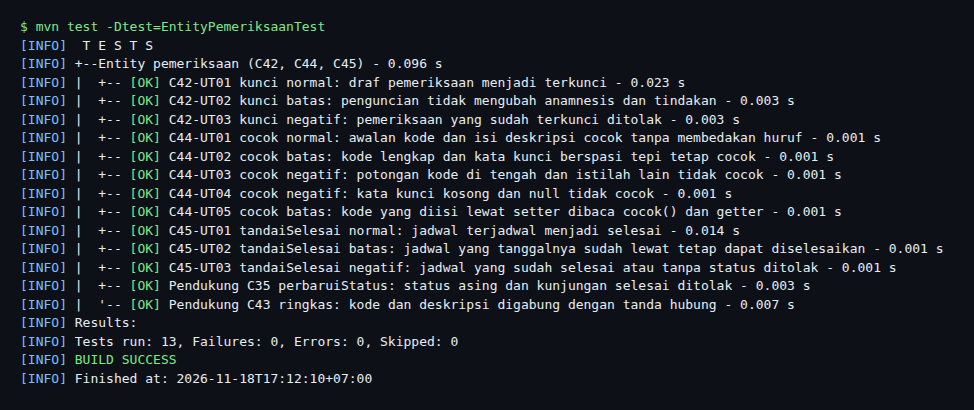 |
| C42 (coverage) | Total 2 dari 28 baris terlewat, cabang 100%<br> |
| C44 (coverage) | Seluruh baris dan cabang tercakup<br> |
| C45 (coverage) | Total 4 dari 24 baris terlewat, cabang 100%<br>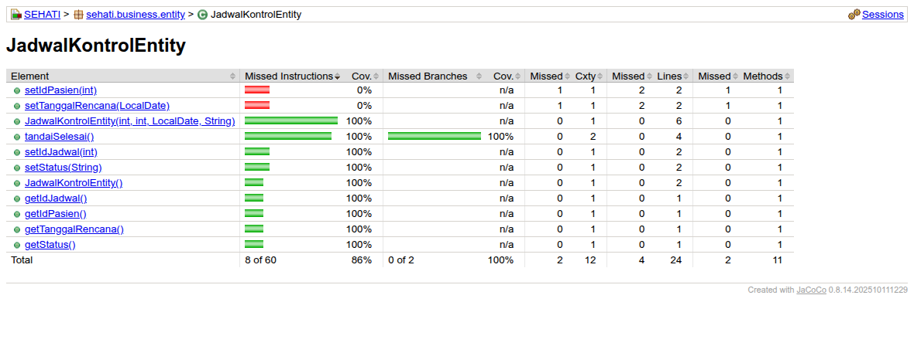 |
| C46-UT01 – C46-UT04, C47-UT01 – C47-UT03 | Keluaran `mvn test -Dtest=EntityResepTest`<br> |
| C46 (coverage) | Total 6 dari 34 baris terlewat, cabang 100%<br> |
| C59-UT21 – C59-UT32 | Keluaran `mvn test -Dtest=DataKlinisBoundaryPemeriksaanTest`<br> |
| INT-TC17 – INT-TC22 | Keluaran `mvn test -Dtest=PemeriksaanResepIntegrasiTest`<br> |
| UC05-TC01 | `v9.0`: ringkasan I-06 tanpa bagian skrining hari ini (Fail). Uji ulang: panel "Skrining hari ini" tampil (Pass)<br><br>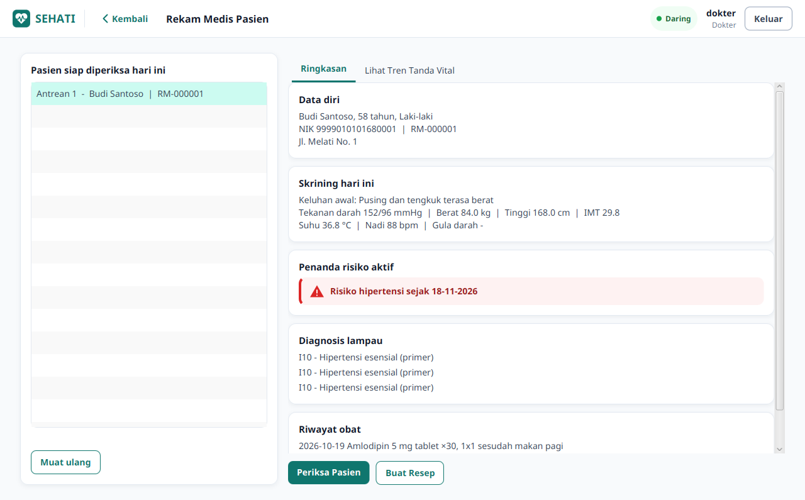 |
| UC05-TC02 | Grafik tren empat kunjungan<br>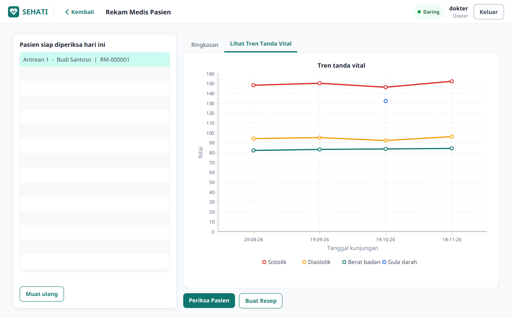 |
| UC05-TC03 | Berurutan: saran ICD-10, isian lengkap, simpan dengan jadwal kontrol, dialog konfirmasi, rekam medis terkunci, daftar pantau perawat (entri 9 Des 2026), dan isi basis data setelah pengujian<br>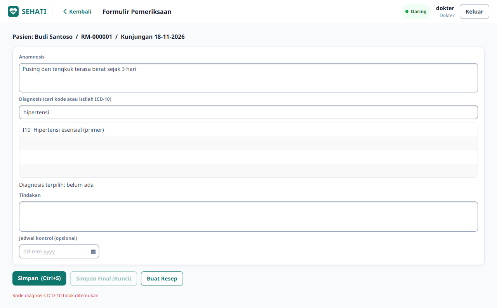<br><br>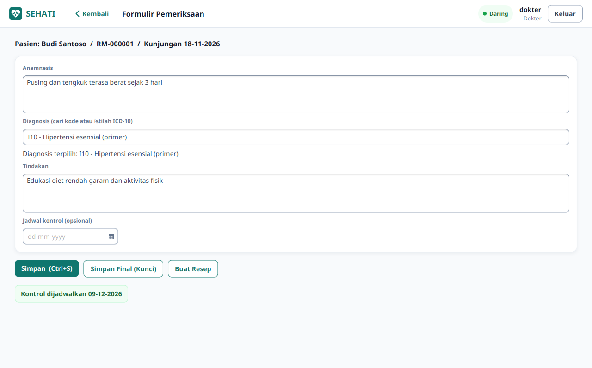<br><br><br>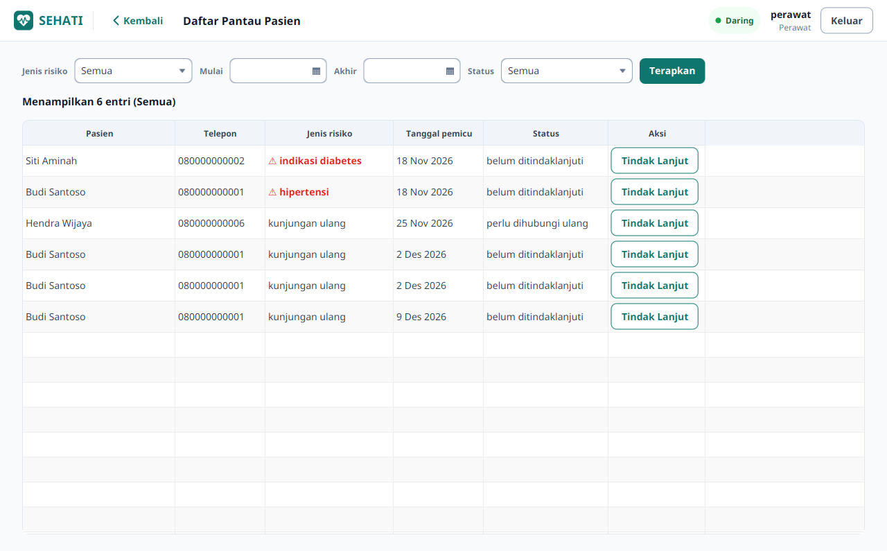<br>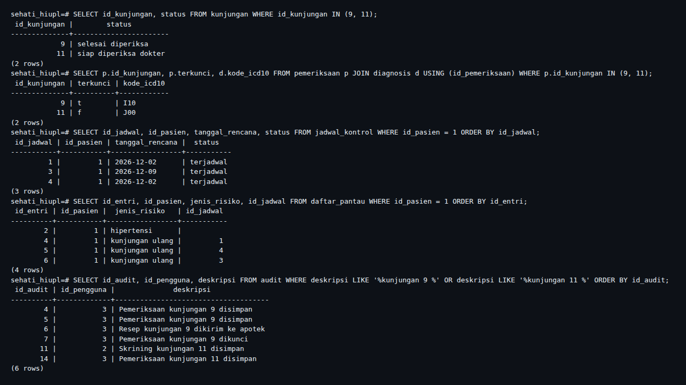 |
| UC05-TC04 | Mode baca saja untuk perawat<br>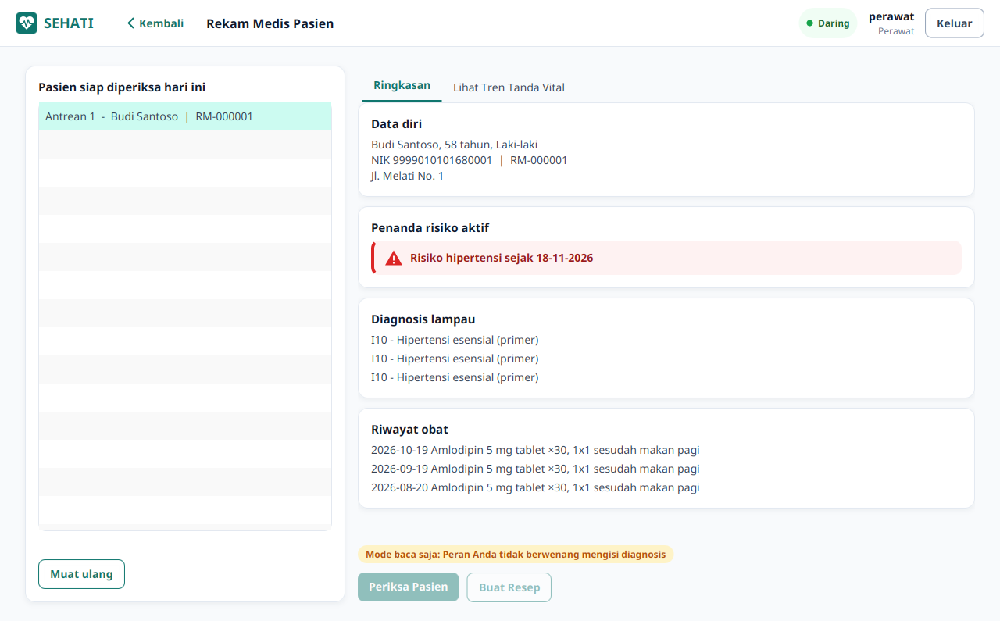 |
| UC05-TC05 | Pesan kode tidak ditemukan, lalu saran muncul setelah istilah diganti<br><br> |
| UC05-TC06 | Indikator "Luring" pada bilah aplikasi dan pemeriksaan tetap tersimpan<br><br> |
| UC05-TC07 | Tabel pengukuran pasien yang baru sekali diukur<br>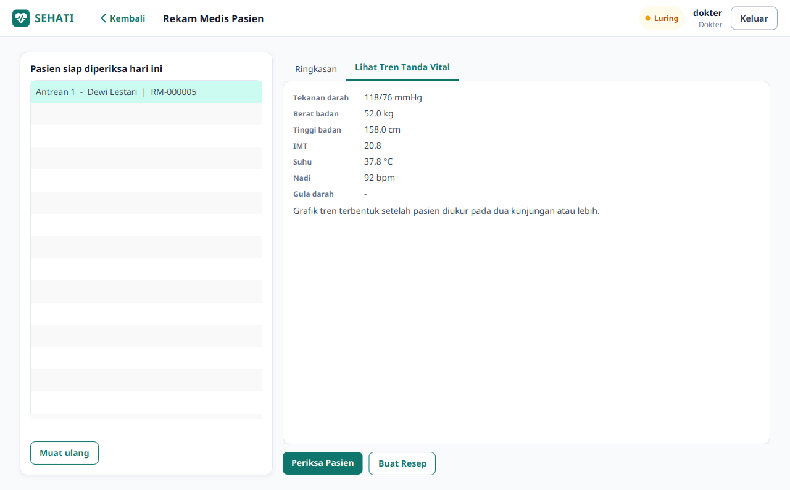 |
| UC05-TC08 | `v9.0`: sebelum, simpan jadwal 02-12-2026, lalu dua entri 2 Des 2026 (Fail). Isi tabel `jadwal_kontrol` dan `daftar_pantau` `v9.0` ada pada bukti basis data UC05-TC03<br><br><br><br>Uji ulang setelah perbaikan: langkah yang sama, daftar pantau tetap satu entri 2 Des 2026, dan isi basis data (Pass)<br><br><br>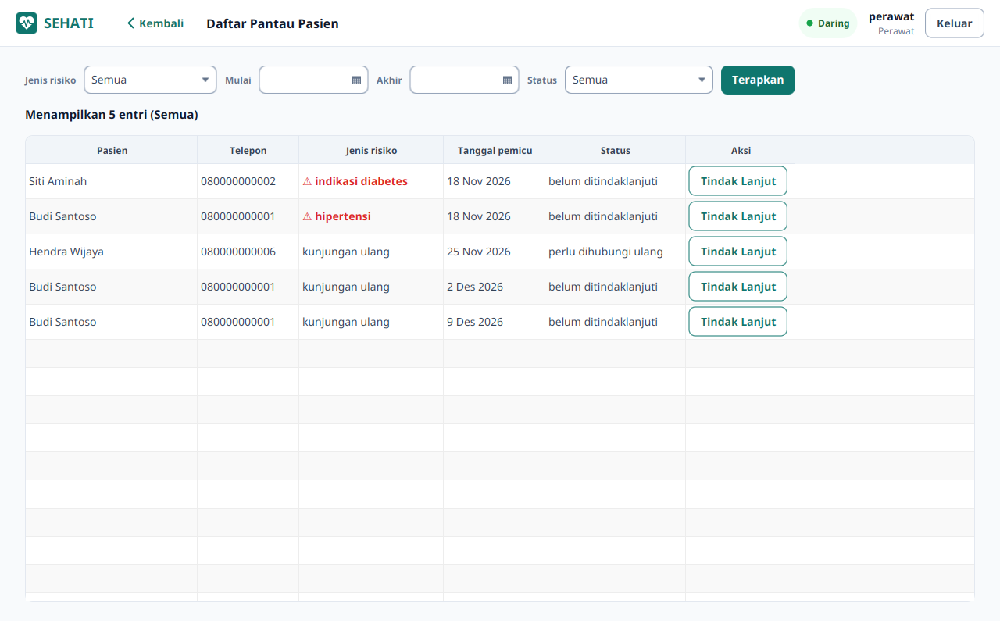<br> |
| UC06-TC01 | Dua item "Tersedia", resep terkirim, dan isi `resep`, `item_resep`, serta antrean apotek<br><br><br>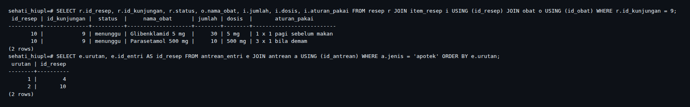 |
| UC06-TC02 | Stok kurang dengan tombol kirim nonaktif, lalu setelah jumlah diperbaiki<br>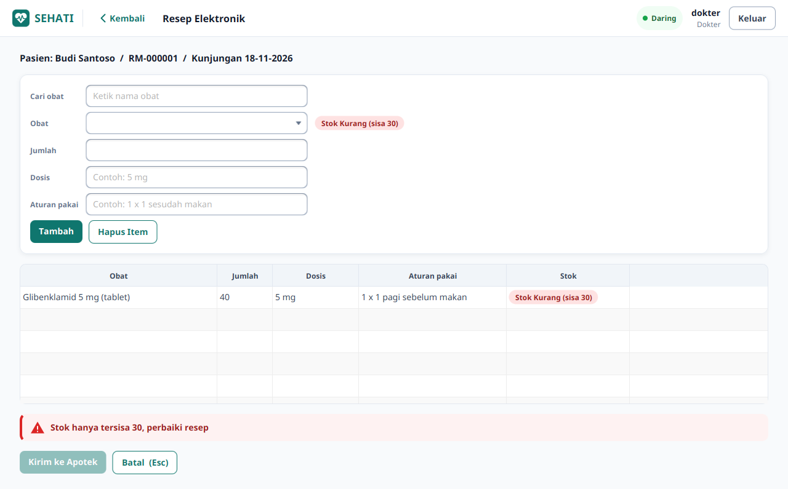<br>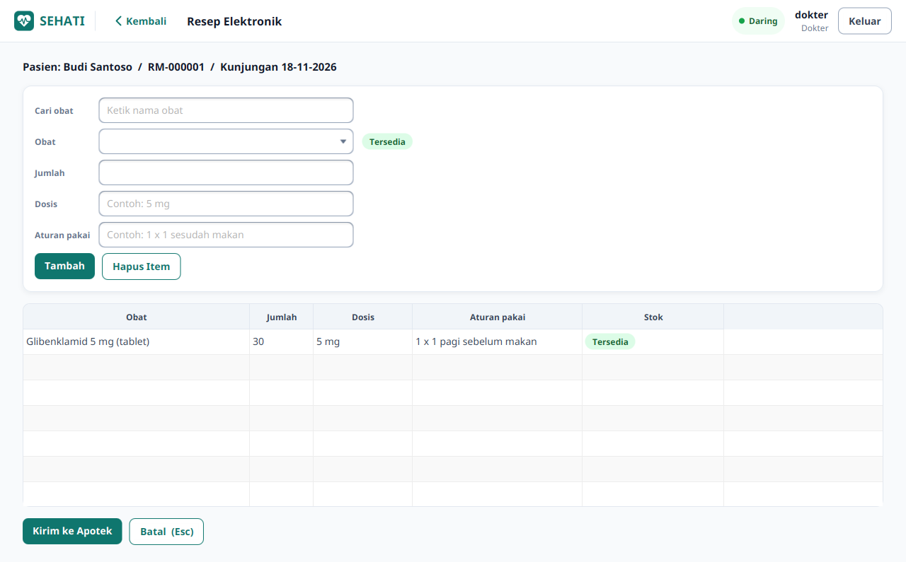 |
| C17-UT01 – C17-UT17 | Keluaran `mvn test -Dtest=AutentikasiManagerTest` setelah perbaikan: 17 test `[OK]`<br> |
| C17-UT17 (`v9.0`, Fail) | Test yang sama pada kode `v9.0`: C17-UT17 `[XX]`, `NullPointer`<br>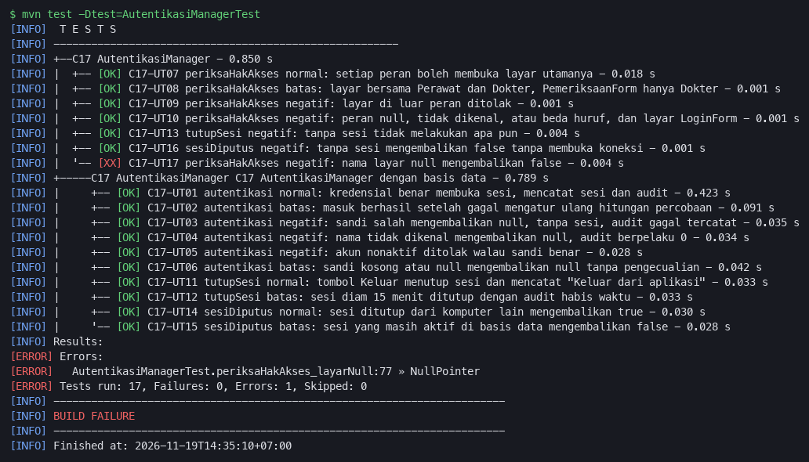 |
| C17 (coverage) | Total 8 dari 56 baris dan 2 dari 26 cabang terlewat<br> |
| C29-UT01 – C29-UT37 | Keluaran `mvn test -Dtest=KonfigurasiManagerTest`: 37 test `[OK]`<br> |
| C29 (coverage) | Total 30 dari 159 baris dan 9 dari 72 cabang terlewat<br>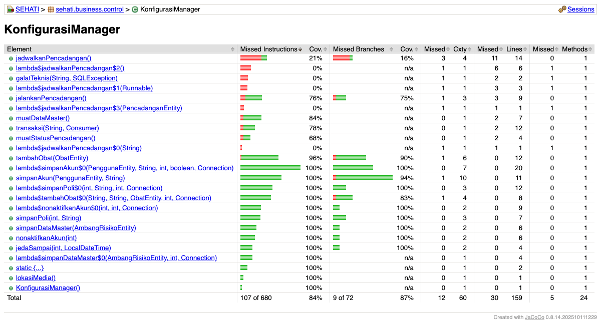 |
| C30-UT01 – C30-UT11, C31-UT01 – C31-UT07, C32-UT01 – C32-UT03 | Keluaran `mvn test -Dtest=PenggunaEntityTest,SesiEntityTest,AuditEntityTest`: 21 test `[OK]`<br> |
| C30 (coverage) | Total 6 dari 36 baris terlewat, cabang 100%<br> |
| C31 (coverage) | Seluruh baris dan cabang tercakup<br> |
| C56-UT01 – C56-UT10 | Keluaran `mvn test -Dtest=DataAkunBoundaryTest`: 10 test `[OK]`<br>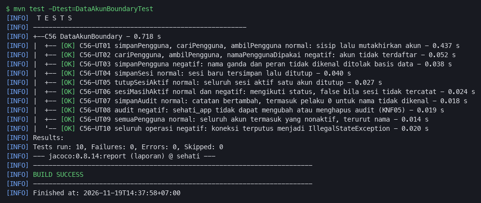 |
| C64-UT01 – C64-UT16 | Keluaran `mvn test -Dtest=DataPencadanganBoundaryTest`: 16 test `[OK]`<br> |
| C64 (coverage) | Total 14 dari 98 baris dan 6 dari 42 cabang terlewat<br> |
| INT-TC01 – INT-TC06 | Keluaran `mvn test -Dtest=AksesIntegrasiTest`: 6 test `[OK]`<br>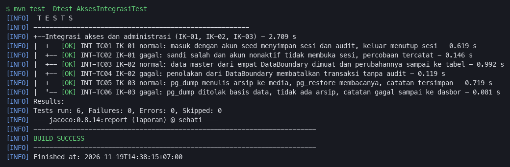 |
| UC01-TC01 | Layar masuk, dasbor admin, dan dasbor perawat<br><br><br>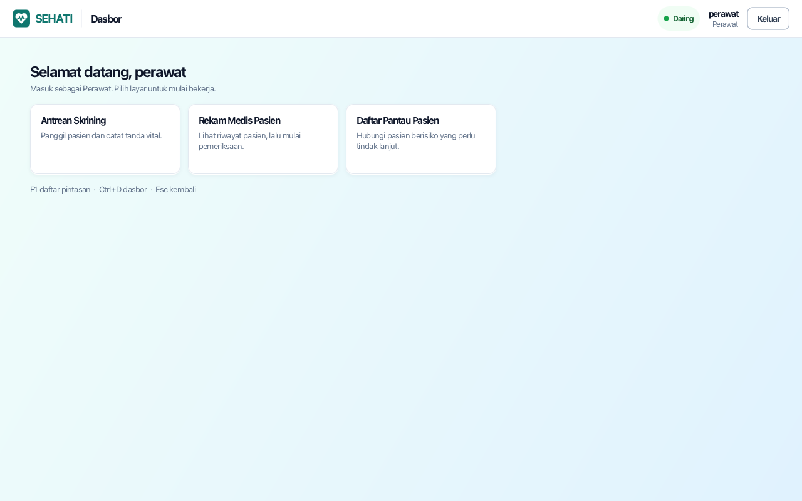 |
| UC01-TC02 | Pesan kredensial salah dengan kolom sandi kosong, lalu dasbor setelah masuk ulang<br><br> |
| UC01-TC03 | Pesan akun nonaktif<br> |
| UC01-TC04 | Dasbor perawat dan pesan akses ditolak<br> |
| UC01 (basis data) | Audit dan sesi UC01-TC01 sampai UC01-TC03<br>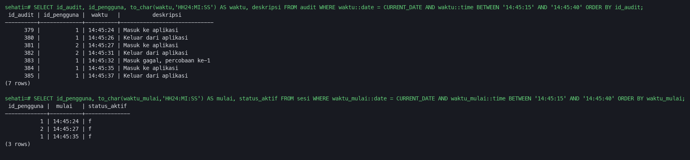 |
| UC12-TC01 | Tab Akun Pengguna, isian akun, akun tersimpan, isian ambang, dan ambang tersimpan<br><br><br>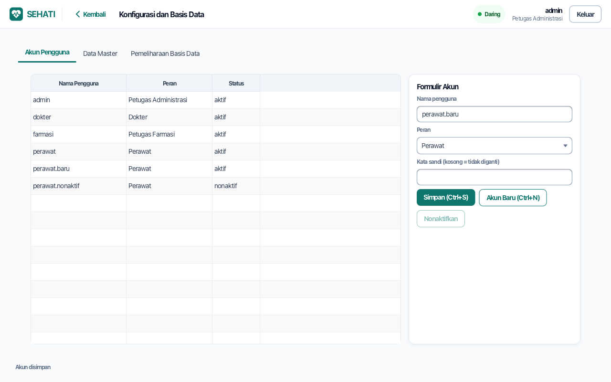<br>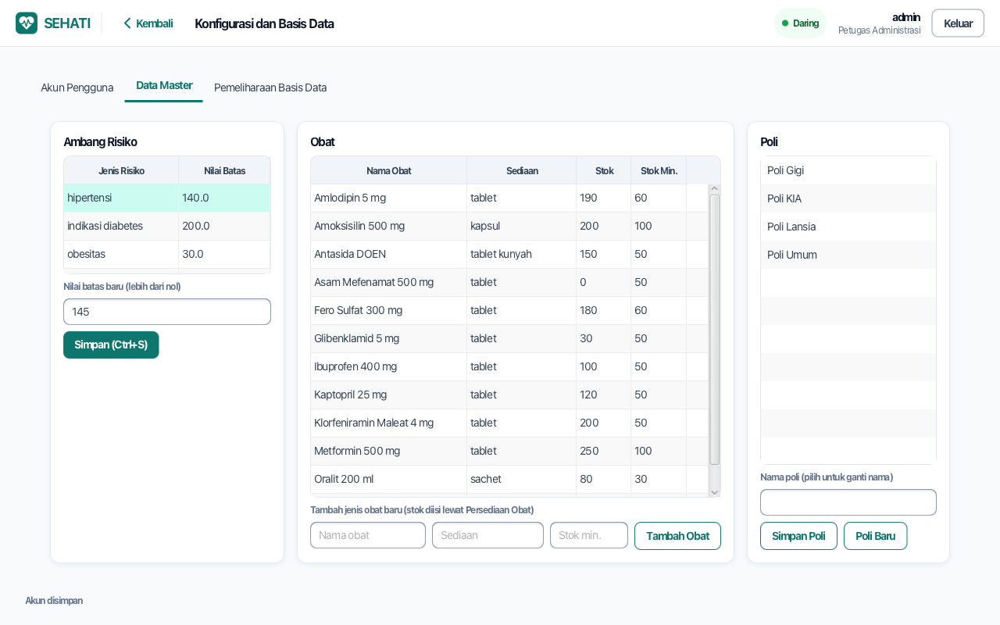<br> |
| UC12-TC02 | Status pencadangan sebelum dan sesudah "Jalankan Pencadangan"<br><br>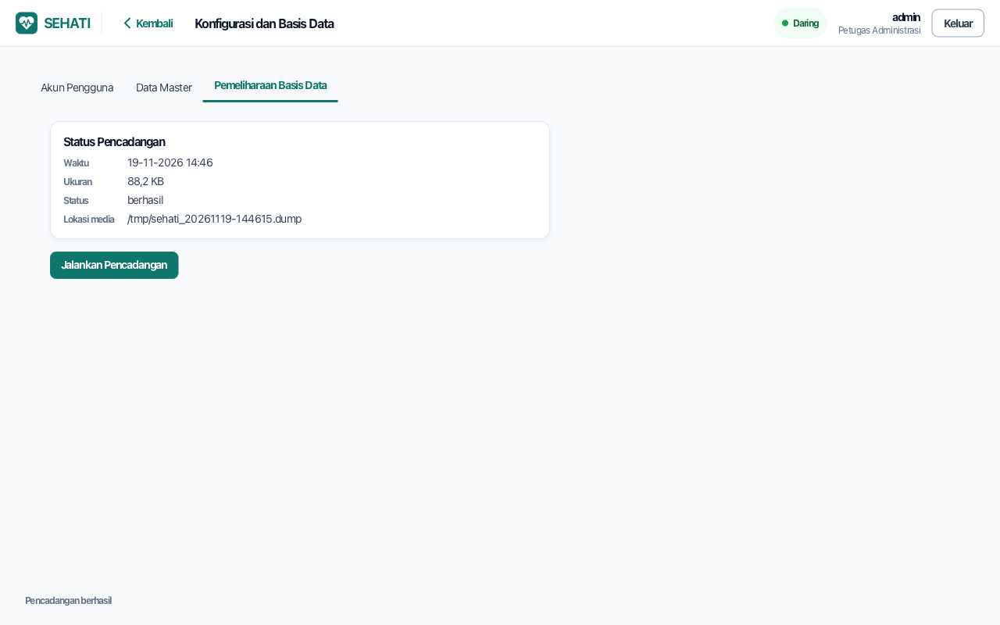 |
| UC12-TC03 | Nama pengguna yang sudah dipakai ditandai, lalu nama baru tersimpan<br>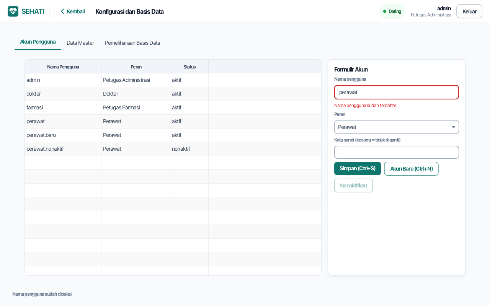<br>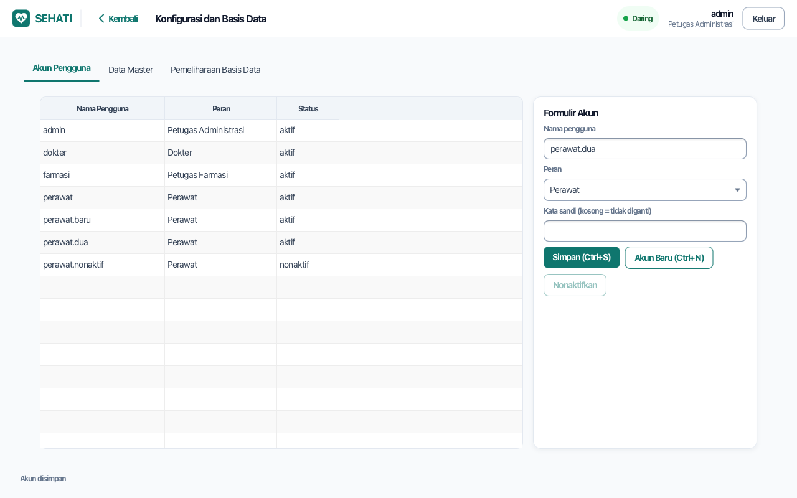 |
| UC12-TC04 | Berurutan: komputer B masuk sebagai `perawat.baru`, dialog konfirmasi di komputer A, akun nonaktif, komputer B terputus, dan percobaan masuk ditolak<br><br>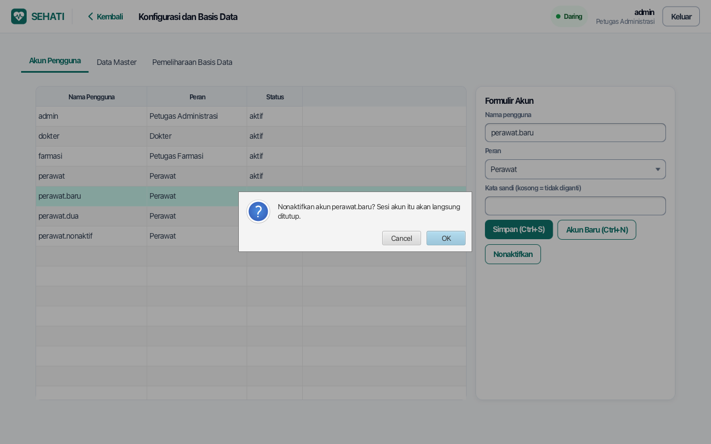<br><br><br> |
| UC12-TC05 | Berurutan: dasbor dan tab Pemeliharaan setelah jadwal gagal, dasbor setelah aplikasi dibuka ulang, pencadangan ulang berhasil, dan dasbor tanpa peringatan<br><br>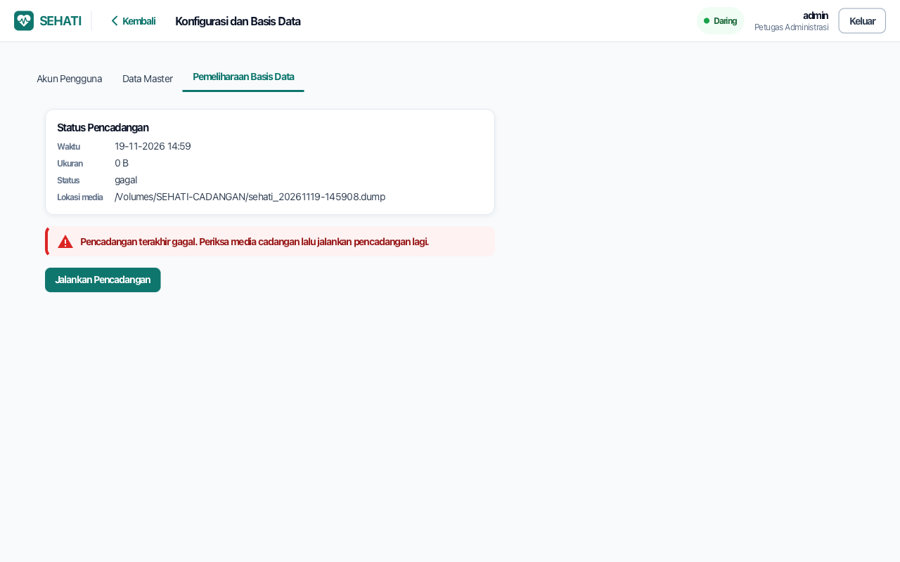<br>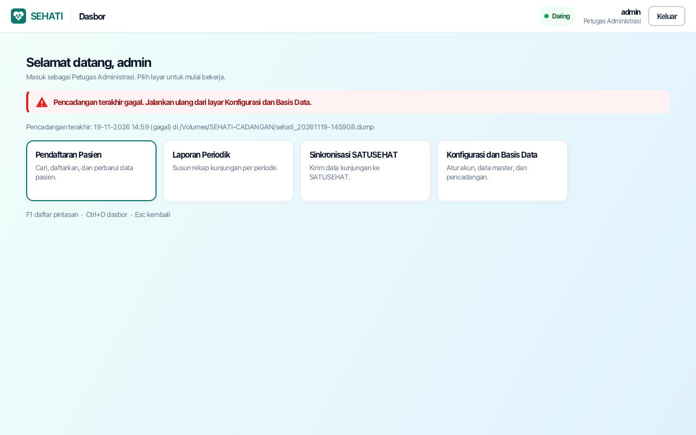<br><br><br> |
| UC12 (basis data) | Akun, ambang, audit, sesi, dan catatan pencadangan setelah UC12-TC01 sampai UC12-TC04<br> |
| KNF04-TC01 | *Hash* seluruh akun, masuk sebagai perawat, layar setelah 15 menit diam, dan audit masuk serta sesi berakhir<br><br><br>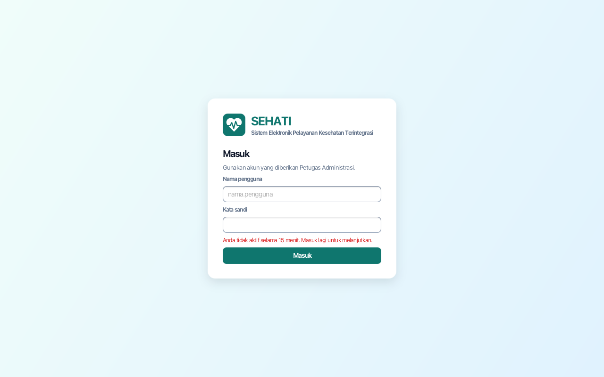<br> |
| KNF05-TC01 | Perintah ubah dan hapus audit sebagai `sehati_app` ditolak (dasbor per peran pada UC01-TC01 dan UC01-TC04)<br> |
| KNF06-TC01 | Keluaran `UjiKnf06`: lima pencadangan selagi aplikasi dipakai<br> |
| C18-UT01 – C18-UT24, C19-UT01 – C19-UT11, C57-UT01 – C57-UT19, C58-UT01 – C58-UT21 | Keluaran `mvn test -Dtest=PasienManagerTest,KunjunganManagerTest,DataPasienBoundaryTest,DataKunjunganBoundaryTest`: seluruh test `[OK]`; coverage kelas Mendalam terpenuhi minimal 70%, integrasi IK-04 hingga IK-05 dan IK-17 hingga IK-18 lulus, use case UC02 dan UC03 lulus, KNF01, KNF10, dan KNF11 lulus |
| *[ID pengujian milik Humam]* | *[Diisi Humam: keluaran test runner per kelas, coverage kelas Mendalam, integrasi, use case, dan KNF]* |
| *[ID pengujian milik Malik]* | *[Diisi Malik: keluaran test runner per kelas, coverage kelas Mendalam, integrasi, use case, dan KNF]* |
| *[ID pengujian milik Fachry]* | *[Diisi Fachry: keluaran test runner per kelas, coverage kelas Mendalam, integrasi, use case, dan KNF]* |

<br>

---

# BAB 5: Traceability

Tabel 5.1 memetakan setiap KF ke KNF, *use case*, kelas perancangan, berkas implementasi, dan *test case*. Berkas ditulis relatif terhadap `src/src/main/java/sehati/`. Setiap KF memiliki minimal satu *test case* dan dinyatakan terpenuhi apabila **seluruh** *test case* terkaitnya berkesimpulan `Pass`. Seluruh 24 KF diimplementasikan pada tag `v9.0`, sehingga tidak ada baris "tidak diimplementasikan".

Tabel 5.1. Matriks Kerunutan KF terhadap Implementasi dan Pengujian

| KF ID | KNF Terkait | Use Case ID | Kelas Terkait | Implementasi File Terkait | Test Case (UC) | Test Case (Unit/Integrasi/KNF) |
| :--- | :--- | :--- | :--- | :--- | :--- | :--- |
| KF01 | KNF01 | UC02<br>UC03 | C02 - PasienForm<br>C18 - PasienManager<br>C33 - PasienEntity<br>C57 - DataPasienBoundary | `presentation/PasienForm.java`<br>`business/control/PasienManager.java`<br>`dataaccess/DataPasienBoundary.java` | UC02-TC01 s.d. UC02-TC03 | C18-UT01 s.d. C18-UT24, INT-TC07, INT-TC08, KNF01-TC01 |
| KF02 | - | UC02 | C02 - PasienForm<br>C18 - PasienManager<br>C33 - PasienEntity<br>C34 - RekamMedisEntity<br>C57 - DataPasienBoundary | `presentation/PasienForm.java`<br>`business/control/PasienManager.java`<br>`business/entity/PasienEntity.java`<br>`dataaccess/DataPasienBoundary.java` | UC02-TC01 s.d. UC02-TC03 | C18-UT01 s.d. C18-UT24, C33-UT01 s.d. C33-UT02, C34-UT01 s.d. C34-UT03, INT-TC07, INT-TC08 |
| KF03 | KNF11 | UC03 | C03 - KunjunganForm<br>C19 - KunjunganManager<br>C35 - KunjunganEntity<br>C36 - PoliEntity<br>C58 - DataKunjunganBoundary | `presentation/KunjunganForm.java`<br>`business/control/KunjunganManager.java`<br>`business/entity/PoliEntity.java`<br>`dataaccess/DataKunjunganBoundary.java` | UC03-TC01 s.d. UC03-TC04 | C19-UT01 s.d. C19-UT11, C36-UT01 s.d. C36-UT04, INT-TC09, INT-TC10 |
| KF04 | - | UC04 | C04 - AntreanSkriningForm<br>C20 - SkriningManager<br>C37 - AntreanEntity<br>C58 - DataKunjunganBoundary | `presentation/AntreanSkriningForm.java`<br>`business/control/SkriningManager.java`<br>`business/entity/AntreanEntity.java` | *[UC04-TC.., diisi Humam]* | *[C20-UT.., C37-UT.., INT-TC11; diisi Humam]* |
| KF05 | - | UC04 | C05 - SkriningForm<br>C20 - SkriningManager<br>C38 - SkriningEntity<br>C39 - TandaVitalEntity<br>C59 - DataKlinisBoundary | `presentation/SkriningForm.java`<br>`business/control/SkriningManager.java`<br>`dataaccess/DataKlinisBoundary.java` | *[UC04-TC.., diisi Humam]* | *[C20-UT.., C59-UT01 s.d. C59-UT20, INT-TC11, INT-TC12; diisi Humam]* |
| KF06 | KNF02 | UC04 | C05 - SkriningForm<br>C20 - SkriningManager<br>C39 - TandaVitalEntity | `presentation/SkriningForm.java`<br>`business/control/SkriningManager.java` | *[UC04-TC.., diisi Humam]* | *[C20-UT.., KNF02-TC01; diisi Humam]* |
| KF07 | KNF08 | UC04 | C05 - SkriningForm<br>C21 - RisikoManager<br>C40 - AmbangRisikoEntity<br>C41 - PenandaRisikoEntity<br>C51 - DaftarPantauEntity<br>C60 - DataPantauBoundary | `presentation/SkriningForm.java`<br>`business/control/RisikoManager.java`<br>`dataaccess/DataPantauBoundary.java` | *[UC04-TC.., diisi Humam]* | *[C21-UT.., C40-UT.., C41-UT.., INT-TC13, INT-TC14, KNF08-TC01; diisi Humam]* |
| KF08 | - | UC05 | C06 - RekamMedisForm<br>C22 - PemeriksaanManager<br>C39 - TandaVitalEntity<br>C59 - DataKlinisBoundary | `presentation/RekamMedisForm.java`<br>`business/control/PemeriksaanManager.java` | UC05-TC02, UC05-TC07 | C22-UT04 s.d. C22-UT06 |
| KF09 | - | UC05 | C06 - RekamMedisForm<br>C22 - PemeriksaanManager<br>C34 - RekamMedisEntity<br>C57 - DataPasienBoundary<br>C59 - DataKlinisBoundary | `presentation/RekamMedisForm.java`<br>`business/control/PemeriksaanManager.java`<br>`dataaccess/DataPasienBoundary.java` | UC05-TC01 (Fail pada `v9.0`, Pass setelah perbaikan) | C22-UT01 s.d. C22-UT03, C22-UT35, C22-UT36, INT-TC17 |
| KF10 | KNF05 | UC05 | C07 - PemeriksaanForm<br>C22 - PemeriksaanManager<br>C42 - PemeriksaanEntity<br>C43 - DiagnosisEntity<br>C44 - KodeICD10Entity<br>C59 - DataKlinisBoundary | `presentation/PemeriksaanForm.java`<br>`business/control/PemeriksaanManager.java`<br>`business/entity/KodeICD10Entity.java`<br>`dataaccess/DataKlinisBoundary.java` | UC05-TC03, UC05-TC04, UC05-TC05 | C22-UT07 s.d. C22-UT15, C22-UT20 s.d. C22-UT27, C22-UT31 s.d. C22-UT34, C42-UT01 s.d. C42-UT03, C44-UT01 s.d. C44-UT05, C59-UT21 s.d. C59-UT27, INT-TC17 s.d. INT-TC20 |
| KF11 | - | UC06 | C08 - ResepForm<br>C23 - ResepManager<br>C46 - ResepEntity<br>C47 - ItemResepEntity<br>C48 - ObatEntity<br>C61 - DataFarmasiBoundary | `presentation/ResepForm.java`<br>`business/control/ResepManager.java`<br>`business/entity/ResepEntity.java`<br>`dataaccess/DataFarmasiBoundary.java` | UC06-TC01, UC06-TC02 | C23-UT01 s.d. C23-UT25, C46-UT01 s.d. C46-UT04, C47-UT01 s.d. C47-UT03, INT-TC21, INT-TC22 |
| KF12 | - | UC05<br>UC09 | C07 - PemeriksaanForm<br>C22 - PemeriksaanManager<br>C45 - JadwalKontrolEntity<br>C21 - RisikoManager<br>C26 - PantauManager<br>C51 - DaftarPantauEntity<br>C59 - DataKlinisBoundary<br>C60 - DataPantauBoundary | `presentation/PemeriksaanForm.java`<br>`business/control/PemeriksaanManager.java`<br>`business/control/RisikoManager.java`<br>`dataaccess/DataKlinisBoundary.java` | UC05-TC03, UC05-TC08 (Fail pada `v9.0`, Pass setelah perbaikan); *[UC09-TC.., diisi Humam]* | C22-UT16 s.d. C22-UT19, C22-UT23, C22-UT28 s.d. C22-UT30, C22-UT37 (Fail pada `v9.0`, Pass setelah perbaikan), C45-UT01 s.d. C45-UT03, C59-UT28 s.d. C59-UT32, INT-TC19; *[C21-UT.., C26-UT.., INT-TC15, INT-TC16; diisi Humam]* |
| KF13 | - | UC07 | C09 - AntreanResepForm<br>C10 - PenyerahanObatForm<br>C24 - ApotekManager<br>C46 - ResepEntity<br>C61 - DataFarmasiBoundary | `presentation/AntreanResepForm.java`<br>`presentation/PenyerahanObatForm.java`<br>`business/control/ApotekManager.java` | *[UC07-TC.., diisi Malik]* | C46-UT01 s.d. C46-UT04; *[C24-UT.., INT-TC23, INT-TC24; diisi Malik]* |
| KF14 | KNF03<br>KNF07 | UC07 | C10 - PenyerahanObatForm<br>C24 - ApotekManager<br>C48 - ObatEntity<br>C49 - BetsObatEntity<br>C54 - BundelFHIREntity<br>C61 - DataFarmasiBoundary<br>C63 - DataSinkronisasiBoundary | `business/control/ApotekManager.java`<br>`business/control/PenyusunBundelFHIR.java`<br>`dataaccess/DataFarmasiBoundary.java` | *[UC07-TC.., diisi Malik]* | C22-UT20, INT-TC19 (bundel kunjungan tanpa resep); *[C24-UT.., C48-UT.., C49-UT.., INT-TC23, INT-TC24, KNF03-TC01, KNF07-TC01; diisi Malik dan Fachry]* |
| KF15 | - | UC12 | C16 - KonfigurasiForm<br>C29 - KonfigurasiManager<br>C30 - PenggunaEntity<br>C36 - PoliEntity<br>C40 - AmbangRisikoEntity<br>C48 - ObatEntity<br>C56 - DataAkunBoundary | `presentation/KonfigurasiForm.java`<br>`business/control/KonfigurasiManager.java`<br>`dataaccess/DataAkunBoundary.java` | UC12-TC01, UC12-TC03, UC12-TC04 | C29-UT01 s.d. C29-UT27, C30-UT01 s.d. C30-UT11, C56-UT01 s.d. C56-UT03, C56-UT09, INT-TC03, INT-TC04 |
| KF16 | KNF04<br>KNF05 | UC01 | C01 - LoginForm<br>C17 - AutentikasiManager<br>C30 - PenggunaEntity<br>C31 - SesiEntity<br>C32 - AuditEntity<br>C56 - DataAkunBoundary | `presentation/LoginForm.java`<br>`presentation/Navigasi.java`<br>`business/control/AutentikasiManager.java`<br>`common/SesiAktif.java` | UC01-TC01 s.d. UC01-TC04, UC12-TC04 | C17-UT01 s.d. C17-UT17 (C17-UT17 Fail pada `v9.0`, Pass setelah perbaikan), C30-UT01 s.d. C30-UT05, C31-UT01 s.d. C31-UT07, C32-UT01 s.d. C32-UT03, C56-UT04 s.d. C56-UT08, C22-UT15, C22-UT27, C23-UT21, C29-UT10 (pembatasan peran pada operasi tulis), INT-TC01, INT-TC02, KNF04-TC01, KNF05-TC01 |
| KF17 | - | UC08 | C11 - PersediaanForm<br>C25 - PersediaanManager<br>C48 - ObatEntity<br>C49 - BetsObatEntity<br>C50 - PenerimaanObatEntity<br>C61 - DataFarmasiBoundary | `presentation/PersediaanForm.java`<br>`business/control/PersediaanManager.java`<br>`dataaccess/DataFarmasiBoundary.java` | *[UC08-TC.., diisi Malik]* | *[C25-UT.., C48-UT.., C49-UT.., C50-UT.., INT-TC25, INT-TC26; diisi Malik]* |
| KF18 | - | UC09 | C12 - DaftarPantauForm<br>C26 - PantauManager<br>C21 - RisikoManager<br>C51 - DaftarPantauEntity<br>C52 - TindakLanjutEntity<br>C60 - DataPantauBoundary | `presentation/DaftarPantauForm.java`<br>`business/control/PantauManager.java`<br>`dataaccess/DataPantauBoundary.java` | *[UC09-TC.., diisi Humam]* | *[C26-UT.., C51-UT.., INT-TC15, INT-TC16; diisi Humam]* |
| KF19 | - | UC10 | C13 - LaporanForm<br>C27 - LaporanManager<br>C53 - LaporanEntity<br>C62 - DataLaporanBoundary | `presentation/LaporanForm.java`<br>`business/control/LaporanManager.java`<br>`dataaccess/DataLaporanBoundary.java` | *[UC10-TC.., diisi Fachry]* | *[C27-UT.., C53-UT.., INT-TC27, INT-TC28; diisi Fachry]* |
| KF20 | KNF07 | UC11 | C14 - SinkronisasiForm<br>C15 - SATUSEHATGateway<br>C28 - SinkronisasiManager<br>C54 - BundelFHIREntity<br>C63 - DataSinkronisasiBoundary | `presentation/SinkronisasiForm.java`<br>`business/control/SinkronisasiManager.java`<br>`dataaccess/SATUSEHATGateway.java`<br>`dataaccess/DataSinkronisasiBoundary.java` | *[UC11-TC.., diisi Fachry]* | *[C15-UT.., C28-UT.., C54-UT.., C63-UT.., INT-TC29 s.d. INT-TC32, KNF07-TC01; diisi Fachry]* |
| KF21 | KNF06 | UC12 | C16 - KonfigurasiForm<br>C29 - KonfigurasiManager<br>C55 - PencadanganEntity<br>C64 - DataPencadanganBoundary | `presentation/KonfigurasiForm.java`<br>`business/control/KonfigurasiManager.java`<br>`dataaccess/DataPencadanganBoundary.java` | UC12-TC02, UC12-TC05 | C29-UT28 s.d. C29-UT37, C64-UT01 s.d. C64-UT16, INT-TC05, INT-TC06, KNF06-TC01 |
| KF22 | KNF09<br>KNF10<br>KNF13 | UC05<br>UC11 | C14 - SinkronisasiForm<br>C15 - SATUSEHATGateway<br>C28 - SinkronisasiManager | `presentation/BilahAplikasi.java`<br>`presentation/Navigasi.java`<br>`business/control/SinkronisasiManager.java`<br>`dataaccess/SATUSEHATGateway.java` | UC05-TC06; *[UC11-TC.., diisi Fachry]* | *[C15-UT.., C28-UT.., KNF09-TC01, KNF10-TC01, KNF13-TC01; diisi Fachry, Steven, dan Malik]* |
| KF23 | KNF11 | UC03<br>UC07 | C19 - KunjunganManager<br>C24 - ApotekManager<br>C36 - PoliEntity<br>C58 - DataKunjunganBoundary<br>C61 - DataFarmasiBoundary | `business/control/KunjunganManager.java`<br>`business/control/ApotekManager.java`<br>`dataaccess/DataKunjunganBoundary.java`<br>`dataaccess/DataFarmasiBoundary.java` | UC03-TC01 s.d. UC03-TC04, UC07-TC01 s.d. UC07-TC03 | INT-TC22 (penguncian antrean apotek); INT-TC33, INT-TC34, KNF11-TC01 |
| KF24 | KNF12 | UC04<br>UC05 | C05 - SkriningForm<br>C07 - PemeriksaanForm | `presentation/SkriningForm.java`<br>`presentation/PemeriksaanForm.java`<br>`presentation/Navigasi.java`<br>`presentation/TabelPintasan.java` | UC05-TC03 (Ctrl+S); *[UC04-TC.., diisi Humam]* | *[KNF12-TC01; diisi Humam]* |

Pada `v9.0`, tiga KF belum terpenuhi karena memiliki *test case* `Fail`:

- **KF09** (UC05-TC01): hasil skrining hari itu belum tampil pada ringkasan rekam medis I-06.
- **KF12** (UC05-TC08, C22-UT37): jadwal kontrol pada tanggal yang sama dapat dibuat dua kali setelah jadwal pertama masuk daftar pantau.
- **KF16** (C17-UT17): `periksaHakAkses()` melempar `NullPointerException` untuk nama layar `null` alih-alih menolak akses.

Ketiganya sudah diperbaiki (Tabel 3.5) dan diuji ulang dengan hasil `Pass`. Bagian KF12 milik UC09 masih menunggu hasil pengujian Humam. KF lain menunggu hasil pengujian setiap modul.

Tabel 5.2. Matriks Kerunutan KNF terhadap Pengujian

| ID KNF | Parameter | KF/UC Terkait | Test Case |
| :--- | :--- | :--- | :--- |
| KNF01 | Response time | KF01 / UC02 | KNF01-TC01 |
| KNF02 | Reliability | KF06 / UC04 | KNF02-TC01 |
| KNF03 | Reliability | KF14 / UC07 | KNF03-TC01 |
| KNF04 | Security | KF16 / UC01 | KNF04-TC01 |
| KNF05 | Security | KF10, KF16 / UC01, UC05, seluruh UC dengan perubahan data | KNF05-TC01 |
| KNF06 | Reliability | KF21 / UC12 | KNF06-TC01 |
| KNF07 | Portability | KF14, KF20 / UC07, UC11 | KNF07-TC01 |
| KNF08 | Ergonomy | KF07 / UC04 | KNF08-TC01 |
| KNF09 | Availability | KF22 / UC05, UC11 | KNF09-TC01 |
| KNF10 | Portability | KF22 / - | KNF10-TC01 |
| KNF11 | Reliability | KF23 / UC03, UC07 | KNF11-TC01 |
| KNF12 | Ergonomy | KF24 / UC04 | KNF12-TC01 |
| KNF13 | Reliability | KF22 / - | KNF13-TC01 |
