<h1>
IF2150 REKAYASA PERANGKAT LUNAK
 
TUGAS 7
 
DESKRIPSI PERANCANGAN PERANGKAT LUNAK (DPPL)
</h1>
 

## SEHATI - Sistem Elektronik Pelayanan Kesehatan Terintegrasi

### Untuk: Made Branenda Jordhy

Dipersiapkan oleh:

| Informasi | Keterangan |
| --- | --- |
| Kelas | K02 |
| Kelompok | G09 |
| Nama Kelompok | Cumlaude |

| NIM | Nama |
| --- | --- |
| 13525008 | Malik Arsyafiandra Madani |
| 13525044 | Steven Vanako |
| 13525071 | Muhammad Adnan Kurniawan |
| 13525074 | Axeleon Justin Algianto |
| 13525110 | Fachry Azriel Fajdwani |

---

## Daftar Perubahan

| Revisi | Deskripsi |
| :--- | :--- |
| A | Pembuatan awal DPPL SEHATI: BAB 1 dan BAB 2 dari SKPL dan APL, realisasi dua belas *use case* dengan 42 *sequence diagram*, diagram kelas keseluruhan, dan matriks kerunutan. |
| B | Perbaikan hasil asistensi: menambahkan logo, menggambar ulang *sequence diagram* dengan notasi *boundary*, *control*, dan *entity*, mengalirkan UC03 dan UC07 alternatif 2 lewat `Form`, serta memangkas diagram kelas per *use case* sesuai metode yang dipakai. |

---

 

# BAB 1: Pendahuluan

## 1.1 Tujuan Penulisan Dokumen
Dokumen ini memuat Deskripsi Perancangan Perangkat Lunak (DPPL) untuk SEHATI. DPPL melanjutkan SKPL (Tugas 5) dan APL (Tugas 6): kebutuhan, *use case*, dan kelas analisis pada SKPL diwujudkan menjadi kelas perancangan lengkap dengan tipe data, metode, dan urutan pesan antarobjek, di atas arsitektur berlapis yang ditetapkan APL. Pengembang memakai dokumen ini sebagai acuan langsung saat menulis kode, penguji memakai *sequence diagram* untuk menurunkan skenario uji integrasi, dan asisten memakainya untuk memeriksa bahwa setiap skenario SKPL sudah punya realisasi di tingkat kelas.

## 1.2 Lingkup Masalah
SEHATI adalah aplikasi *desktop* untuk pelayanan rawat jalan puskesmas, dari pendaftaran di loket sampai penyerahan obat di apotek. Riwayat pasien yang tersebar di berkas kertas dihimpun ke satu rekam medis elektronik, hasil pengukuran pasien dibandingkan antar-kunjungan, dan pasien yang mengarah ke hipertensi, obesitas, atau diabetes dimasukkan ke daftar pantau. Data disimpan di basis data lokal puskesmas agar pelayanan tetap berjalan tanpa internet, lalu dikirim ke SATUSEHAT ketika koneksi tersedia.

## 1.3 Definisi, Istilah, dan Singkatan

Tabel 1.3. Definisi Istilah dan Singkatan

| Singkatan, Akronim, atau Istilah | Penjelasan |
| :--- | :--- |
| P/L | Perangkat Lunak. |
| DPPL | Deskripsi Perancangan Perangkat Lunak, dokumen ini. |
| SKPL | Spesifikasi Kebutuhan Perangkat Lunak (Tugas 5). |
| APL | Arsitektur Perangkat Lunak (Tugas 6). |
| KF / KNF | Kebutuhan Fungsional / Kebutuhan Non-Fungsional. |
| UC | *Use Case*. |
| ECB | *Entity-Control-Boundary*, kerangka pembagian kelas menjadi antarmuka (*boundary*), pengatur alur (*control*), dan data (*entity*). |
| Kelas analisis | Kelas pada BAB 5 SKPL yang menggambarkan konsep masalah tanpa tipe data dan parameter. |
| Kelas perancangan | Kelas pada dokumen ini yang sudah memiliki visibilitas, tipe data, parameter, dan tipe kembalian sehingga siap diimplementasikan. |
| *Sequence diagram* | Diagram UML yang memperlihatkan urutan pesan antarobjek untuk satu skenario. |
| JDBC | *Java Database Connectivity*, antarmuka Java untuk menjalankan kueri SQL ke DBMS. |
| RME | Rekam Medis Elektronik. |
| SATUSEHAT | Platform integrasi data kesehatan nasional milik Kemenkes RI. |
| HL7 FHIR | *Health Level Seven Fast Healthcare Interoperability Resources*, standar pertukaran data kesehatan yang dipakai SATUSEHAT. |
| ICD-10 | *International Classification of Diseases, 10th Revision*, sistem kode diagnosis standar WHO. |
| NIK | Nomor Induk Kependudukan, nomor identitas 16 digit pada KTP. |

## 1.4 Aturan Penomoran
Dokumen ini memakai pola ID yang sama dengan SKPL dan APL. Kelas C01 sampai C55 adalah kelas SKPL dengan ID yang tidak berubah. Sembilan kelas akses data yang ditambahkan APL diberi nomor lanjutan C56 sampai C64 dengan pola yang sama.

Tabel 1.4. Aturan Penomoran

| Hal/Bagian | Penomoran | Keterangan |
| :--- | :--- | :--- |
| Kebutuhan Fungsional | KFXX | XX adalah dua digit angka berurutan, sama dengan SKPL |
| Kebutuhan Non-Fungsional | KNFXX | XX adalah dua digit angka berurutan, sama dengan SKPL |
| Aktor | AXX | XX adalah dua digit angka berurutan, sama dengan SKPL |
| *Use Case* | UCXX | XX adalah dua digit angka berurutan, sama dengan SKPL |
| Kelas | CXX | XX adalah dua digit angka berurutan; C01 sampai C55 dari SKPL, C56 sampai C64 untuk kelas akses data |

## 1.5 Referensi
1. Kelompok K02-G09. (2026). *Spesifikasi Kebutuhan Perangkat Lunak SEHATI* (Tugas 5), `docs/M5/K02_G09_SKPL.md`. Sumber KF, KNF, *use case*, skenario, kelas analisis, dan *traceability*.
2. Kelompok K02-G09. (2026). *Arsitektur Perangkat Lunak SEHATI* (Tugas 6), `docs/M6/K02_G09_APL.md`. Sumber *pattern* arsitektur, identifikasi komponen, *Logical View*, dan *Physical View*.
3. Sommerville, I. (2016). *Software Engineering* (10th ed.). Pearson. Bab 6 (*Architectural Design*) dan Bab 7 (*Design and Implementation*).
4. Object Management Group. *Unified Modeling Language (UML) Specification*. https://www.omg.org/spec/UML/. Acuan notasi *sequence diagram* dan diagram kelas.
5. Jacobson, I., Christerson, M., Jonsson, P., & Övergaard, G. (1992). *Object-Oriented Software Engineering: A Use Case Driven Approach*. Addison-Wesley. Acuan kerangka ECB.
6. Dokumentasi teknologi: OpenJFX, *JavaFX 21 Documentation* (https://openjfx.io/); PostgreSQL Global Development Group, *PostgreSQL 15 Documentation* (https://www.postgresql.org/docs/15/); HL7, *FHIR R4* (https://hl7.org/fhir/R4/); Kemenkes RI, *SATUSEHAT Platform* (https://satusehat.kemkes.go.id/platform/docs/id/fhir/).
7. Perkakas diagram: Mermaid (https://mermaid.js.org/) untuk *sequence diagram* dan diagram kelas.

## 1.6 Deskripsi Umum Dokumen (Ikhtisar)
DPPL ini terdiri atas lima bab. BAB 1 memuat tujuan, lingkup, istilah, aturan penomoran, dan referensi. BAB 2 menetapkan lingkungan implementasi lalu merangkum hasil APL, yaitu *Layered Architecture*, 65 komponen, *Logical View*, dan *Physical View*. BAB 3 merealisasikan dua belas *use case* SKPL; tiap *use case* memuat identifikasi kelas perancangan, *sequence diagram* untuk setiap skenario normal dan alternatif, serta diagram kelasnya. BAB 4 menyatukan 64 kelas perancangan dalam diagram kelas keseluruhan beserta daftar atribut dan metodenya, dan BAB 5 memetakan setiap kelas ke *use case* yang memakainya.

 

---

# BAB 2: Perancangan Arsitektur

## 2.1 Rancangan Lingkungan Implementasi

SEHATI dibangun dan dijalankan pada lingkungan berikut. Baris sistem operasi, DBMS, perangkat keras, dan jaringan disalin dari Tabel 1.1 APL (sama dengan Subbab 2.5 SKPL), sedangkan baris lainnya adalah keputusan perancangan untuk tahap implementasi.

Tabel 2.1. Lingkungan Implementasi SEHATI

| Komponen | Spesifikasi |
| :--- | :--- |
| **Aplikasi / Client** | Aplikasi desktop JavaFX 21 di atas Java 21 LTS. JavaFX menyediakan komponen grafik garis untuk KF08 dan berjalan dalam batas RAM 4 GB pada KNF10. |
| **DBMS** | PostgreSQL 15 pada satu komputer server di jaringan lokal puskesmas. Seluruh komputer client mengaksesnya lewat LAN. Kami memilih PostgreSQL karena MVCC dan isolasi transaksinya memenuhi KF23 dan KNF11, dan tipe JSONB-nya dapat menyimpan bundel FHIR (KF20). |
| **Sistem Operasi** | Windows 10/11 64-bit dan distribusi Linux 64-bit. SEHATI mendukung keduanya (KNF10). |
| **Perangkat Keras** | Komputer dengan RAM 4 GB dan ruang penyimpanan kosong 2 GB (KNF10). |
| **Jaringan** | Jaringan lokal untuk berbagi basis data antarkomputer. SEHATI memakai internet untuk sinkronisasi SATUSEHAT saja. |
| **Lainnya** | Penjadwal pencadangan berbasis `pg_dump` (KF21) dan *worker* sinkronisasi yang memanggil REST API *sandbox* SATUSEHAT (KF20). |
| **Bahasa Pemrograman** | Java 21 LTS untuk seluruh lapisan aplikasi, FXML dan CSS untuk tata letak layar JavaFX, serta SQL (dialek PostgreSQL) untuk skema dan kueri pada *Data Access Layer*. |
| **Development Tools** | JDK 21 (Eclipse Temurin), JavaFX 21 SDK, Apache Maven untuk *build* dan pengelolaan pustaka (PostgreSQL JDBC Driver, Apache PDFBox, jBCrypt untuk *hash* kata sandi), IntelliJ IDEA Community Edition sebagai IDE, pgAdmin 4 untuk mengelola basis data, serta Git dan GitHub untuk kontrol versi. |
| **Filing System** | Seluruh data pelayanan disimpan di PostgreSQL, bukan di berkas. Sistem berkas lokal (NTFS pada Windows, ext4 pada Linux) hanya dipakai untuk tiga keluaran: berkas laporan PDF/CSV pada direktori pilihan pengguna (KF19), arsip ekspor bundel terenkripsi saat luring (KF20), dan arsip `pg_dump` pada media cadangan terpisah (KF21). |

- **JavaFX 21** mengisi *Presentation Layer*. Tiap `Form` menjadi satu layar JavaFX yang menangani tampilan, grafik garis KF08, dan pintasan papan ketik KF24, lalu memanggil `Manager` yang bersesuaian.
- **Java 21** menjalankan *Business Layer* dan *Data Access Layer* dalam proses aplikasi yang sama pada tiap komputer client. Pemisahan lapisan diwujudkan sebagai pemisahan paket dan kelas, bukan sebagai proses terpisah, sehingga aplikasi tetap muat pada batas RAM 4 GB (KNF10).
- **JDBC ke PostgreSQL 15 lewat LAN** menjadi jembatan antara *Data Access Layer* dan *Database Layer*. Transaksi dan penguncian baris PostgreSQL memenuhi KF23 dan KNF11, dan kolom JSONB menyimpan isi bundel FHIR pada `DataSinkronisasiBoundary`.
- **REST API *sandbox* SATUSEHAT** hanya dipanggil oleh `SATUSEHATGateway`, sedangkan **`pg_dump`** hanya dijalankan oleh `DataPencadanganBoundary`. Keduanya berada di *Data Access Layer* karena berhubungan dengan sumber di luar proses aplikasi.

## 2.2 Style/Pattern Arsitektur Acuan

SEHATI memakai **Layered Architecture** sebagai acuan. Sistem dibagi menjadi empat lapisan yang tersusun dari atas ke bawah. Setiap lapisan hanya memakai layanan dari lapisan tepat di bawahnya, dan lapisan bawah tidak pernah memanggil lapisan di atasnya.

Tabel 2.2. Lapisan Arsitektur SEHATI

| Lapisan | Peran | Isi pada SEHATI |
| :--- | :--- | :--- |
| *Presentation Layer* | Menampilkan layar kepada aktor, menerima masukan dari papan ketik dan tetikus, lalu meneruskan setiap aksi ke *Business Layer*. Lapisan ini tidak menyimpan aturan bisnis dan tidak menyentuh data. | 15 kelas boundary berakhiran `Form` (Subbab 5.1 SKPL). |
| *Business Layer* | Menjalankan alur kerja tiap *use case* dan aturan bisnisnya, seperti validasi NIK, validasi rentang tanda vital, evaluasi risiko, pemeriksaan stok, dan penyusunan bundel FHIR. Lapisan ini juga memegang objek data domain yang diolah selama alur berjalan. | 13 kelas control berakhiran `Manager` dan 26 kelas entity berakhiran `Entity`. |
| *Data Access Layer* | Menerjemahkan permintaan baca dan tulis dari *Business Layer* menjadi kueri ke basis data, menjaga transaksi tetap atomik, serta menjadi satu-satunya pintu ke sistem di luar P/L. | Sembilan komponen akses data berakhiran `DataBoundary` dan `SATUSEHATGateway`. |
| *Database Layer* | Menyimpan seluruh data pelayanan secara persisten dan menangani penguncian baris saat beberapa petugas mengubah data yang sama. | `BasisDataSEHATI` pada PostgreSQL 15. |

Pembagian ini meneruskan kerangka *Entity-Control-Boundary* pada BAB 5 SKPL. Boundary yang disentuh aktor menjadi *Presentation Layer*, sedangkan control dan entity berada bersama di *Business Layer*. Aturan SKPL bahwa boundary tidak pernah menyentuh entity secara langsung kini menjadi aturan antarlapisan: `Form` hanya memanggil `Manager`, dan hanya `Manager` yang memanggil *Data Access Layer*.

**Alasan pemilihan**

1. **Alur bisnis berupa tahapan dengan aktor berbeda.** Pasien melewati loket, skrining, pemeriksaan, dan apotek (Subbab 2.1 SKPL), dan tiap tahap dilayani aktor yang berbeda pada layar yang berbeda. Layar-layar itu memakai aturan dan data yang sama; `KunjunganEntity`, misalnya, dipakai enam *use case*. Menaruh aturan di *Business Layer* membuat setiap layar menerapkan aturan yang sama tanpa salinan logika.
2. **Kebutuhan keamanan menuntut satu titik pemeriksaan.** KF16, KNF04, dan KNF05 mewajibkan otorisasi berbasis peran pada setiap akses data dan jejak audit pada setiap perubahan. Karena *Presentation Layer* tidak bisa melompati *Business Layer*, setiap akses pasti melewati `AutentikasiManager` dan setiap perubahan pasti ditulis ke `AuditEntity`.
3. **Aturan klinis tidak boleh dilewati.** KNF02 melarang jalan pintas pada validasi tanda vital, dan KF11 menahan resep yang stoknya kurang. Kedua aturan berada di *Business Layer*, sehingga tidak ada layar yang dapat menyimpan data tanpa melewatinya.
4. **Konkurensi dan atomisitas terkumpul di lapisan bawah.** KF23 dan KNF11 menuntut nomor antrean dan stok obat tetap benar saat sedikitnya lima perangkat bekerja bersamaan, sedangkan KNF03 dan KNF13 menuntut bundel dan data tersimpan tetap utuh. Transaksi dan penguncian baris ditangani *Data Access Layer* dan PostgreSQL, sehingga *Business Layer* cukup menyatakan langkah mana yang harus berjalan dalam satu transaksi.
5. **Sistem luar terisolasi.** SATUSEHAT hanya dihubungi lewat `SATUSEHATGateway` di *Data Access Layer*. Pelayanan di lapisan atas tetap berjalan penuh saat internet putus (KF22, KNF09), dan perubahan API SATUSEHAT hanya menyentuh satu komponen.
6. **Pembagian kerja tim.** Anggota yang mengerjakan layar JavaFX dapat bekerja terpisah dari anggota yang mengerjakan aturan bisnis maupun skema basis data, selama antarmuka antarlapisan sudah disepakati.

**Penerapan pada SEHATI**

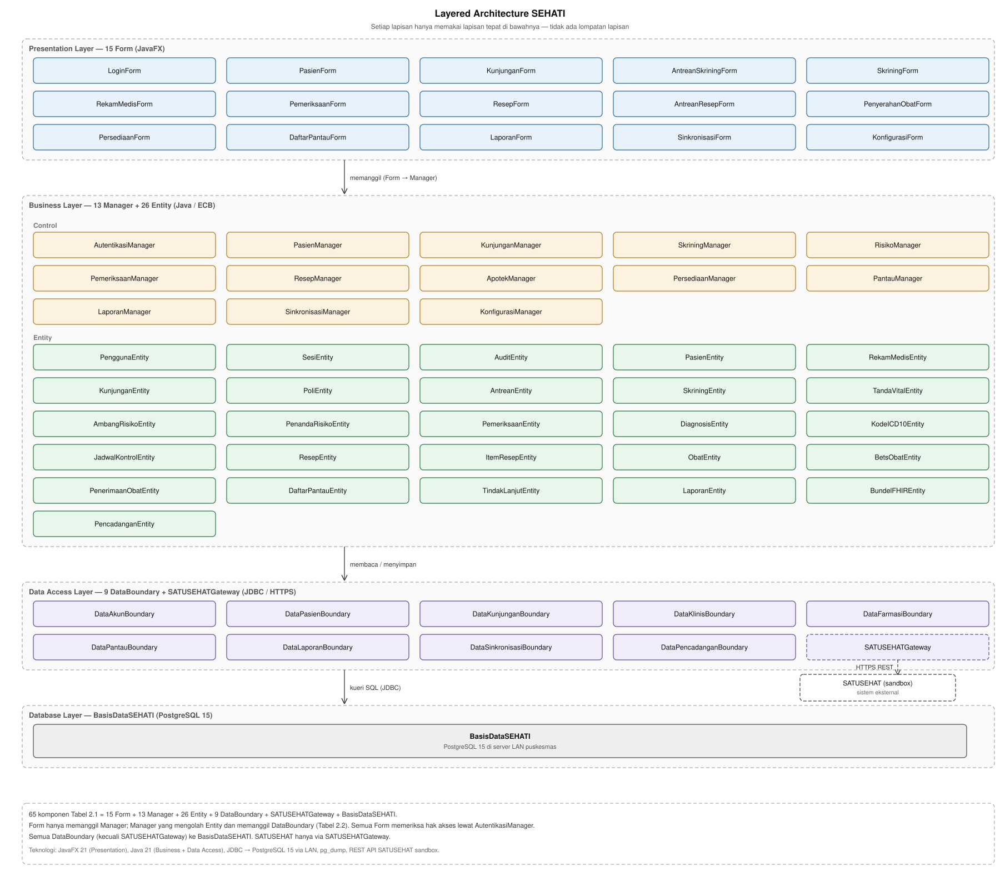

<i>Gambar 1. Penerapan Layered Architecture pada SEHATI</i>

## 2.3 Identifikasi Komponen / Modul / Subsistem

Komponen SEHATI dikelompokkan menurut lapisan pada Subbab 2.2. Seluruh 55 kelas SKPL tercakup: 15 boundary berakhiran `Form` di *Presentation Layer*, 13 control dan 26 entity di *Business Layer*, serta `SATUSEHATGateway` di *Data Access Layer*. Sepuluh komponen lain tidak berasal dari diagram kelas. Sembilan `DataBoundary` dan `BasisDataSEHATI` ditambahkan karena *Data Access Layer* dan *Database Layer* membutuhkan komponen tersendiri. Komponen tambahan ini tidak menambah fitur di luar SKPL; masing-masing hanya menyimpan dan membaca entity yang sudah ada.

Tabel 2.3. Identifikasi Komponen/Modul/Subsistem

| Nama Komponen/Modul/Subsistem | Jenis | Penjelasan |
| :--- | :--- | :--- |
| LoginForm | Presentation Layer | Menampilkan layar masuk, menerima nama pengguna dan kata sandi, lalu meneruskannya ke AutentikasiManager. |
| PasienForm | Presentation Layer | Menampilkan kolom pencarian dan formulir data pasien di loket, lalu meneruskan pencarian, pendaftaran, dan penyuntingan ke PasienManager. |
| KunjunganForm | Presentation Layer | Menampilkan pilihan poli dan tiket antrean, lalu meneruskan permintaan kunjungan ke KunjunganManager. |
| AntreanSkriningForm | Presentation Layer | Menampilkan antrean skrining terurut nomor antrean dan meneruskan perintah "Panggil Berikutnya" ke SkriningManager. |
| SkriningForm | Presentation Layer | Menampilkan formulir keluhan dan tanda vital, meneruskan isian ke SkriningManager, lalu meminta penanda risiko dari RisikoManager dan menampilkan peringatan rentang serta penanda risikonya. |
| RekamMedisForm | Presentation Layer | Menampilkan ringkasan rekam medis dan grafik tren tanda vital yang disusun PemeriksaanManager. |
| PemeriksaanForm | Presentation Layer | Menampilkan formulir anamnesis, diagnosis ICD-10, tindakan, dan jadwal kontrol, lalu meneruskan isiannya ke PemeriksaanManager. |
| ResepForm | Presentation Layer | Menampilkan formulir resep beserta indikator stok, lalu meneruskan item resep ke ResepManager. |
| AntreanResepForm | Presentation Layer | Menampilkan antrean resep apotek terurut waktu masuk dan meneruskan pilihan resep ke ApotekManager. |
| PenyerahanObatForm | Presentation Layer | Menampilkan rincian resep dan meneruskan konfirmasi "Obat Diserahkan" ke ApotekManager. |
| PersediaanForm | Presentation Layer | Menampilkan formulir obat masuk dan dasbor peringatan persediaan, lalu meneruskan penerimaan ke PersediaanManager. |
| DaftarPantauForm | Presentation Layer | Menampilkan daftar pantau beserta penyaringnya, meneruskan penyaring dan catatan tindak lanjut ke PantauManager, serta mengambil entri risiko aktif dari RisikoManager. |
| LaporanForm | Presentation Layer | Menampilkan pemilihan rentang tanggal dan pratinjau rekapitulasi, lalu meneruskan permintaan ekspor ke LaporanManager. |
| SinkronisasiForm | Presentation Layer | Menampilkan status setiap bundel dan indikator koneksi, lalu meneruskan perintah sinkronisasi atau "Ekspor Bundel" ke SinkronisasiManager. |
| KonfigurasiForm | Presentation Layer | Menampilkan manajemen akun, data master, dan status pencadangan, lalu meneruskan perubahan ke KonfigurasiManager. |
| AutentikasiManager | Business Layer | Memeriksa kredensial terhadap hash kata sandi, membuka dan mengakhiri sesi (termasuk batas diam 15 menit), serta memeriksa hak akses peran untuk setiap layar. |
| PasienManager | Business Layer | Menjalankan pencarian parsial, memvalidasi NIK 16 digit dan keunikannya, menerbitkan nomor rekam medis, dan memutakhirkan data pasien. |
| KunjunganManager | Business Layer | Membuka kunjungan, menolak kunjungan ganda, dan menerbitkan nomor antrean berurutan per poli per hari. |
| SkriningManager | Business Layer | Memanggil pasien terdepan, memvalidasi rentang fisiologis tanda vital tanpa jalan pintas, menyimpan hasil skrining, lalu meneruskannya ke RisikoManager. |
| RisikoManager | Business Layer | Membandingkan tanda vital terhadap ambang dan riwayat tiga kunjungan, menerbitkan penanda risiko, dan memasukkan pasien ke daftar pantau. |
| PemeriksaanManager | Business Layer | Menyusun ringkasan rekam medis dan seri tren, menyimpan pemeriksaan dan diagnosis ICD-10 khusus dokter, serta menjadwalkan kontrol. |
| ResepManager | Business Layer | Menyusun item resep, memeriksa kecukupan stok, dan meneruskan resep yang lolos ke antrean apotek. |
| ApotekManager | Business Layer | Melayani resep, lalu dalam satu transaksi memotong stok, menandai resep selesai, menutup kunjungan, dan menyusun bundel FHIR. |
| PersediaanManager | Business Layer | Mencatat obat masuk, menambah stok, dan menerbitkan peringatan stok di bawah ambang atau bets 90 hari menjelang kedaluwarsa. |
| PantauManager | Business Layer | Menyaring daftar pantau menurut jenis risiko, tanggal, dan status, lalu mencatat hasil tindak lanjut. |
| LaporanManager | Business Layer | Menghitung rekapitulasi kunjungan dan diagnosis terbanyak per rentang tanggal, lalu menghasilkan berkas PDF dan CSV. |
| SinkronisasiManager | Business Layer | Mengelola antrean bundel, memeriksa koneksi lewat SATUSEHATGateway, lalu mengirim bundel saat daring atau mengekspornya sebagai berkas saat luring. |
| KonfigurasiManager | Business Layer | Mengurus akun staf, data master obat, poli, dan ambang risiko, serta menjadwalkan pencadangan dan memantau hasilnya. |
| PenggunaEntity | Business Layer | Merepresentasikan akun staf beserta hash kata sandi, peran, dan status aktifnya. |
| SesiEntity | Business Layer | Merepresentasikan sesi kerja pengguna sejak masuk sampai keluar atau habis waktu. |
| AuditEntity | Business Layer | Merepresentasikan catatan jejak audit berisi pelaku, waktu, dan deskripsi perubahan. |
| PasienEntity | Business Layer | Merepresentasikan data diri pasien beserta NIK dan nomor rekam medisnya. |
| RekamMedisEntity | Business Layer | Merepresentasikan riwayat klinis pasien: diagnosis lampau, riwayat obat, dan penanda risiko aktif. |
| KunjunganEntity | Business Layer | Merepresentasikan satu kedatangan pasien ke poli beserta nomor antrean dan statusnya. |
| PoliEntity | Business Layer | Merepresentasikan data master poli beserta urutan antrean terakhir hari itu. |
| AntreanEntity | Business Layer | Merepresentasikan daftar urut pada titik layanan skrining, poli, atau apotek. |
| SkriningEntity | Business Layer | Merepresentasikan hasil skrining satu kunjungan beserta keluhan awalnya. |
| TandaVitalEntity | Business Layer | Merepresentasikan nilai tekanan darah, berat, tinggi, suhu, nadi, dan gula darah, termasuk perhitungan IMT. |
| AmbangRisikoEntity | Business Layer | Merepresentasikan data master ambang klinis tiap jenis risiko. |
| PenandaRisikoEntity | Business Layer | Merepresentasikan penanda risiko yang melekat pada kunjungan beserta jenisnya. |
| PemeriksaanEntity | Business Layer | Merepresentasikan anamnesis, tindakan, dan status kunci hasil pemeriksaan dokter. |
| DiagnosisEntity | Business Layer | Merepresentasikan diagnosis kunjungan dalam kode ICD-10. |
| KodeICD10Entity | Business Layer | Merepresentasikan data master kode ICD-10 yang dicari dokter saat mengisi diagnosis. |
| JadwalKontrolEntity | Business Layer | Merepresentasikan rencana kunjungan ulang pasien. |
| ResepEntity | Business Layer | Merepresentasikan resep elektronik satu kunjungan beserta status pelayanannya. |
| ItemResepEntity | Business Layer | Merepresentasikan satu obat pada resep beserta dosis, jumlah, dan aturan pakai. |
| ObatEntity | Business Layer | Merepresentasikan data master obat beserta saldo stok dan ambang minimumnya. |
| BetsObatEntity | Business Layer | Merepresentasikan satu bets obat beserta jumlah dan tanggal kedaluwarsanya. |
| PenerimaanObatEntity | Business Layer | Merepresentasikan catatan obat masuk beserta nomor faktur dan tanggal terimanya. |
| DaftarPantauEntity | Business Layer | Merepresentasikan entri pasien berisiko atau terjadwal kontrol beserta status tindak lanjutnya. |
| TindakLanjutEntity | Business Layer | Merepresentasikan satu upaya menghubungi pasien: jenis kontak, hasil, dan status kedatangan. |
| LaporanEntity | Business Layer | Merepresentasikan hasil rekapitulasi beserta rentang tanggal dan format berkasnya. |
| BundelFHIREntity | Business Layer | Merepresentasikan bundel HL7 FHIR R4 satu kunjungan beserta status pengirimannya. |
| PencadanganEntity | Business Layer | Merepresentasikan catatan satu pencadangan beserta waktu, status, dan lokasi medianya. |
| DataAkunBoundary | Data Access Layer | Membaca dan menyimpan PenggunaEntity, SesiEntity, dan AuditEntity. Catatan audit hanya dapat ditambah, tidak dapat diubah atau dihapus. |
| DataPasienBoundary | Data Access Layer | Menjalankan pencarian parsial berindeks serta membaca dan menyimpan PasienEntity dan RekamMedisEntity. |
| DataKunjunganBoundary | Data Access Layer | Membaca dan menyimpan KunjunganEntity, PoliEntity, dan AntreanEntity, serta mengunci baris urutan poli saat nomor antrean diterbitkan. |
| DataKlinisBoundary | Data Access Layer | Membaca dan menyimpan SkriningEntity, TandaVitalEntity, AmbangRisikoEntity, PenandaRisikoEntity, PemeriksaanEntity, DiagnosisEntity, KodeICD10Entity, dan JadwalKontrolEntity. |
| DataFarmasiBoundary | Data Access Layer | Membaca dan menyimpan ResepEntity, ItemResepEntity, ObatEntity, BetsObatEntity, dan PenerimaanObatEntity, serta mengunci baris stok saat pemotongan agar tidak terjadi *lost update*. |
| DataPantauBoundary | Data Access Layer | Membaca dan menyimpan DaftarPantauEntity dan TindakLanjutEntity beserta kueri penyaringnya. |
| DataLaporanBoundary | Data Access Layer | Menjalankan kueri agregasi kunjungan dan diagnosis, menyimpan LaporanEntity, dan menulis berkas PDF dan CSV ke penyimpanan lokal. |
| DataSinkronisasiBoundary | Data Access Layer | Membaca dan menyimpan BundelFHIREntity dengan isi bundel pada kolom JSONB, serta menulis berkas ekspor bundel saat luring. |
| DataPencadanganBoundary | Data Access Layer | Menjalankan `pg_dump` sesuai jadwal ke media penyimpanan terpisah dan menyimpan PencadanganEntity. |
| SATUSEHATGateway | Data Access Layer | Memeriksa koneksi internet dan mengirim bundel ke REST API *sandbox* SATUSEHAT, lalu mengembalikan status pengiriman ke SinkronisasiManager. |
| BasisDataSEHATI | Database Layer | Basis data PostgreSQL 15 di server LAN puskesmas yang menyimpan seluruh tabel data pelayanan secara persisten dan menangani transaksi serta penguncian baris. |

Tabel 2.4 menelusuri setiap *use case* SKPL ke komponen yang menjalankannya pada tiap lapisan. Seluruh dua belas *use case* tercakup.

Tabel 2.4. Pemetaan Use Case ke Komponen

| ID UC | Presentation Layer | Business Layer (Control) | Data Access Layer |
| :--- | :--- | :--- | :--- |
| UC01 | LoginForm | AutentikasiManager | DataAkunBoundary |
| UC02 | PasienForm | PasienManager | DataPasienBoundary, DataAkunBoundary |
| UC03 | KunjunganForm | KunjunganManager | DataKunjunganBoundary, DataPasienBoundary, DataAkunBoundary |
| UC04 | AntreanSkriningForm, SkriningForm | SkriningManager, RisikoManager | DataKunjunganBoundary, DataKlinisBoundary, DataPantauBoundary |
| UC05 | RekamMedisForm, PemeriksaanForm | PemeriksaanManager | DataPasienBoundary, DataKlinisBoundary, DataKunjunganBoundary, DataAkunBoundary |
| UC06 | ResepForm | ResepManager | DataFarmasiBoundary, DataKunjunganBoundary |
| UC07 | AntreanResepForm, PenyerahanObatForm | ApotekManager | DataFarmasiBoundary, DataKunjunganBoundary, DataSinkronisasiBoundary |
| UC08 | PersediaanForm | PersediaanManager | DataFarmasiBoundary, DataAkunBoundary |
| UC09 | DaftarPantauForm | PantauManager, RisikoManager | DataPantauBoundary, DataPasienBoundary, DataKlinisBoundary |
| UC10 | LaporanForm | LaporanManager | DataLaporanBoundary |
| UC11 | SinkronisasiForm | SinkronisasiManager | DataSinkronisasiBoundary, SATUSEHATGateway |
| UC12 | KonfigurasiForm | KonfigurasiManager | DataAkunBoundary, DataKunjunganBoundary, DataKlinisBoundary, DataFarmasiBoundary, DataPencadanganBoundary |

Seluruh `Form` juga memanggil AutentikasiManager untuk memeriksa hak akses peran sebelum layar dibuka (KF16), dan seluruh komponen *Data Access Layer* kecuali SATUSEHATGateway membaca dan menulis BasisDataSEHATI.

## 2.4 Model Arsitektur Perangkat Lunak

Arsitektur SEHATI digambarkan lewat dua *view* dari model 4+1 Kruchten yang sudah ditetapkan pada BAB 3 APL. *Logical View* memperlihatkan pembagian fungsi dan relasi antarkomponen, sedangkan *Physical View* memperlihatkan di komputer mana komponen dijalankan. Kedua *view* memakai nama komponen yang sama dengan Tabel 2.3.

### 2.4.1 Logical View

*Logical View* menggambarkan SEHATI sebagai kumpulan komponen fungsional beserta layanan yang saling dipakai antarkomponen untuk memenuhi kebutuhan fungsional. *View* ini tidak membahas di komputer mana komponen dijalankan. Yang diperlihatkan adalah lapisan tempat setiap komponen berada, komponen yang dipanggilnya, dan data domain yang diolahnya.

Kami memilih *Logical View* karena 12 *use case* dan 24 KF SEHATI tersebar ke 65 komponen. Pembaca perlu melihat `Form` mana memanggil `Manager` mana, serta `DataBoundary` mana yang dipakai tiap `Manager` untuk membaca dan menyimpan data. Tabel 2.4 sudah mencatat pemetaan itu per *use case*, tetapi baru dalam *view* ini terlihat bahwa seluruh relasi mematuhi aturan antarlapisan pada Subbab 2.2: semua panah antarlapisan mengarah ke bawah, tidak ada `Form` yang melompat ke *Data Access Layer*, dan SATUSEHAT hanya tersentuh lewat `SATUSEHATGateway`.

<i>Gambar 2. Logical View SEHATI</i>

Gambar 2 berbentuk *block diagram* yang memuat seluruh komponen Tabel 2.3, dikelompokkan ke empat lapisan Subbab 2.2. *Business Layer* dibagi lagi menjadi sub-kelompok *Control* dan *Entity*. Panah putus-putus berlabel "memanggil" menghubungkan tiap `Form` ke `Manager`-nya, dan satu panah dari seluruh *Presentation Layer* ke `AutentikasiManager` menandai pemeriksaan hak akses sebelum layar dibuka (KF16). Dua relasi antar-`Manager` diambil dari diagram kelas SKPL: `SkriningManager` meneruskan hasil skrining ke `RisikoManager`, dan `PantauManager` memuat entri risiko dan jadwal kontrol dari `RisikoManager`. Panah "membuat dan mengolah" dari *Control* ke *Entity* menandai bahwa objek domain hanya dibuat dan diubah oleh `Manager`. Garis dari tiap `Manager` turun ke jalurnya sendiri, lalu bercabang ke `DataBoundary` yang dipakainya sesuai Tabel 2.4. Titik hitam menandai percabangan, sedangkan garis yang bersilangan tanpa titik tidak saling terhubung. Relasi antar-*entity* (komposisi, agregasi, dan asosiasi) disalin dari diagram kelas keseluruhan SKPL. Di lapisan bawah, setiap `DataBoundary` menjalankan kueri SQL lewat JDBC ke `BasisDataSEHATI`. `DataPencadanganBoundary` menjalankan `pg_dump`, dan `SATUSEHATGateway` mengirim bundel lewat HTTPS ke SATUSEHAT (*sandbox*), sistem luar yang digambar dengan garis putus-putus.

### 2.4.2 Physical View

*Physical View* menggambarkan pemetaan komponen P/L ke *node* perangkat keras tempat komponen itu dijalankan, beserta jalur komunikasi antar-*node*. Bila *Logical View* menjawab komponen mana memanggil komponen mana, *Physical View* menjawab komponen itu terpasang di komputer mana, berjalan di atas lingkungan eksekusi apa, dan lewat jaringan apa datanya berpindah.

Kami memilih *Physical View* karena sebagian besar KNF SEHATI adalah kebutuhan tentang penempatan, bukan tentang fungsi. SEHATI dipasang di beberapa komputer sekaligus (loket, ruang periksa, dan apotek) yang berbagi satu basis data di LAN puskesmas, dan KNF11 menuntut sistem tetap benar saat sedikitnya lima perangkat bekerja bersamaan. Pelayanan juga harus berjalan penuh tanpa internet (KF22, KNF09), sedangkan internet hanya dipakai untuk sinkronisasi ke SATUSEHAT (KF20), dan pencadangan harus disimpan ke media terpisah (KF21). Hal-hal ini hanya terlihat jelas bila komponen digambar di atas komputer tempat ia berjalan. *View* ini juga menjadi bentuk visual Tabel 2.1, karena setiap baris tabel itu (aplikasi, DBMS, sistem operasi, perangkat keras, jaringan, dan pencadangan) muncul sebagai *node*, lingkungan eksekusi, atau jalur komunikasi.

<i>Gambar 3. Physical View SEHATI</i>

Gambar 3 berbentuk *deployment diagram* UML. Ada tiga jenis «device» client, yaitu Komputer Loket, Komputer Ruang Periksa, dan Komputer Apotek, masing-masing dengan spesifikasi minimum KNF10. Komputer Ruang Periksa diberi multiplisitas `1..*` karena tiap ruang poli memiliki komputernya sendiri. Setiap client menjalankan lingkungan eksekusi Java 21 LTS dan JavaFX 21 yang berisi dua *artifact*. `sehati-ui.jar` memuat seluruh `Form`, tetapi yang dapat dibuka di tiap komputer hanya `Form` milik peran penggunanya (KF16), sehingga gambar menuliskan `Form` yang aktif per *node*. `sehati-core.jar` memuat *Business Layer* dan *Data Access Layer* dan isinya sama di setiap client. Rincian isi `sehati-core.jar` dituliskan sekali pada panel bawah agar seluruh 65 komponen Tabel 2.3 tetap tercakup tanpa ditulis berulang.

Seluruh client terhubung ke «device» Server Basis Data lewat jalur berlabel "LAN · JDBC / TCP 5432". Server menjalankan PostgreSQL 15 yang berisi `BasisDataSEHATI`, dan transaksi serta penguncian barisnya menjaga nomor antrean dan stok obat saat beberapa client menulis bersamaan (KF23, KNF11). Hanya Komputer Loket yang memiliki jalur keluar ke internet. Jalur "Internet · HTTPS REST" dipakai `SATUSEHATGateway` saat Petugas Administrasi menjalankan sinkronisasi, dan SATUSEHAT (*sandbox*) digambar dengan garis putus-putus karena berada di luar puskesmas. Bila jalur ini putus, hanya sinkronisasi yang tertunda, sedangkan jalur LAN yang dipakai pelayanan tetap berjalan (KNF09). Komputer Loket juga menyimpan berkas laporan PDF/CSV dan berkas ekspor bundel di penyimpanan lokal, serta menjalankan `pg_dump` lewat `DataPencadanganBoundary`. Hasil *dump* ditulis ke «device» Media Cadangan berupa HDD eksternal yang terhubung lewat USB, terpisah dari server basis data (KF21). `pg_dump` sengaja ditaruh di Komputer Loket, bukan di server. Pencadangan dijadwalkan dan dipantau Petugas Administrasi lewat `KonfigurasiForm` (UC12), dan `DataPencadanganBoundary` yang memanggilnya ikut terpasang di `sehati-core.jar` pada client. `pg_dump` cukup tersambung ke PostgreSQL lewat jalur TCP 5432 yang sudah ada, sehingga server tidak perlu menjalankan komponen SEHATI apa pun selain basis data. Dengan begitu, salinan cadangan juga tersimpan di komputer yang berbeda dari server, jadi kalau server rusak, cadangannya tidak ikut hilang.

 

---

# BAB 3: Realisasi Use Case

Setiap *use case* direalisasikan dengan pola yang sama mengikuti Subbab 2.2: aktor berinteraksi dengan `Form`, `Form` memanggil `Manager`, `Manager` membaca dan menyimpan data lewat `DataBoundary`, lalu `DataBoundary` menjalankan kueri JDBC ke PostgreSQL. Objek `Entity` hanya dibuat dan diubah oleh `Manager`. Pada *sequence diagram*, panah utuh adalah pemanggilan metode, panah putus-putus adalah nilai kembalian, dan pesan «create» menandai pembuatan objek baru. Nomor urut pesan dicantumkan pada setiap panah. Setiap pesan yang menuju kelas SEHATI adalah metode yang tercantum pada diagram kelas *use case* tersebut dan pada Tabel 4.1.

Kami menggambar setiap *lifeline* dengan ikon UML sesuai stereotipnya: `Form`, `DataBoundary`, dan `SATUSEHATGateway` sebagai *boundary*, `Manager` sebagai *control*, dan kelas berakhiran `Entity` sebagai *entity*. Fragmen `loop` menandai langkah berulang, `par` menandai dua petugas yang bekerja bersamaan, dan `critical` menandai langkah yang harus selesai dalam satu transaksi. Diagram kelas tiap *use case* hanya memuat atribut dan metode yang dipakai *use case* itu, sedangkan Tabel 4.1 memuat daftar lengkapnya.

## 3.1 Use Case Masuk ke Aplikasi

**ID Use Case:** UC01  
**Nama Use Case:** Masuk ke Aplikasi

### 3.1.1 Identifikasi Kelas

Tabel 3.1. Identifikasi Kelas Use Case UC01

| No | Nama Kelas Perancangan | Nama Kelas Analisis Terkait |
| :--- | :--- | :--- |
| 1 | C01 LoginForm | C01 LoginForm |
| 2 | C17 AutentikasiManager | C17 AutentikasiManager |
| 3 | C56 DataAkunBoundary | Tidak ada (kelas baru perancangan, komponen *Data Access Layer* pada APL) |
| 4 | C30 PenggunaEntity | C30 PenggunaEntity |
| 5 | C31 SesiEntity | C31 SesiEntity |
| 6 | C32 AuditEntity | C32 AuditEntity |

### 3.1.2 Sequence Diagram

- **Skenario Normal**

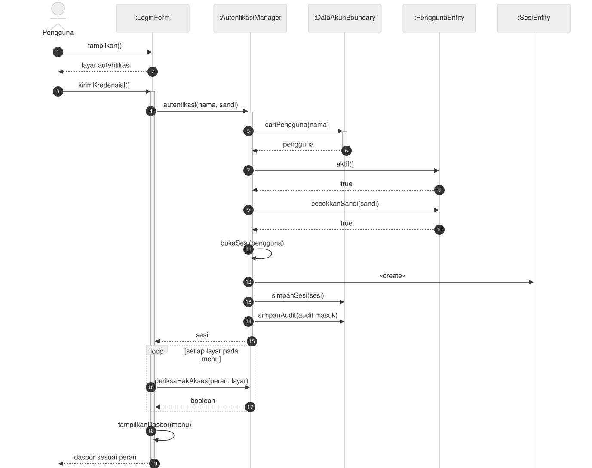

<i>Gambar 4. Sequence Diagram UC01 - Skenario Normal</i>

- **Skenario Alternatif 1: Kredensial Tidak Cocok**

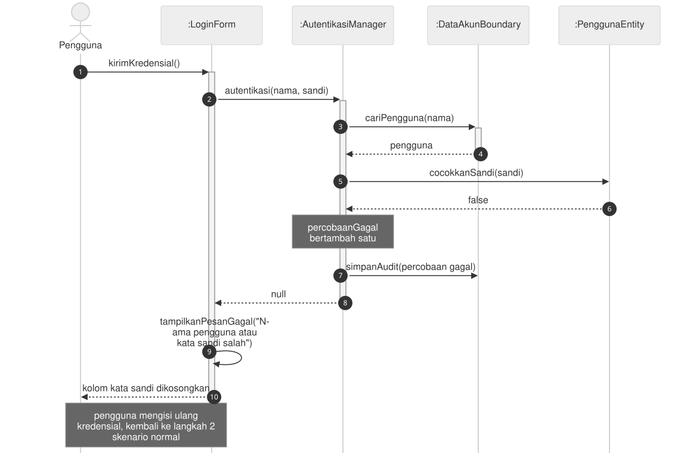

<i>Gambar 5. Sequence Diagram UC01 - Skenario Alternatif 1: Kredensial Tidak Cocok</i>

- **Skenario Alternatif 2: Akun Berstatus Nonaktif**

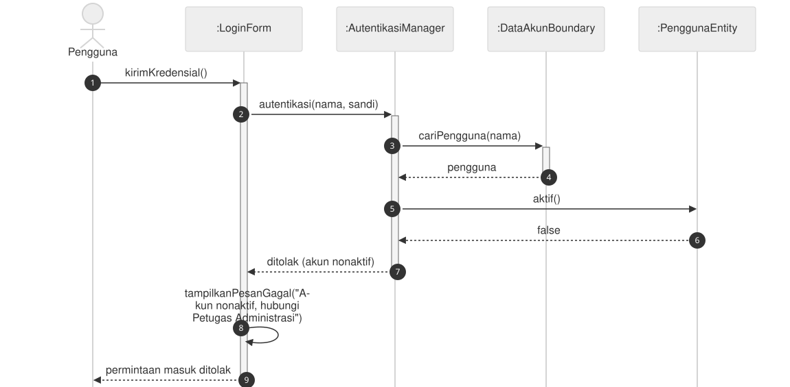

<i>Gambar 6. Sequence Diagram UC01 - Skenario Alternatif 2: Akun Berstatus Nonaktif</i>

- **Skenario Alternatif 3: Pengguna Membuka Modul di Luar Hak Aksesnya**

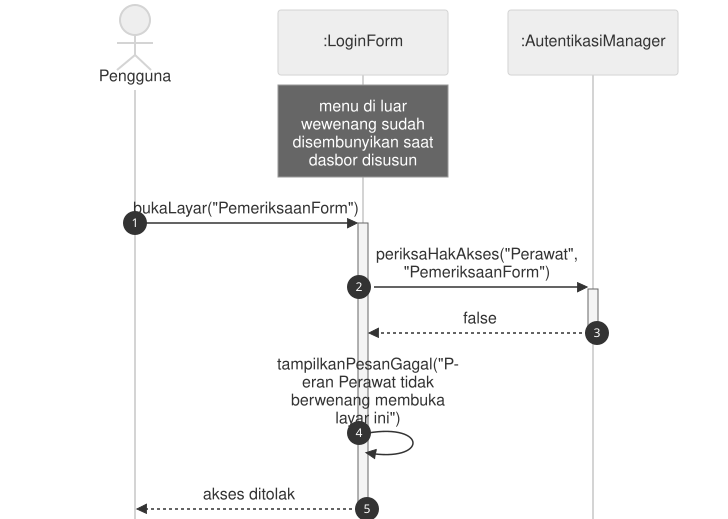

<i>Gambar 7. Sequence Diagram UC01 - Skenario Alternatif 3: Pengguna Membuka Modul di Luar Hak Aksesnya</i>

### 3.1.3 Diagram Kelas

<i>Gambar 8. Diagram Kelas Masuk ke Aplikasi (UC01)</i>

## 3.2 Use Case Mengelola Data Pasien

**ID Use Case:** UC02  
**Nama Use Case:** Mengelola Data Pasien

### 3.2.1 Identifikasi Kelas

Tabel 3.2. Identifikasi Kelas Use Case UC02

| No | Nama Kelas Perancangan | Nama Kelas Analisis Terkait |
| :--- | :--- | :--- |
| 1 | C02 PasienForm | C02 PasienForm |
| 2 | C18 PasienManager | C18 PasienManager |
| 3 | C56 DataAkunBoundary | Tidak ada (kelas baru perancangan, komponen *Data Access Layer* pada APL) |
| 4 | C57 DataPasienBoundary | Tidak ada (kelas baru perancangan, komponen *Data Access Layer* pada APL) |
| 5 | C32 AuditEntity | C32 AuditEntity |
| 6 | C33 PasienEntity | C33 PasienEntity |
| 7 | C34 RekamMedisEntity | C34 RekamMedisEntity |

### 3.2.2 Sequence Diagram

- **Skenario Normal (Pendaftaran Pasien Baru)**

<i>Gambar 9. Sequence Diagram UC02 - Skenario Normal (Pendaftaran Pasien Baru)</i>

- **Skenario Alternatif 1: Memutakhirkan Data Pasien Lama**

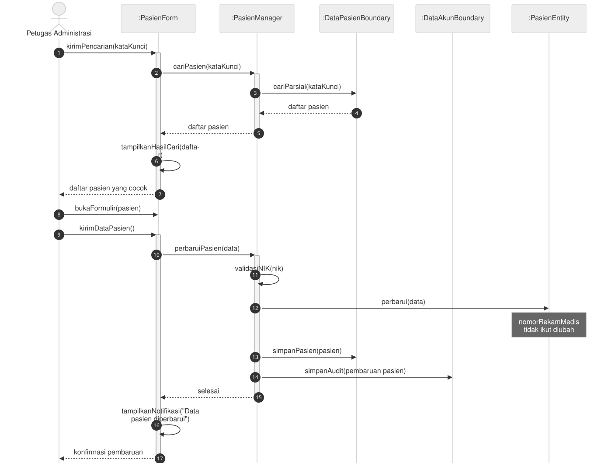

<i>Gambar 10. Sequence Diagram UC02 - Skenario Alternatif 1: Memutakhirkan Data Pasien Lama</i>

- **Skenario Alternatif 2: NIK Tidak Valid atau Sudah Dipakai Pasien Lain**

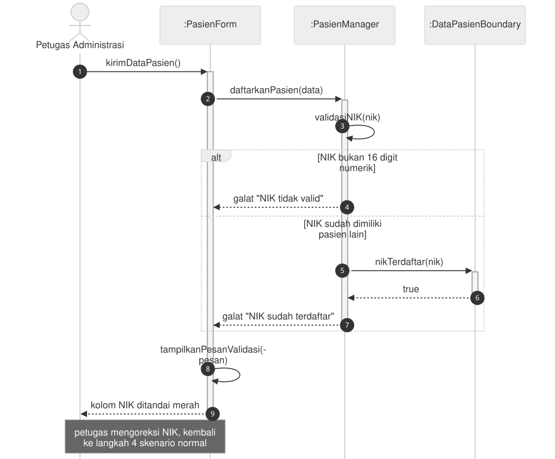

<i>Gambar 11. Sequence Diagram UC02 - Skenario Alternatif 2: NIK Tidak Valid atau Sudah Dipakai Pasien Lain</i>

### 3.2.3 Diagram Kelas


<i>Gambar 12. Diagram Kelas Mengelola Data Pasien (UC02)</i>

## 3.3 Use Case Mengelola Kunjungan Pasien

**ID Use Case:** UC03  
**Nama Use Case:** Mengelola Kunjungan Pasien

### 3.3.1 Identifikasi Kelas

Tabel 3.3. Identifikasi Kelas Use Case UC03

| No | Nama Kelas Perancangan | Nama Kelas Analisis Terkait |
| :--- | :--- | :--- |
| 1 | C03 KunjunganForm | C03 KunjunganForm |
| 2 | C19 KunjunganManager | C19 KunjunganManager |
| 3 | C56 DataAkunBoundary | Tidak ada (kelas baru perancangan, komponen *Data Access Layer* pada APL) |
| 4 | C57 DataPasienBoundary | Tidak ada (kelas baru perancangan, komponen *Data Access Layer* pada APL) |
| 5 | C58 DataKunjunganBoundary | Tidak ada (kelas baru perancangan, komponen *Data Access Layer* pada APL) |
| 6 | C32 AuditEntity | C32 AuditEntity |
| 7 | C33 PasienEntity | C33 PasienEntity |
| 8 | C35 KunjunganEntity | C35 KunjunganEntity |
| 9 | C36 PoliEntity | C36 PoliEntity |
| 10 | C37 AntreanEntity | C37 AntreanEntity |

### 3.3.2 Sequence Diagram

- **Skenario Normal**

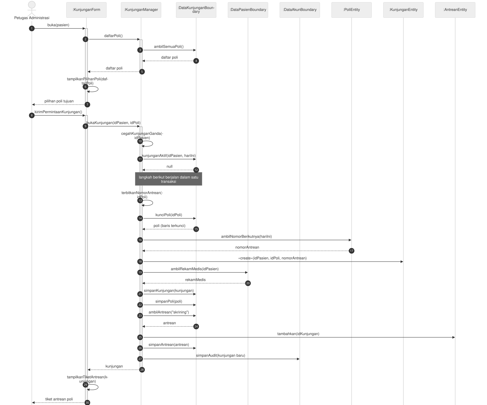

<i>Gambar 13. Sequence Diagram UC03 - Skenario Normal</i>

- **Skenario Alternatif 1: Pasien Masih Punya Kunjungan Aktif Hari Itu**

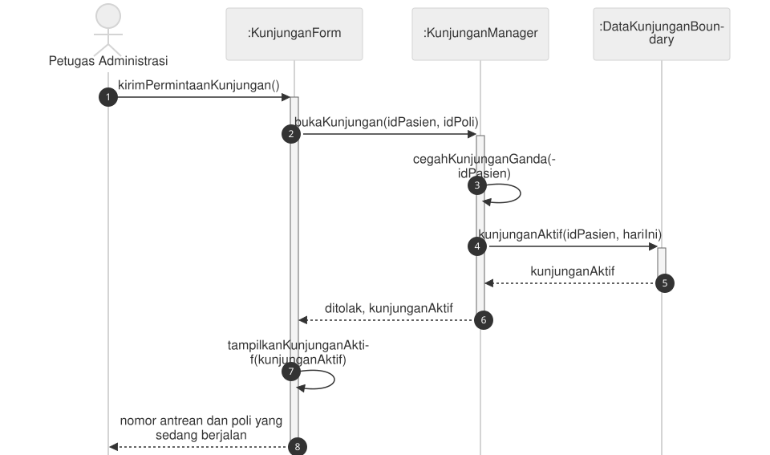

<i>Gambar 14. Sequence Diagram UC03 - Skenario Alternatif 1: Pasien Masih Punya Kunjungan Aktif Hari Itu</i>

- **Skenario Alternatif 2: Dua Petugas Membuka Kunjungan pada Poli yang Sama secara Bersamaan**

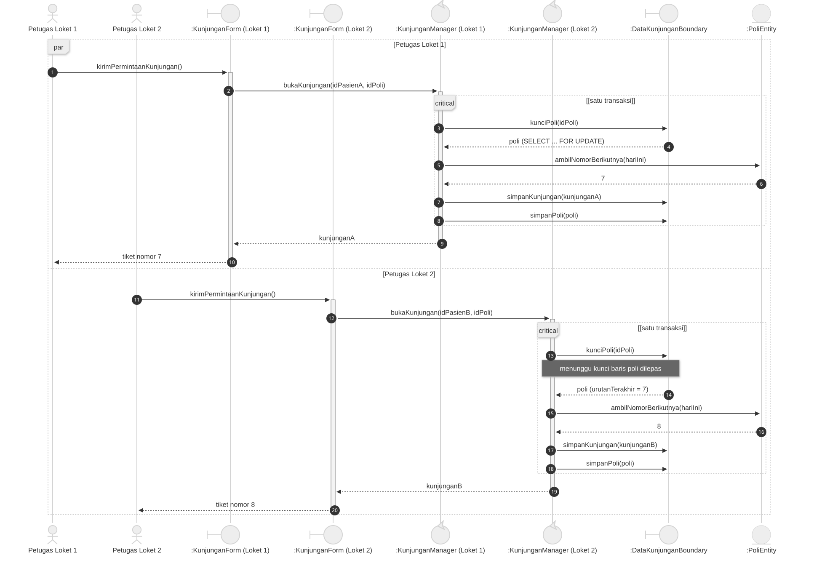

<i>Gambar 15. Sequence Diagram UC03 - Skenario Alternatif 2: Dua Petugas Membuka Kunjungan pada Poli yang Sama secara Bersamaan</i>

- **Skenario Alternatif 3: Hari Pelayanan Berganti**

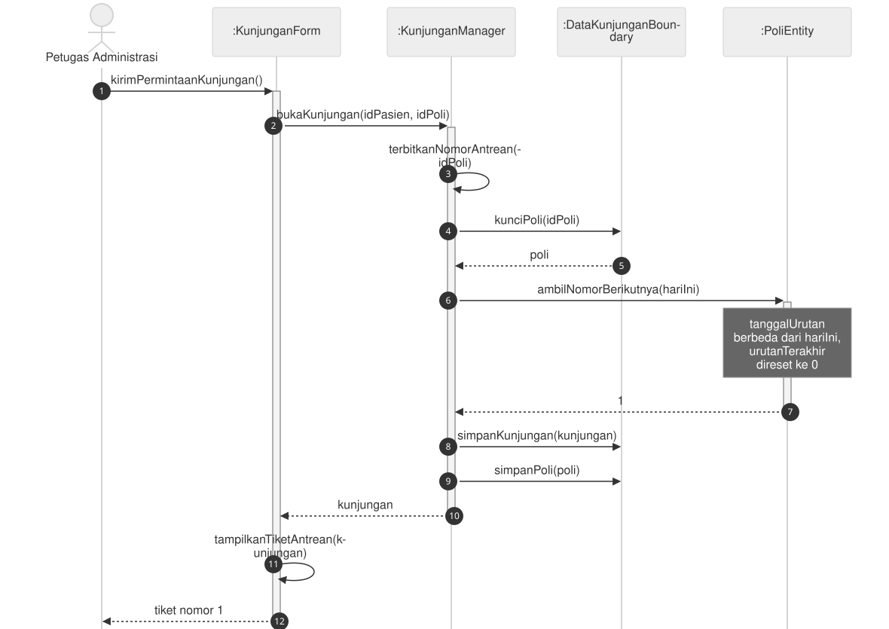

<i>Gambar 16. Sequence Diagram UC03 - Skenario Alternatif 3: Hari Pelayanan Berganti</i>

### 3.3.3 Diagram Kelas


<i>Gambar 17. Diagram Kelas Mengelola Kunjungan Pasien (UC03)</i>

## 3.4 Use Case Melakukan Skrining Awal

**ID Use Case:** UC04  
**Nama Use Case:** Melakukan Skrining Awal

### 3.4.1 Identifikasi Kelas

Tabel 3.4. Identifikasi Kelas Use Case UC04

| No | Nama Kelas Perancangan | Nama Kelas Analisis Terkait |
| :--- | :--- | :--- |
| 1 | C04 AntreanSkriningForm | C04 AntreanSkriningForm |
| 2 | C05 SkriningForm | C05 SkriningForm |
| 3 | C20 SkriningManager | C20 SkriningManager |
| 4 | C21 RisikoManager | C21 RisikoManager |
| 5 | C58 DataKunjunganBoundary | Tidak ada (kelas baru perancangan, komponen *Data Access Layer* pada APL) |
| 6 | C59 DataKlinisBoundary | Tidak ada (kelas baru perancangan, komponen *Data Access Layer* pada APL) |
| 7 | C60 DataPantauBoundary | Tidak ada (kelas baru perancangan, komponen *Data Access Layer* pada APL) |
| 8 | C35 KunjunganEntity | C35 KunjunganEntity |
| 9 | C37 AntreanEntity | C37 AntreanEntity |
| 10 | C38 SkriningEntity | C38 SkriningEntity |
| 11 | C39 TandaVitalEntity | C39 TandaVitalEntity |
| 12 | C40 AmbangRisikoEntity | C40 AmbangRisikoEntity |
| 13 | C41 PenandaRisikoEntity | C41 PenandaRisikoEntity |
| 14 | C51 DaftarPantauEntity | C51 DaftarPantauEntity |

### 3.4.2 Sequence Diagram

- **Skenario Normal**

<i>Gambar 18. Sequence Diagram UC04 - Skenario Normal</i>

- **Skenario Alternatif 1: Pasien Tidak Hadir saat Dipanggil**

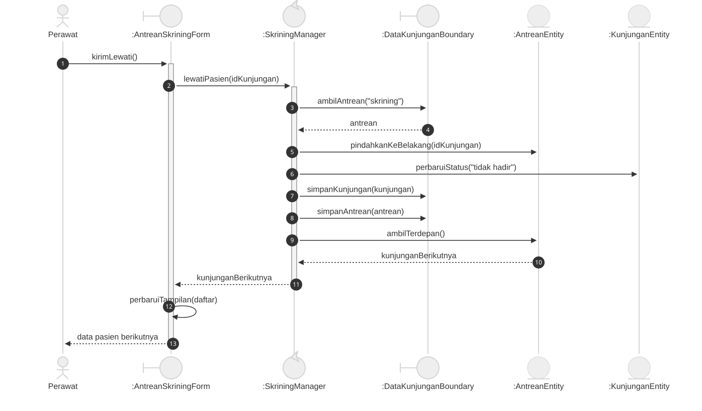

<i>Gambar 19. Sequence Diagram UC04 - Skenario Alternatif 1: Pasien Tidak Hadir saat Dipanggil</i>

- **Skenario Alternatif 2: Nilai Pengukuran di Luar Rentang Fisiologis Wajar**

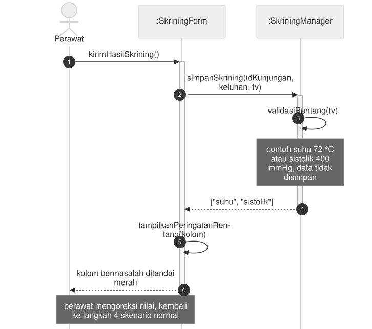

<i>Gambar 20. Sequence Diagram UC04 - Skenario Alternatif 2: Nilai Pengukuran di Luar Rentang Fisiologis Wajar</i>

- **Skenario Alternatif 3: Hasil Pengukuran Melampaui Ambang Risiko**

<i>Gambar 21. Sequence Diagram UC04 - Skenario Alternatif 3: Hasil Pengukuran Melampaui Ambang Risiko</i>

### 3.4.3 Diagram Kelas

<i>Gambar 22. Diagram Kelas Melakukan Skrining Awal (UC04)</i>

## 3.5 Use Case Melakukan Pemeriksaan Medis

**ID Use Case:** UC05  
**Nama Use Case:** Melakukan Pemeriksaan Medis

### 3.5.1 Identifikasi Kelas

Tabel 3.5. Identifikasi Kelas Use Case UC05

| No | Nama Kelas Perancangan | Nama Kelas Analisis Terkait |
| :--- | :--- | :--- |
| 1 | C06 RekamMedisForm | C06 RekamMedisForm |
| 2 | C07 PemeriksaanForm | C07 PemeriksaanForm |
| 3 | C17 AutentikasiManager | C17 AutentikasiManager |
| 4 | C22 PemeriksaanManager | C22 PemeriksaanManager |
| 5 | C56 DataAkunBoundary | Tidak ada (kelas baru perancangan, komponen *Data Access Layer* pada APL) |
| 6 | C57 DataPasienBoundary | Tidak ada (kelas baru perancangan, komponen *Data Access Layer* pada APL) |
| 7 | C58 DataKunjunganBoundary | Tidak ada (kelas baru perancangan, komponen *Data Access Layer* pada APL) |
| 8 | C59 DataKlinisBoundary | Tidak ada (kelas baru perancangan, komponen *Data Access Layer* pada APL) |
| 9 | C32 AuditEntity | C32 AuditEntity |
| 10 | C34 RekamMedisEntity | C34 RekamMedisEntity |
| 11 | C35 KunjunganEntity | C35 KunjunganEntity |
| 12 | C39 TandaVitalEntity | C39 TandaVitalEntity |
| 13 | C42 PemeriksaanEntity | C42 PemeriksaanEntity |
| 14 | C43 DiagnosisEntity | C43 DiagnosisEntity |
| 15 | C44 KodeICD10Entity | C44 KodeICD10Entity |
| 16 | C45 JadwalKontrolEntity | C45 JadwalKontrolEntity |

### 3.5.2 Sequence Diagram

- **Skenario Normal**

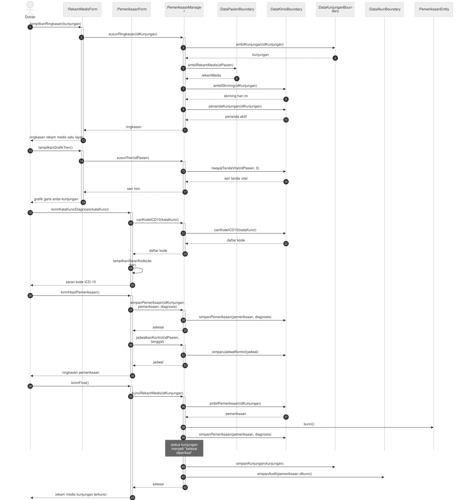

<i>Gambar 23. Sequence Diagram UC05 - Skenario Normal</i>

- **Skenario Alternatif 1: Pengguna yang Membuka Layar Bukan Berstatus Dokter**

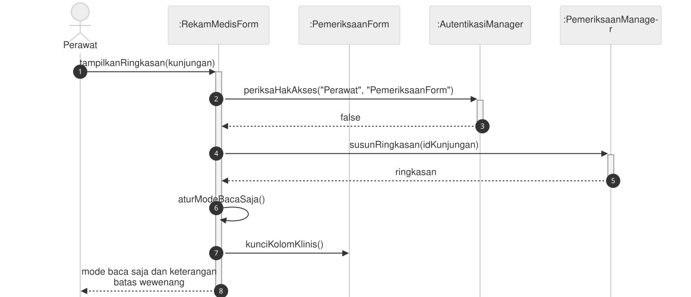

<i>Gambar 24. Sequence Diagram UC05 - Skenario Alternatif 1: Pengguna yang Membuka Layar Bukan Berstatus Dokter</i>

- **Skenario Alternatif 2: Kode Diagnosis ICD-10 Tidak Ditemukan**

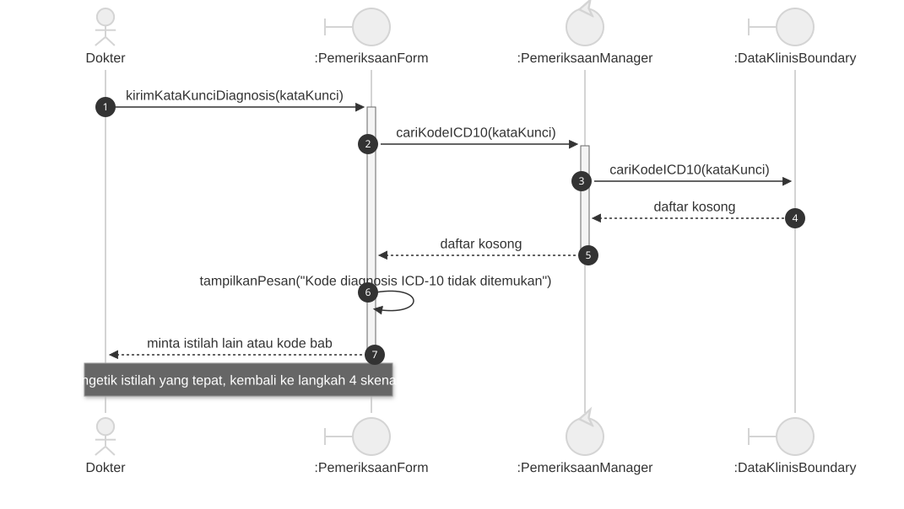

<i>Gambar 25. Sequence Diagram UC05 - Skenario Alternatif 2: Kode Diagnosis ICD-10 Tidak Ditemukan</i>

- **Skenario Alternatif 3: Pemeriksaan Berlangsung saat Koneksi Internet Terputus**

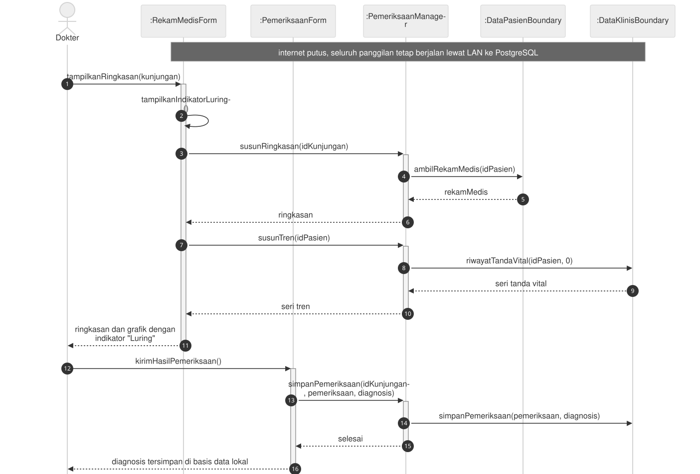

<i>Gambar 26. Sequence Diagram UC05 - Skenario Alternatif 3: Pemeriksaan Berlangsung saat Koneksi Internet Terputus</i>

- **Skenario Alternatif 4: Pasien Baru Pertama Kali Berkunjung**

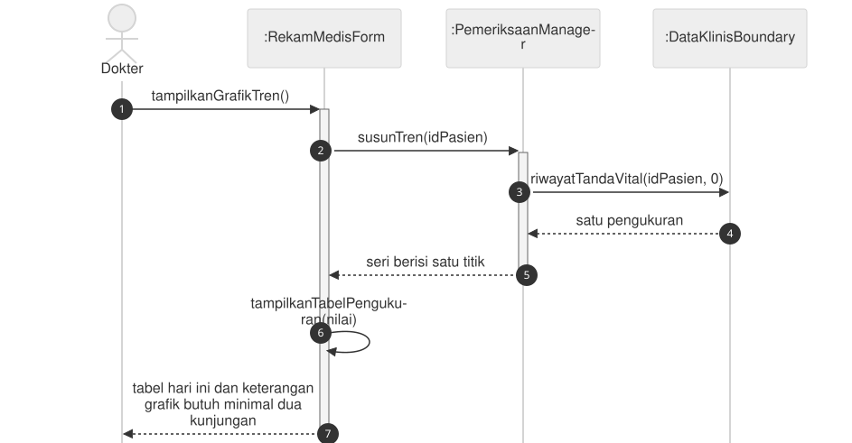

<i>Gambar 27. Sequence Diagram UC05 - Skenario Alternatif 4: Pasien Baru Pertama Kali Berkunjung</i>

### 3.5.3 Diagram Kelas


<i>Gambar 28. Diagram Kelas Melakukan Pemeriksaan Medis (UC05)</i>

## 3.6 Use Case Menyusun Resep Elektronik

**ID Use Case:** UC06  
**Nama Use Case:** Menyusun Resep Elektronik

### 3.6.1 Identifikasi Kelas

Tabel 3.6. Identifikasi Kelas Use Case UC06

| No | Nama Kelas Perancangan | Nama Kelas Analisis Terkait |
| :--- | :--- | :--- |
| 1 | C08 ResepForm | C08 ResepForm |
| 2 | C23 ResepManager | C23 ResepManager |
| 3 | C58 DataKunjunganBoundary | Tidak ada (kelas baru perancangan, komponen *Data Access Layer* pada APL) |
| 4 | C61 DataFarmasiBoundary | Tidak ada (kelas baru perancangan, komponen *Data Access Layer* pada APL) |
| 5 | C37 AntreanEntity | C37 AntreanEntity |
| 6 | C42 PemeriksaanEntity | C42 PemeriksaanEntity |
| 7 | C46 ResepEntity | C46 ResepEntity |
| 8 | C47 ItemResepEntity | C47 ItemResepEntity |
| 9 | C48 ObatEntity | C48 ObatEntity |

### 3.6.2 Sequence Diagram

- **Skenario Normal**

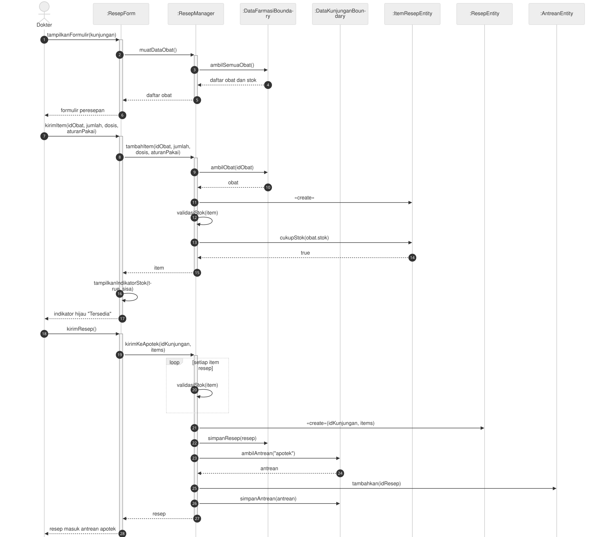

<i>Gambar 29. Sequence Diagram UC06 - Skenario Normal</i>

- **Skenario Alternatif 1: Jumlah Obat yang Diresepkan Melampaui Stok**

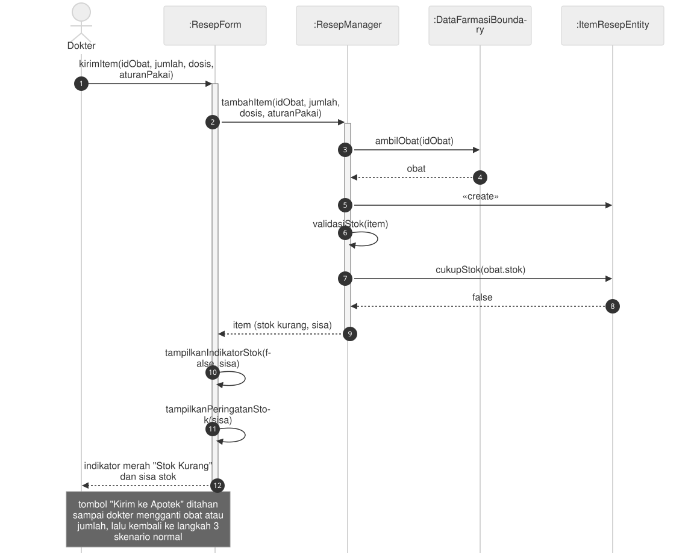

<i>Gambar 30. Sequence Diagram UC06 - Skenario Alternatif 1: Jumlah Obat yang Diresepkan Melampaui Stok</i>

### 3.6.3 Diagram Kelas


<i>Gambar 31. Diagram Kelas Menyusun Resep Elektronik (UC06)</i>

## 3.7 Use Case Melayani Resep Obat

**ID Use Case:** UC07  
**Nama Use Case:** Melayani Resep Obat

### 3.7.1 Identifikasi Kelas

Tabel 3.7. Identifikasi Kelas Use Case UC07

| No | Nama Kelas Perancangan | Nama Kelas Analisis Terkait |
| :--- | :--- | :--- |
| 1 | C09 AntreanResepForm | C09 AntreanResepForm |
| 2 | C10 PenyerahanObatForm | C10 PenyerahanObatForm |
| 3 | C24 ApotekManager | C24 ApotekManager |
| 4 | C58 DataKunjunganBoundary | Tidak ada (kelas baru perancangan, komponen *Data Access Layer* pada APL) |
| 5 | C61 DataFarmasiBoundary | Tidak ada (kelas baru perancangan, komponen *Data Access Layer* pada APL) |
| 6 | C63 DataSinkronisasiBoundary | Tidak ada (kelas baru perancangan, komponen *Data Access Layer* pada APL) |
| 7 | C35 KunjunganEntity | C35 KunjunganEntity |
| 8 | C37 AntreanEntity | C37 AntreanEntity |
| 9 | C46 ResepEntity | C46 ResepEntity |
| 10 | C47 ItemResepEntity | C47 ItemResepEntity |
| 11 | C48 ObatEntity | C48 ObatEntity |
| 12 | C49 BetsObatEntity | C49 BetsObatEntity |
| 13 | C54 BundelFHIREntity | C54 BundelFHIREntity |

### 3.7.2 Sequence Diagram

- **Skenario Normal**

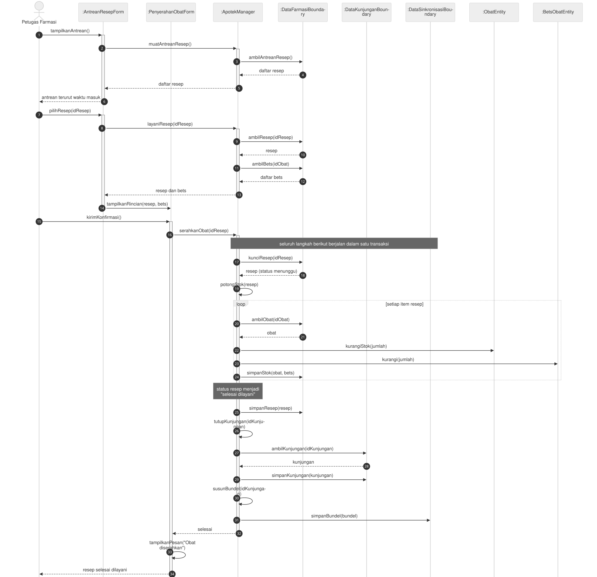

<i>Gambar 32. Sequence Diagram UC07 - Skenario Normal</i>

- **Skenario Alternatif 1: Sediaan Obat Bermasalah saat Disiapkan**

<i>Gambar 33. Sequence Diagram UC07 - Skenario Alternatif 1: Sediaan Obat Bermasalah saat Disiapkan</i>

- **Skenario Alternatif 2: Dua Petugas Mengonfirmasi Penyerahan secara Bersamaan**

<i>Gambar 34. Sequence Diagram UC07 - Skenario Alternatif 2: Dua Petugas Mengonfirmasi Penyerahan secara Bersamaan</i>

### 3.7.3 Diagram Kelas

<i>Gambar 35. Diagram Kelas Melayani Resep Obat (UC07)</i>

## 3.8 Use Case Mengelola Persediaan Obat

**ID Use Case:** UC08  
**Nama Use Case:** Mengelola Persediaan Obat

### 3.8.1 Identifikasi Kelas

Tabel 3.8. Identifikasi Kelas Use Case UC08

| No | Nama Kelas Perancangan | Nama Kelas Analisis Terkait |
| :--- | :--- | :--- |
| 1 | C11 PersediaanForm | C11 PersediaanForm |
| 2 | C25 PersediaanManager | C25 PersediaanManager |
| 3 | C56 DataAkunBoundary | Tidak ada (kelas baru perancangan, komponen *Data Access Layer* pada APL) |
| 4 | C61 DataFarmasiBoundary | Tidak ada (kelas baru perancangan, komponen *Data Access Layer* pada APL) |
| 5 | C32 AuditEntity | C32 AuditEntity |
| 6 | C48 ObatEntity | C48 ObatEntity |
| 7 | C49 BetsObatEntity | C49 BetsObatEntity |
| 8 | C50 PenerimaanObatEntity | C50 PenerimaanObatEntity |

### 3.8.2 Sequence Diagram

- **Skenario Normal**

<i>Gambar 36. Sequence Diagram UC08 - Skenario Normal</i>

- **Skenario Alternatif 1: Stok Menipis atau Bets Mendekati Kedaluwarsa**

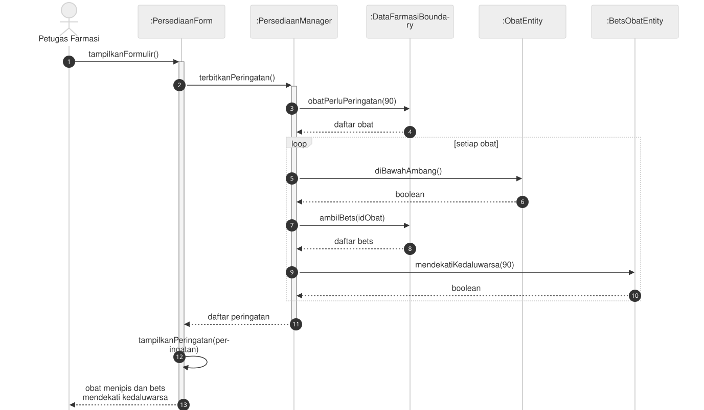

<i>Gambar 37. Sequence Diagram UC08 - Skenario Alternatif 1: Stok Menipis atau Bets Mendekati Kedaluwarsa</i>

- **Skenario Alternatif 2: Jumlah atau Tanggal Kedaluwarsa Tidak Valid**

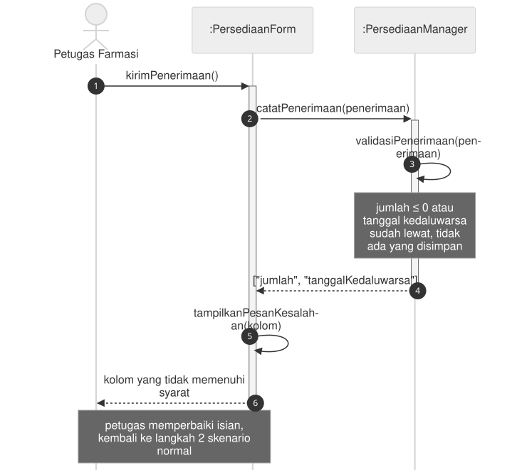

<i>Gambar 38. Sequence Diagram UC08 - Skenario Alternatif 2: Jumlah atau Tanggal Kedaluwarsa Tidak Valid</i>

### 3.8.3 Diagram Kelas

<i>Gambar 39. Diagram Kelas Mengelola Persediaan Obat (UC08)</i>

## 3.9 Use Case Mengelola Daftar Pantau Pasien

**ID Use Case:** UC09  
**Nama Use Case:** Mengelola Daftar Pantau Pasien

### 3.9.1 Identifikasi Kelas

Tabel 3.9. Identifikasi Kelas Use Case UC09

| No | Nama Kelas Perancangan | Nama Kelas Analisis Terkait |
| :--- | :--- | :--- |
| 1 | C12 DaftarPantauForm | C12 DaftarPantauForm |
| 2 | C21 RisikoManager | C21 RisikoManager |
| 3 | C26 PantauManager | C26 PantauManager |
| 4 | C57 DataPasienBoundary | Tidak ada (kelas baru perancangan, komponen *Data Access Layer* pada APL) |
| 5 | C59 DataKlinisBoundary | Tidak ada (kelas baru perancangan, komponen *Data Access Layer* pada APL) |
| 6 | C60 DataPantauBoundary | Tidak ada (kelas baru perancangan, komponen *Data Access Layer* pada APL) |
| 7 | C33 PasienEntity | C33 PasienEntity |
| 8 | C34 RekamMedisEntity | C34 RekamMedisEntity |
| 9 | C41 PenandaRisikoEntity | C41 PenandaRisikoEntity |
| 10 | C45 JadwalKontrolEntity | C45 JadwalKontrolEntity |
| 11 | C51 DaftarPantauEntity | C51 DaftarPantauEntity |
| 12 | C52 TindakLanjutEntity | C52 TindakLanjutEntity |

### 3.9.2 Sequence Diagram

- **Skenario Normal**

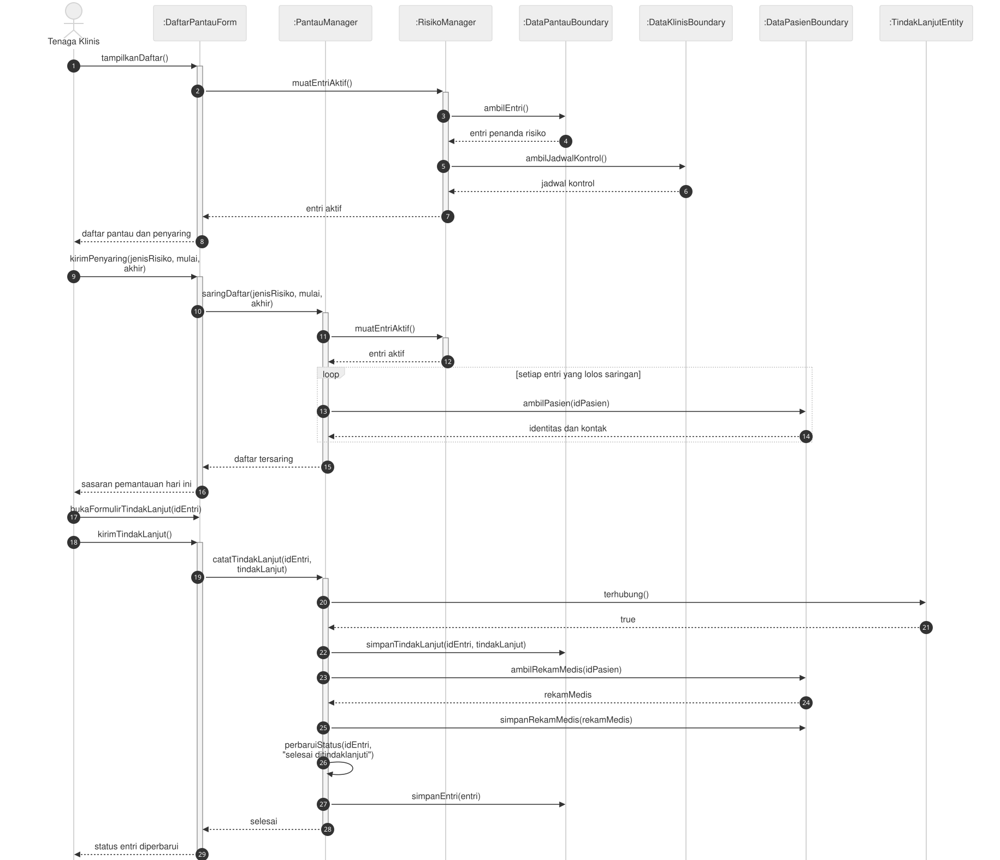

<i>Gambar 40. Sequence Diagram UC09 - Skenario Normal</i>

- **Skenario Alternatif 1: Pasien Belum Dapat Dihubungi**

<i>Gambar 41. Sequence Diagram UC09 - Skenario Alternatif 1: Pasien Belum Dapat Dihubungi</i>

- **Skenario Alternatif 2: Penyaringan Tidak Menemukan Pasien**

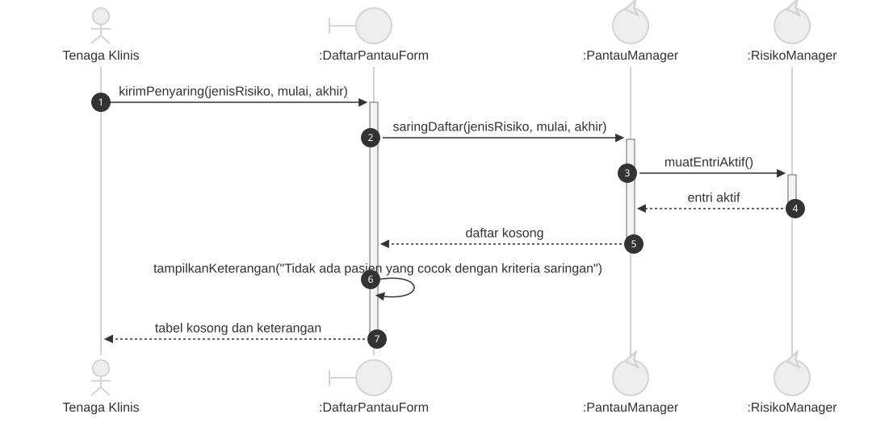

<i>Gambar 42. Sequence Diagram UC09 - Skenario Alternatif 2: Penyaringan Tidak Menemukan Pasien</i>

### 3.9.3 Diagram Kelas


<i>Gambar 43. Diagram Kelas Mengelola Daftar Pantau Pasien (UC09)</i>

## 3.10 Use Case Menyusun Laporan Periodik

**ID Use Case:** UC10  
**Nama Use Case:** Menyusun Laporan Periodik

### 3.10.1 Identifikasi Kelas

Tabel 3.10. Identifikasi Kelas Use Case UC10

| No | Nama Kelas Perancangan | Nama Kelas Analisis Terkait |
| :--- | :--- | :--- |
| 1 | C13 LaporanForm | C13 LaporanForm |
| 2 | C27 LaporanManager | C27 LaporanManager |
| 3 | C62 DataLaporanBoundary | Tidak ada (kelas baru perancangan, komponen *Data Access Layer* pada APL) |
| 4 | C35 KunjunganEntity | C35 KunjunganEntity |
| 5 | C36 PoliEntity | C36 PoliEntity |
| 6 | C43 DiagnosisEntity | C43 DiagnosisEntity |
| 7 | C53 LaporanEntity | C53 LaporanEntity |

### 3.10.2 Sequence Diagram

- **Skenario Normal**

<i>Gambar 44. Sequence Diagram UC10 - Skenario Normal</i>

- **Skenario Alternatif 1: Tidak Ada Pelayanan pada Rentang Waktu Terpilih**

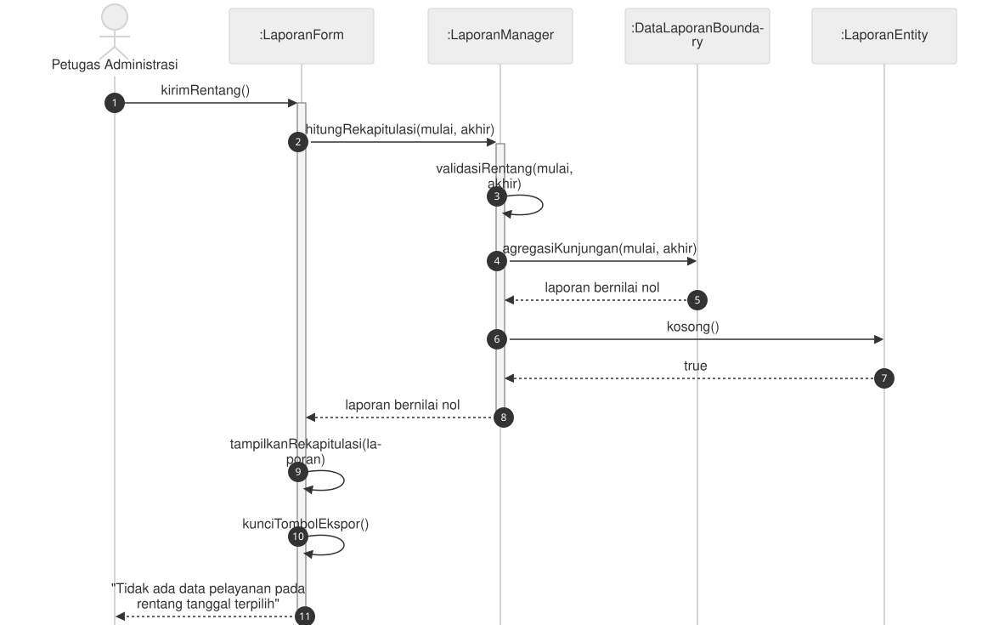

<i>Gambar 45. Sequence Diagram UC10 - Skenario Alternatif 1: Tidak Ada Pelayanan pada Rentang Waktu Terpilih</i>

- **Skenario Alternatif 2: Rentang Tanggal Tidak Valid**

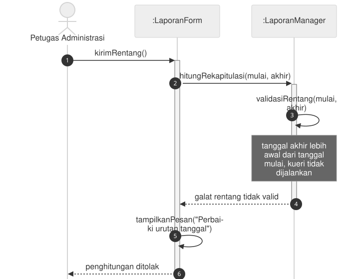

<i>Gambar 46. Sequence Diagram UC10 - Skenario Alternatif 2: Rentang Tanggal Tidak Valid</i>

### 3.10.3 Diagram Kelas


<i>Gambar 47. Diagram Kelas Menyusun Laporan Periodik (UC10)</i>

## 3.11 Use Case Melakukan Sinkronisasi SATUSEHAT

**ID Use Case:** UC11  
**Nama Use Case:** Melakukan Sinkronisasi SATUSEHAT

### 3.11.1 Identifikasi Kelas

Tabel 3.11. Identifikasi Kelas Use Case UC11

| No | Nama Kelas Perancangan | Nama Kelas Analisis Terkait |
| :--- | :--- | :--- |
| 1 | C14 SinkronisasiForm | C14 SinkronisasiForm |
| 2 | C28 SinkronisasiManager | C28 SinkronisasiManager |
| 3 | C15 SATUSEHATGateway | C15 SATUSEHATGateway |
| 4 | C63 DataSinkronisasiBoundary | Tidak ada (kelas baru perancangan, komponen *Data Access Layer* pada APL) |
| 5 | C35 KunjunganEntity | C35 KunjunganEntity |
| 6 | C54 BundelFHIREntity | C54 BundelFHIREntity |

### 3.11.2 Sequence Diagram

- **Skenario Normal**

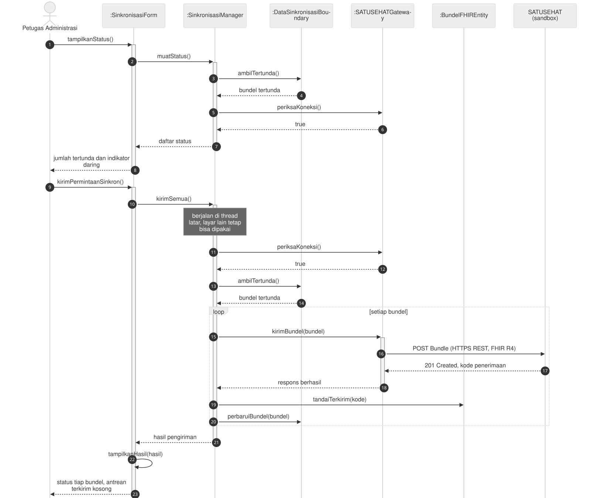

<i>Gambar 48. Sequence Diagram UC11 - Skenario Normal</i>

- **Skenario Alternatif 1: Sinkronisasi Dijalankan saat Jaringan Terputus**

<i>Gambar 49. Sequence Diagram UC11 - Skenario Alternatif 1: Sinkronisasi Dijalankan saat Jaringan Terputus</i>

- **Skenario Alternatif 2: SATUSEHAT Menolak Sebagian Bundel**

<i>Gambar 50. Sequence Diagram UC11 - Skenario Alternatif 2: SATUSEHAT Menolak Sebagian Bundel</i>

### 3.11.3 Diagram Kelas


<i>Gambar 51. Diagram Kelas Melakukan Sinkronisasi SATUSEHAT (UC11)</i>

## 3.12 Use Case Mengelola Konfigurasi & Basis Data Sistem

**ID Use Case:** UC12  
**Nama Use Case:** Mengelola Konfigurasi & Basis Data Sistem

### 3.12.1 Identifikasi Kelas

Tabel 3.12. Identifikasi Kelas Use Case UC12

| No | Nama Kelas Perancangan | Nama Kelas Analisis Terkait |
| :--- | :--- | :--- |
| 1 | C16 KonfigurasiForm | C16 KonfigurasiForm |
| 2 | C29 KonfigurasiManager | C29 KonfigurasiManager |
| 3 | C56 DataAkunBoundary | Tidak ada (kelas baru perancangan, komponen *Data Access Layer* pada APL) |
| 4 | C58 DataKunjunganBoundary | Tidak ada (kelas baru perancangan, komponen *Data Access Layer* pada APL) |
| 5 | C59 DataKlinisBoundary | Tidak ada (kelas baru perancangan, komponen *Data Access Layer* pada APL) |
| 6 | C61 DataFarmasiBoundary | Tidak ada (kelas baru perancangan, komponen *Data Access Layer* pada APL) |
| 7 | C64 DataPencadanganBoundary | Tidak ada (kelas baru perancangan, komponen *Data Access Layer* pada APL) |
| 8 | C30 PenggunaEntity | C30 PenggunaEntity |
| 9 | C32 AuditEntity | C32 AuditEntity |
| 10 | C36 PoliEntity | C36 PoliEntity |
| 11 | C40 AmbangRisikoEntity | C40 AmbangRisikoEntity |
| 12 | C48 ObatEntity | C48 ObatEntity |
| 13 | C55 PencadanganEntity | C55 PencadanganEntity |

### 3.12.2 Sequence Diagram

- **Skenario Normal (Manajemen Akun dan Data Master)**

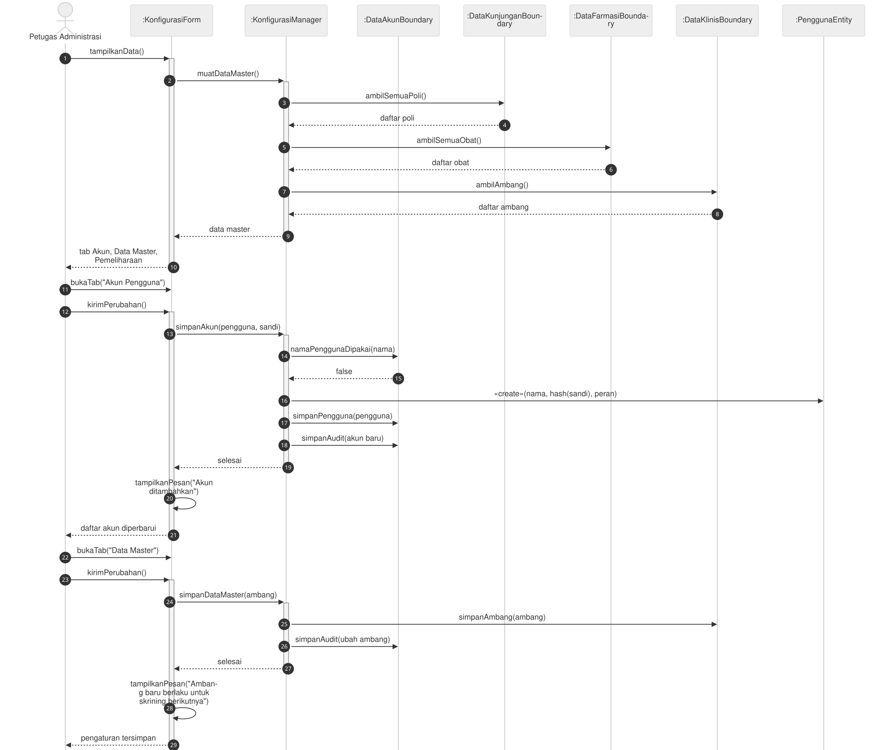

<i>Gambar 52. Sequence Diagram UC12 - Skenario Normal (Manajemen Akun dan Data Master)</i>

- **Skenario Alternatif 1: Memantau dan Menjalankan Pencadangan Basis Data**

<i>Gambar 53. Sequence Diagram UC12 - Skenario Alternatif 1: Memantau dan Menjalankan Pencadangan Basis Data</i>

- **Skenario Alternatif 2: Nama Pengguna Sudah Dipakai**

<i>Gambar 54. Sequence Diagram UC12 - Skenario Alternatif 2: Nama Pengguna Sudah Dipakai</i>

- **Skenario Alternatif 3: Menonaktifkan Akun Pengguna Lama**

<i>Gambar 55. Sequence Diagram UC12 - Skenario Alternatif 3: Menonaktifkan Akun Pengguna Lama</i>

- **Skenario Alternatif 4: Pencadangan Terjadwal Gagal**

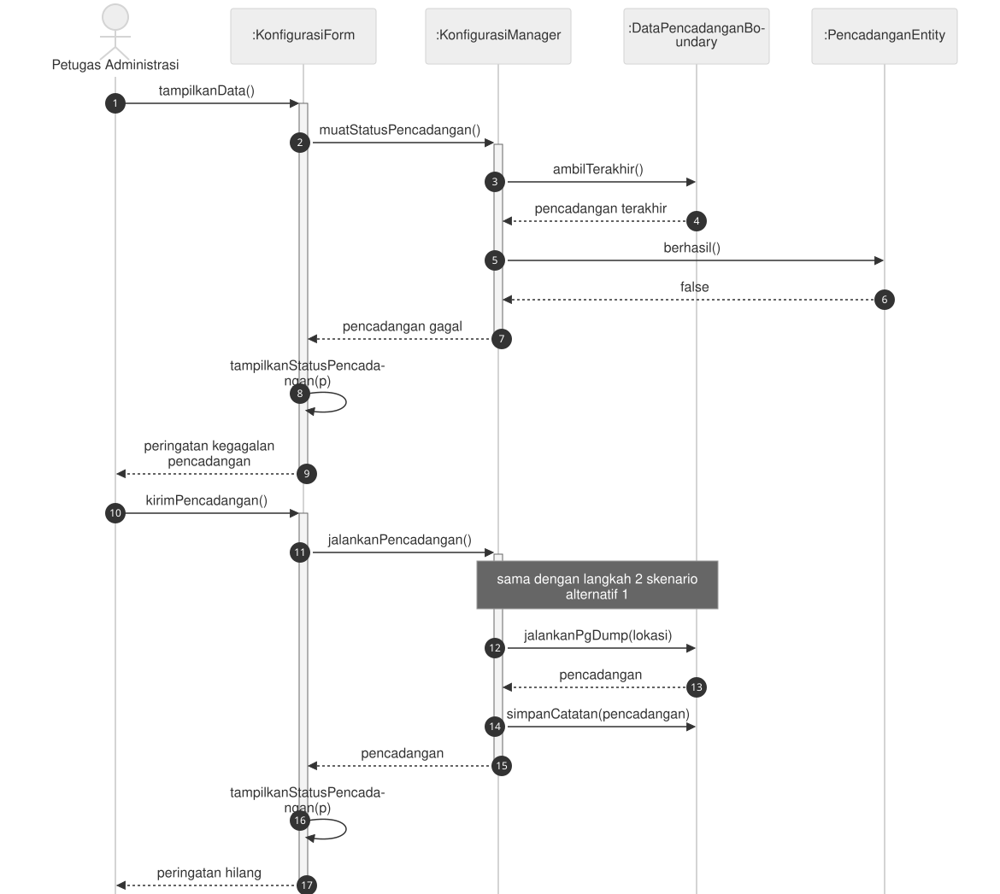

<i>Gambar 56. Sequence Diagram UC12 - Skenario Alternatif 4: Pencadangan Terjadwal Gagal</i>

### 3.12.3 Diagram Kelas


<i>Gambar 57. Diagram Kelas Mengelola Konfigurasi & Basis Data Sistem (UC12)</i>

 

---

# BAB 4: Diagram Kelas Keseluruhan

## 4.1 Diagram Kelas

Diagram berikut menyatukan 64 kelas perancangan dari dua belas diagram kelas pada BAB 3. Agar tetap terbaca, kotak kelas hanya memuat stereotip dan nama; atribut dan metode lengkap setiap kelas tercantum pada Tabel 4.1. Relasi `Manager` ke `Entity` juga tidak digambar ulang di sini karena sudah tampil pada diagram kelas tiap *use case*.


<i>Gambar 58. Diagram Kelas Perancangan Keseluruhan SEHATI</i>

Kelas perancangan berbeda dari kelas analisis SKPL pada empat hal berikut.

1. **Sembilan kelas akses data ditambahkan (C56 sampai C64).** Kelas ini adalah komponen *Data Access Layer* pada APL dan menjadi satu-satunya kelas yang menjalankan kueri ke PostgreSQL.
2. **Metode `simpan()` dipindahkan dari `Entity` ke `DataBoundary`.** Di SKPL, sebagian besar *entity* menyimpan dirinya sendiri. Pada perancangan, *entity* hanya memegang data dan aturan domain miliknya (misalnya `ObatEntity.kurangiStok()` atau `AmbangRisikoEntity.dilampaui()`), sedangkan penyimpanan dilakukan `DataBoundary`. Dengan begitu, *Business Layer* tidak bergantung pada basis data, sesuai aturan antarlapisan pada Subbab 2.2.
3. **Setiap atribut dan metode diberi visibilitas dan tipe.** Metode yang hanya dipakai di dalam kelasnya sendiri, seperti `PasienManager.terbitkanNomorRM()` dan `SkriningManager.validasiRentang()`, dibuat privat (`-`).
4. **Metode ditambahkan sesuai kebutuhan *sequence diagram*.** Contohnya `RisikoManager.ambilPenanda()` untuk `SkriningForm` dan `KunjunganManager.daftarPoli()` untuk layar pembuatan kunjungan. Sebaliknya, `SinkronisasiManager.antrekanBundel()` dihapus karena bundel sudah dimasukkan ke antrean oleh `ApotekManager` lewat `DataSinkronisasiBoundary`.

Tabel 4.1. Daftar Kelas Perancangan Keseluruhan

| ID Kelas | Nama Kelas | Atribut | Metode/Operasi |
| :--- | :--- | :--- | :--- |
| C01 | LoginForm «boundary» | `-namaPengguna: String` `-kataSandi: String` | `+tampilkan(): void` `+kirimKredensial(): void` `+tampilkanDasbor(menu: List<String>): void` `+bukaLayar(layar: String): void` `+tampilkanPesanGagal(pesan: String): void` |
| C02 | PasienForm «boundary» | `-kataKunci: String` `-dataFormulir: PasienEntity` | `+tampilkan(): void` `+kirimPencarian(kataKunci: String): void` `+tampilkanHasilCari(hasil: List<PasienEntity>): void` `+bukaFormulir(pasien: PasienEntity): void` `+kirimDataPasien(): void` `+tampilkanPesanValidasi(pesan: String): void` `+tampilkanNotifikasi(pesan: String): void` |
| C03 | KunjunganForm «boundary» | `-pasienTerpilih: PasienEntity` `-poliTerpilih: PoliEntity` | `+buka(pasien: PasienEntity): void` `+tampilkanPilihanPoli(daftarPoli: List<PoliEntity>): void` `+kirimPermintaanKunjungan(): void` `+tampilkanTiketAntrean(kunjungan: KunjunganEntity): void` `+tampilkanKunjunganAktif(kunjungan: KunjunganEntity): void` |
| C04 | AntreanSkriningForm «boundary» | `-daftarTampil: List<KunjunganEntity>` | `+tampilkanAntrean(): void` `+kirimPanggilan(): void` `+kirimLewati(): void` `+perbaruiTampilan(daftar: List<KunjunganEntity>): void` |
| C05 | SkriningForm «boundary» | `-isianKeluhan: String` `-isianUkuran: TandaVitalEntity` | `+tampilkanFormulir(kunjungan: KunjunganEntity): void` `+kirimHasilSkrining(): void` `+tampilkanPeringatanRentang(kolom: List<String>): void` `+tampilkanPenandaRisiko(penanda: List<PenandaRisikoEntity>): void` |
| C06 | RekamMedisForm «boundary» | `-idPasienTampil: int` `-seriTren: List<TandaVitalEntity>` | `+tampilkanRingkasan(kunjungan: KunjunganEntity): void` `+tampilkanGrafikTren(): void` `+tampilkanTabelPengukuran(nilai: TandaVitalEntity): void` `+aturModeBacaSaja(): void` `+tampilkanIndikatorLuring(): void` |
| C07 | PemeriksaanForm «boundary» | `-isianAnamnesis: String` `-kataKunciDiagnosis: String` | `+kirimKataKunciDiagnosis(kataKunci: String): void` `+tampilkanSaranKode(daftar: List<KodeICD10Entity>): void` `+kirimHasilPemeriksaan(): void` `+kirimFinal(): void` `+kunciKolomKlinis(): void` `+tampilkanPesan(pesan: String): void` |
| C08 | ResepForm «boundary» | `-isianItem: List<ItemResepEntity>` `-indikatorStok: String` | `+tampilkanFormulir(kunjungan: KunjunganEntity): void` `+kirimItem(idObat: int, jumlah: int, dosis: String, aturanPakai: String): void` `+tampilkanIndikatorStok(tersedia: boolean, sisa: int): void` `+kirimResep(): void` `+tampilkanPeringatanStok(sisa: int): void` |
| C09 | AntreanResepForm «boundary» | `-daftarTampil: List<ResepEntity>` | `+tampilkanAntrean(): void` `+pilihResep(idResep: int): void` |
| C10 | PenyerahanObatForm «boundary» | `-rincianTampil: ResepEntity` `-catatanPengembalian: String` | `+tampilkanRincian(resep: ResepEntity, bets: List<BetsObatEntity>): void` `+kirimKonfirmasi(): void` `+bukaKolomCatatan(): void` `+kirimPengembalian(alasan: String): void` `+tampilkanPesan(pesan: String): void` |
| C11 | PersediaanForm «boundary» | `-isianPenerimaan: PenerimaanObatEntity` `-daftarPeringatan: List<String>` | `+tampilkanFormulir(): void` `+kirimPenerimaan(): void` `+tampilkanSaldo(obat: ObatEntity): void` `+tampilkanPeringatan(peringatan: List<String>): void` `+tampilkanPesanKesalahan(kolom: List<String>): void` |
| C12 | DaftarPantauForm «boundary» | `-penyaring: String` `-daftarTampil: List<DaftarPantauEntity>` | `+tampilkanDaftar(): void` `+kirimPenyaring(jenisRisiko: String, mulai: LocalDate, akhir: LocalDate): void` `+bukaFormulirTindakLanjut(idEntri: int): void` `+kirimTindakLanjut(): void` `+tampilkanKeterangan(pesan: String): void` |
| C13 | LaporanForm «boundary» | `-tanggalMulai: LocalDate` `-tanggalAkhir: LocalDate` | `+tampilkan(): void` `+kirimRentang(): void` `+tampilkanRekapitulasi(laporan: LaporanEntity): void` `+kirimPermintaanEkspor(format: String, direktori: String): void` `+kunciTombolEkspor(): void` `+tampilkanPesan(pesan: String): void` |
| C14 | SinkronisasiForm «boundary» | `-daftarStatus: List<BundelFHIREntity>` | `+tampilkanStatus(): void` `+kirimPermintaanSinkron(): void` `+tampilkanHasil(hasil: List<BundelFHIREntity>): void` `+tampilkanTombolEkspor(): void` `+kirimPermintaanEkspor(lokasi: String): void` `+tampilkanPesan(pesan: String): void` |
| C15 | SATUSEHATGateway «boundary» | `-alamatLayanan: String` `-token: String` | `+periksaKoneksi(): boolean` `+kirimBundel(bundel: BundelFHIREntity): ResponsKirim` |
| C16 | KonfigurasiForm «boundary» | `-tabAktif: String` `-isianData: String` | `+tampilkanData(): void` `+bukaTab(tab: String): void` `+kirimPerubahan(): void` `+kirimNonaktifkan(idPengguna: int): void` `+kirimPencadangan(): void` `+tampilkanStatusPencadangan(p: PencadanganEntity): void` `+tampilkanPesan(pesan: String): void` |
| C17 | AutentikasiManager «control» | `-percobaanGagal: int` | `+autentikasi(nama: String, sandi: String): SesiEntity` `-bukaSesi(p: PenggunaEntity): SesiEntity` `+periksaHakAkses(peran: String, layar: String): boolean` |
| C18 | PasienManager «control» | - | `+cariPasien(kataKunci: String): List<PasienEntity>` `+daftarkanPasien(data: PasienEntity): PasienEntity` `+perbaruiPasien(data: PasienEntity): void` `+validasiNIK(nik: String): boolean` `-terbitkanNomorRM(): String` |
| C19 | KunjunganManager «control» | - | `+daftarPoli(): List<PoliEntity>` `+bukaKunjungan(idPasien: int, idPoli: int): KunjunganEntity` `-cegahKunjunganGanda(idPasien: int): KunjunganEntity` `-terbitkanNomorAntrean(idPoli: int): int` |
| C20 | SkriningManager «control» | - | `+muatAntrean(): List<KunjunganEntity>` `+panggilPasien(): KunjunganEntity` `+lewatiPasien(idKunjungan: int): KunjunganEntity` `+simpanSkrining(idKunjungan: int, keluhan: String, tv: TandaVitalEntity): List<String>` `-validasiRentang(tv: TandaVitalEntity): List<String>` |
| C21 | RisikoManager «control» | - | `+evaluasiRisiko(kunjungan: KunjunganEntity, tv: TandaVitalEntity): List<PenandaRisikoEntity>` `-terbitkanPenanda(idKunjungan: int, jenis: String): PenandaRisikoEntity` `-masukkanKeDaftarPantau(idPasien: int, jenis: String): void` `+ambilPenanda(idKunjungan: int): List<PenandaRisikoEntity>` `+muatEntriAktif(): List<DaftarPantauEntity>` |
| C22 | PemeriksaanManager «control» | - | `+susunRingkasan(idKunjungan: int): RekamMedisEntity` `+susunTren(idPasien: int): List<TandaVitalEntity>` `+cariKodeICD10(kataKunci: String): List<KodeICD10Entity>` `+simpanPemeriksaan(idKunjungan: int, p: PemeriksaanEntity, d: DiagnosisEntity): void` `+jadwalkanKontrol(idPasien: int, tanggal: LocalDate): JadwalKontrolEntity` `+kunciRekamMedis(idKunjungan: int): void` |
| C23 | ResepManager «control» | - | `+muatDataObat(): List<ObatEntity>` `+tambahItem(idObat: int, jumlah: int, dosis: String, aturanPakai: String): ItemResepEntity` `-validasiStok(item: ItemResepEntity): boolean` `+kirimKeApotek(idKunjungan: int, items: List<ItemResepEntity>): ResepEntity` |
| C24 | ApotekManager «control» | - | `+muatAntreanResep(): List<ResepEntity>` `+layaniResep(idResep: int): ResepEntity` `+serahkanObat(idResep: int): void` `-potongStok(resep: ResepEntity): void` `-tutupKunjungan(idKunjungan: int): void` `-susunBundel(idKunjungan: int): BundelFHIREntity` `+kembalikanKeDokter(idResep: int, alasan: String): void` |
| C25 | PersediaanManager «control» | - | `+muatDataObat(): List<ObatEntity>` `+catatPenerimaan(p: PenerimaanObatEntity): void` `-validasiPenerimaan(p: PenerimaanObatEntity): List<String>` `-tambahStok(idObat: int, jumlah: int): ObatEntity` `+terbitkanPeringatan(): List<String>` |
| C26 | PantauManager «control» | - | `+saringDaftar(jenisRisiko: String, mulai: LocalDate, akhir: LocalDate): List<DaftarPantauEntity>` `+catatTindakLanjut(idEntri: int, t: TindakLanjutEntity): void` `-perbaruiStatus(idEntri: int, status: String): void` |
| C27 | LaporanManager «control» | - | `+hitungRekapitulasi(mulai: LocalDate, akhir: LocalDate): LaporanEntity` `-validasiRentang(mulai: LocalDate, akhir: LocalDate): boolean` `+ekspor(laporan: LaporanEntity, format: String, direktori: String): String` |
| C28 | SinkronisasiManager «control» | `-jumlahTertunda: int` | `+muatStatus(): List<BundelFHIREntity>` `+kirimSemua(): List<BundelFHIREntity>` `+eksporBundel(lokasi: String): String` |
| C29 | KonfigurasiManager «control» | - | `+muatDataMaster(): void` `+simpanAkun(p: PenggunaEntity, sandi: String): void` `+nonaktifkanAkun(idPengguna: int): void` `+simpanDataMaster(a: AmbangRisikoEntity): void` `+muatStatusPencadangan(): PencadanganEntity` `+jalankanPencadangan(): PencadanganEntity` |
| C30 | PenggunaEntity «entity» | `-idPengguna: int` `-namaPengguna: String` `-kataSandiHash: String` `-peran: String` `-status: String` | `+cocokkanSandi(sandi: String): boolean` `+aktif(): boolean` `+nonaktifkan(): void` |
| C31 | SesiEntity «entity» | `-idSesi: UUID` `-idPengguna: int` `-waktuMulai: LocalDateTime` `-statusAktif: boolean` | `+habisWaktu(menit: int): boolean` `+tutup(): void` |
| C32 | AuditEntity «entity» | `-idAudit: long` `-idPengguna: int` `-waktu: LocalDateTime` `-deskripsi: String` | `+buat(idPengguna: int, deskripsi: String): AuditEntity` |
| C33 | PasienEntity «entity» | `-idPasien: int` `-nik: String` `-nomorRekamMedis: String` `-nama: String` `-tanggalLahir: LocalDate` `-jenisKelamin: String` `-alamat: String` `-nomorTelepon: String` | `+perbarui(data: PasienEntity): void` |
| C34 | RekamMedisEntity «entity» | `-idRekamMedis: int` `-daftarDiagnosis: List<DiagnosisEntity>` `-riwayatObat: List<String>` | `+tambahEntri(catatan: String): void` |
| C35 | KunjunganEntity «entity» | `-idKunjungan: int` `-idPasien: int` `-tanggal: LocalDate` `-nomorAntrean: int` `-status: String` | `+perbaruiStatus(status: String): void` `+aktifHariIni(): boolean` |
| C36 | PoliEntity «entity» | `-idPoli: int` `-namaPoli: String` `-urutanTerakhir: int` `-tanggalUrutan: LocalDate` | `+ambilNomorBerikutnya(hariIni: LocalDate): int` |
| C37 | AntreanEntity «entity» | `-idAntrean: int` `-jenis: String` `-daftarEntri: List<Integer>` | `+tambahkan(idEntri: int): void` `+ambilTerdepan(): KunjunganEntity` `+pindahkanKeBelakang(idEntri: int): void` `+keluarkan(idEntri: int): void` |
| C38 | SkriningEntity «entity» | `-idSkrining: int` `-idKunjungan: int` `-keluhanAwal: String` `-waktu: LocalDateTime` | `+lampirkanTandaVital(tv: TandaVitalEntity): void` |
| C39 | TandaVitalEntity «entity» | `-sistolik: int` `-diastolik: int` `-beratBadan: double` `-tinggiBadan: double` `-suhu: double` `-nadi: int` `-gulaDarah: Integer` | `+hitungIMT(): double` |
| C40 | AmbangRisikoEntity «entity» | `-idAmbang: int` `-jenisRisiko: String` `-nilaiBatas: double` | `+dilampaui(nilai: double): boolean` |
| C41 | PenandaRisikoEntity «entity» | `-idPenanda: int` `-idKunjungan: int` `-jenisRisiko: String` `-tanggal: LocalDate` `-status: String` | `+cabut(): void` |
| C42 | PemeriksaanEntity «entity» | `-idPemeriksaan: int` `-idKunjungan: int` `-anamnesis: String` `-tindakan: String` `-terkunci: boolean` | `+kunci(): void` |
| C43 | DiagnosisEntity «entity» | `-idDiagnosis: int` `-kodeICD10: String` `-deskripsi: String` | `+ringkas(): String` |
| C44 | KodeICD10Entity «entity» | `-kode: String` `-deskripsi: String` `-bab: String` | `+cocok(kataKunci: String): boolean` |
| C45 | JadwalKontrolEntity «entity» | `-idJadwal: int` `-idPasien: int` `-tanggalRencana: LocalDate` `-status: String` | `+tandaiSelesai(): void` |
| C46 | ResepEntity «entity» | `-idResep: int` `-idKunjungan: int` `-waktuMasuk: LocalDateTime` `-status: String` `-catatan: String` | `+perbaruiStatus(status: String): void` |
| C47 | ItemResepEntity «entity» | `-idItem: int` `-idObat: int` `-dosis: String` `-jumlah: int` `-aturanPakai: String` | `+cukupStok(stok: int): boolean` |
| C48 | ObatEntity «entity» | `-idObat: int` `-namaObat: String` `-sediaan: String` `-stok: int` `-ambangMinimum: int` | `+kurangiStok(jumlah: int): void` `+tambahStok(jumlah: int): void` `+diBawahAmbang(): boolean` |
| C49 | BetsObatEntity «entity» | `-nomorBets: String` `-idObat: int` `-jumlah: int` `-tanggalKedaluwarsa: LocalDate` | `+kurangi(jumlah: int): void` `+mendekatiKedaluwarsa(hari: int): boolean` |
| C50 | PenerimaanObatEntity «entity» | `-idPenerimaan: int` `-nomorFaktur: String` `-tanggalTerima: LocalDate` `-daftarBets: List<BetsObatEntity>` | `+totalJumlah(): int` |
| C51 | DaftarPantauEntity «entity» | `-idEntri: int` `-idPasien: int` `-jenisRisiko: String` `-statusTindakLanjut: String` | `+perbaruiStatus(status: String): void` |
| C52 | TindakLanjutEntity «entity» | `-idTindakLanjut: int` `-jenisKontak: String` `-hasilUpaya: String` `-statusKedatangan: String` | `+terhubung(): boolean` |
| C53 | LaporanEntity «entity» | `-idLaporan: int` `-tanggalMulai: LocalDate` `-tanggalAkhir: LocalDate` `-format: String` `-ringkasan: String` | `+kosong(): boolean` |
| C54 | BundelFHIREntity «entity» | `-idBundel: int` `-idKunjungan: int` `-isiBundel: String` `-status: String` `-alasanGagal: String` | `+tandaiTerkirim(kode: String): void` `+tandaiGagal(alasan: String): void` |
| C55 | PencadanganEntity «entity» | `-idPencadangan: int` `-waktu: LocalDateTime` `-status: String` `-lokasiMedia: String` `-ukuranBerkas: long` | `+berhasil(): boolean` |
| C56 | DataAkunBoundary «boundary» | `-koneksi: Connection` | `+cariPengguna(nama: String): PenggunaEntity` `+ambilPengguna(idPengguna: int): PenggunaEntity` `+namaPenggunaDipakai(nama: String): boolean` `+simpanPengguna(p: PenggunaEntity): void` `+simpanSesi(s: SesiEntity): void` `+tutupSesiAktif(idPengguna: int): void` `+simpanAudit(a: AuditEntity): void` |
| C57 | DataPasienBoundary «boundary» | `-koneksi: Connection` | `+cariParsial(kataKunci: String): List<PasienEntity>` `+ambilPasien(idPasien: int): PasienEntity` `+nikTerdaftar(nik: String): boolean` `+nomorRMBerikutnya(): String` `+simpanPasien(p: PasienEntity): void` `+ambilRekamMedis(idPasien: int): RekamMedisEntity` `+simpanRekamMedis(rm: RekamMedisEntity): void` |
| C58 | DataKunjunganBoundary «boundary» | `-koneksi: Connection` | `+ambilSemuaPoli(): List<PoliEntity>` `+kunciPoli(idPoli: int): PoliEntity` `+simpanPoli(p: PoliEntity): void` `+kunjunganAktif(idPasien: int, tanggal: LocalDate): KunjunganEntity` `+ambilKunjungan(idKunjungan: int): KunjunganEntity` `+simpanKunjungan(k: KunjunganEntity): void` `+ambilAntrean(jenis: String): AntreanEntity` `+simpanAntrean(a: AntreanEntity): void` |
| C59 | DataKlinisBoundary «boundary» | `-koneksi: Connection` | `+simpanSkrining(s: SkriningEntity): void` `+ambilSkrining(idKunjungan: int): SkriningEntity` `+riwayatTandaVital(idPasien: int, batas: int): List<TandaVitalEntity>` `+ambilAmbang(): List<AmbangRisikoEntity>` `+simpanAmbang(a: AmbangRisikoEntity): void` `+simpanPenanda(p: PenandaRisikoEntity): void` `+penandaKunjungan(idKunjungan: int): List<PenandaRisikoEntity>` `+cariKodeICD10(kataKunci: String): List<KodeICD10Entity>` `+simpanPemeriksaan(p: PemeriksaanEntity, d: DiagnosisEntity): void` `+ambilPemeriksaan(idKunjungan: int): PemeriksaanEntity` `+simpanJadwalKontrol(j: JadwalKontrolEntity): void` `+ambilJadwalKontrol(): List<JadwalKontrolEntity>` |
| C60 | DataPantauBoundary «boundary» | `-koneksi: Connection` | `+ambilEntri(): List<DaftarPantauEntity>` `+simpanEntri(e: DaftarPantauEntity): void` `+simpanTindakLanjut(idEntri: int, t: TindakLanjutEntity): void` |
| C61 | DataFarmasiBoundary «boundary» | `-koneksi: Connection` | `+ambilSemuaObat(): List<ObatEntity>` `+ambilObat(idObat: int): ObatEntity` `+ambilBets(idObat: int): List<BetsObatEntity>` `+simpanStok(o: ObatEntity, bets: List<BetsObatEntity>): void` `+simpanPenerimaan(p: PenerimaanObatEntity): void` `+obatPerluPeringatan(hari: int): List<ObatEntity>` `+simpanResep(r: ResepEntity): void` `+ambilAntreanResep(): List<ResepEntity>` `+ambilResep(idResep: int): ResepEntity` `+kunciResep(idResep: int): ResepEntity` |
| C62 | DataLaporanBoundary «boundary» | `-koneksi: Connection` | `+agregasiKunjungan(mulai: LocalDate, akhir: LocalDate): LaporanEntity` `+simpanLaporan(l: LaporanEntity): void` `+tulisBerkas(l: LaporanEntity, format: String, direktori: String): String` |
| C63 | DataSinkronisasiBoundary «boundary» | `-koneksi: Connection` | `+simpanBundel(b: BundelFHIREntity): void` `+ambilTertunda(): List<BundelFHIREntity>` `+perbaruiBundel(b: BundelFHIREntity): void` `+tulisArsipTerenkripsi(daftar: List<BundelFHIREntity>, lokasi: String): String` |
| C64 | DataPencadanganBoundary «boundary» | `-koneksi: Connection` `-lokasiMedia: String` | `+ambilTerakhir(): PencadanganEntity` `+jalankanPgDump(lokasi: String): PencadanganEntity` `+verifikasiArsip(p: PencadanganEntity): boolean` `+simpanCatatan(p: PencadanganEntity): void` |

 

---

# BAB 5: Matriks Kerunutan

Tabel berikut memetakan setiap kelas perancangan ke *use case* yang memakainya. Acuan awalnya adalah BAB 6 SKPL, lalu disesuaikan dengan Tabel 3.1 sampai Tabel 3.12. Ada dua perbedaan dengan SKPL. Pertama, kelas C56 sampai C64 ikut dipetakan ke *use case* yang memanggilnya. Kedua, `AutentikasiManager` kini juga terkait UC05 karena `RekamMedisForm` memeriksa hak akses sebelum membuka kolom diagnosis (skenario alternatif 1 UC05). Seluruh 64 kelas terkait sedikitnya satu *use case*, dan seluruh dua belas *use case* direalisasikan sedikitnya oleh satu `Form`, satu `Manager`, dan satu `DataBoundary`.

Tabel 5.1. Matriks Kerunutan Kelas terhadap Use Case

| Kelas | Use Case Terkait |
| :--- | :--- |
| C01 - LoginForm | UC01 - Masuk ke Aplikasi |
| C02 - PasienForm | UC02 - Mengelola Data Pasien |
| C03 - KunjunganForm | UC03 - Mengelola Kunjungan Pasien |
| C04 - AntreanSkriningForm | UC04 - Melakukan Skrining Awal |
| C05 - SkriningForm | UC04 - Melakukan Skrining Awal |
| C06 - RekamMedisForm | UC05 - Melakukan Pemeriksaan Medis |
| C07 - PemeriksaanForm | UC05 - Melakukan Pemeriksaan Medis |
| C08 - ResepForm | UC06 - Menyusun Resep Elektronik |
| C09 - AntreanResepForm | UC07 - Melayani Resep Obat |
| C10 - PenyerahanObatForm | UC07 - Melayani Resep Obat |
| C11 - PersediaanForm | UC08 - Mengelola Persediaan Obat |
| C12 - DaftarPantauForm | UC09 - Mengelola Daftar Pantau Pasien |
| C13 - LaporanForm | UC10 - Menyusun Laporan Periodik |
| C14 - SinkronisasiForm | UC11 - Melakukan Sinkronisasi SATUSEHAT |
| C15 - SATUSEHATGateway | UC11 - Melakukan Sinkronisasi SATUSEHAT |
| C16 - KonfigurasiForm | UC12 - Mengelola Konfigurasi & Basis Data Sistem |
| C17 - AutentikasiManager | UC01 - Masuk ke Aplikasi UC05 - Melakukan Pemeriksaan Medis |
| C18 - PasienManager | UC02 - Mengelola Data Pasien |
| C19 - KunjunganManager | UC03 - Mengelola Kunjungan Pasien |
| C20 - SkriningManager | UC04 - Melakukan Skrining Awal |
| C21 - RisikoManager | UC04 - Melakukan Skrining Awal UC09 - Mengelola Daftar Pantau Pasien |
| C22 - PemeriksaanManager | UC05 - Melakukan Pemeriksaan Medis |
| C23 - ResepManager | UC06 - Menyusun Resep Elektronik |
| C24 - ApotekManager | UC07 - Melayani Resep Obat |
| C25 - PersediaanManager | UC08 - Mengelola Persediaan Obat |
| C26 - PantauManager | UC09 - Mengelola Daftar Pantau Pasien |
| C27 - LaporanManager | UC10 - Menyusun Laporan Periodik |
| C28 - SinkronisasiManager | UC11 - Melakukan Sinkronisasi SATUSEHAT |
| C29 - KonfigurasiManager | UC12 - Mengelola Konfigurasi & Basis Data Sistem |
| C30 - PenggunaEntity | UC01 - Masuk ke Aplikasi UC12 - Mengelola Konfigurasi & Basis Data Sistem |
| C31 - SesiEntity | UC01 - Masuk ke Aplikasi |
| C32 - AuditEntity | UC01 - Masuk ke Aplikasi UC02 - Mengelola Data Pasien UC03 - Mengelola Kunjungan Pasien UC05 - Melakukan Pemeriksaan Medis UC08 - Mengelola Persediaan Obat UC12 - Mengelola Konfigurasi & Basis Data Sistem |
| C33 - PasienEntity | UC02 - Mengelola Data Pasien UC03 - Mengelola Kunjungan Pasien UC09 - Mengelola Daftar Pantau Pasien |
| C34 - RekamMedisEntity | UC02 - Mengelola Data Pasien UC05 - Melakukan Pemeriksaan Medis UC09 - Mengelola Daftar Pantau Pasien |
| C35 - KunjunganEntity | UC03 - Mengelola Kunjungan Pasien UC04 - Melakukan Skrining Awal UC05 - Melakukan Pemeriksaan Medis UC07 - Melayani Resep Obat UC10 - Menyusun Laporan Periodik UC11 - Melakukan Sinkronisasi SATUSEHAT |
| C36 - PoliEntity | UC03 - Mengelola Kunjungan Pasien UC10 - Menyusun Laporan Periodik UC12 - Mengelola Konfigurasi & Basis Data Sistem |
| C37 - AntreanEntity | UC03 - Mengelola Kunjungan Pasien UC04 - Melakukan Skrining Awal UC06 - Menyusun Resep Elektronik UC07 - Melayani Resep Obat |
| C38 - SkriningEntity | UC04 - Melakukan Skrining Awal |
| C39 - TandaVitalEntity | UC04 - Melakukan Skrining Awal UC05 - Melakukan Pemeriksaan Medis |
| C40 - AmbangRisikoEntity | UC04 - Melakukan Skrining Awal UC12 - Mengelola Konfigurasi & Basis Data Sistem |
| C41 - PenandaRisikoEntity | UC04 - Melakukan Skrining Awal UC09 - Mengelola Daftar Pantau Pasien |
| C42 - PemeriksaanEntity | UC05 - Melakukan Pemeriksaan Medis UC06 - Menyusun Resep Elektronik |
| C43 - DiagnosisEntity | UC05 - Melakukan Pemeriksaan Medis UC10 - Menyusun Laporan Periodik |
| C44 - KodeICD10Entity | UC05 - Melakukan Pemeriksaan Medis |
| C45 - JadwalKontrolEntity | UC05 - Melakukan Pemeriksaan Medis UC09 - Mengelola Daftar Pantau Pasien |
| C46 - ResepEntity | UC06 - Menyusun Resep Elektronik UC07 - Melayani Resep Obat |
| C47 - ItemResepEntity | UC06 - Menyusun Resep Elektronik UC07 - Melayani Resep Obat |
| C48 - ObatEntity | UC06 - Menyusun Resep Elektronik UC07 - Melayani Resep Obat UC08 - Mengelola Persediaan Obat UC12 - Mengelola Konfigurasi & Basis Data Sistem |
| C49 - BetsObatEntity | UC07 - Melayani Resep Obat UC08 - Mengelola Persediaan Obat |
| C50 - PenerimaanObatEntity | UC08 - Mengelola Persediaan Obat |
| C51 - DaftarPantauEntity | UC04 - Melakukan Skrining Awal UC09 - Mengelola Daftar Pantau Pasien |
| C52 - TindakLanjutEntity | UC09 - Mengelola Daftar Pantau Pasien |
| C53 - LaporanEntity | UC10 - Menyusun Laporan Periodik |
| C54 - BundelFHIREntity | UC07 - Melayani Resep Obat UC11 - Melakukan Sinkronisasi SATUSEHAT |
| C55 - PencadanganEntity | UC12 - Mengelola Konfigurasi & Basis Data Sistem |
| C56 - DataAkunBoundary | UC01 - Masuk ke Aplikasi UC02 - Mengelola Data Pasien UC03 - Mengelola Kunjungan Pasien UC05 - Melakukan Pemeriksaan Medis UC08 - Mengelola Persediaan Obat UC12 - Mengelola Konfigurasi & Basis Data Sistem |
| C57 - DataPasienBoundary | UC02 - Mengelola Data Pasien UC03 - Mengelola Kunjungan Pasien UC05 - Melakukan Pemeriksaan Medis UC09 - Mengelola Daftar Pantau Pasien |
| C58 - DataKunjunganBoundary | UC03 - Mengelola Kunjungan Pasien UC04 - Melakukan Skrining Awal UC05 - Melakukan Pemeriksaan Medis UC06 - Menyusun Resep Elektronik UC07 - Melayani Resep Obat UC12 - Mengelola Konfigurasi & Basis Data Sistem |
| C59 - DataKlinisBoundary | UC04 - Melakukan Skrining Awal UC05 - Melakukan Pemeriksaan Medis UC09 - Mengelola Daftar Pantau Pasien UC12 - Mengelola Konfigurasi & Basis Data Sistem |
| C60 - DataPantauBoundary | UC04 - Melakukan Skrining Awal UC09 - Mengelola Daftar Pantau Pasien |
| C61 - DataFarmasiBoundary | UC06 - Menyusun Resep Elektronik UC07 - Melayani Resep Obat UC08 - Mengelola Persediaan Obat UC12 - Mengelola Konfigurasi & Basis Data Sistem |
| C62 - DataLaporanBoundary | UC10 - Menyusun Laporan Periodik |
| C63 - DataSinkronisasiBoundary | UC07 - Melayani Resep Obat UC11 - Melakukan Sinkronisasi SATUSEHAT |
| C64 - DataPencadanganBoundary | UC12 - Mengelola Konfigurasi & Basis Data Sistem |
