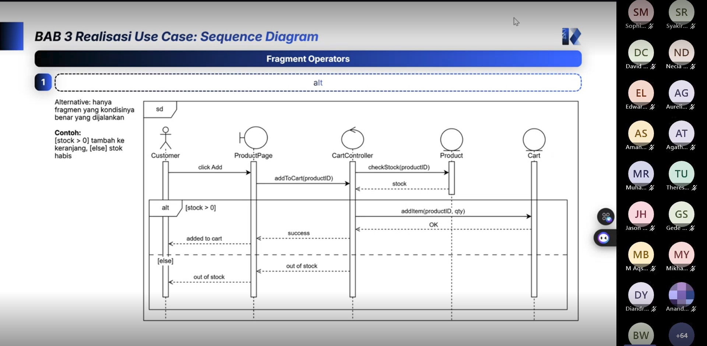

# Form Asistensi

## Tugas Besar IF2150 - Rekayasa Perangkat Lunak

| Informasi | Keterangan |
| --- | --- |
| **Hari** | Jumat |
| **Tanggal** | 09/10/2026 |
| **Kelas** | K02 |
| **Nomor Kelompok** | G09 |
| **Nama Kelompok** | Cumlaude |
| **Nama Perangkat Lunak** | SEHATI (Sistem Elektronik Pelayanan Kesehatan Terintegrasi) |
| **Dokumen** | K02_G09_DPPL.md (Tugas 7 - Deskripsi Perancangan Perangkat Lunak), Asistensi Akbar |

### Anggota Kelompok

| NIM | Nama |
| --- | --- |
| 13525008 | Malik Arsyafiandra Madani |
| 13525044 | Steven Vanako |
| 13525071 | Muhammad Adnan Kurniawan |
| 13525074 | Axeleon Justin Algianto |
| 13525110 | Fachry Azriel Fajdwani |

### Catatan

| Catatan |
| --- |
| 1. DPPL menggabungkan SKPL dan APL dengan satu tambahan, yaitu logo P/L pada halaman identitas. BAB 1 mengikuti SKPL dan BAB 2 mengikuti APL, dan bagian yang tidak berubah boleh disalin. |
| 2. BAB 3 menjabarkan tiap *use case* menjadi identifikasi kelas, *sequence diagram*, dan diagram kelas. Nama kelas perancangan menjadi nama kelas saat implementasi dan boleh sama dengan nama kelas analisis. |
| 3. *Sequence diagram* wajib memakai notasi dasar aktor, *boundary*, *control*, *entity*, *lifeline*, dan *activation bar*. Satu diagram boleh memuat beberapa fragmen, termasuk fragmen bersarang. Skenario alternatif boleh digabung ke diagram skenario normal, tetapi alur alternatif yang panjang atau melibatkan objek tambahan sebaiknya dipisah. |
| 4. Diagram kelas per *use case* menampilkan atribut dan metode beserta visibilitasnya (`+`, `-`, `#`), terbatas pada yang dipakai *use case* itu. Tabel atribut dan metode per *use case* tidak perlu dibuat lagi. |
| 5. Diagram kelas keseluruhan pada BAB 4 cukup memuat kotak kelas tanpa atribut dan metode. Daftar lengkapnya ditulis pada Tabel 4.1 beserta visibilitasnya, lalu BAB 5 memetakan setiap kelas perancangan ke *use case* terkait. |
| 6. Fragmen `critical` dipakai untuk proses yang tidak boleh disela proses lain, misalnya pengurangan saldo atau stok. Antrean yang memang diproses berurutan tidak perlu masuk `critical`. |

## Dokumentasi

<!--  -->

  

  <i>Gambar 1. Dokumentasi kegiatan asistensi.</i>

