<h1>
IF2150 REKAYASA PERANGKAT LUNAK
<br>
TUGAS 8
<br>
DESKRIPSI PERANCANGAN PERANGKAT LUNAK (DPPL) 2
</h1>
<br>

## SEHATI - Sistem Elektronik Pelayanan Kesehatan Terintegrasi

<p align="center">

</p>

### Untuk: Made Branenda Jordhy

Dipersiapkan oleh:

| Informasi | Keterangan |
| --- | --- |
| Kelas | K02 |
| Kelompok | G09 |
| Nama Kelompok | Cumlaude |

| NIM | Nama |
| --- | --- |
| 13525008 | Malik Arsyafiandra Madani |
| 13525044 | Steven Vanako |
| 13525071 | Muhammad Adnan Kurniawan |
| 13525074 | Axeleon Justin Algianto |
| 13525110 | Fachry Azriel Fajdwani |

---

## Daftar Perubahan

| Revisi | Deskripsi |
| :--- | :--- |
| A | Melanjutkan DPPL Tugas 7. BAB 1 sampai BAB 4 dibawa dari DPPL Tugas 7 dengan tambahan aturan penomoran algoritma, kueri, dan antarmuka pada Subbab 1.4. BAB 5 Perancangan Rinci Kelas dan BAB 6 Perancangan Antarmuka ditambahkan, sedangkan matriks kerunutan berpindah dari BAB 5 menjadi BAB 7. |

---

<br>

# BAB 1: Pendahuluan

## 1.1 Tujuan Penulisan Dokumen
Dokumen ini memuat Deskripsi Perancangan Perangkat Lunak (DPPL) untuk SEHATI. DPPL melanjutkan SKPL (Tugas 5) dan APL (Tugas 6): kebutuhan, *use case*, dan kelas analisis pada SKPL diwujudkan menjadi kelas perancangan lengkap dengan tipe data, metode, dan urutan pesan antarobjek, di atas arsitektur berlapis yang ditetapkan APL. Versi kedua ini melanjutkan DPPL Tugas 7 sampai tingkat rinci: setiap operasi kelas diberi tanggung jawab dan algoritma, dan setiap layar diberi rancangan antarmuka beserta reaksi sistemnya. Pengembang memakai dokumen ini sebagai acuan langsung saat menulis kode, penguji memakai *sequence diagram* dan algoritma untuk menurunkan skenario uji, dan asisten memakainya untuk memeriksa bahwa setiap skenario SKPL sudah punya realisasi di tingkat kelas dan layar.

## 1.2 Lingkup Masalah
SEHATI adalah aplikasi *desktop* untuk pelayanan rawat jalan puskesmas, dari pendaftaran di loket sampai penyerahan obat di apotek. Riwayat pasien yang tersebar di berkas kertas dihimpun ke satu rekam medis elektronik, hasil pengukuran pasien dibandingkan antar-kunjungan, dan pasien yang mengarah ke hipertensi, obesitas, atau diabetes dimasukkan ke daftar pantau. Data disimpan di basis data lokal puskesmas agar pelayanan tetap berjalan tanpa internet, lalu dikirim ke SATUSEHAT ketika koneksi tersedia.

## 1.3 Definisi, Istilah, dan Singkatan

Tabel 1.3. Definisi Istilah dan Singkatan

| Singkatan, Akronim, atau Istilah | Penjelasan |
| :--- | :--- |
| P/L | Perangkat Lunak. |
| DPPL | Deskripsi Perancangan Perangkat Lunak, dokumen ini. |
| SKPL | Spesifikasi Kebutuhan Perangkat Lunak (Tugas 5). |
| APL | Arsitektur Perangkat Lunak (Tugas 6). |
| KF / KNF | Kebutuhan Fungsional / Kebutuhan Non-Fungsional. |
| UC | *Use Case*. |
| ECB | *Entity-Control-Boundary*, kerangka pembagian kelas menjadi antarmuka (*boundary*), pengatur alur (*control*), dan data (*entity*). |
| Kelas analisis | Kelas pada BAB 5 SKPL yang menggambarkan konsep masalah tanpa tipe data dan parameter. |
| Kelas perancangan | Kelas pada dokumen ini yang sudah memiliki visibilitas, tipe data, parameter, dan tipe kembalian sehingga siap diimplementasikan. |
| *Sequence diagram* | Diagram UML yang memperlihatkan urutan pesan antarobjek untuk satu skenario. |
| JDBC | *Java Database Connectivity*, antarmuka Java untuk menjalankan kueri SQL ke DBMS. |
| *Pseudocode* | Penulisan langkah algoritma dalam bahasa semiformal yang tidak terikat sintaks bahasa pemrograman tertentu. |
| Transaksi | Rangkaian kueri yang dijalankan sebagai satu kesatuan: seluruhnya disimpan (COMMIT) atau seluruhnya dibatalkan (ROLLBACK). |
| FEFO | *First Expired, First Out*, aturan pengeluaran obat yang mendahulukan bets dengan tanggal kedaluwarsa paling dekat. |
| bcrypt | Fungsi *hash* kata sandi yang sengaja lambat dan memakai *salt*, dipakai untuk memenuhi KNF04. |
| RME | Rekam Medis Elektronik. |
| SATUSEHAT | Platform integrasi data kesehatan nasional milik Kemenkes RI. |
| HL7 FHIR | *Health Level Seven Fast Healthcare Interoperability Resources*, standar pertukaran data kesehatan yang dipakai SATUSEHAT. |
| ICD-10 | *International Classification of Diseases, 10th Revision*, sistem kode diagnosis standar WHO. |
| NIK | Nomor Induk Kependudukan, nomor identitas 16 digit pada KTP. |

## 1.4 Aturan Penomoran
Dokumen ini memakai pola ID yang sama dengan SKPL, APL, dan DPPL Tugas 7. Kelas C01 sampai C55 adalah kelas SKPL dengan ID yang tidak berubah. Sembilan kelas akses data yang ditambahkan APL diberi nomor lanjutan C56 sampai C64 dengan pola yang sama. Tiga pola terakhir pada Tabel 1.4 baru muncul di dokumen ini karena algoritma, kueri, dan layar belum dirancang pada dokumen sebelumnya. ID algoritma dan kueri memuat ID kelas pemiliknya, sehingga nomor tidak bertabrakan walaupun bagian kelas yang berbeda ditulis terpisah.

Tabel 1.4. Aturan Penomoran

| Hal/Bagian | Penomoran | Keterangan |
| :--- | :--- | :--- |
| Kebutuhan Fungsional | KFXX | XX adalah dua digit angka berurutan, sama dengan SKPL |
| Kebutuhan Non-Fungsional | KNFXX | XX adalah dua digit angka berurutan, sama dengan SKPL |
| Aktor | AXX | XX adalah dua digit angka berurutan, sama dengan SKPL |
| *Use Case* | UCXX | XX adalah dua digit angka berurutan, sama dengan SKPL |
| Kelas | CXX | XX adalah dua digit angka berurutan; C01 sampai C55 dari SKPL, C56 sampai C64 untuk kelas akses data |
| Algoritma | Algo-CXX-YY | CXX adalah ID kelas pemilik operasi, YY adalah dua digit urutan algoritma pada kelas tersebut, misalnya Algo-C19-01 |
| Kueri | Q-CXX-YY | CXX adalah ID kelas `DataBoundary` yang menjalankan kueri, YY adalah dua digit urutan kueri pada kelas tersebut |
| Layar antarmuka | I-XX | XX adalah dua digit angka berurutan untuk setiap layar pada BAB 6 |
| Objek antarmuka | I-XX-YY | I-XX adalah ID layar tempat objek berada, YY adalah dua digit urutan objek pada layar tersebut |

## 1.5 Referensi
1. Kelompok K02-G09. (2026). *Spesifikasi Kebutuhan Perangkat Lunak SEHATI* (Tugas 5), `docs/M5/K02_G09_SKPL.md`. Sumber KF, KNF, *use case*, skenario, kelas analisis, dan *traceability*.
2. Kelompok K02-G09. (2026). *Arsitektur Perangkat Lunak SEHATI* (Tugas 6), `docs/M6/K02_G09_APL.md`. Sumber *pattern* arsitektur, identifikasi komponen, *Logical View*, dan *Physical View*.
3. Kelompok K02-G09. (2026). *Deskripsi Perancangan Perangkat Lunak SEHATI* (Tugas 7), `docs/M7/K02_G09_DPPL.md`. Sumber BAB 1 sampai BAB 4 dan matriks kerunutan pada dokumen ini.
4. Sommerville, I. (2016). *Software Engineering* (10th ed.). Pearson. Bab 6 (*Architectural Design*) dan Bab 7 (*Design and Implementation*).
5. Object Management Group. *Unified Modeling Language (UML) Specification*. https://www.omg.org/spec/UML/. Acuan notasi *sequence diagram* dan diagram kelas.
6. Jacobson, I., Christerson, M., Jonsson, P., & Övergaard, G. (1992). *Object-Oriented Software Engineering: A Use Case Driven Approach*. Addison-Wesley. Acuan kerangka ECB.
7. Dokumentasi teknologi: OpenJFX, *JavaFX 21 Documentation* (https://openjfx.io/); Oracle, *Java SE 21 API Specification* (https://docs.oracle.com/en/java/javase/21/docs/api/); PostgreSQL Global Development Group, *PostgreSQL 15 Documentation* (https://www.postgresql.org/docs/15/); HL7, *FHIR R4* (https://hl7.org/fhir/R4/); Kemenkes RI, *SATUSEHAT Platform* (https://satusehat.kemkes.go.id/platform/docs/id/fhir/).
8. Perkakas diagram: Mermaid (https://mermaid.js.org/) untuk *sequence diagram* dan diagram kelas.

## 1.6 Deskripsi Umum Dokumen (Ikhtisar)
DPPL ini terdiri atas tujuh bab. BAB 1 memuat tujuan, lingkup, istilah, aturan penomoran, dan referensi. BAB 2 menetapkan lingkungan implementasi lalu merangkum hasil APL, yaitu *Layered Architecture*, 65 komponen, *Logical View*, dan *Physical View*. BAB 3 merealisasikan dua belas *use case* SKPL; tiap *use case* memuat identifikasi kelas perancangan, *sequence diagram* untuk setiap skenario normal dan alternatif, serta diagram kelasnya. BAB 4 menyatukan 64 kelas perancangan dalam diagram kelas keseluruhan beserta daftar atribut dan metodenya. BAB 5 merinci setiap kelas menjadi tabel operasi dan atribut, lengkap dengan algoritma dan kueri untuk operasi yang penting. BAB 6 menyajikan rancangan antarmuka setiap layar beserta spesifikasi objeknya, dan BAB 7 memetakan setiap kelas ke *use case* yang memakainya.

<br>

---

# BAB 2: Perancangan Arsitektur

## 2.1 Rancangan Lingkungan Implementasi

SEHATI dibangun dan dijalankan pada lingkungan berikut. Baris sistem operasi, DBMS, perangkat keras, dan jaringan disalin dari Tabel 1.1 APL (sama dengan Subbab 2.5 SKPL), sedangkan baris lainnya adalah keputusan perancangan untuk tahap implementasi.

Tabel 2.1. Lingkungan Implementasi SEHATI

| Komponen | Spesifikasi |
| :--- | :--- |
| **Aplikasi / Client** | Aplikasi desktop JavaFX 21 di atas Java 21 LTS. JavaFX menyediakan komponen grafik garis untuk KF08 dan berjalan dalam batas RAM 4 GB pada KNF10. |
| **DBMS** | PostgreSQL 15 pada satu komputer server di jaringan lokal puskesmas. Seluruh komputer client mengaksesnya lewat LAN. Kami memilih PostgreSQL karena MVCC dan isolasi transaksinya memenuhi KF23 dan KNF11, dan tipe JSONB-nya dapat menyimpan bundel FHIR (KF20). |
| **Sistem Operasi** | Windows 10/11 64-bit dan distribusi Linux 64-bit. SEHATI mendukung keduanya (KNF10). |
| **Perangkat Keras** | Komputer dengan RAM 4 GB dan ruang penyimpanan kosong 2 GB (KNF10). |
| **Jaringan** | Jaringan lokal untuk berbagi basis data antarkomputer. SEHATI memakai internet untuk sinkronisasi SATUSEHAT saja. |
| **Lainnya** | Penjadwal pencadangan berbasis `pg_dump` (KF21) dan *worker* sinkronisasi yang memanggil REST API *sandbox* SATUSEHAT (KF20). |
| **Bahasa Pemrograman** | Java 21 LTS untuk seluruh lapisan aplikasi, FXML dan CSS untuk tata letak layar JavaFX, serta SQL (dialek PostgreSQL) untuk skema dan kueri pada *Data Access Layer*. |
| **Development Tools** | JDK 21 (Eclipse Temurin), JavaFX 21 SDK, Apache Maven untuk *build* dan pengelolaan pustaka (PostgreSQL JDBC Driver, Apache PDFBox, jBCrypt untuk *hash* kata sandi), IntelliJ IDEA Community Edition sebagai IDE, pgAdmin 4 untuk mengelola basis data, serta Git dan GitHub untuk kontrol versi. |
| **Filing System** | Seluruh data pelayanan disimpan di PostgreSQL, bukan di berkas. Sistem berkas lokal (NTFS pada Windows, ext4 pada Linux) hanya dipakai untuk tiga keluaran: berkas laporan PDF/CSV pada direktori pilihan pengguna (KF19), arsip ekspor bundel terenkripsi saat luring (KF20), dan arsip `pg_dump` pada media cadangan terpisah (KF21). |

- **JavaFX 21** mengisi *Presentation Layer*. Tiap `Form` menjadi satu layar JavaFX yang menangani tampilan, grafik garis KF08, dan pintasan papan ketik KF24, lalu memanggil `Manager` yang bersesuaian.
- **Java 21** menjalankan *Business Layer* dan *Data Access Layer* dalam proses aplikasi yang sama pada tiap komputer client. Pemisahan lapisan diwujudkan sebagai pemisahan paket dan kelas, bukan sebagai proses terpisah, sehingga aplikasi tetap muat pada batas RAM 4 GB (KNF10).
- **JDBC ke PostgreSQL 15 lewat LAN** menjadi jembatan antara *Data Access Layer* dan *Database Layer*. Transaksi dan penguncian baris PostgreSQL memenuhi KF23 dan KNF11, dan kolom JSONB menyimpan isi bundel FHIR pada `DataSinkronisasiBoundary`.
- **REST API *sandbox* SATUSEHAT** hanya dipanggil oleh `SATUSEHATGateway`, sedangkan **`pg_dump`** hanya dijalankan oleh `DataPencadanganBoundary`. Keduanya berada di *Data Access Layer* karena berhubungan dengan sumber di luar proses aplikasi.

## 2.2 Style/Pattern Arsitektur Acuan

SEHATI memakai **Layered Architecture** sebagai acuan. Sistem dibagi menjadi empat lapisan yang tersusun dari atas ke bawah. Setiap lapisan hanya memakai layanan dari lapisan tepat di bawahnya, dan lapisan bawah tidak pernah memanggil lapisan di atasnya.

Tabel 2.2. Lapisan Arsitektur SEHATI

| Lapisan | Peran | Isi pada SEHATI |
| :--- | :--- | :--- |
| *Presentation Layer* | Menampilkan layar kepada aktor, menerima masukan dari papan ketik dan tetikus, lalu meneruskan setiap aksi ke *Business Layer*. Lapisan ini tidak menyimpan aturan bisnis dan tidak menyentuh data. | 15 kelas boundary berakhiran `Form` (Subbab 5.1 SKPL). |
| *Business Layer* | Menjalankan alur kerja tiap *use case* dan aturan bisnisnya, seperti validasi NIK, validasi rentang tanda vital, evaluasi risiko, pemeriksaan stok, dan penyusunan bundel FHIR. Lapisan ini juga memegang objek data domain yang diolah selama alur berjalan. | 13 kelas control berakhiran `Manager` dan 26 kelas entity berakhiran `Entity`. |
| *Data Access Layer* | Menerjemahkan permintaan baca dan tulis dari *Business Layer* menjadi kueri ke basis data, menjaga transaksi tetap atomik, serta menjadi satu-satunya pintu ke sistem di luar P/L. | Sembilan komponen akses data berakhiran `DataBoundary` dan `SATUSEHATGateway`. |
| *Database Layer* | Menyimpan seluruh data pelayanan secara persisten dan menangani penguncian baris saat beberapa petugas mengubah data yang sama. | `BasisDataSEHATI` pada PostgreSQL 15. |

Pembagian ini meneruskan kerangka *Entity-Control-Boundary* pada BAB 5 SKPL. Boundary yang disentuh aktor menjadi *Presentation Layer*, sedangkan control dan entity berada bersama di *Business Layer*. Aturan SKPL bahwa boundary tidak pernah menyentuh entity secara langsung kini menjadi aturan antarlapisan: `Form` hanya memanggil `Manager`, dan hanya `Manager` yang memanggil *Data Access Layer*.

**Alasan pemilihan**

1. **Alur bisnis berupa tahapan dengan aktor berbeda.** Pasien melewati loket, skrining, pemeriksaan, dan apotek (Subbab 2.1 SKPL), dan tiap tahap dilayani aktor yang berbeda pada layar yang berbeda. Layar-layar itu memakai aturan dan data yang sama; `KunjunganEntity`, misalnya, dipakai enam *use case*. Menaruh aturan di *Business Layer* membuat setiap layar menerapkan aturan yang sama tanpa salinan logika.
2. **Kebutuhan keamanan menuntut satu titik pemeriksaan.** KF16, KNF04, dan KNF05 mewajibkan otorisasi berbasis peran pada setiap akses data dan jejak audit pada setiap perubahan. Karena *Presentation Layer* tidak bisa melompati *Business Layer*, setiap akses pasti melewati `AutentikasiManager` dan setiap perubahan pasti ditulis ke `AuditEntity`.
3. **Aturan klinis tidak boleh dilewati.** KNF02 melarang jalan pintas pada validasi tanda vital, dan KF11 menahan resep yang stoknya kurang. Kedua aturan berada di *Business Layer*, sehingga tidak ada layar yang dapat menyimpan data tanpa melewatinya.
4. **Konkurensi dan atomisitas terkumpul di lapisan bawah.** KF23 dan KNF11 menuntut nomor antrean dan stok obat tetap benar saat sedikitnya lima perangkat bekerja bersamaan, sedangkan KNF03 dan KNF13 menuntut bundel dan data tersimpan tetap utuh. Transaksi dan penguncian baris ditangani *Data Access Layer* dan PostgreSQL, sehingga *Business Layer* cukup menyatakan langkah mana yang harus berjalan dalam satu transaksi.
5. **Sistem luar terisolasi.** SATUSEHAT hanya dihubungi lewat `SATUSEHATGateway` di *Data Access Layer*. Pelayanan di lapisan atas tetap berjalan penuh saat internet putus (KF22, KNF09), dan perubahan API SATUSEHAT hanya menyentuh satu komponen.
6. **Pembagian kerja tim.** Anggota yang mengerjakan layar JavaFX dapat bekerja terpisah dari anggota yang mengerjakan aturan bisnis maupun skema basis data, selama antarmuka antarlapisan sudah disepakati.

**Penerapan pada SEHATI**

<p align="center">

</p>
<p align="center">
<i>Gambar 1. Penerapan Layered Architecture pada SEHATI</i>
</p>

## 2.3 Identifikasi Komponen / Modul / Subsistem

Komponen SEHATI dikelompokkan menurut lapisan pada Subbab 2.2. Seluruh 55 kelas SKPL tercakup: 15 boundary berakhiran `Form` di *Presentation Layer*, 13 control dan 26 entity di *Business Layer*, serta `SATUSEHATGateway` di *Data Access Layer*. Sepuluh komponen lain tidak berasal dari diagram kelas. Sembilan `DataBoundary` dan `BasisDataSEHATI` ditambahkan karena *Data Access Layer* dan *Database Layer* membutuhkan komponen tersendiri. Komponen tambahan ini tidak menambah fitur di luar SKPL; masing-masing hanya menyimpan dan membaca entity yang sudah ada.

Tabel 2.3. Identifikasi Komponen/Modul/Subsistem

| Nama Komponen/Modul/Subsistem | Jenis | Penjelasan |
| :--- | :--- | :--- |
| LoginForm | Presentation Layer | Menampilkan layar masuk, menerima nama pengguna dan kata sandi, lalu meneruskannya ke AutentikasiManager. |
| PasienForm | Presentation Layer | Menampilkan kolom pencarian dan formulir data pasien di loket, lalu meneruskan pencarian, pendaftaran, dan penyuntingan ke PasienManager. |
| KunjunganForm | Presentation Layer | Menampilkan pilihan poli dan tiket antrean, lalu meneruskan permintaan kunjungan ke KunjunganManager. |
| AntreanSkriningForm | Presentation Layer | Menampilkan antrean skrining terurut nomor antrean dan meneruskan perintah "Panggil Berikutnya" ke SkriningManager. |
| SkriningForm | Presentation Layer | Menampilkan formulir keluhan dan tanda vital, meneruskan isian ke SkriningManager, lalu meminta penanda risiko dari RisikoManager dan menampilkan peringatan rentang serta penanda risikonya. |
| RekamMedisForm | Presentation Layer | Menampilkan ringkasan rekam medis dan grafik tren tanda vital yang disusun PemeriksaanManager. |
| PemeriksaanForm | Presentation Layer | Menampilkan formulir anamnesis, diagnosis ICD-10, tindakan, dan jadwal kontrol, lalu meneruskan isiannya ke PemeriksaanManager. |
| ResepForm | Presentation Layer | Menampilkan formulir resep beserta indikator stok, lalu meneruskan item resep ke ResepManager. |
| AntreanResepForm | Presentation Layer | Menampilkan antrean resep apotek terurut waktu masuk dan meneruskan pilihan resep ke ApotekManager. |
| PenyerahanObatForm | Presentation Layer | Menampilkan rincian resep dan meneruskan konfirmasi "Obat Diserahkan" ke ApotekManager. |
| PersediaanForm | Presentation Layer | Menampilkan formulir obat masuk dan dasbor peringatan persediaan, lalu meneruskan penerimaan ke PersediaanManager. |
| DaftarPantauForm | Presentation Layer | Menampilkan daftar pantau beserta penyaringnya, meneruskan penyaring dan catatan tindak lanjut ke PantauManager, serta mengambil entri risiko aktif dari RisikoManager. |
| LaporanForm | Presentation Layer | Menampilkan pemilihan rentang tanggal dan pratinjau rekapitulasi, lalu meneruskan permintaan ekspor ke LaporanManager. |
| SinkronisasiForm | Presentation Layer | Menampilkan status setiap bundel dan indikator koneksi, lalu meneruskan perintah sinkronisasi atau "Ekspor Bundel" ke SinkronisasiManager. |
| KonfigurasiForm | Presentation Layer | Menampilkan manajemen akun, data master, dan status pencadangan, lalu meneruskan perubahan ke KonfigurasiManager. |
| AutentikasiManager | Business Layer | Memeriksa kredensial terhadap hash kata sandi, membuka dan mengakhiri sesi (termasuk batas diam 15 menit), serta memeriksa hak akses peran untuk setiap layar. |
| PasienManager | Business Layer | Menjalankan pencarian parsial, memvalidasi NIK 16 digit dan keunikannya, menerbitkan nomor rekam medis, dan memutakhirkan data pasien. |
| KunjunganManager | Business Layer | Membuka kunjungan, menolak kunjungan ganda, dan menerbitkan nomor antrean berurutan per poli per hari. |
| SkriningManager | Business Layer | Memanggil pasien terdepan, memvalidasi rentang fisiologis tanda vital tanpa jalan pintas, menyimpan hasil skrining, lalu meneruskannya ke RisikoManager. |
| RisikoManager | Business Layer | Membandingkan tanda vital terhadap ambang dan riwayat tiga kunjungan, menerbitkan penanda risiko, dan memasukkan pasien ke daftar pantau. |
| PemeriksaanManager | Business Layer | Menyusun ringkasan rekam medis dan seri tren, menyimpan pemeriksaan dan diagnosis ICD-10 khusus dokter, serta menjadwalkan kontrol. |
| ResepManager | Business Layer | Menyusun item resep, memeriksa kecukupan stok, dan meneruskan resep yang lolos ke antrean apotek. |
| ApotekManager | Business Layer | Melayani resep, lalu dalam satu transaksi memotong stok, menandai resep selesai, menutup kunjungan, dan menyusun bundel FHIR. |
| PersediaanManager | Business Layer | Mencatat obat masuk, menambah stok, dan menerbitkan peringatan stok di bawah ambang atau bets 90 hari menjelang kedaluwarsa. |
| PantauManager | Business Layer | Menyaring daftar pantau menurut jenis risiko, tanggal, dan status, lalu mencatat hasil tindak lanjut. |
| LaporanManager | Business Layer | Menghitung rekapitulasi kunjungan dan diagnosis terbanyak per rentang tanggal, lalu menghasilkan berkas PDF dan CSV. |
| SinkronisasiManager | Business Layer | Mengelola antrean bundel, memeriksa koneksi lewat SATUSEHATGateway, lalu mengirim bundel saat daring atau mengekspornya sebagai berkas saat luring. |
| KonfigurasiManager | Business Layer | Mengurus akun staf, data master obat, poli, dan ambang risiko, serta menjadwalkan pencadangan dan memantau hasilnya. |
| PenggunaEntity | Business Layer | Merepresentasikan akun staf beserta hash kata sandi, peran, dan status aktifnya. |
| SesiEntity | Business Layer | Merepresentasikan sesi kerja pengguna sejak masuk sampai keluar atau habis waktu. |
| AuditEntity | Business Layer | Merepresentasikan catatan jejak audit berisi pelaku, waktu, dan deskripsi perubahan. |
| PasienEntity | Business Layer | Merepresentasikan data diri pasien beserta NIK dan nomor rekam medisnya. |
| RekamMedisEntity | Business Layer | Merepresentasikan riwayat klinis pasien: diagnosis lampau, riwayat obat, dan penanda risiko aktif. |
| KunjunganEntity | Business Layer | Merepresentasikan satu kedatangan pasien ke poli beserta nomor antrean dan statusnya. |
| PoliEntity | Business Layer | Merepresentasikan data master poli beserta urutan antrean terakhir hari itu. |
| AntreanEntity | Business Layer | Merepresentasikan daftar urut pada titik layanan skrining, poli, atau apotek. |
| SkriningEntity | Business Layer | Merepresentasikan hasil skrining satu kunjungan beserta keluhan awalnya. |
| TandaVitalEntity | Business Layer | Merepresentasikan nilai tekanan darah, berat, tinggi, suhu, nadi, dan gula darah, termasuk perhitungan IMT. |
| AmbangRisikoEntity | Business Layer | Merepresentasikan data master ambang klinis tiap jenis risiko. |
| PenandaRisikoEntity | Business Layer | Merepresentasikan penanda risiko yang melekat pada kunjungan beserta jenisnya. |
| PemeriksaanEntity | Business Layer | Merepresentasikan anamnesis, tindakan, dan status kunci hasil pemeriksaan dokter. |
| DiagnosisEntity | Business Layer | Merepresentasikan diagnosis kunjungan dalam kode ICD-10. |
| KodeICD10Entity | Business Layer | Merepresentasikan data master kode ICD-10 yang dicari dokter saat mengisi diagnosis. |
| JadwalKontrolEntity | Business Layer | Merepresentasikan rencana kunjungan ulang pasien. |
| ResepEntity | Business Layer | Merepresentasikan resep elektronik satu kunjungan beserta status pelayanannya. |
| ItemResepEntity | Business Layer | Merepresentasikan satu obat pada resep beserta dosis, jumlah, dan aturan pakai. |
| ObatEntity | Business Layer | Merepresentasikan data master obat beserta saldo stok dan ambang minimumnya. |
| BetsObatEntity | Business Layer | Merepresentasikan satu bets obat beserta jumlah dan tanggal kedaluwarsanya. |
| PenerimaanObatEntity | Business Layer | Merepresentasikan catatan obat masuk beserta nomor faktur dan tanggal terimanya. |
| DaftarPantauEntity | Business Layer | Merepresentasikan entri pasien berisiko atau terjadwal kontrol beserta status tindak lanjutnya. |
| TindakLanjutEntity | Business Layer | Merepresentasikan satu upaya menghubungi pasien: jenis kontak, hasil, dan status kedatangan. |
| LaporanEntity | Business Layer | Merepresentasikan hasil rekapitulasi beserta rentang tanggal dan format berkasnya. |
| BundelFHIREntity | Business Layer | Merepresentasikan bundel HL7 FHIR R4 satu kunjungan beserta status pengirimannya. |
| PencadanganEntity | Business Layer | Merepresentasikan catatan satu pencadangan beserta waktu, status, dan lokasi medianya. |
| DataAkunBoundary | Data Access Layer | Membaca dan menyimpan PenggunaEntity, SesiEntity, dan AuditEntity. Catatan audit hanya dapat ditambah, tidak dapat diubah atau dihapus. |
| DataPasienBoundary | Data Access Layer | Menjalankan pencarian parsial berindeks serta membaca dan menyimpan PasienEntity dan RekamMedisEntity. |
| DataKunjunganBoundary | Data Access Layer | Membaca dan menyimpan KunjunganEntity, PoliEntity, dan AntreanEntity, serta mengunci baris urutan poli saat nomor antrean diterbitkan. |
| DataKlinisBoundary | Data Access Layer | Membaca dan menyimpan SkriningEntity, TandaVitalEntity, AmbangRisikoEntity, PenandaRisikoEntity, PemeriksaanEntity, DiagnosisEntity, KodeICD10Entity, dan JadwalKontrolEntity. |
| DataFarmasiBoundary | Data Access Layer | Membaca dan menyimpan ResepEntity, ItemResepEntity, ObatEntity, BetsObatEntity, dan PenerimaanObatEntity, serta mengunci baris stok saat pemotongan agar tidak terjadi *lost update*. |
| DataPantauBoundary | Data Access Layer | Membaca dan menyimpan DaftarPantauEntity dan TindakLanjutEntity beserta kueri penyaringnya. |
| DataLaporanBoundary | Data Access Layer | Menjalankan kueri agregasi kunjungan dan diagnosis, menyimpan LaporanEntity, dan menulis berkas PDF dan CSV ke penyimpanan lokal. |
| DataSinkronisasiBoundary | Data Access Layer | Membaca dan menyimpan BundelFHIREntity dengan isi bundel pada kolom JSONB, serta menulis berkas ekspor bundel saat luring. |
| DataPencadanganBoundary | Data Access Layer | Menjalankan `pg_dump` sesuai jadwal ke media penyimpanan terpisah dan menyimpan PencadanganEntity. |
| SATUSEHATGateway | Data Access Layer | Memeriksa koneksi internet dan mengirim bundel ke REST API *sandbox* SATUSEHAT, lalu mengembalikan status pengiriman ke SinkronisasiManager. |
| BasisDataSEHATI | Database Layer | Basis data PostgreSQL 15 di server LAN puskesmas yang menyimpan seluruh tabel data pelayanan secara persisten dan menangani transaksi serta penguncian baris. |

Tabel 2.4 menelusuri setiap *use case* SKPL ke komponen yang menjalankannya pada tiap lapisan. Seluruh dua belas *use case* tercakup.

Tabel 2.4. Pemetaan Use Case ke Komponen

| ID UC | Presentation Layer | Business Layer (Control) | Data Access Layer |
| :--- | :--- | :--- | :--- |
| UC01 | LoginForm | AutentikasiManager | DataAkunBoundary |
| UC02 | PasienForm | PasienManager | DataPasienBoundary, DataAkunBoundary |
| UC03 | KunjunganForm | KunjunganManager | DataKunjunganBoundary, DataPasienBoundary, DataAkunBoundary |
| UC04 | AntreanSkriningForm, SkriningForm | SkriningManager, RisikoManager | DataKunjunganBoundary, DataKlinisBoundary, DataPantauBoundary |
| UC05 | RekamMedisForm, PemeriksaanForm | PemeriksaanManager | DataPasienBoundary, DataKlinisBoundary, DataKunjunganBoundary, DataAkunBoundary |
| UC06 | ResepForm | ResepManager | DataFarmasiBoundary, DataKunjunganBoundary |
| UC07 | AntreanResepForm, PenyerahanObatForm | ApotekManager | DataFarmasiBoundary, DataKunjunganBoundary, DataSinkronisasiBoundary |
| UC08 | PersediaanForm | PersediaanManager | DataFarmasiBoundary, DataAkunBoundary |
| UC09 | DaftarPantauForm | PantauManager, RisikoManager | DataPantauBoundary, DataPasienBoundary, DataKlinisBoundary |
| UC10 | LaporanForm | LaporanManager | DataLaporanBoundary |
| UC11 | SinkronisasiForm | SinkronisasiManager | DataSinkronisasiBoundary, SATUSEHATGateway |
| UC12 | KonfigurasiForm | KonfigurasiManager | DataAkunBoundary, DataKunjunganBoundary, DataKlinisBoundary, DataFarmasiBoundary, DataPencadanganBoundary |

Seluruh `Form` juga memanggil AutentikasiManager untuk memeriksa hak akses peran sebelum layar dibuka (KF16), dan seluruh komponen *Data Access Layer* kecuali SATUSEHATGateway membaca dan menulis BasisDataSEHATI.

## 2.4 Model Arsitektur Perangkat Lunak

Arsitektur SEHATI digambarkan lewat dua *view* dari model 4+1 Kruchten yang sudah ditetapkan pada BAB 3 APL. *Logical View* memperlihatkan pembagian fungsi dan relasi antarkomponen, sedangkan *Physical View* memperlihatkan di komputer mana komponen dijalankan. Kedua *view* memakai nama komponen yang sama dengan Tabel 2.3.

### 2.4.1 Logical View

*Logical View* menggambarkan SEHATI sebagai kumpulan komponen fungsional beserta layanan yang saling dipakai antarkomponen untuk memenuhi kebutuhan fungsional. *View* ini tidak membahas di komputer mana komponen dijalankan. Yang diperlihatkan adalah lapisan tempat setiap komponen berada, komponen yang dipanggilnya, dan data domain yang diolahnya.

Kami memilih *Logical View* karena 12 *use case* dan 24 KF SEHATI tersebar ke 65 komponen. Pembaca perlu melihat `Form` mana memanggil `Manager` mana, serta `DataBoundary` mana yang dipakai tiap `Manager` untuk membaca dan menyimpan data. Tabel 2.4 sudah mencatat pemetaan itu per *use case*, tetapi baru dalam *view* ini terlihat bahwa seluruh relasi mematuhi aturan antarlapisan pada Subbab 2.2: semua panah antarlapisan mengarah ke bawah, tidak ada `Form` yang melompat ke *Data Access Layer*, dan SATUSEHAT hanya tersentuh lewat `SATUSEHATGateway`.

<p align="center">
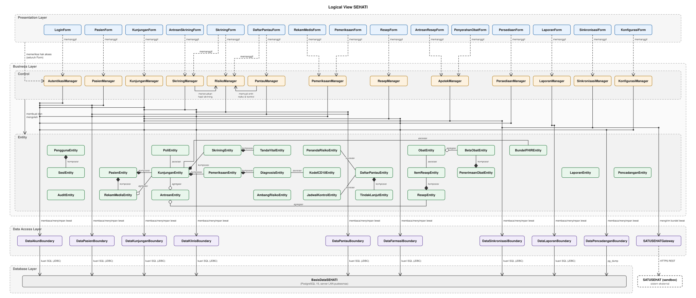
</p>
<p align="center">
<i>Gambar 2. Logical View SEHATI</i>
</p>

Gambar 2 berbentuk *block diagram* yang memuat seluruh komponen Tabel 2.3, dikelompokkan ke empat lapisan Subbab 2.2. *Business Layer* dibagi lagi menjadi sub-kelompok *Control* dan *Entity*. Panah putus-putus berlabel "memanggil" menghubungkan tiap `Form` ke `Manager`-nya, dan satu panah dari seluruh *Presentation Layer* ke `AutentikasiManager` menandai pemeriksaan hak akses sebelum layar dibuka (KF16). Dua relasi antar-`Manager` diambil dari diagram kelas SKPL: `SkriningManager` meneruskan hasil skrining ke `RisikoManager`, dan `PantauManager` memuat entri risiko dan jadwal kontrol dari `RisikoManager`. Panah "membuat dan mengolah" dari *Control* ke *Entity* menandai bahwa objek domain hanya dibuat dan diubah oleh `Manager`. Garis dari tiap `Manager` turun ke jalurnya sendiri, lalu bercabang ke `DataBoundary` yang dipakainya sesuai Tabel 2.4. Titik hitam menandai percabangan, sedangkan garis yang bersilangan tanpa titik tidak saling terhubung. Relasi antar-*entity* (komposisi, agregasi, dan asosiasi) disalin dari diagram kelas keseluruhan SKPL. Di lapisan bawah, setiap `DataBoundary` menjalankan kueri SQL lewat JDBC ke `BasisDataSEHATI`. `DataPencadanganBoundary` menjalankan `pg_dump`, dan `SATUSEHATGateway` mengirim bundel lewat HTTPS ke SATUSEHAT (*sandbox*), sistem luar yang digambar dengan garis putus-putus.

### 2.4.2 Physical View

*Physical View* menggambarkan pemetaan komponen P/L ke *node* perangkat keras tempat komponen itu dijalankan, beserta jalur komunikasi antar-*node*. Bila *Logical View* menjawab komponen mana memanggil komponen mana, *Physical View* menjawab komponen itu terpasang di komputer mana, berjalan di atas lingkungan eksekusi apa, dan lewat jaringan apa datanya berpindah.

Kami memilih *Physical View* karena sebagian besar KNF SEHATI adalah kebutuhan tentang penempatan, bukan tentang fungsi. SEHATI dipasang di beberapa komputer sekaligus (loket, ruang periksa, dan apotek) yang berbagi satu basis data di LAN puskesmas, dan KNF11 menuntut sistem tetap benar saat sedikitnya lima perangkat bekerja bersamaan. Pelayanan juga harus berjalan penuh tanpa internet (KF22, KNF09), sedangkan internet hanya dipakai untuk sinkronisasi ke SATUSEHAT (KF20), dan pencadangan harus disimpan ke media terpisah (KF21). Hal-hal ini hanya terlihat jelas bila komponen digambar di atas komputer tempat ia berjalan. *View* ini juga menjadi bentuk visual Tabel 2.1, karena setiap baris tabel itu (aplikasi, DBMS, sistem operasi, perangkat keras, jaringan, dan pencadangan) muncul sebagai *node*, lingkungan eksekusi, atau jalur komunikasi.

<p align="center">
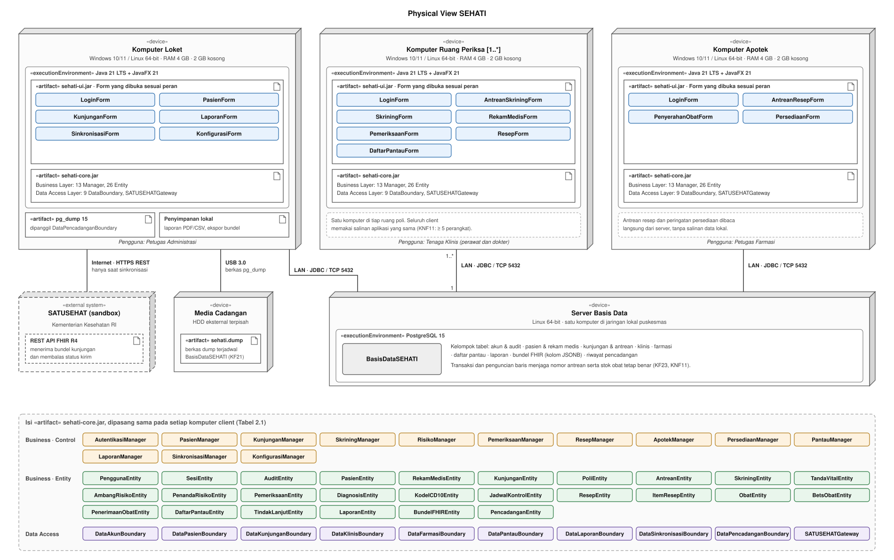
</p>
<p align="center">
<i>Gambar 3. Physical View SEHATI</i>
</p>

Gambar 3 berbentuk *deployment diagram* UML. Ada tiga jenis «device» client, yaitu Komputer Loket, Komputer Ruang Periksa, dan Komputer Apotek, masing-masing dengan spesifikasi minimum KNF10. Komputer Ruang Periksa diberi multiplisitas `1..*` karena tiap ruang poli memiliki komputernya sendiri. Setiap client menjalankan lingkungan eksekusi Java 21 LTS dan JavaFX 21 yang berisi dua *artifact*. `sehati-ui.jar` memuat seluruh `Form`, tetapi yang dapat dibuka di tiap komputer hanya `Form` milik peran penggunanya (KF16), sehingga gambar menuliskan `Form` yang aktif per *node*. `sehati-core.jar` memuat *Business Layer* dan *Data Access Layer* dan isinya sama di setiap client. Rincian isi `sehati-core.jar` dituliskan sekali pada panel bawah agar seluruh 65 komponen Tabel 2.3 tetap tercakup tanpa ditulis berulang.

Seluruh client terhubung ke «device» Server Basis Data lewat jalur berlabel "LAN · JDBC / TCP 5432". Server menjalankan PostgreSQL 15 yang berisi `BasisDataSEHATI`, dan transaksi serta penguncian barisnya menjaga nomor antrean dan stok obat saat beberapa client menulis bersamaan (KF23, KNF11). Hanya Komputer Loket yang memiliki jalur keluar ke internet. Jalur "Internet · HTTPS REST" dipakai `SATUSEHATGateway` saat Petugas Administrasi menjalankan sinkronisasi, dan SATUSEHAT (*sandbox*) digambar dengan garis putus-putus karena berada di luar puskesmas. Bila jalur ini putus, hanya sinkronisasi yang tertunda, sedangkan jalur LAN yang dipakai pelayanan tetap berjalan (KNF09). Komputer Loket juga menyimpan berkas laporan PDF/CSV dan berkas ekspor bundel di penyimpanan lokal, serta menjalankan `pg_dump` lewat `DataPencadanganBoundary`. Hasil *dump* ditulis ke «device» Media Cadangan berupa HDD eksternal yang terhubung lewat USB, terpisah dari server basis data (KF21). `pg_dump` sengaja ditaruh di Komputer Loket, bukan di server. Pencadangan dijadwalkan dan dipantau Petugas Administrasi lewat `KonfigurasiForm` (UC12), dan `DataPencadanganBoundary` yang memanggilnya ikut terpasang di `sehati-core.jar` pada client. `pg_dump` cukup tersambung ke PostgreSQL lewat jalur TCP 5432 yang sudah ada, sehingga server tidak perlu menjalankan komponen SEHATI apa pun selain basis data. Dengan begitu, salinan cadangan juga tersimpan di komputer yang berbeda dari server, jadi kalau server rusak, cadangannya tidak ikut hilang.

<br>

---

# BAB 3: Realisasi Use Case

Setiap *use case* direalisasikan dengan pola yang sama mengikuti Subbab 2.2: aktor berinteraksi dengan `Form`, `Form` memanggil `Manager`, `Manager` membaca dan menyimpan data lewat `DataBoundary`, lalu `DataBoundary` menjalankan kueri JDBC ke PostgreSQL. Objek `Entity` hanya dibuat dan diubah oleh `Manager`. Pada *sequence diagram*, panah utuh adalah pemanggilan metode, panah putus-putus adalah nilai kembalian, dan pesan «create» menandai pembuatan objek baru. Nomor urut pesan dicantumkan pada setiap panah. Setiap pesan yang menuju kelas SEHATI adalah metode yang tercantum pada diagram kelas *use case* tersebut dan pada Tabel 4.1.

Kami menggambar setiap *lifeline* dengan ikon UML sesuai stereotipnya: `Form`, `DataBoundary`, dan `SATUSEHATGateway` sebagai *boundary*, `Manager` sebagai *control*, dan kelas berakhiran `Entity` sebagai *entity*. Fragmen `loop` menandai langkah berulang, `par` menandai dua petugas yang bekerja bersamaan, dan `critical` menandai langkah yang harus selesai dalam satu transaksi. Diagram kelas tiap *use case* hanya memuat atribut dan metode yang dipakai *use case* itu, sedangkan Tabel 4.1 memuat daftar lengkapnya.

## 3.1 Use Case Masuk ke Aplikasi

**ID Use Case:** UC01  
**Nama Use Case:** Masuk ke Aplikasi

### 3.1.1 Identifikasi Kelas

Tabel 3.1. Identifikasi Kelas Use Case UC01

| No | Nama Kelas Perancangan | Nama Kelas Analisis Terkait |
| :--- | :--- | :--- |
| 1 | C01 LoginForm | C01 LoginForm |
| 2 | C17 AutentikasiManager | C17 AutentikasiManager |
| 3 | C56 DataAkunBoundary | Tidak ada (kelas baru perancangan, komponen *Data Access Layer* pada APL) |
| 4 | C30 PenggunaEntity | C30 PenggunaEntity |
| 5 | C31 SesiEntity | C31 SesiEntity |
| 6 | C32 AuditEntity | C32 AuditEntity |

### 3.1.2 Sequence Diagram

- **Skenario Normal**

<p align="center">
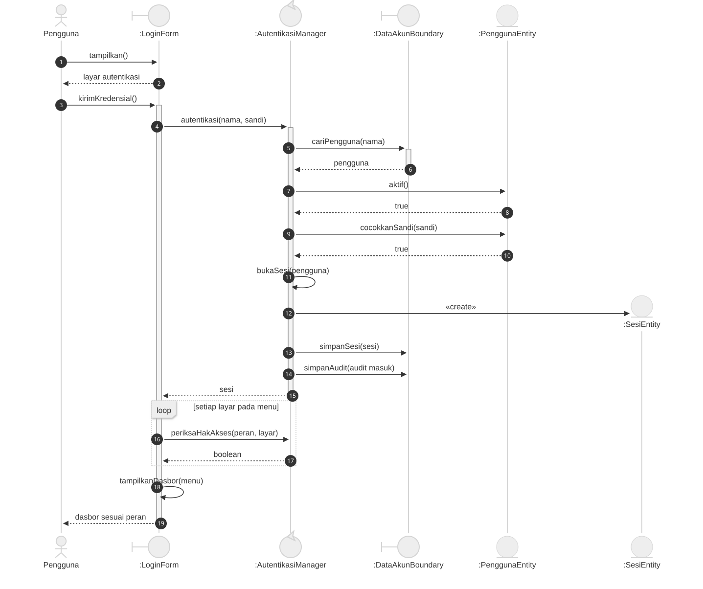
</p>
<p align="center">
<i>Gambar 4. Sequence Diagram UC01 - Skenario Normal</i>
</p>

- **Skenario Alternatif 1: Kredensial Tidak Cocok**

<p align="center">
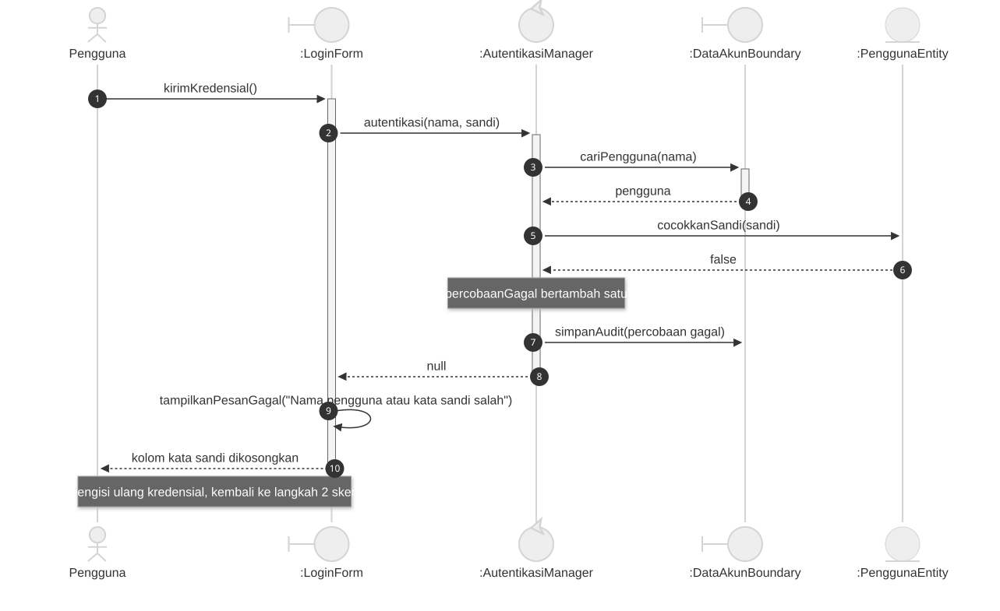
</p>
<p align="center">
<i>Gambar 5. Sequence Diagram UC01 - Skenario Alternatif 1: Kredensial Tidak Cocok</i>
</p>

- **Skenario Alternatif 2: Akun Berstatus Nonaktif**

<p align="center">
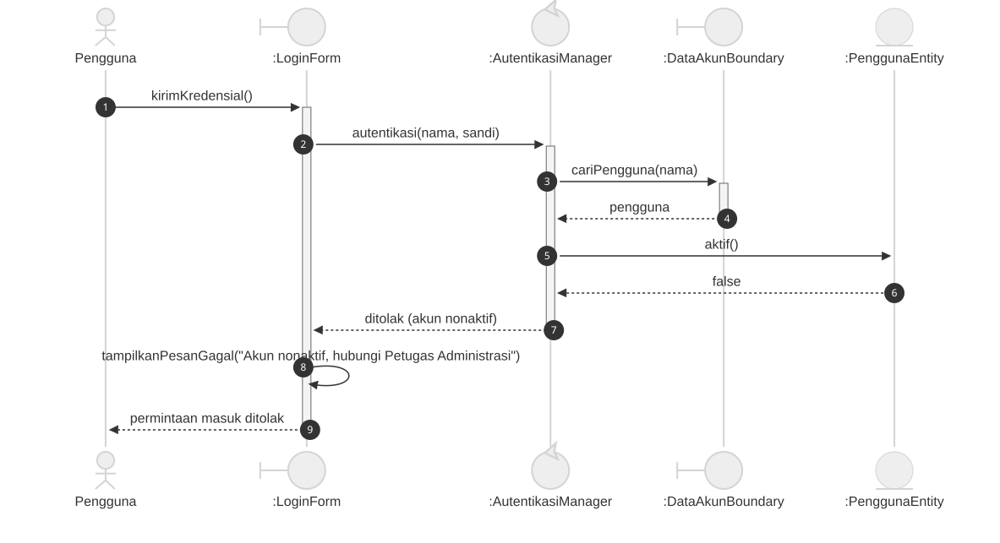
</p>
<p align="center">
<i>Gambar 6. Sequence Diagram UC01 - Skenario Alternatif 2: Akun Berstatus Nonaktif</i>
</p>

- **Skenario Alternatif 3: Pengguna Membuka Modul di Luar Hak Aksesnya**

<p align="center">
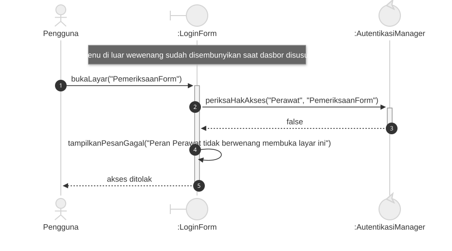
</p>
<p align="center">
<i>Gambar 7. Sequence Diagram UC01 - Skenario Alternatif 3: Pengguna Membuka Modul di Luar Hak Aksesnya</i>
</p>

### 3.1.3 Diagram Kelas

<p align="center">
</p>
<p align="center">
<i>Gambar 8. Diagram Kelas Masuk ke Aplikasi (UC01)</i>
</p>

## 3.2 Use Case Mengelola Data Pasien

**ID Use Case:** UC02  
**Nama Use Case:** Mengelola Data Pasien

### 3.2.1 Identifikasi Kelas

Tabel 3.2. Identifikasi Kelas Use Case UC02

| No | Nama Kelas Perancangan | Nama Kelas Analisis Terkait |
| :--- | :--- | :--- |
| 1 | C02 PasienForm | C02 PasienForm |
| 2 | C18 PasienManager | C18 PasienManager |
| 3 | C56 DataAkunBoundary | Tidak ada (kelas baru perancangan, komponen *Data Access Layer* pada APL) |
| 4 | C57 DataPasienBoundary | Tidak ada (kelas baru perancangan, komponen *Data Access Layer* pada APL) |
| 5 | C32 AuditEntity | C32 AuditEntity |
| 6 | C33 PasienEntity | C33 PasienEntity |
| 7 | C34 RekamMedisEntity | C34 RekamMedisEntity |

### 3.2.2 Sequence Diagram

- **Skenario Normal (Pendaftaran Pasien Baru)**

<p align="center">
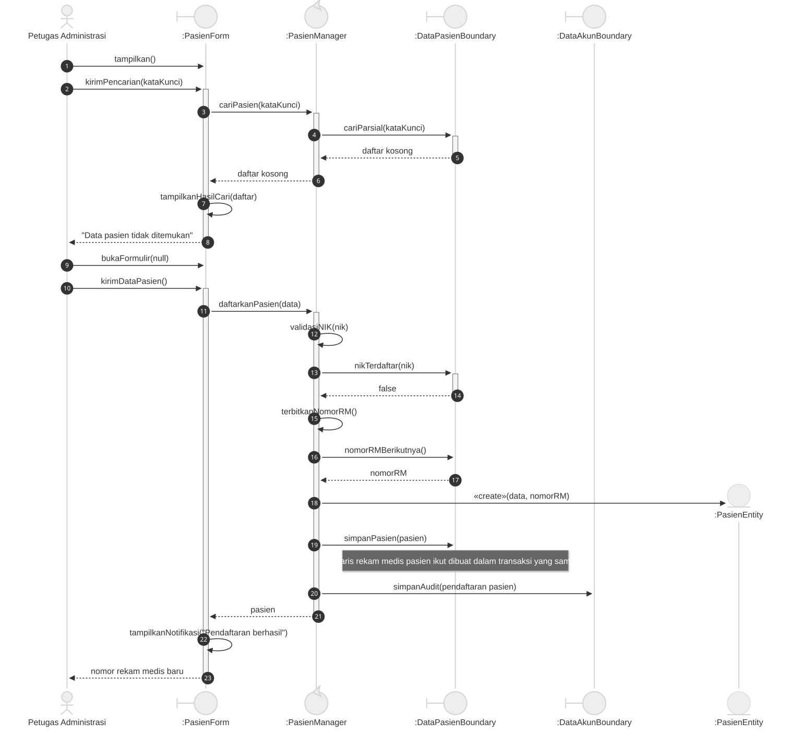
</p>
<p align="center">
<i>Gambar 9. Sequence Diagram UC02 - Skenario Normal (Pendaftaran Pasien Baru)</i>
</p>

- **Skenario Alternatif 1: Memutakhirkan Data Pasien Lama**

<p align="center">
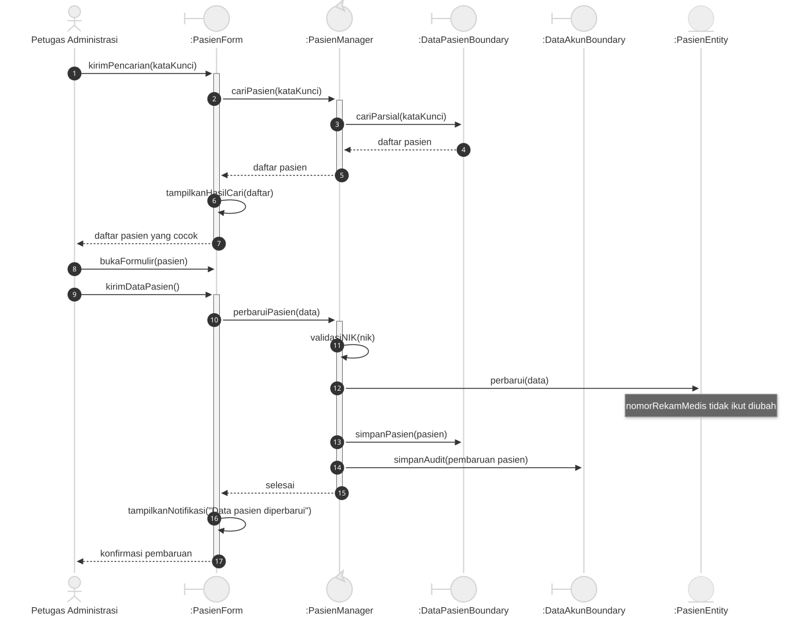
</p>
<p align="center">
<i>Gambar 10. Sequence Diagram UC02 - Skenario Alternatif 1: Memutakhirkan Data Pasien Lama</i>
</p>

- **Skenario Alternatif 2: NIK Tidak Valid atau Sudah Dipakai Pasien Lain**

<p align="center">
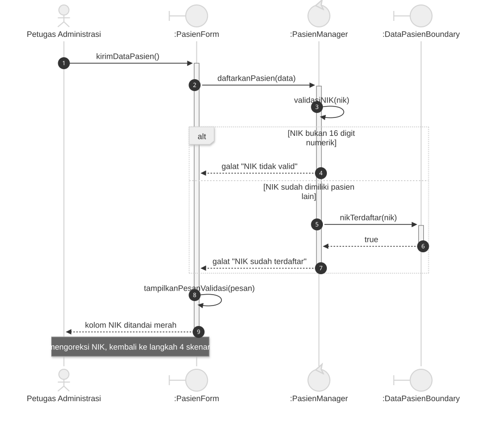
</p>
<p align="center">
<i>Gambar 11. Sequence Diagram UC02 - Skenario Alternatif 2: NIK Tidak Valid atau Sudah Dipakai Pasien Lain</i>
</p>

### 3.2.3 Diagram Kelas

<p align="center">
</p>
<p align="center">
<i>Gambar 12. Diagram Kelas Mengelola Data Pasien (UC02)</i>
</p>

## 3.3 Use Case Mengelola Kunjungan Pasien

**ID Use Case:** UC03  
**Nama Use Case:** Mengelola Kunjungan Pasien

### 3.3.1 Identifikasi Kelas

Tabel 3.3. Identifikasi Kelas Use Case UC03

| No | Nama Kelas Perancangan | Nama Kelas Analisis Terkait |
| :--- | :--- | :--- |
| 1 | C03 KunjunganForm | C03 KunjunganForm |
| 2 | C19 KunjunganManager | C19 KunjunganManager |
| 3 | C56 DataAkunBoundary | Tidak ada (kelas baru perancangan, komponen *Data Access Layer* pada APL) |
| 4 | C57 DataPasienBoundary | Tidak ada (kelas baru perancangan, komponen *Data Access Layer* pada APL) |
| 5 | C58 DataKunjunganBoundary | Tidak ada (kelas baru perancangan, komponen *Data Access Layer* pada APL) |
| 6 | C32 AuditEntity | C32 AuditEntity |
| 7 | C33 PasienEntity | C33 PasienEntity |
| 8 | C35 KunjunganEntity | C35 KunjunganEntity |
| 9 | C36 PoliEntity | C36 PoliEntity |
| 10 | C37 AntreanEntity | C37 AntreanEntity |

### 3.3.2 Sequence Diagram

- **Skenario Normal**

<p align="center">
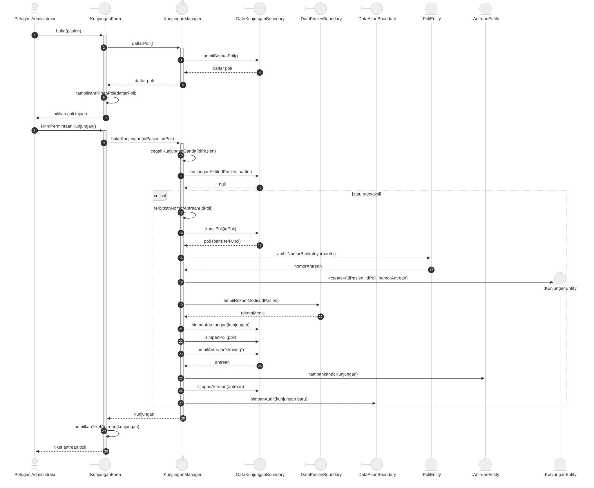
</p>
<p align="center">
<i>Gambar 13. Sequence Diagram UC03 - Skenario Normal</i>
</p>

- **Skenario Alternatif 1: Pasien Masih Punya Kunjungan Aktif Hari Itu**

<p align="center">
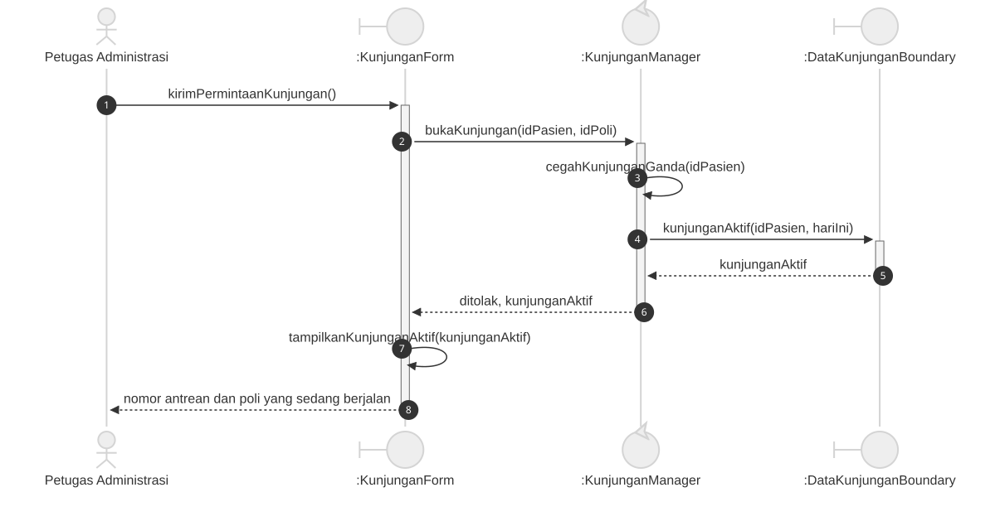
</p>
<p align="center">
<i>Gambar 14. Sequence Diagram UC03 - Skenario Alternatif 1: Pasien Masih Punya Kunjungan Aktif Hari Itu</i>
</p>

- **Skenario Alternatif 2: Dua Petugas Membuka Kunjungan pada Poli yang Sama secara Bersamaan**

<p align="center">
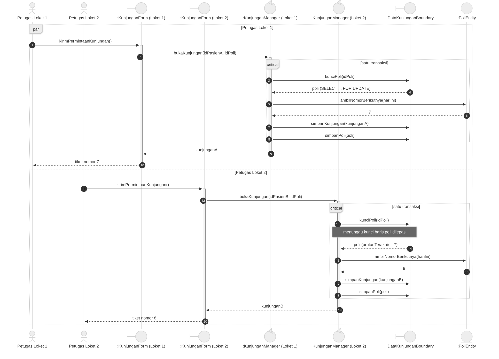
</p>
<p align="center">
<i>Gambar 15. Sequence Diagram UC03 - Skenario Alternatif 2: Dua Petugas Membuka Kunjungan pada Poli yang Sama secara Bersamaan</i>
</p>

- **Skenario Alternatif 3: Hari Pelayanan Berganti**

<p align="center">
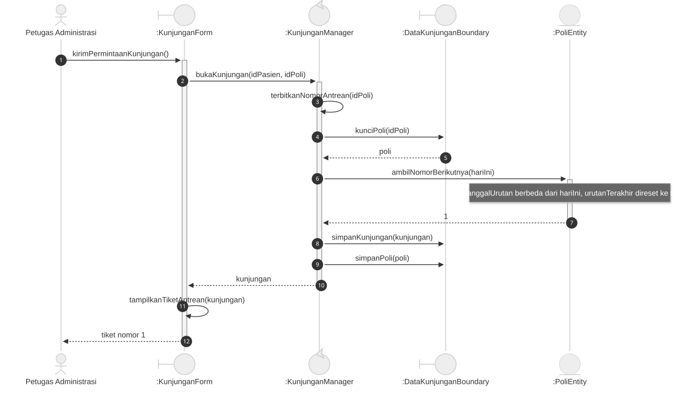
</p>
<p align="center">
<i>Gambar 16. Sequence Diagram UC03 - Skenario Alternatif 3: Hari Pelayanan Berganti</i>
</p>

### 3.3.3 Diagram Kelas

<p align="center">
</p>
<p align="center">
<i>Gambar 17. Diagram Kelas Mengelola Kunjungan Pasien (UC03)</i>
</p>

## 3.4 Use Case Melakukan Skrining Awal

**ID Use Case:** UC04  
**Nama Use Case:** Melakukan Skrining Awal

### 3.4.1 Identifikasi Kelas

Tabel 3.4. Identifikasi Kelas Use Case UC04

| No | Nama Kelas Perancangan | Nama Kelas Analisis Terkait |
| :--- | :--- | :--- |
| 1 | C04 AntreanSkriningForm | C04 AntreanSkriningForm |
| 2 | C05 SkriningForm | C05 SkriningForm |
| 3 | C20 SkriningManager | C20 SkriningManager |
| 4 | C21 RisikoManager | C21 RisikoManager |
| 5 | C58 DataKunjunganBoundary | Tidak ada (kelas baru perancangan, komponen *Data Access Layer* pada APL) |
| 6 | C59 DataKlinisBoundary | Tidak ada (kelas baru perancangan, komponen *Data Access Layer* pada APL) |
| 7 | C60 DataPantauBoundary | Tidak ada (kelas baru perancangan, komponen *Data Access Layer* pada APL) |
| 8 | C35 KunjunganEntity | C35 KunjunganEntity |
| 9 | C37 AntreanEntity | C37 AntreanEntity |
| 10 | C38 SkriningEntity | C38 SkriningEntity |
| 11 | C39 TandaVitalEntity | C39 TandaVitalEntity |
| 12 | C40 AmbangRisikoEntity | C40 AmbangRisikoEntity |
| 13 | C41 PenandaRisikoEntity | C41 PenandaRisikoEntity |
| 14 | C51 DaftarPantauEntity | C51 DaftarPantauEntity |

### 3.4.2 Sequence Diagram

- **Skenario Normal**

<p align="center">
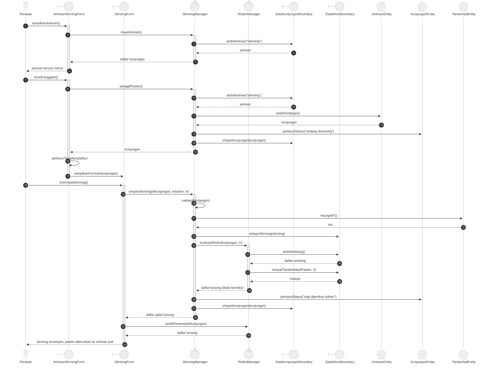
</p>
<p align="center">
<i>Gambar 18. Sequence Diagram UC04 - Skenario Normal</i>
</p>

- **Skenario Alternatif 1: Pasien Tidak Hadir saat Dipanggil**

<p align="center">

</p>
<p align="center">
<i>Gambar 19. Sequence Diagram UC04 - Skenario Alternatif 1: Pasien Tidak Hadir saat Dipanggil</i>
</p>

- **Skenario Alternatif 2: Nilai Pengukuran di Luar Rentang Fisiologis Wajar**

<p align="center">
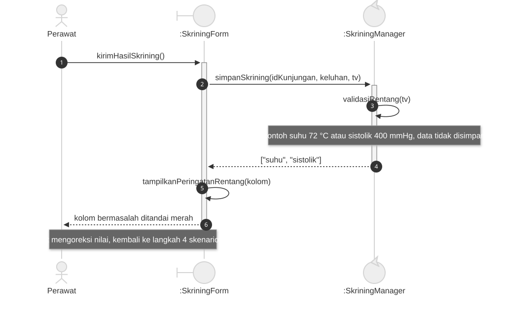
</p>
<p align="center">
<i>Gambar 20. Sequence Diagram UC04 - Skenario Alternatif 2: Nilai Pengukuran di Luar Rentang Fisiologis Wajar</i>
</p>

- **Skenario Alternatif 3: Hasil Pengukuran Melampaui Ambang Risiko**

<p align="center">
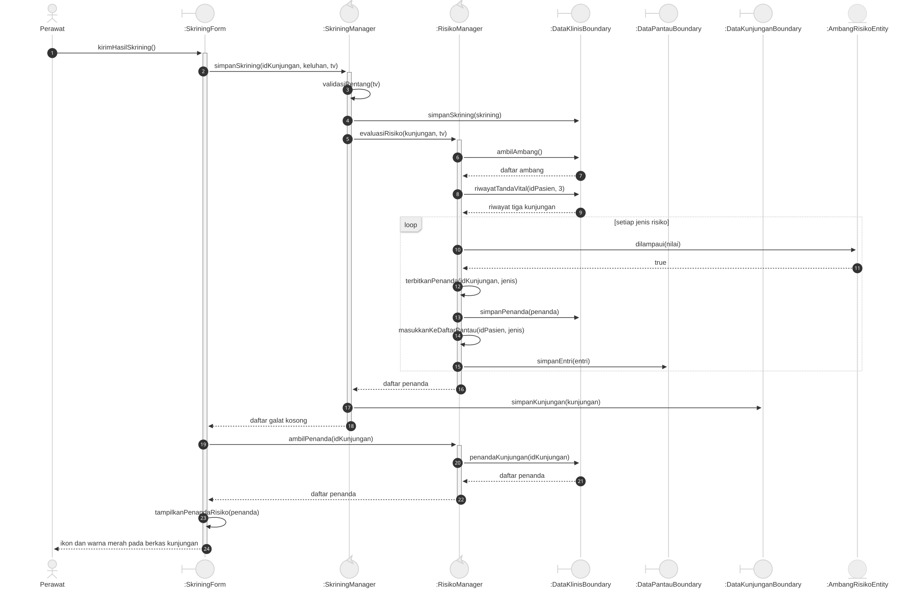
</p>
<p align="center">
<i>Gambar 21. Sequence Diagram UC04 - Skenario Alternatif 3: Hasil Pengukuran Melampaui Ambang Risiko</i>
</p>

### 3.4.3 Diagram Kelas

<p align="center">
</p>
<p align="center">
<i>Gambar 22. Diagram Kelas Melakukan Skrining Awal (UC04)</i>
</p>

## 3.5 Use Case Melakukan Pemeriksaan Medis

**ID Use Case:** UC05  
**Nama Use Case:** Melakukan Pemeriksaan Medis

### 3.5.1 Identifikasi Kelas

Tabel 3.5. Identifikasi Kelas Use Case UC05

| No | Nama Kelas Perancangan | Nama Kelas Analisis Terkait |
| :--- | :--- | :--- |
| 1 | C06 RekamMedisForm | C06 RekamMedisForm |
| 2 | C07 PemeriksaanForm | C07 PemeriksaanForm |
| 3 | C17 AutentikasiManager | C17 AutentikasiManager |
| 4 | C22 PemeriksaanManager | C22 PemeriksaanManager |
| 5 | C56 DataAkunBoundary | Tidak ada (kelas baru perancangan, komponen *Data Access Layer* pada APL) |
| 6 | C57 DataPasienBoundary | Tidak ada (kelas baru perancangan, komponen *Data Access Layer* pada APL) |
| 7 | C58 DataKunjunganBoundary | Tidak ada (kelas baru perancangan, komponen *Data Access Layer* pada APL) |
| 8 | C59 DataKlinisBoundary | Tidak ada (kelas baru perancangan, komponen *Data Access Layer* pada APL) |
| 9 | C32 AuditEntity | C32 AuditEntity |
| 10 | C34 RekamMedisEntity | C34 RekamMedisEntity |
| 11 | C35 KunjunganEntity | C35 KunjunganEntity |
| 12 | C39 TandaVitalEntity | C39 TandaVitalEntity |
| 13 | C42 PemeriksaanEntity | C42 PemeriksaanEntity |
| 14 | C43 DiagnosisEntity | C43 DiagnosisEntity |
| 15 | C44 KodeICD10Entity | C44 KodeICD10Entity |
| 16 | C45 JadwalKontrolEntity | C45 JadwalKontrolEntity |

### 3.5.2 Sequence Diagram

- **Skenario Normal**

<p align="center">
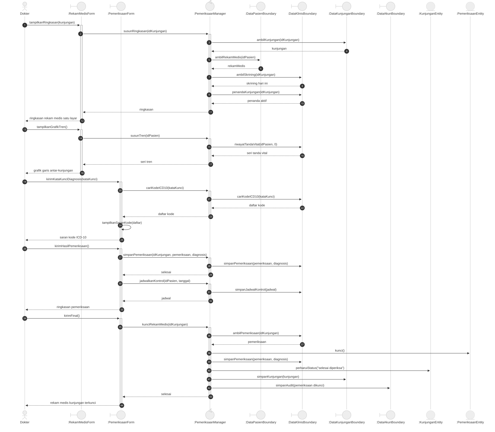
</p>
<p align="center">
<i>Gambar 23. Sequence Diagram UC05 - Skenario Normal</i>
</p>

- **Skenario Alternatif 1: Pengguna yang Membuka Layar Bukan Berstatus Dokter**

<p align="center">
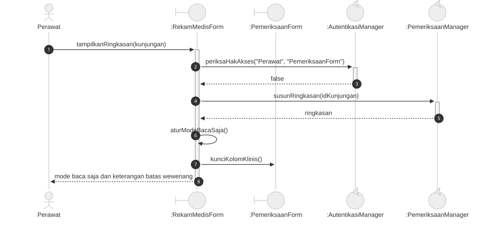
</p>
<p align="center">
<i>Gambar 24. Sequence Diagram UC05 - Skenario Alternatif 1: Pengguna yang Membuka Layar Bukan Berstatus Dokter</i>
</p>

- **Skenario Alternatif 2: Kode Diagnosis ICD-10 Tidak Ditemukan**

<p align="center">

</p>
<p align="center">
<i>Gambar 25. Sequence Diagram UC05 - Skenario Alternatif 2: Kode Diagnosis ICD-10 Tidak Ditemukan</i>
</p>

- **Skenario Alternatif 3: Pemeriksaan Berlangsung saat Koneksi Internet Terputus**

<p align="center">
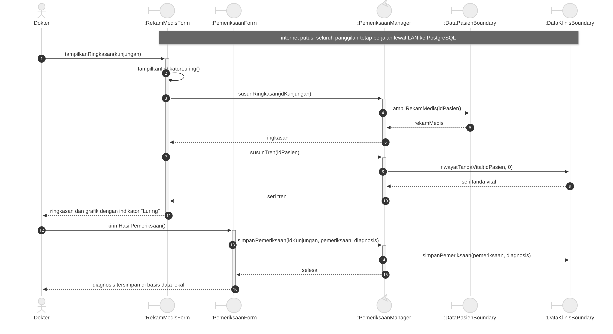
</p>
<p align="center">
<i>Gambar 26. Sequence Diagram UC05 - Skenario Alternatif 3: Pemeriksaan Berlangsung saat Koneksi Internet Terputus</i>
</p>

- **Skenario Alternatif 4: Pasien Baru Pertama Kali Berkunjung**

<p align="center">
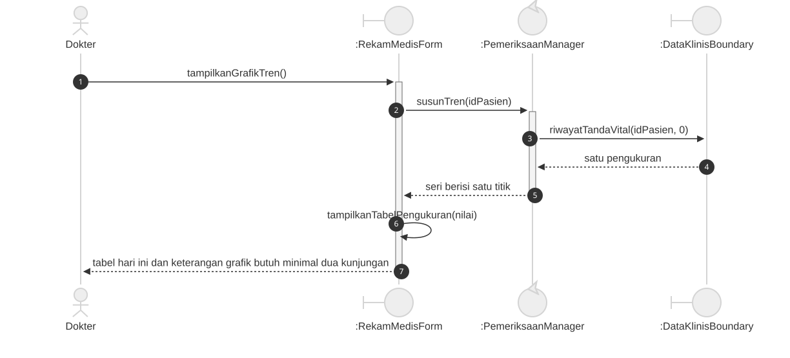
</p>
<p align="center">
<i>Gambar 27. Sequence Diagram UC05 - Skenario Alternatif 4: Pasien Baru Pertama Kali Berkunjung</i>
</p>

### 3.5.3 Diagram Kelas

<p align="center">
</p>
<p align="center">
<i>Gambar 28. Diagram Kelas Melakukan Pemeriksaan Medis (UC05)</i>
</p>

## 3.6 Use Case Menyusun Resep Elektronik

**ID Use Case:** UC06  
**Nama Use Case:** Menyusun Resep Elektronik

### 3.6.1 Identifikasi Kelas

Tabel 3.6. Identifikasi Kelas Use Case UC06

| No | Nama Kelas Perancangan | Nama Kelas Analisis Terkait |
| :--- | :--- | :--- |
| 1 | C08 ResepForm | C08 ResepForm |
| 2 | C23 ResepManager | C23 ResepManager |
| 3 | C58 DataKunjunganBoundary | Tidak ada (kelas baru perancangan, komponen *Data Access Layer* pada APL) |
| 4 | C61 DataFarmasiBoundary | Tidak ada (kelas baru perancangan, komponen *Data Access Layer* pada APL) |
| 5 | C37 AntreanEntity | C37 AntreanEntity |
| 6 | C42 PemeriksaanEntity | C42 PemeriksaanEntity |
| 7 | C46 ResepEntity | C46 ResepEntity |
| 8 | C47 ItemResepEntity | C47 ItemResepEntity |
| 9 | C48 ObatEntity | C48 ObatEntity |

### 3.6.2 Sequence Diagram

- **Skenario Normal**

<p align="center">
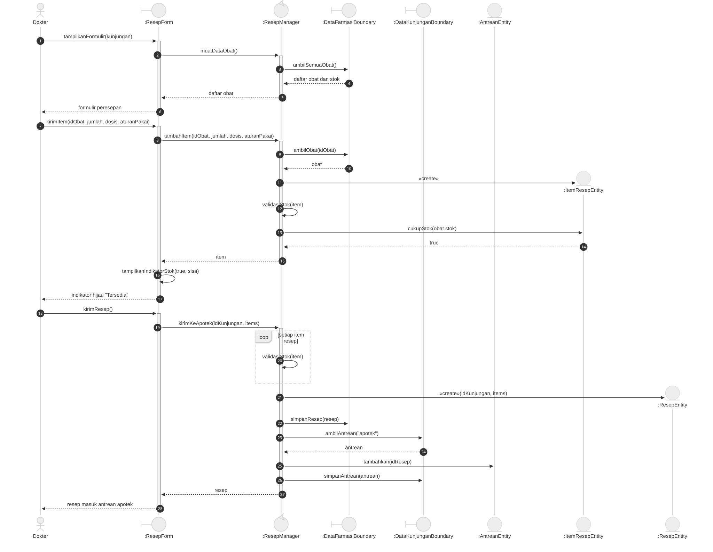
</p>
<p align="center">
<i>Gambar 29. Sequence Diagram UC06 - Skenario Normal</i>
</p>

- **Skenario Alternatif 1: Jumlah Obat yang Diresepkan Melampaui Stok**

<p align="center">
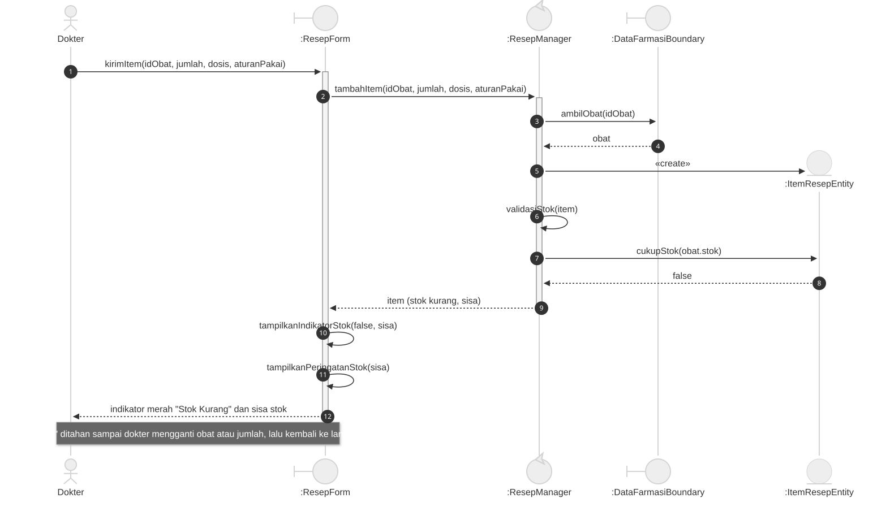
</p>
<p align="center">
<i>Gambar 30. Sequence Diagram UC06 - Skenario Alternatif 1: Jumlah Obat yang Diresepkan Melampaui Stok</i>
</p>

### 3.6.3 Diagram Kelas

<p align="center">
</p>
<p align="center">
<i>Gambar 31. Diagram Kelas Menyusun Resep Elektronik (UC06)</i>
</p>

## 3.7 Use Case Melayani Resep Obat

**ID Use Case:** UC07  
**Nama Use Case:** Melayani Resep Obat

### 3.7.1 Identifikasi Kelas

Tabel 3.7. Identifikasi Kelas Use Case UC07

| No | Nama Kelas Perancangan | Nama Kelas Analisis Terkait |
| :--- | :--- | :--- |
| 1 | C09 AntreanResepForm | C09 AntreanResepForm |
| 2 | C10 PenyerahanObatForm | C10 PenyerahanObatForm |
| 3 | C24 ApotekManager | C24 ApotekManager |
| 4 | C58 DataKunjunganBoundary | Tidak ada (kelas baru perancangan, komponen *Data Access Layer* pada APL) |
| 5 | C61 DataFarmasiBoundary | Tidak ada (kelas baru perancangan, komponen *Data Access Layer* pada APL) |
| 6 | C63 DataSinkronisasiBoundary | Tidak ada (kelas baru perancangan, komponen *Data Access Layer* pada APL) |
| 7 | C35 KunjunganEntity | C35 KunjunganEntity |
| 8 | C37 AntreanEntity | C37 AntreanEntity |
| 9 | C46 ResepEntity | C46 ResepEntity |
| 10 | C47 ItemResepEntity | C47 ItemResepEntity |
| 11 | C48 ObatEntity | C48 ObatEntity |
| 12 | C49 BetsObatEntity | C49 BetsObatEntity |
| 13 | C54 BundelFHIREntity | C54 BundelFHIREntity |

### 3.7.2 Sequence Diagram

- **Skenario Normal**

<p align="center">
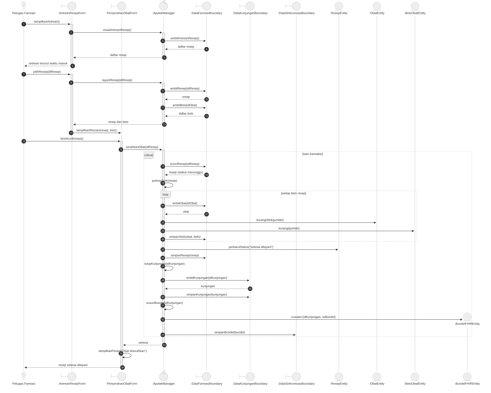
</p>
<p align="center">
<i>Gambar 32. Sequence Diagram UC07 - Skenario Normal</i>
</p>

- **Skenario Alternatif 1: Sediaan Obat Bermasalah saat Disiapkan**

<p align="center">
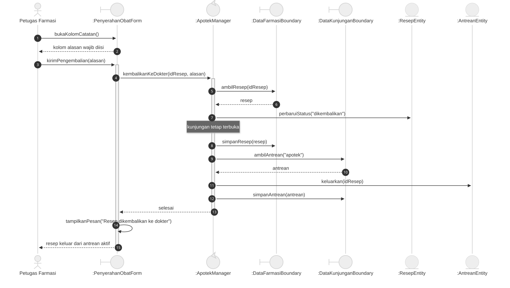
</p>
<p align="center">
<i>Gambar 33. Sequence Diagram UC07 - Skenario Alternatif 1: Sediaan Obat Bermasalah saat Disiapkan</i>
</p>

- **Skenario Alternatif 2: Dua Petugas Mengonfirmasi Penyerahan secara Bersamaan**

<p align="center">
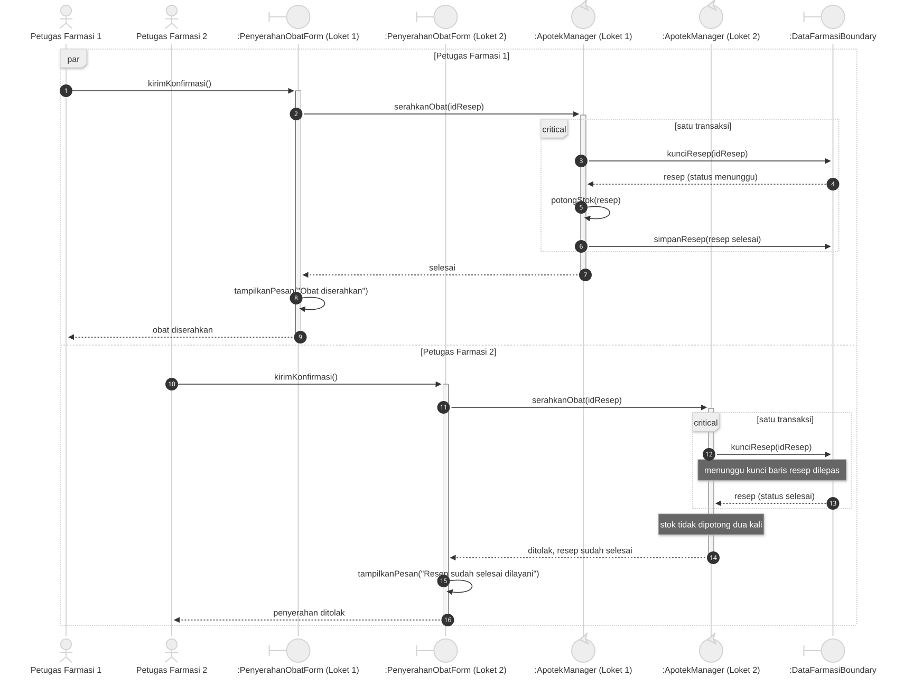
</p>
<p align="center">
<i>Gambar 34. Sequence Diagram UC07 - Skenario Alternatif 2: Dua Petugas Mengonfirmasi Penyerahan secara Bersamaan</i>
</p>

### 3.7.3 Diagram Kelas

<p align="center">
</p>
<p align="center">
<i>Gambar 35. Diagram Kelas Melayani Resep Obat (UC07)</i>
</p>

## 3.8 Use Case Mengelola Persediaan Obat

**ID Use Case:** UC08  
**Nama Use Case:** Mengelola Persediaan Obat

### 3.8.1 Identifikasi Kelas

Tabel 3.8. Identifikasi Kelas Use Case UC08

| No | Nama Kelas Perancangan | Nama Kelas Analisis Terkait |
| :--- | :--- | :--- |
| 1 | C11 PersediaanForm | C11 PersediaanForm |
| 2 | C25 PersediaanManager | C25 PersediaanManager |
| 3 | C56 DataAkunBoundary | Tidak ada (kelas baru perancangan, komponen *Data Access Layer* pada APL) |
| 4 | C61 DataFarmasiBoundary | Tidak ada (kelas baru perancangan, komponen *Data Access Layer* pada APL) |
| 5 | C32 AuditEntity | C32 AuditEntity |
| 6 | C48 ObatEntity | C48 ObatEntity |
| 7 | C49 BetsObatEntity | C49 BetsObatEntity |
| 8 | C50 PenerimaanObatEntity | C50 PenerimaanObatEntity |

### 3.8.2 Sequence Diagram

- **Skenario Normal**

<p align="center">
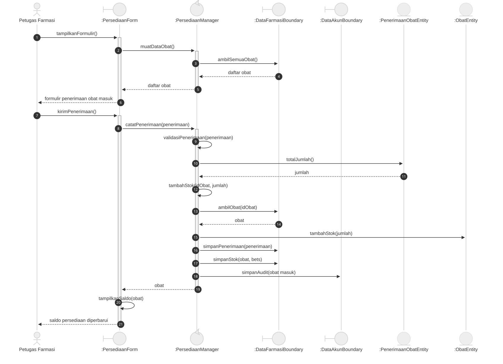
</p>
<p align="center">
<i>Gambar 36. Sequence Diagram UC08 - Skenario Normal</i>
</p>

- **Skenario Alternatif 1: Stok Menipis atau Bets Mendekati Kedaluwarsa**

<p align="center">
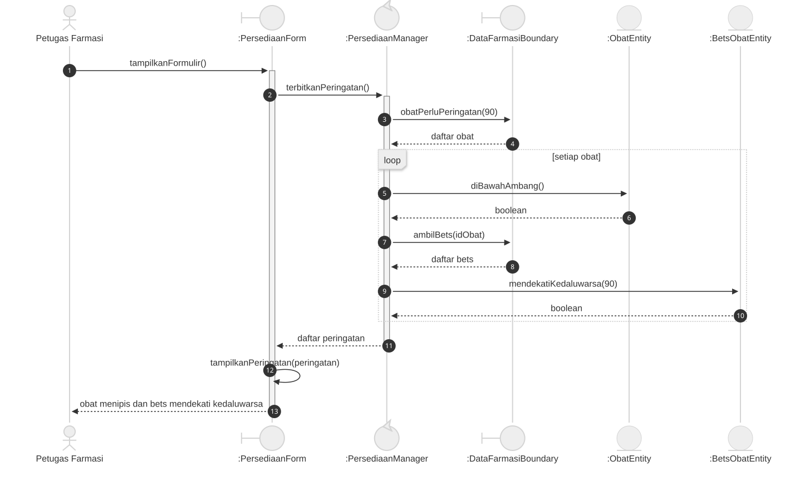
</p>
<p align="center">
<i>Gambar 37. Sequence Diagram UC08 - Skenario Alternatif 1: Stok Menipis atau Bets Mendekati Kedaluwarsa</i>
</p>

- **Skenario Alternatif 2: Jumlah atau Tanggal Kedaluwarsa Tidak Valid**

<p align="center">
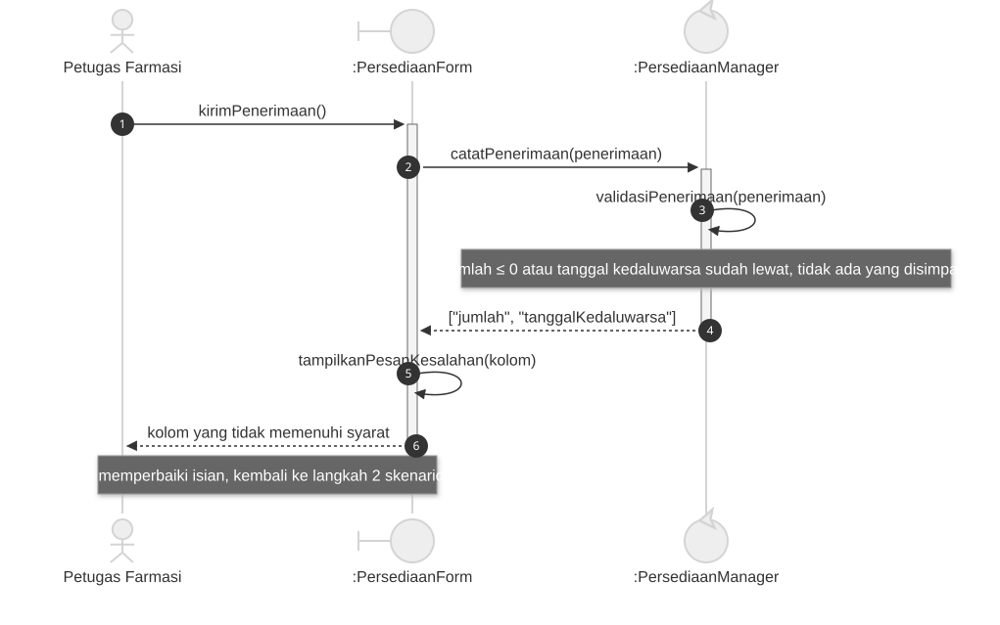
</p>
<p align="center">
<i>Gambar 38. Sequence Diagram UC08 - Skenario Alternatif 2: Jumlah atau Tanggal Kedaluwarsa Tidak Valid</i>
</p>

### 3.8.3 Diagram Kelas

<p align="center">
</p>
<p align="center">
<i>Gambar 39. Diagram Kelas Mengelola Persediaan Obat (UC08)</i>
</p>

## 3.9 Use Case Mengelola Daftar Pantau Pasien

**ID Use Case:** UC09  
**Nama Use Case:** Mengelola Daftar Pantau Pasien

### 3.9.1 Identifikasi Kelas

Tabel 3.9. Identifikasi Kelas Use Case UC09

| No | Nama Kelas Perancangan | Nama Kelas Analisis Terkait |
| :--- | :--- | :--- |
| 1 | C12 DaftarPantauForm | C12 DaftarPantauForm |
| 2 | C21 RisikoManager | C21 RisikoManager |
| 3 | C26 PantauManager | C26 PantauManager |
| 4 | C57 DataPasienBoundary | Tidak ada (kelas baru perancangan, komponen *Data Access Layer* pada APL) |
| 5 | C59 DataKlinisBoundary | Tidak ada (kelas baru perancangan, komponen *Data Access Layer* pada APL) |
| 6 | C60 DataPantauBoundary | Tidak ada (kelas baru perancangan, komponen *Data Access Layer* pada APL) |
| 7 | C33 PasienEntity | C33 PasienEntity |
| 8 | C34 RekamMedisEntity | C34 RekamMedisEntity |
| 9 | C41 PenandaRisikoEntity | C41 PenandaRisikoEntity |
| 10 | C45 JadwalKontrolEntity | C45 JadwalKontrolEntity |
| 11 | C51 DaftarPantauEntity | C51 DaftarPantauEntity |
| 12 | C52 TindakLanjutEntity | C52 TindakLanjutEntity |

### 3.9.2 Sequence Diagram

- **Skenario Normal**

<p align="center">
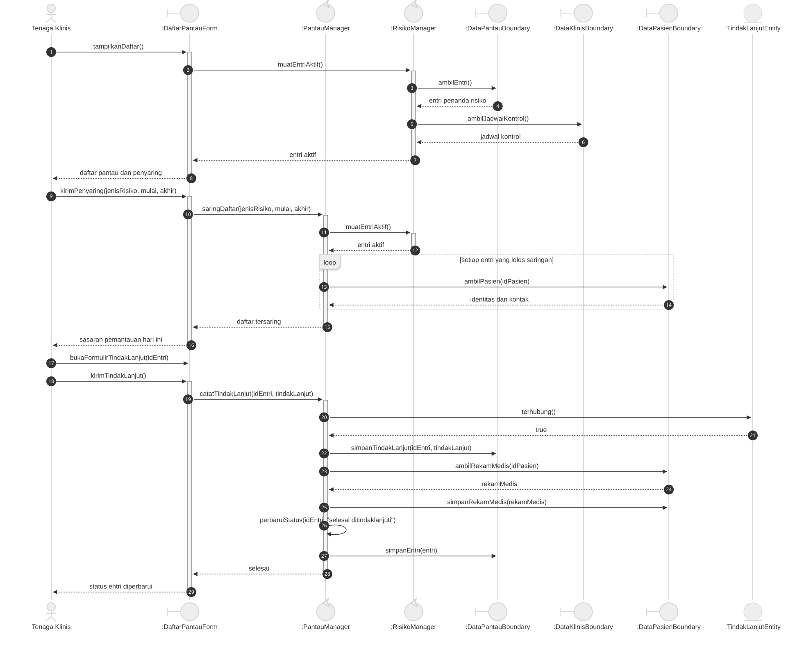
</p>
<p align="center">
<i>Gambar 40. Sequence Diagram UC09 - Skenario Normal</i>
</p>

- **Skenario Alternatif 1: Pasien Belum Dapat Dihubungi**

<p align="center">
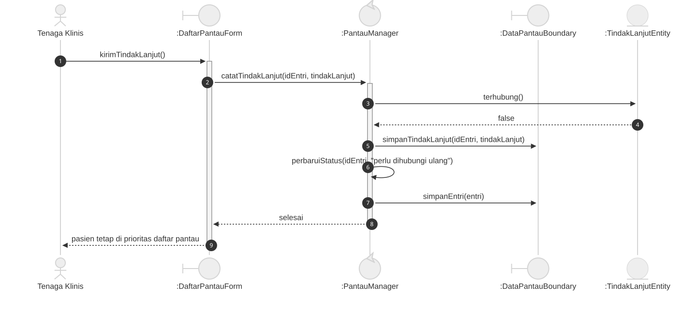
</p>
<p align="center">
<i>Gambar 41. Sequence Diagram UC09 - Skenario Alternatif 1: Pasien Belum Dapat Dihubungi</i>
</p>

- **Skenario Alternatif 2: Penyaringan Tidak Menemukan Pasien**

<p align="center">

</p>
<p align="center">
<i>Gambar 42. Sequence Diagram UC09 - Skenario Alternatif 2: Penyaringan Tidak Menemukan Pasien</i>
</p>

### 3.9.3 Diagram Kelas

<p align="center">
</p>
<p align="center">
<i>Gambar 43. Diagram Kelas Mengelola Daftar Pantau Pasien (UC09)</i>
</p>

## 3.10 Use Case Menyusun Laporan Periodik

**ID Use Case:** UC10  
**Nama Use Case:** Menyusun Laporan Periodik

### 3.10.1 Identifikasi Kelas

Tabel 3.10. Identifikasi Kelas Use Case UC10

| No | Nama Kelas Perancangan | Nama Kelas Analisis Terkait |
| :--- | :--- | :--- |
| 1 | C13 LaporanForm | C13 LaporanForm |
| 2 | C27 LaporanManager | C27 LaporanManager |
| 3 | C62 DataLaporanBoundary | Tidak ada (kelas baru perancangan, komponen *Data Access Layer* pada APL) |
| 4 | C35 KunjunganEntity | C35 KunjunganEntity |
| 5 | C36 PoliEntity | C36 PoliEntity |
| 6 | C43 DiagnosisEntity | C43 DiagnosisEntity |
| 7 | C53 LaporanEntity | C53 LaporanEntity |

### 3.10.2 Sequence Diagram

- **Skenario Normal**

<p align="center">
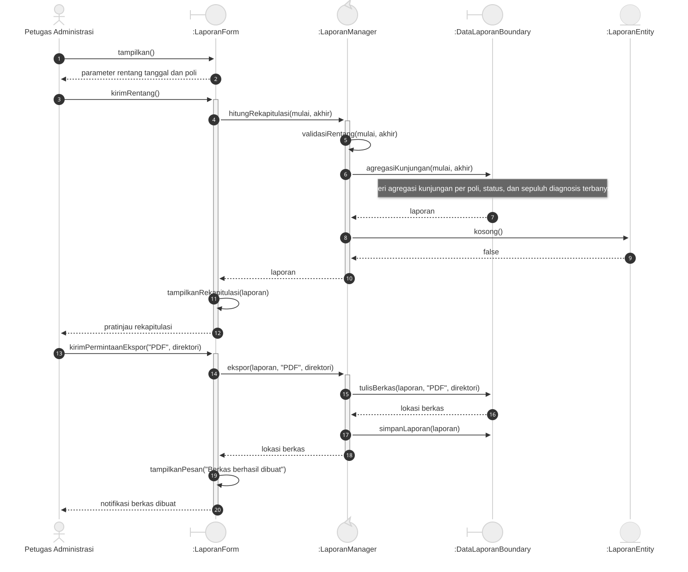
</p>
<p align="center">
<i>Gambar 44. Sequence Diagram UC10 - Skenario Normal</i>
</p>

- **Skenario Alternatif 1: Tidak Ada Pelayanan pada Rentang Waktu Terpilih**

<p align="center">
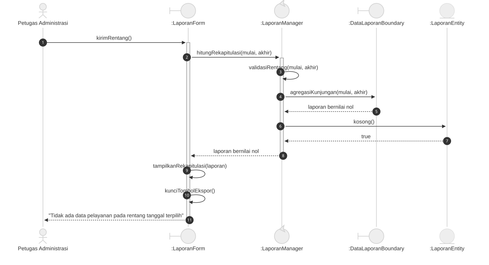
</p>
<p align="center">
<i>Gambar 45. Sequence Diagram UC10 - Skenario Alternatif 1: Tidak Ada Pelayanan pada Rentang Waktu Terpilih</i>
</p>

- **Skenario Alternatif 2: Rentang Tanggal Tidak Valid**

<p align="center">
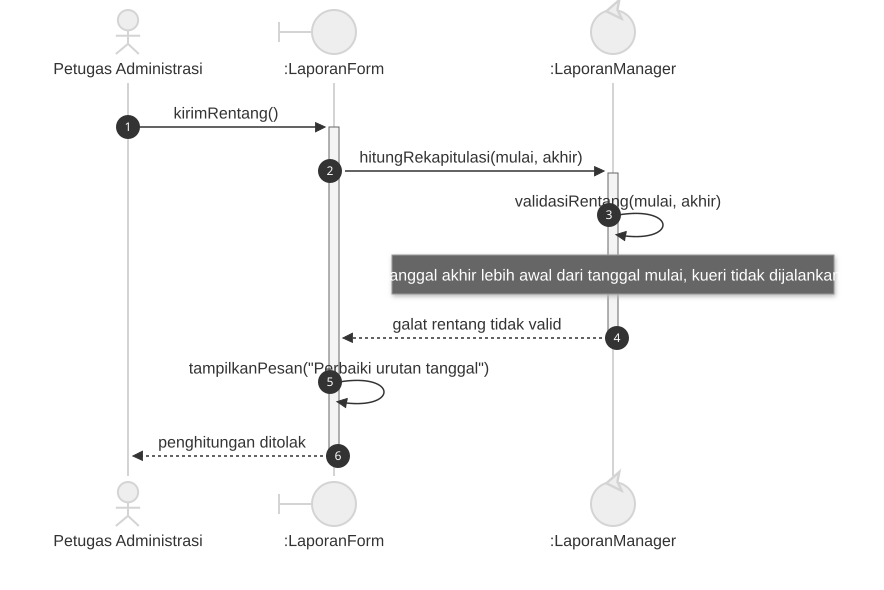
</p>
<p align="center">
<i>Gambar 46. Sequence Diagram UC10 - Skenario Alternatif 2: Rentang Tanggal Tidak Valid</i>
</p>

### 3.10.3 Diagram Kelas

<p align="center">

</p>
<p align="center">
<i>Gambar 47. Diagram Kelas Menyusun Laporan Periodik (UC10)</i>
</p>

## 3.11 Use Case Melakukan Sinkronisasi SATUSEHAT

**ID Use Case:** UC11  
**Nama Use Case:** Melakukan Sinkronisasi SATUSEHAT

### 3.11.1 Identifikasi Kelas

Tabel 3.11. Identifikasi Kelas Use Case UC11

| No | Nama Kelas Perancangan | Nama Kelas Analisis Terkait |
| :--- | :--- | :--- |
| 1 | C14 SinkronisasiForm | C14 SinkronisasiForm |
| 2 | C28 SinkronisasiManager | C28 SinkronisasiManager |
| 3 | C15 SATUSEHATGateway | C15 SATUSEHATGateway |
| 4 | C63 DataSinkronisasiBoundary | Tidak ada (kelas baru perancangan, komponen *Data Access Layer* pada APL) |
| 5 | C35 KunjunganEntity | C35 KunjunganEntity |
| 6 | C54 BundelFHIREntity | C54 BundelFHIREntity |

### 3.11.2 Sequence Diagram

- **Skenario Normal**

<p align="center">
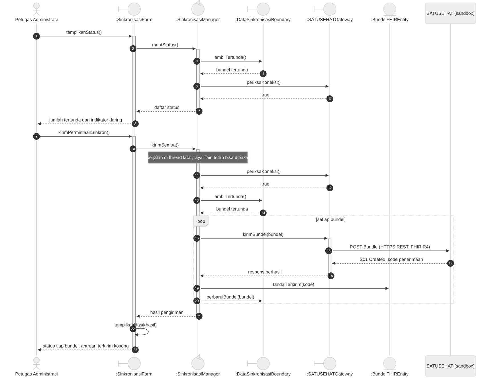
</p>
<p align="center">
<i>Gambar 48. Sequence Diagram UC11 - Skenario Normal</i>
</p>

- **Skenario Alternatif 1: Sinkronisasi Dijalankan saat Jaringan Terputus**

<p align="center">
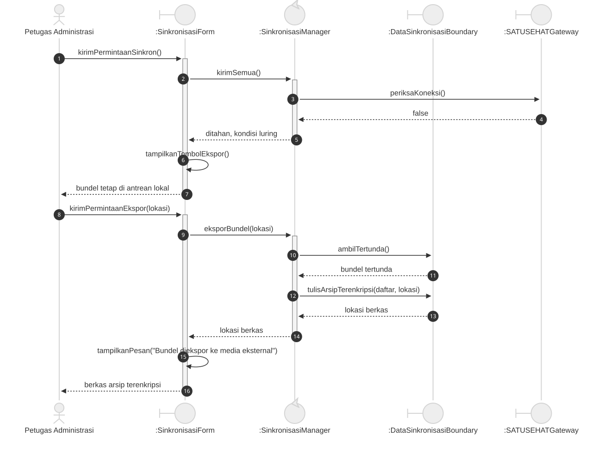
</p>
<p align="center">
<i>Gambar 49. Sequence Diagram UC11 - Skenario Alternatif 1: Sinkronisasi Dijalankan saat Jaringan Terputus</i>
</p>

- **Skenario Alternatif 2: SATUSEHAT Menolak Sebagian Bundel**

<p align="center">
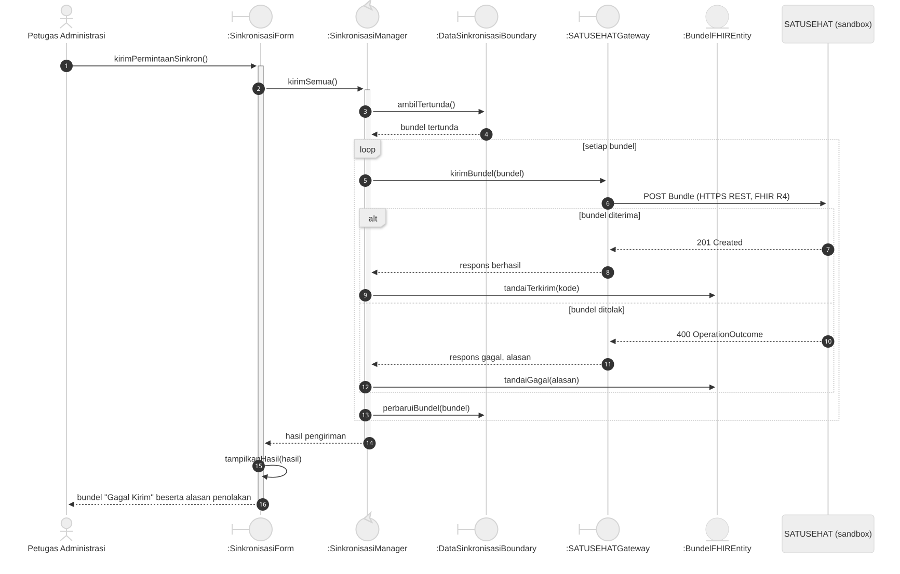
</p>
<p align="center">
<i>Gambar 50. Sequence Diagram UC11 - Skenario Alternatif 2: SATUSEHAT Menolak Sebagian Bundel</i>
</p>

### 3.11.3 Diagram Kelas

<p align="center">

</p>
<p align="center">
<i>Gambar 51. Diagram Kelas Melakukan Sinkronisasi SATUSEHAT (UC11)</i>
</p>

## 3.12 Use Case Mengelola Konfigurasi & Basis Data Sistem

**ID Use Case:** UC12  
**Nama Use Case:** Mengelola Konfigurasi & Basis Data Sistem

### 3.12.1 Identifikasi Kelas

Tabel 3.12. Identifikasi Kelas Use Case UC12

| No | Nama Kelas Perancangan | Nama Kelas Analisis Terkait |
| :--- | :--- | :--- |
| 1 | C16 KonfigurasiForm | C16 KonfigurasiForm |
| 2 | C29 KonfigurasiManager | C29 KonfigurasiManager |
| 3 | C56 DataAkunBoundary | Tidak ada (kelas baru perancangan, komponen *Data Access Layer* pada APL) |
| 4 | C58 DataKunjunganBoundary | Tidak ada (kelas baru perancangan, komponen *Data Access Layer* pada APL) |
| 5 | C59 DataKlinisBoundary | Tidak ada (kelas baru perancangan, komponen *Data Access Layer* pada APL) |
| 6 | C61 DataFarmasiBoundary | Tidak ada (kelas baru perancangan, komponen *Data Access Layer* pada APL) |
| 7 | C64 DataPencadanganBoundary | Tidak ada (kelas baru perancangan, komponen *Data Access Layer* pada APL) |
| 8 | C30 PenggunaEntity | C30 PenggunaEntity |
| 9 | C32 AuditEntity | C32 AuditEntity |
| 10 | C36 PoliEntity | C36 PoliEntity |
| 11 | C40 AmbangRisikoEntity | C40 AmbangRisikoEntity |
| 12 | C48 ObatEntity | C48 ObatEntity |
| 13 | C55 PencadanganEntity | C55 PencadanganEntity |

### 3.12.2 Sequence Diagram

- **Skenario Normal (Manajemen Akun dan Data Master)**

<p align="center">
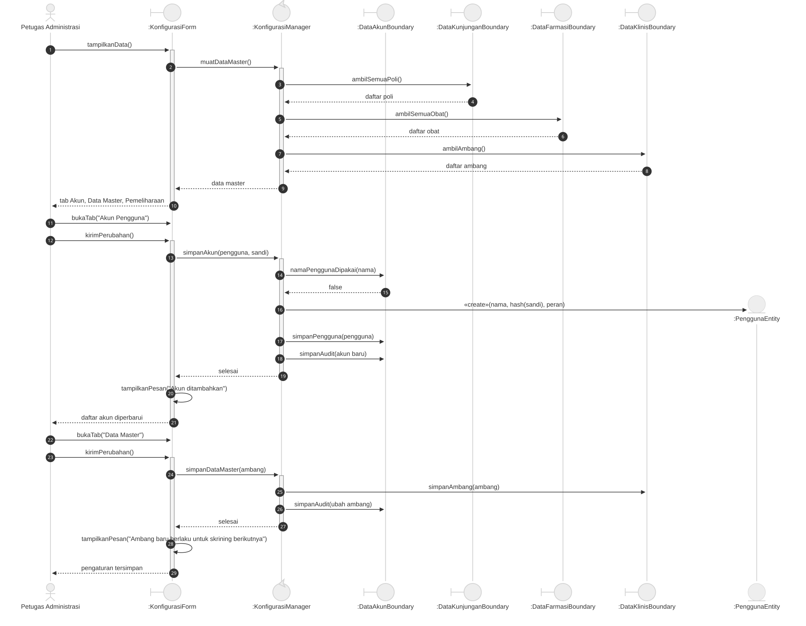
</p>
<p align="center">
<i>Gambar 52. Sequence Diagram UC12 - Skenario Normal (Manajemen Akun dan Data Master)</i>
</p>

- **Skenario Alternatif 1: Memantau dan Menjalankan Pencadangan Basis Data**

<p align="center">
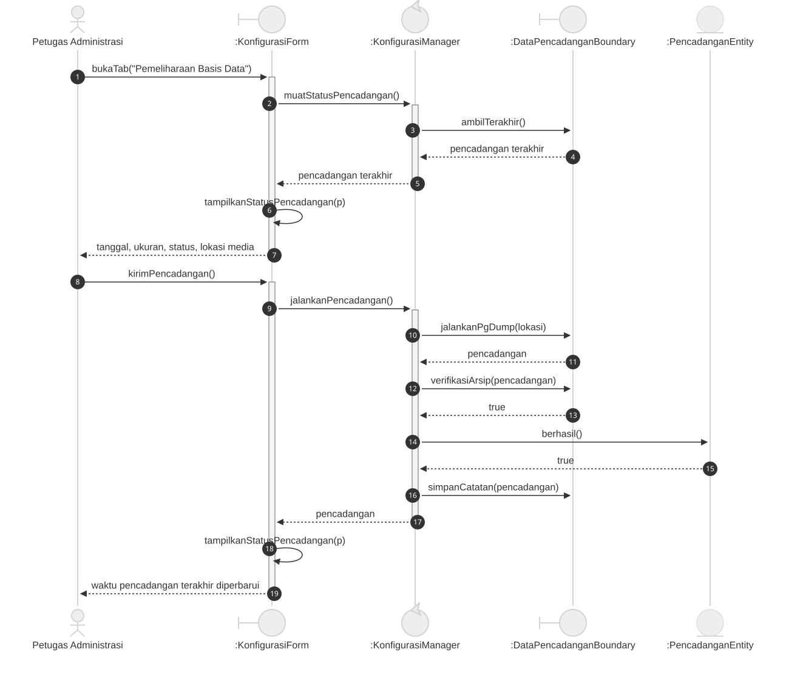
</p>
<p align="center">
<i>Gambar 53. Sequence Diagram UC12 - Skenario Alternatif 1: Memantau dan Menjalankan Pencadangan Basis Data</i>
</p>

- **Skenario Alternatif 2: Nama Pengguna Sudah Dipakai**

<p align="center">
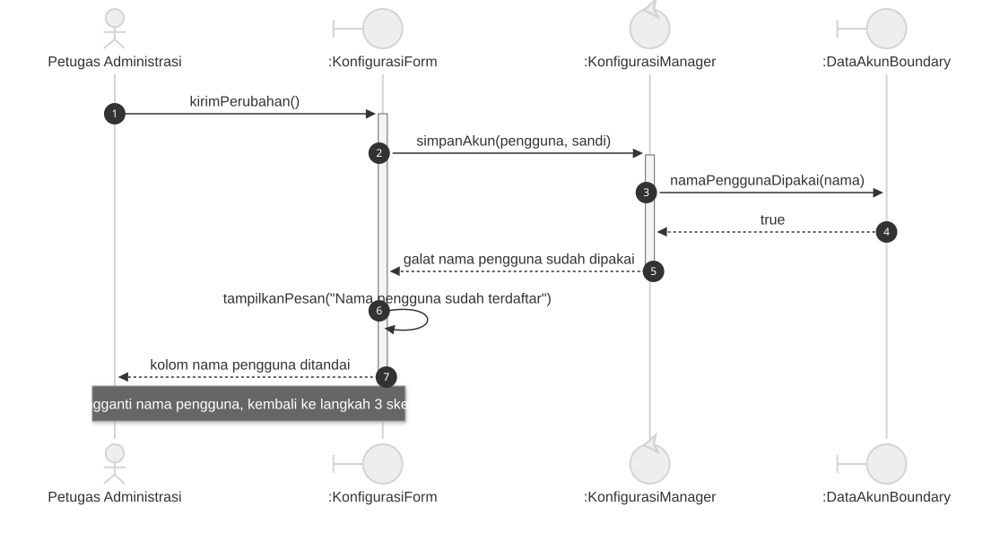
</p>
<p align="center">
<i>Gambar 54. Sequence Diagram UC12 - Skenario Alternatif 2: Nama Pengguna Sudah Dipakai</i>
</p>

- **Skenario Alternatif 3: Menonaktifkan Akun Pengguna Lama**

<p align="center">
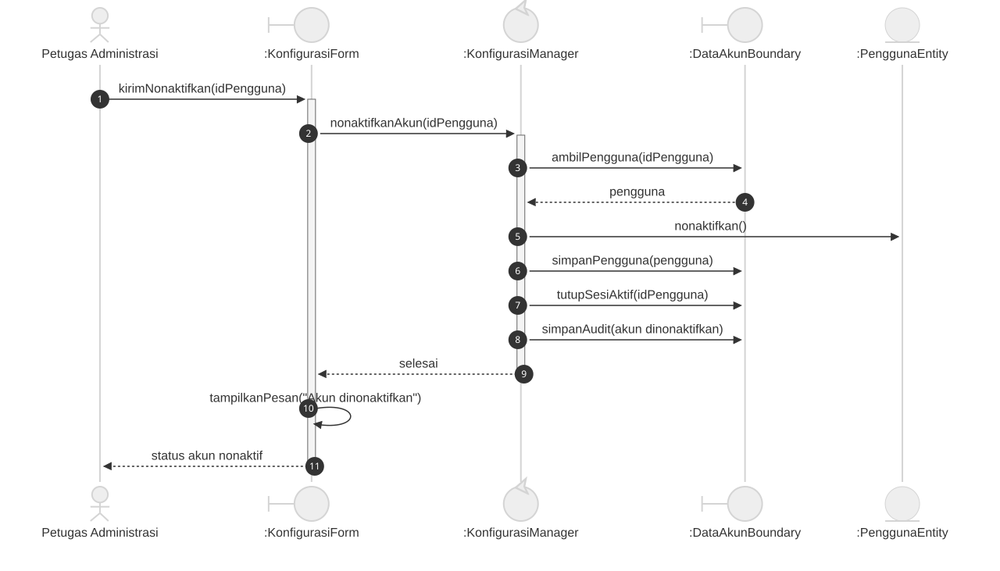
</p>
<p align="center">
<i>Gambar 55. Sequence Diagram UC12 - Skenario Alternatif 3: Menonaktifkan Akun Pengguna Lama</i>
</p>

- **Skenario Alternatif 4: Pencadangan Terjadwal Gagal**

<p align="center">
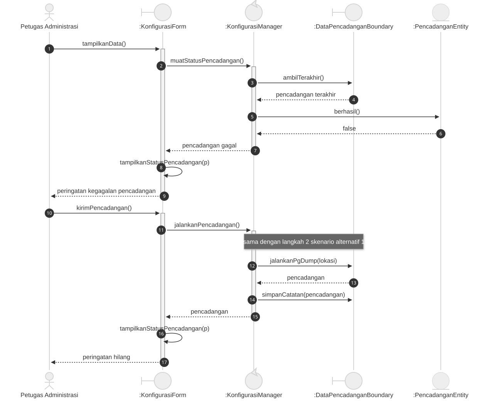
</p>
<p align="center">
<i>Gambar 56. Sequence Diagram UC12 - Skenario Alternatif 4: Pencadangan Terjadwal Gagal</i>
</p>

### 3.12.3 Diagram Kelas

<p align="center">

</p>
<p align="center">
<i>Gambar 57. Diagram Kelas Mengelola Konfigurasi & Basis Data Sistem (UC12)</i>
</p>

<br>

---

# BAB 4: Diagram Kelas Keseluruhan

## 4.1 Diagram Kelas

Diagram berikut menyatukan 64 kelas perancangan dari dua belas diagram kelas pada BAB 3. Agar tetap terbaca, kotak kelas hanya memuat stereotip dan nama; atribut dan metode lengkap setiap kelas tercantum pada Tabel 4.1. Relasi antarkelas, termasuk `Manager` ke `Entity`, digambar seluruhnya di sini.

<p align="center">

</p>
<p align="center">
<i>Gambar 58. Diagram Kelas Perancangan Keseluruhan SEHATI</i>
</p>

Kelas perancangan berbeda dari kelas analisis SKPL pada empat hal berikut.

1. **Sembilan kelas akses data ditambahkan (C56 sampai C64).** Kelas ini adalah komponen *Data Access Layer* pada APL dan menjadi satu-satunya kelas yang menjalankan kueri ke PostgreSQL.
2. **Metode `simpan()` dipindahkan dari `Entity` ke `DataBoundary`.** Di SKPL, sebagian besar *entity* menyimpan dirinya sendiri. Pada perancangan, *entity* hanya memegang data dan aturan domain miliknya (misalnya `ObatEntity.kurangiStok()` atau `AmbangRisikoEntity.dilampaui()`), sedangkan penyimpanan dilakukan `DataBoundary`. Dengan begitu, *Business Layer* tidak bergantung pada basis data, sesuai aturan antarlapisan pada Subbab 2.2.
3. **Setiap atribut dan metode diberi visibilitas dan tipe.** Metode yang hanya dipakai di dalam kelasnya sendiri, seperti `PasienManager.terbitkanNomorRM()` dan `SkriningManager.validasiRentang()`, dibuat privat (`-`).
4. **Metode ditambahkan sesuai kebutuhan *sequence diagram*.** Contohnya `RisikoManager.ambilPenanda()` untuk `SkriningForm` dan `KunjunganManager.daftarPoli()` untuk layar pembuatan kunjungan. Sebaliknya, `SinkronisasiManager.antrekanBundel()` dihapus karena bundel sudah dimasukkan ke antrean oleh `ApotekManager` lewat `DataSinkronisasiBoundary`.

Tabel 4.1. Daftar Kelas Perancangan Keseluruhan

| ID Kelas | Nama Kelas | Atribut | Metode/Operasi |
| :--- | :--- | :--- | :--- |
| C01 | LoginForm «boundary» | `-namaPengguna: String`<br>`-kataSandi: String` | `+tampilkan(): void`<br>`+kirimKredensial(): void`<br>`+tampilkanDasbor(menu: List<String>): void`<br>`+bukaLayar(layar: String): void`<br>`+tampilkanPesanGagal(pesan: String): void` |
| C02 | PasienForm «boundary» | `-kataKunci: String`<br>`-dataFormulir: PasienEntity` | `+tampilkan(): void`<br>`+kirimPencarian(kataKunci: String): void`<br>`+tampilkanHasilCari(hasil: List<PasienEntity>): void`<br>`+bukaFormulir(pasien: PasienEntity): void`<br>`+kirimDataPasien(): void`<br>`+tampilkanPesanValidasi(pesan: String): void`<br>`+tampilkanNotifikasi(pesan: String): void` |
| C03 | KunjunganForm «boundary» | `-pasienTerpilih: PasienEntity`<br>`-poliTerpilih: PoliEntity` | `+buka(pasien: PasienEntity): void`<br>`+tampilkanPilihanPoli(daftarPoli: List<PoliEntity>): void`<br>`+kirimPermintaanKunjungan(): void`<br>`+tampilkanTiketAntrean(kunjungan: KunjunganEntity): void`<br>`+tampilkanKunjunganAktif(kunjungan: KunjunganEntity): void` |
| C04 | AntreanSkriningForm «boundary» | `-daftarTampil: List<KunjunganEntity>` | `+tampilkanAntrean(): void`<br>`+kirimPanggilan(): void`<br>`+kirimLewati(): void`<br>`+perbaruiTampilan(daftar: List<KunjunganEntity>): void` |
| C05 | SkriningForm «boundary» | `-isianKeluhan: String`<br>`-isianUkuran: TandaVitalEntity` | `+tampilkanFormulir(kunjungan: KunjunganEntity): void`<br>`+kirimHasilSkrining(): void`<br>`+tampilkanPeringatanRentang(kolom: List<String>): void`<br>`+tampilkanPenandaRisiko(penanda: List<PenandaRisikoEntity>): void` |
| C06 | RekamMedisForm «boundary» | `-idPasienTampil: int`<br>`-seriTren: List<TandaVitalEntity>` | `+tampilkanRingkasan(kunjungan: KunjunganEntity): void`<br>`+tampilkanGrafikTren(): void`<br>`+tampilkanTabelPengukuran(nilai: TandaVitalEntity): void`<br>`+aturModeBacaSaja(): void`<br>`+tampilkanIndikatorLuring(): void` |
| C07 | PemeriksaanForm «boundary» | `-isianAnamnesis: String`<br>`-kataKunciDiagnosis: String` | `+kirimKataKunciDiagnosis(kataKunci: String): void`<br>`+tampilkanSaranKode(daftar: List<KodeICD10Entity>): void`<br>`+kirimHasilPemeriksaan(): void`<br>`+kirimFinal(): void`<br>`+kunciKolomKlinis(): void`<br>`+tampilkanPesan(pesan: String): void` |
| C08 | ResepForm «boundary» | `-isianItem: List<ItemResepEntity>`<br>`-indikatorStok: String` | `+tampilkanFormulir(kunjungan: KunjunganEntity): void`<br>`+kirimItem(idObat: int, jumlah: int, dosis: String, aturanPakai: String): void`<br>`+tampilkanIndikatorStok(tersedia: boolean, sisa: int): void`<br>`+kirimResep(): void`<br>`+tampilkanPeringatanStok(sisa: int): void` |
| C09 | AntreanResepForm «boundary» | `-daftarTampil: List<ResepEntity>` | `+tampilkanAntrean(): void`<br>`+pilihResep(idResep: int): void` |
| C10 | PenyerahanObatForm «boundary» | `-rincianTampil: ResepEntity`<br>`-catatanPengembalian: String` | `+tampilkanRincian(resep: ResepEntity, bets: List<BetsObatEntity>): void`<br>`+kirimKonfirmasi(): void`<br>`+bukaKolomCatatan(): void`<br>`+kirimPengembalian(alasan: String): void`<br>`+tampilkanPesan(pesan: String): void` |
| C11 | PersediaanForm «boundary» | `-isianPenerimaan: PenerimaanObatEntity`<br>`-daftarPeringatan: List<String>` | `+tampilkanFormulir(): void`<br>`+kirimPenerimaan(): void`<br>`+tampilkanSaldo(obat: ObatEntity): void`<br>`+tampilkanPeringatan(peringatan: List<String>): void`<br>`+tampilkanPesanKesalahan(kolom: List<String>): void` |
| C12 | DaftarPantauForm «boundary» | `-penyaring: String`<br>`-daftarTampil: List<DaftarPantauEntity>` | `+tampilkanDaftar(): void`<br>`+kirimPenyaring(jenisRisiko: String, mulai: LocalDate, akhir: LocalDate): void`<br>`+bukaFormulirTindakLanjut(idEntri: int): void`<br>`+kirimTindakLanjut(): void`<br>`+tampilkanKeterangan(pesan: String): void` |
| C13 | LaporanForm «boundary» | `-tanggalMulai: LocalDate`<br>`-tanggalAkhir: LocalDate` | `+tampilkan(): void`<br>`+kirimRentang(): void`<br>`+tampilkanRekapitulasi(laporan: LaporanEntity): void`<br>`+kirimPermintaanEkspor(format: String, direktori: String): void`<br>`+kunciTombolEkspor(): void`<br>`+tampilkanPesan(pesan: String): void` |
| C14 | SinkronisasiForm «boundary» | `-daftarStatus: List<BundelFHIREntity>` | `+tampilkanStatus(): void`<br>`+kirimPermintaanSinkron(): void`<br>`+tampilkanHasil(hasil: List<BundelFHIREntity>): void`<br>`+tampilkanTombolEkspor(): void`<br>`+kirimPermintaanEkspor(lokasi: String): void`<br>`+tampilkanPesan(pesan: String): void` |
| C15 | SATUSEHATGateway «boundary» | `-alamatLayanan: String`<br>`-token: String` | `+periksaKoneksi(): boolean`<br>`+kirimBundel(bundel: BundelFHIREntity): ResponsKirim` |
| C16 | KonfigurasiForm «boundary» | `-tabAktif: String`<br>`-isianData: String` | `+tampilkanData(): void`<br>`+bukaTab(tab: String): void`<br>`+kirimPerubahan(): void`<br>`+kirimNonaktifkan(idPengguna: int): void`<br>`+kirimPencadangan(): void`<br>`+tampilkanStatusPencadangan(p: PencadanganEntity): void`<br>`+tampilkanPesan(pesan: String): void` |
| C17 | AutentikasiManager «control» | `-percobaanGagal: int` | `+autentikasi(nama: String, sandi: String): SesiEntity`<br>`-bukaSesi(p: PenggunaEntity): SesiEntity`<br>`+periksaHakAkses(peran: String, layar: String): boolean` |
| C18 | PasienManager «control» | - | `+cariPasien(kataKunci: String): List<PasienEntity>`<br>`+daftarkanPasien(data: PasienEntity): PasienEntity`<br>`+perbaruiPasien(data: PasienEntity): void`<br>`+validasiNIK(nik: String): boolean`<br>`-terbitkanNomorRM(): String` |
| C19 | KunjunganManager «control» | - | `+daftarPoli(): List<PoliEntity>`<br>`+bukaKunjungan(idPasien: int, idPoli: int): KunjunganEntity`<br>`-cegahKunjunganGanda(idPasien: int): KunjunganEntity`<br>`-terbitkanNomorAntrean(idPoli: int): int` |
| C20 | SkriningManager «control» | - | `+muatAntrean(): List<KunjunganEntity>`<br>`+panggilPasien(): KunjunganEntity`<br>`+lewatiPasien(idKunjungan: int): KunjunganEntity`<br>`+simpanSkrining(idKunjungan: int, keluhan: String, tv: TandaVitalEntity): List<String>`<br>`-validasiRentang(tv: TandaVitalEntity): List<String>` |
| C21 | RisikoManager «control» | - | `+evaluasiRisiko(kunjungan: KunjunganEntity, tv: TandaVitalEntity): List<PenandaRisikoEntity>`<br>`-terbitkanPenanda(idKunjungan: int, jenis: String): PenandaRisikoEntity`<br>`-masukkanKeDaftarPantau(idPasien: int, jenis: String): void`<br>`+ambilPenanda(idKunjungan: int): List<PenandaRisikoEntity>`<br>`+muatEntriAktif(): List<DaftarPantauEntity>` |
| C22 | PemeriksaanManager «control» | - | `+susunRingkasan(idKunjungan: int): RekamMedisEntity`<br>`+susunTren(idPasien: int): List<TandaVitalEntity>`<br>`+cariKodeICD10(kataKunci: String): List<KodeICD10Entity>`<br>`+simpanPemeriksaan(idKunjungan: int, p: PemeriksaanEntity, d: DiagnosisEntity): void`<br>`+jadwalkanKontrol(idPasien: int, tanggal: LocalDate): JadwalKontrolEntity`<br>`+kunciRekamMedis(idKunjungan: int): void` |
| C23 | ResepManager «control» | - | `+muatDataObat(): List<ObatEntity>`<br>`+tambahItem(idObat: int, jumlah: int, dosis: String, aturanPakai: String): ItemResepEntity`<br>`-validasiStok(item: ItemResepEntity): boolean`<br>`+kirimKeApotek(idKunjungan: int, items: List<ItemResepEntity>): ResepEntity` |
| C24 | ApotekManager «control» | - | `+muatAntreanResep(): List<ResepEntity>`<br>`+layaniResep(idResep: int): ResepEntity`<br>`+serahkanObat(idResep: int): void`<br>`-potongStok(resep: ResepEntity): void`<br>`-tutupKunjungan(idKunjungan: int): void`<br>`-susunBundel(idKunjungan: int): BundelFHIREntity`<br>`+kembalikanKeDokter(idResep: int, alasan: String): void` |
| C25 | PersediaanManager «control» | - | `+muatDataObat(): List<ObatEntity>`<br>`+catatPenerimaan(p: PenerimaanObatEntity): void`<br>`-validasiPenerimaan(p: PenerimaanObatEntity): List<String>`<br>`-tambahStok(idObat: int, jumlah: int): ObatEntity`<br>`+terbitkanPeringatan(): List<String>` |
| C26 | PantauManager «control» | - | `+saringDaftar(jenisRisiko: String, mulai: LocalDate, akhir: LocalDate): List<DaftarPantauEntity>`<br>`+catatTindakLanjut(idEntri: int, t: TindakLanjutEntity): void`<br>`-perbaruiStatus(idEntri: int, status: String): void` |
| C27 | LaporanManager «control» | - | `+hitungRekapitulasi(mulai: LocalDate, akhir: LocalDate): LaporanEntity`<br>`-validasiRentang(mulai: LocalDate, akhir: LocalDate): boolean`<br>`+ekspor(laporan: LaporanEntity, format: String, direktori: String): String` |
| C28 | SinkronisasiManager «control» | `-jumlahTertunda: int` | `+muatStatus(): List<BundelFHIREntity>`<br>`+kirimSemua(): List<BundelFHIREntity>`<br>`+eksporBundel(lokasi: String): String` |
| C29 | KonfigurasiManager «control» | - | `+muatDataMaster(): void`<br>`+simpanAkun(p: PenggunaEntity, sandi: String): void`<br>`+nonaktifkanAkun(idPengguna: int): void`<br>`+simpanDataMaster(a: AmbangRisikoEntity): void`<br>`+muatStatusPencadangan(): PencadanganEntity`<br>`+jalankanPencadangan(): PencadanganEntity` |
| C30 | PenggunaEntity «entity» | `-idPengguna: int`<br>`-namaPengguna: String`<br>`-kataSandiHash: String`<br>`-peran: String`<br>`-status: String` | `+cocokkanSandi(sandi: String): boolean`<br>`+aktif(): boolean`<br>`+nonaktifkan(): void` |
| C31 | SesiEntity «entity» | `-idSesi: UUID`<br>`-idPengguna: int`<br>`-waktuMulai: LocalDateTime`<br>`-statusAktif: boolean` | `+habisWaktu(menit: int): boolean`<br>`+tutup(): void` |
| C32 | AuditEntity «entity» | `-idAudit: long`<br>`-idPengguna: int`<br>`-waktu: LocalDateTime`<br>`-deskripsi: String` | `+buat(idPengguna: int, deskripsi: String)$: AuditEntity` |
| C33 | PasienEntity «entity» | `-idPasien: int`<br>`-nik: String`<br>`-nomorRekamMedis: String`<br>`-nama: String`<br>`-tanggalLahir: LocalDate`<br>`-jenisKelamin: String`<br>`-alamat: String`<br>`-nomorTelepon: String` | `+perbarui(data: PasienEntity): void` |
| C34 | RekamMedisEntity «entity» | `-idRekamMedis: int`<br>`-daftarDiagnosis: List<DiagnosisEntity>`<br>`-riwayatObat: List<String>` | `+tambahEntri(catatan: String): void` |
| C35 | KunjunganEntity «entity» | `-idKunjungan: int`<br>`-idPasien: int`<br>`-tanggal: LocalDate`<br>`-nomorAntrean: int`<br>`-status: String` | `+perbaruiStatus(status: String): void`<br>`+aktifHariIni(): boolean` |
| C36 | PoliEntity «entity» | `-idPoli: int`<br>`-namaPoli: String`<br>`-urutanTerakhir: int`<br>`-tanggalUrutan: LocalDate` | `+ambilNomorBerikutnya(hariIni: LocalDate): int` |
| C37 | AntreanEntity «entity» | `-idAntrean: int`<br>`-jenis: String`<br>`-daftarEntri: List<Integer>` | `+tambahkan(idEntri: int): void`<br>`+ambilTerdepan(): KunjunganEntity`<br>`+pindahkanKeBelakang(idEntri: int): void`<br>`+keluarkan(idEntri: int): void` |
| C38 | SkriningEntity «entity» | `-idSkrining: int`<br>`-idKunjungan: int`<br>`-keluhanAwal: String`<br>`-waktu: LocalDateTime` | `+lampirkanTandaVital(tv: TandaVitalEntity): void` |
| C39 | TandaVitalEntity «entity» | `-sistolik: int`<br>`-diastolik: int`<br>`-beratBadan: double`<br>`-tinggiBadan: double`<br>`-suhu: double`<br>`-nadi: int`<br>`-gulaDarah: Integer` | `+hitungIMT(): double` |
| C40 | AmbangRisikoEntity «entity» | `-idAmbang: int`<br>`-jenisRisiko: String`<br>`-nilaiBatas: double` | `+dilampaui(nilai: double): boolean` |
| C41 | PenandaRisikoEntity «entity» | `-idPenanda: int`<br>`-idKunjungan: int`<br>`-jenisRisiko: String`<br>`-tanggal: LocalDate`<br>`-status: String` | `+cabut(): void` |
| C42 | PemeriksaanEntity «entity» | `-idPemeriksaan: int`<br>`-idKunjungan: int`<br>`-anamnesis: String`<br>`-tindakan: String`<br>`-terkunci: boolean` | `+kunci(): void` |
| C43 | DiagnosisEntity «entity» | `-idDiagnosis: int`<br>`-kodeICD10: String`<br>`-deskripsi: String` | `+ringkas(): String` |
| C44 | KodeICD10Entity «entity» | `-kode: String`<br>`-deskripsi: String`<br>`-bab: String` | `+cocok(kataKunci: String): boolean` |
| C45 | JadwalKontrolEntity «entity» | `-idJadwal: int`<br>`-idPasien: int`<br>`-tanggalRencana: LocalDate`<br>`-status: String` | `+tandaiSelesai(): void` |
| C46 | ResepEntity «entity» | `-idResep: int`<br>`-idKunjungan: int`<br>`-waktuMasuk: LocalDateTime`<br>`-status: String`<br>`-catatan: String` | `+perbaruiStatus(status: String): void` |
| C47 | ItemResepEntity «entity» | `-idItem: int`<br>`-idObat: int`<br>`-dosis: String`<br>`-jumlah: int`<br>`-aturanPakai: String` | `+cukupStok(stok: int): boolean` |
| C48 | ObatEntity «entity» | `-idObat: int`<br>`-namaObat: String`<br>`-sediaan: String`<br>`-stok: int`<br>`-ambangMinimum: int` | `+kurangiStok(jumlah: int): void`<br>`+tambahStok(jumlah: int): void`<br>`+diBawahAmbang(): boolean` |
| C49 | BetsObatEntity «entity» | `-nomorBets: String`<br>`-idObat: int`<br>`-jumlah: int`<br>`-tanggalKedaluwarsa: LocalDate` | `+kurangi(jumlah: int): void`<br>`+mendekatiKedaluwarsa(hari: int): boolean` |
| C50 | PenerimaanObatEntity «entity» | `-idPenerimaan: int`<br>`-nomorFaktur: String`<br>`-tanggalTerima: LocalDate`<br>`-daftarBets: List<BetsObatEntity>` | `+totalJumlah(): int` |
| C51 | DaftarPantauEntity «entity» | `-idEntri: int`<br>`-idPasien: int`<br>`-jenisRisiko: String`<br>`-statusTindakLanjut: String` | `+perbaruiStatus(status: String): void` |
| C52 | TindakLanjutEntity «entity» | `-idTindakLanjut: int`<br>`-jenisKontak: String`<br>`-hasilUpaya: String`<br>`-statusKedatangan: String` | `+terhubung(): boolean` |
| C53 | LaporanEntity «entity» | `-idLaporan: int`<br>`-tanggalMulai: LocalDate`<br>`-tanggalAkhir: LocalDate`<br>`-format: String`<br>`-ringkasan: String` | `+kosong(): boolean` |
| C54 | BundelFHIREntity «entity» | `-idBundel: int`<br>`-idKunjungan: int`<br>`-isiBundel: String`<br>`-status: String`<br>`-alasanGagal: String` | `+tandaiTerkirim(kode: String): void`<br>`+tandaiGagal(alasan: String): void` |
| C55 | PencadanganEntity «entity» | `-idPencadangan: int`<br>`-waktu: LocalDateTime`<br>`-status: String`<br>`-lokasiMedia: String`<br>`-ukuranBerkas: long` | `+berhasil(): boolean` |
| C56 | DataAkunBoundary «boundary» | `-koneksi: Connection` | `+cariPengguna(nama: String): PenggunaEntity`<br>`+ambilPengguna(idPengguna: int): PenggunaEntity`<br>`+namaPenggunaDipakai(nama: String): boolean`<br>`+simpanPengguna(p: PenggunaEntity): void`<br>`+simpanSesi(s: SesiEntity): void`<br>`+tutupSesiAktif(idPengguna: int): void`<br>`+simpanAudit(a: AuditEntity): void` |
| C57 | DataPasienBoundary «boundary» | `-koneksi: Connection` | `+cariParsial(kataKunci: String): List<PasienEntity>`<br>`+ambilPasien(idPasien: int): PasienEntity`<br>`+nikTerdaftar(nik: String): boolean`<br>`+nomorRMBerikutnya(): String`<br>`+simpanPasien(p: PasienEntity): void`<br>`+ambilRekamMedis(idPasien: int): RekamMedisEntity`<br>`+simpanRekamMedis(rm: RekamMedisEntity): void` |
| C58 | DataKunjunganBoundary «boundary» | `-koneksi: Connection` | `+ambilSemuaPoli(): List<PoliEntity>`<br>`+kunciPoli(idPoli: int): PoliEntity`<br>`+simpanPoli(p: PoliEntity): void`<br>`+kunjunganAktif(idPasien: int, tanggal: LocalDate): KunjunganEntity`<br>`+ambilKunjungan(idKunjungan: int): KunjunganEntity`<br>`+simpanKunjungan(k: KunjunganEntity): void`<br>`+ambilAntrean(jenis: String): AntreanEntity`<br>`+simpanAntrean(a: AntreanEntity): void` |
| C59 | DataKlinisBoundary «boundary» | `-koneksi: Connection` | `+simpanSkrining(s: SkriningEntity): void`<br>`+ambilSkrining(idKunjungan: int): SkriningEntity`<br>`+riwayatTandaVital(idPasien: int, batas: int): List<TandaVitalEntity>`<br>`+ambilAmbang(): List<AmbangRisikoEntity>`<br>`+simpanAmbang(a: AmbangRisikoEntity): void`<br>`+simpanPenanda(p: PenandaRisikoEntity): void`<br>`+penandaKunjungan(idKunjungan: int): List<PenandaRisikoEntity>`<br>`+cariKodeICD10(kataKunci: String): List<KodeICD10Entity>`<br>`+simpanPemeriksaan(p: PemeriksaanEntity, d: DiagnosisEntity): void`<br>`+ambilPemeriksaan(idKunjungan: int): PemeriksaanEntity`<br>`+simpanJadwalKontrol(j: JadwalKontrolEntity): void`<br>`+ambilJadwalKontrol(): List<JadwalKontrolEntity>` |
| C60 | DataPantauBoundary «boundary» | `-koneksi: Connection` | `+ambilEntri(): List<DaftarPantauEntity>`<br>`+simpanEntri(e: DaftarPantauEntity): void`<br>`+simpanTindakLanjut(idEntri: int, t: TindakLanjutEntity): void` |
| C61 | DataFarmasiBoundary «boundary» | `-koneksi: Connection` | `+ambilSemuaObat(): List<ObatEntity>`<br>`+ambilObat(idObat: int): ObatEntity`<br>`+ambilBets(idObat: int): List<BetsObatEntity>`<br>`+simpanStok(o: ObatEntity, bets: List<BetsObatEntity>): void`<br>`+simpanPenerimaan(p: PenerimaanObatEntity): void`<br>`+obatPerluPeringatan(hari: int): List<ObatEntity>`<br>`+simpanResep(r: ResepEntity): void`<br>`+ambilAntreanResep(): List<ResepEntity>`<br>`+ambilResep(idResep: int): ResepEntity`<br>`+kunciResep(idResep: int): ResepEntity` |
| C62 | DataLaporanBoundary «boundary» | `-koneksi: Connection` | `+agregasiKunjungan(mulai: LocalDate, akhir: LocalDate): LaporanEntity`<br>`+simpanLaporan(l: LaporanEntity): void`<br>`+tulisBerkas(l: LaporanEntity, format: String, direktori: String): String` |
| C63 | DataSinkronisasiBoundary «boundary» | `-koneksi: Connection` | `+simpanBundel(b: BundelFHIREntity): void`<br>`+ambilTertunda(): List<BundelFHIREntity>`<br>`+perbaruiBundel(b: BundelFHIREntity): void`<br>`+tulisArsipTerenkripsi(daftar: List<BundelFHIREntity>, lokasi: String): String` |
| C64 | DataPencadanganBoundary «boundary» | `-koneksi: Connection`<br>`-lokasiMedia: String` | `+ambilTerakhir(): PencadanganEntity`<br>`+jalankanPgDump(lokasi: String): PencadanganEntity`<br>`+verifikasiArsip(p: PencadanganEntity): boolean`<br>`+simpanCatatan(p: PencadanganEntity): void` |

<br>

---

# BAB 5: Perancangan Rinci Kelas

Bab ini merinci 64 kelas pada Tabel 4.1. Tabel 5.1 memetakan setiap kelas perancangan ke kelas analisis SKPL asalnya. Kelas C01 sampai C55 memakai nama yang sama dengan kelas analisisnya, sedangkan C56 sampai C64 tidak memiliki kelas analisis karena baru ditambahkan pada APL sebagai komponen *Data Access Layer*.

Tabel 5.1. Daftar Kelas Perancangan dan Kelas Analisis Terkait

| No | Nama Kelas Perancangan | Nama Kelas Analisis Terkait |
| :--- | :--- | :--- |
| 1 | C01 - LoginForm | LoginForm |
| 2 | C02 - PasienForm | PasienForm |
| 3 | C03 - KunjunganForm | KunjunganForm |
| 4 | C04 - AntreanSkriningForm | AntreanSkriningForm |
| 5 | C05 - SkriningForm | SkriningForm |
| 6 | C06 - RekamMedisForm | RekamMedisForm |
| 7 | C07 - PemeriksaanForm | PemeriksaanForm |
| 8 | C08 - ResepForm | ResepForm |
| 9 | C09 - AntreanResepForm | AntreanResepForm |
| 10 | C10 - PenyerahanObatForm | PenyerahanObatForm |
| 11 | C11 - PersediaanForm | PersediaanForm |
| 12 | C12 - DaftarPantauForm | DaftarPantauForm |
| 13 | C13 - LaporanForm | LaporanForm |
| 14 | C14 - SinkronisasiForm | SinkronisasiForm |
| 15 | C15 - SATUSEHATGateway | SATUSEHATGateway |
| 16 | C16 - KonfigurasiForm | KonfigurasiForm |
| 17 | C17 - AutentikasiManager | AutentikasiManager |
| 18 | C18 - PasienManager | PasienManager |
| 19 | C19 - KunjunganManager | KunjunganManager |
| 20 | C20 - SkriningManager | SkriningManager |
| 21 | C21 - RisikoManager | RisikoManager |
| 22 | C22 - PemeriksaanManager | PemeriksaanManager |
| 23 | C23 - ResepManager | ResepManager |
| 24 | C24 - ApotekManager | ApotekManager |
| 25 | C25 - PersediaanManager | PersediaanManager |
| 26 | C26 - PantauManager | PantauManager |
| 27 | C27 - LaporanManager | LaporanManager |
| 28 | C28 - SinkronisasiManager | SinkronisasiManager |
| 29 | C29 - KonfigurasiManager | KonfigurasiManager |
| 30 | C30 - PenggunaEntity | PenggunaEntity |
| 31 | C31 - SesiEntity | SesiEntity |
| 32 | C32 - AuditEntity | AuditEntity |
| 33 | C33 - PasienEntity | PasienEntity |
| 34 | C34 - RekamMedisEntity | RekamMedisEntity |
| 35 | C35 - KunjunganEntity | KunjunganEntity |
| 36 | C36 - PoliEntity | PoliEntity |
| 37 | C37 - AntreanEntity | AntreanEntity |
| 38 | C38 - SkriningEntity | SkriningEntity |
| 39 | C39 - TandaVitalEntity | TandaVitalEntity |
| 40 | C40 - AmbangRisikoEntity | AmbangRisikoEntity |
| 41 | C41 - PenandaRisikoEntity | PenandaRisikoEntity |
| 42 | C42 - PemeriksaanEntity | PemeriksaanEntity |
| 43 | C43 - DiagnosisEntity | DiagnosisEntity |
| 44 | C44 - KodeICD10Entity | KodeICD10Entity |
| 45 | C45 - JadwalKontrolEntity | JadwalKontrolEntity |
| 46 | C46 - ResepEntity | ResepEntity |
| 47 | C47 - ItemResepEntity | ItemResepEntity |
| 48 | C48 - ObatEntity | ObatEntity |
| 49 | C49 - BetsObatEntity | BetsObatEntity |
| 50 | C50 - PenerimaanObatEntity | PenerimaanObatEntity |
| 51 | C51 - DaftarPantauEntity | DaftarPantauEntity |
| 52 | C52 - TindakLanjutEntity | TindakLanjutEntity |
| 53 | C53 - LaporanEntity | LaporanEntity |
| 54 | C54 - BundelFHIREntity | BundelFHIREntity |
| 55 | C55 - PencadanganEntity | PencadanganEntity |
| 56 | C56 - DataAkunBoundary | - |
| 57 | C57 - DataPasienBoundary | - |
| 58 | C58 - DataKunjunganBoundary | - |
| 59 | C59 - DataKlinisBoundary | - |
| 60 | C60 - DataPantauBoundary | - |
| 61 | C61 - DataFarmasiBoundary | - |
| 62 | C62 - DataLaporanBoundary | - |
| 63 | C63 - DataSinkronisasiBoundary | - |
| 64 | C64 - DataPencadanganBoundary | - |

Subbab 5.1 sampai 5.64 mengikuti urutan ID kelas. Setiap subbab memuat tabel operasi dan tabel atribut dengan nama, parameter, tipe, dan visibilitas yang sama dengan Tabel 4.1 dan diagram kelas pada BAB 3, lalu algoritma untuk operasi yang memuat aturan bisnis, percabangan, atau transaksi. Tipe data mengikuti Java 21: `String`, `int`, `long`, `double`, `boolean`, `Integer` untuk angka yang boleh kosong, `LocalDate` dan `LocalDateTime` dari paket `java.time`, `UUID` dari `java.util`, serta `List<T>` untuk kumpulan objek.

Algoritma ditulis sebagai *pseudocode* dengan empat kesepakatan berikut.

1. **Akses data.** `Manager` tidak menyimpan objek `DataBoundary` sebagai atribut, sesuai relasi dependensi «memakai» pada Gambar 58. Di awal operasi, `Manager` membuka satu koneksi JDBC lalu membuat objek `DataBoundary` yang dibutuhkan dengan koneksi tersebut. Pada *pseudocode*, objek itu ditulis dengan nama kelasnya tanpa akhiran `Boundary` dan berhuruf kecil di depan, misalnya `dataKunjungan` untuk `DataKunjunganBoundary`. Pelaku yang dicatat pada jejak audit ditulis `idPenggunaSesi`, yaitu `idPengguna` milik `SesiEntity` yang dibuka `AutentikasiManager` saat pengguna masuk di komputer tersebut.
2. **Transaksi.** Langkah di antara `MULAI TRANSAKSI` dan `AKHIR TRANSAKSI` berjalan pada satu koneksi dengan *auto-commit* dimatikan. Bila seluruh langkah berhasil, perubahan disimpan (COMMIT). Bila satu langkah gagal atau melempar pengecualian, seluruh perubahan dibatalkan (ROLLBACK). Blok ini sama dengan fragmen `critical` pada *sequence diagram* dan memenuhi KF23, KNF03, KNF11, dan KNF13.
3. **Penolakan.** Masukan yang melanggar aturan bisnis ditolak dengan `IllegalArgumentException`, sedangkan keadaan data yang tidak mengizinkan operasi (misalnya akun nonaktif atau resep yang sudah dilayani) ditolak dengan `IllegalStateException`. Keduanya berasal dari pustaka standar Java dan membawa pesan yang ditampilkan `Form` kepada aktor. Operasi yang pada *sequence diagram* mengembalikan daftar galat, yaitu `SkriningManager.simpanSkrining()`, tetap mengembalikan daftar tersebut.
4. **Kueri.** Kueri SQL dicantumkan pada operasi `DataBoundary` yang menjalankannya (Subbab 5.56 sampai 5.64), bukan pada `Manager` yang memanggilnya, agar setiap kueri hanya ditulis sekali. Nama tabel adalah nama *entity* tanpa akhiran `Entity` dalam huruf kecil bergaris bawah, misalnya `bets_obat` untuk `BetsObatEntity`, dan nama kolom adalah nama atribut dalam bentuk yang sama, misalnya `tanggal_kedaluwarsa`. Tanda `?` adalah parameter `PreparedStatement` yang diisi berurutan, sehingga masukan pengguna tidak pernah disambung langsung ke teks kueri.

## 5.1 Kelas LoginForm

**Nama Kelas:** LoginForm  
**ID Kelas:** C01

Subbab 5.1 sampai 5.16 merinci lima belas kelas `Form` di *Presentation Layer* dan `SATUSEHATGateway` (Subbab 5.15). Setiap `Form` adalah satu layar JavaFX (Bab 6), atributnya adalah isian dan keadaan layar, dan operasinya terbagi dua: operasi `kirimX()` dipanggil pengguna lewat tombol atau pintasan papan ketik lalu meneruskan isiannya ke `Manager`, sedangkan operasi `tampilkanX()` menampilkan hasil `Manager` kepada pengguna. `Form` tidak menjalankan kueri dan tidak menyimpan aturan bisnis, sehingga seluruh keputusan bisnis tetap berada di `Manager`. Pada *pseudocode*, `Manager` yang dipanggil `Form` ditulis dengan nama kelasnya berhuruf kecil di depan, misalnya `pasienManager` untuk `PasienManager`. Isian layar yang berupa teks dan angka dibaca dari kolom JavaFX, lalu diubah ke tipe atribut sebelum dikirim.

Tabel 5.1.1. Operasi Kelas LoginForm

| Nama Operasi | Visibility (private, public) | Keterangan |
| :--- | :--- | :--- |
| `tampilkan(): void` | public | Menampilkan layar autentikasi dengan kedua kolom kosong dan kursor pada kolom nama pengguna. Dipanggil saat aplikasi dibuka dan setiap kali sesi berakhir, termasuk saat pengguna diam 15 menit (UC01, KNF04). |
| `kirimKredensial(): void` | public | Mengambil nama pengguna dan kata sandi dari kolom, memanggil `AutentikasiManager.autentikasi()`, lalu menyusun dasbor bila sesi berhasil dibuka (UC01, Algo-C01-01). |
| `tampilkanDasbor(menu: List<String>): void` | public | Menggambar dasbor yang hanya berisi layar pada `menu`, yaitu layar yang diizinkan bagi peran pengguna. Layar di luar wewenang tidak digambar sama sekali (KF16, skenario alternatif 3 UC01). |
| `bukaLayar(layar: String): void` | public | Memeriksa hak akses sekali lagi lewat `AutentikasiManager.periksaHakAkses()` sebelum layar dibuka, karena layar dapat dituju lewat jalan lain selain menu, misalnya pintasan papan ketik (KF16, KNF05, Algo-C01-02). |
| `tampilkanPesanGagal(pesan: String): void` | public | Menampilkan pesan merah di bawah kolom kata sandi. Pesan untuk nama yang tidak dikenal dan kata sandi yang salah sama, sesuai catatan Algo-C17-01. |

Tabel 5.1.2. Atribut Kelas LoginForm

| Nama Atribut | Visibility (private, public) | Tipe |
| :--- | :--- | :--- |
| `namaPengguna` | private | `String` |
| `kataSandi` | private | `String` |

`kataSandi` dibaca dari `PasswordField` dan ditimpa dengan teks kosong segera setelah autentikasi selesai, berhasil maupun gagal, sehingga kata sandi tidak tertinggal di memori layar. Peran pengguna bukan atribut `LoginForm`. Peran dibawa bersama `SesiEntity` pada konteks sesi aplikasi JavaFX, yaitu pegangan objek yang dipakai bersama oleh seluruh layar dan bukan kelas perancangan tersendiri, sehingga setiap `Form` dapat memanggil `periksaHakAkses()` dengan peran yang sama.

### 5.1.1 Algoritma Pengiriman Kredensial

**Nama Kelas:** LoginForm  
**Nama Operasi:** `kirimKredensial(): void`  
**ID Algoritma:** Algo-C01-01

```text
KONSTANTA DAFTAR_MENU <- [PasienForm, KunjunganForm, AntreanSkriningForm, RekamMedisForm, AntreanResepForm,
                          PersediaanForm, DaftarPantauForm, LaporanForm, SinkronisasiForm, KonfigurasiForm]

PROSEDUR kirimKredensial()
    nama <- namaPengguna tanpa spasi di awal dan akhir
    JIKA nama kosong ATAU kataSandi kosong MAKA
        tampilkanPesanGagal("Nama pengguna dan kata sandi wajib diisi")
        KEMBALI
    AKHIR JIKA
    COBA
        sesi <- autentikasiManager.autentikasi(nama, kataSandi)
    TANGKAP IllegalStateException galat                  // akun nonaktif
        kataSandi <- ""
        tampilkanPesanGagal(galat.pesan)
        KEMBALI
    AKHIR COBA
    kataSandi <- ""
    JIKA sesi = null MAKA
        tampilkanPesanGagal("Nama pengguna atau kata sandi salah")
        KEMBALI                                           // kolom kata sandi kosong, kolom nama tetap terisi
    AKHIR JIKA
    menu <- daftar kosong
    UNTUK SETIAP layar DI DAFTAR_MENU
        JIKA autentikasiManager.periksaHakAkses(peran sesi, layar) MAKA
            tambahkan layar ke menu
        AKHIR JIKA
    AKHIR UNTUK
    tampilkanDasbor(menu)
```

`DAFTAR_MENU` memuat sepuluh layar yang dibuka langsung dari dasbor. `SkriningForm`, `PemeriksaanForm`, `ResepForm`, dan `PenyerahanObatForm` tidak ada di dasbor karena layar itu dibuka dari layar induknya: `AntreanSkriningForm`, `RekamMedisForm`, dan `AntreanResepForm`. Pemeriksaan hak akses tetap berlaku untuk keempatnya (Algo-C01-02).

### 5.1.2 Algoritma Pembukaan Layar

**Nama Kelas:** LoginForm  
**Nama Operasi:** `bukaLayar(layar: String): void`  
**ID Algoritma:** Algo-C01-02

```text
PROSEDUR bukaLayar(layar)
    JIKA autentikasiManager.periksaHakAkses(peran sesi, layar) MAKA
        tampilkan layar
    SELAIN ITU
        tampilkanPesanGagal("Peran " + peran sesi + " tidak berwenang membuka layar ini")
    AKHIR JIKA
```

Prosedur ini merealisasikan skenario alternatif 3 UC01. Setiap `Form` memanggil `periksaHakAkses()` dengan cara yang sama sebelum layarnya dibuka, sehingga hak akses tidak hanya bergantung pada menu yang disembunyikan (KNF05).

## 5.2 Kelas PasienForm

**Nama Kelas:** PasienForm  
**ID Kelas:** C02

Tabel 5.2.1. Operasi Kelas PasienForm

| Nama Operasi | Visibility (private, public) | Keterangan |
| :--- | :--- | :--- |
| `tampilkan(): void` | public | Membuka layar pendaftaran dengan kolom pencarian aktif dan tabel hasil kosong (UC02). |
| `kirimPencarian(kataKunci: String): void` | public | Meneruskan kata kunci ke `PasienManager.cariPasien()` setiap kali isi kolom pencarian berubah dan panjangnya sedikitnya 3 karakter (KF01, KNF01, Algo-C02-01). |
| `tampilkanHasilCari(hasil: List<PasienEntity>): void` | public | Mengisi tabel dengan pasien yang cocok. Bila `hasil` kosong, tabel menampilkan "Data pasien tidak ditemukan" dan tombol "Pasien Baru" disorot (skenario alternatif 2 UC02). |
| `bukaFormulir(pasien: PasienEntity): void` | public | Membuka formulir data pasien. Bila `pasien` terisi, kolom diisi data pasien itu untuk disunting dan nomor rekam medis ditampilkan tanpa dapat diubah. Bila `null`, formulir kosong dibuka untuk pendaftaran baru (KF02). |
| `kirimDataPasien(): void` | public | Membaca isian formulir lalu memanggil `daftarkanPasien()` untuk pasien baru atau `perbaruiPasien()` untuk pasien lama (Algo-C02-02). |
| `tampilkanPesanValidasi(pesan: String): void` | public | Menandai kolom NIK merah dan menampilkan `pesan` di bawahnya, misalnya "NIK tidak valid" atau "NIK sudah terdaftar" (KF02). Isian lain tidak dihapus. |
| `tampilkanNotifikasi(pesan: String): void` | public | Menampilkan notifikasi hijau sementara, misalnya "Pendaftaran berhasil" beserta nomor rekam medis baru. |

Tabel 5.2.2. Atribut Kelas PasienForm

| Nama Atribut | Visibility (private, public) | Tipe |
| :--- | :--- | :--- |
| `kataKunci` | private | `String` |
| `dataFormulir` | private | `PasienEntity` |

`dataFormulir` menampung isian formulir. Nilai `idPasien` yang masih 0 menandai pendaftaran baru, dan nilai yang sudah terisi menandai penyuntingan pasien lama, sejalan dengan aturan sisip atau mutakhirkan pada Subbab 5.56.

### 5.2.1 Algoritma Pencarian Pasien

**Nama Kelas:** PasienForm  
**Nama Operasi:** `kirimPencarian(kataKunci: String): void`  
**ID Algoritma:** Algo-C02-01

```text
PROSEDUR kirimPencarian(kataKunci)                // dipicu setiap perubahan isi kolom pencarian
    teks <- kataKunci tanpa spasi di awal dan akhir
    JIKA panjang(teks) < 3 MAKA
        tampilkanHasilCari(daftar kosong tanpa pesan "tidak ditemukan")
        KEMBALI
    AKHIR JIKA
    tunggu 250 milidetik; batalkan bila isi kolom berubah lagi dalam waktu itu
    hasil <- pasienManager.cariPasien(teks)      // dijalankan di thread latar agar kolom tetap responsif
    tampilkanHasilCari(hasil)
```

Pencarian baru dikirim bila kata kunci sedikitnya 3 karakter, sesuai syarat KNF01 dan indeks trigram pada Algo-C57-01. Jeda 250 milidetik mencegah satu kueri untuk setiap ketukan tombol saat petugas mengetik cepat. Hasil pencarian lama yang baru tiba setelah kata kunci berubah dibuang.

### 5.2.2 Algoritma Pengiriman Data Pasien

**Nama Kelas:** PasienForm  
**Nama Operasi:** `kirimDataPasien(): void`  
**ID Algoritma:** Algo-C02-02

```text
PROSEDUR kirimDataPasien()
    JIKA nama, tanggal lahir, jenis kelamin, atau alamat pada dataFormulir kosong MAKA
        tandai kolom yang kosong
        KEMBALI
    AKHIR JIKA
    COBA
        JIKA dataFormulir.idPasien = 0 MAKA
            pasien <- pasienManager.daftarkanPasien(dataFormulir)
            tampilkanNotifikasi("Pendaftaran berhasil, nomor rekam medis " + pasien.nomorRekamMedis)
        SELAIN ITU
            pasienManager.perbaruiPasien(dataFormulir)
            tampilkanNotifikasi("Data pasien diperbarui")
        AKHIR JIKA
    TANGKAP IllegalArgumentException galat
        tampilkanPesanValidasi(galat.pesan)
    AKHIR COBA
```

Pemeriksaan isian kosong hanya mencegah pengiriman yang pasti ditolak. Validasi NIK dan keunikannya tetap dijalankan `PasienManager` (Algo-C18-01), karena aturan itu harus berlaku untuk pemanggil mana pun.

## 5.3 Kelas KunjunganForm

**Nama Kelas:** KunjunganForm  
**ID Kelas:** C03

Tabel 5.3.1. Operasi Kelas KunjunganForm

| Nama Operasi | Visibility (private, public) | Keterangan |
| :--- | :--- | :--- |
| `buka(pasien: PasienEntity): void` | public | Membuka layar kunjungan untuk pasien terpilih, memuat daftar poli lewat `KunjunganManager.daftarPoli()`, lalu memanggil `tampilkanPilihanPoli()` (UC03). |
| `tampilkanPilihanPoli(daftarPoli: List<PoliEntity>): void` | public | Menampilkan poli sebagai pilihan tujuan. Tombol "Buka Kunjungan" tetap nonaktif sampai satu poli dipilih. |
| `kirimPermintaanKunjungan(): void` | public | Memanggil `KunjunganManager.bukaKunjungan()` dengan pasien dan poli terpilih lalu menampilkan hasilnya (KF03, Algo-C03-01). |
| `tampilkanTiketAntrean(kunjungan: KunjunganEntity): void` | public | Menampilkan tiket antrean berisi nama poli, nomor antrean, dan tanggal. Layar menyediakan tombol cetak tiket. |
| `tampilkanKunjunganAktif(kunjungan: KunjunganEntity): void` | public | Menampilkan nomor antrean dan status kunjungan yang sudah berjalan serta keterangan bahwa kunjungan baru tidak dibuat (skenario alternatif 1 UC03). |

Tabel 5.3.2. Atribut Kelas KunjunganForm

| Nama Atribut | Visibility (private, public) | Tipe |
| :--- | :--- | :--- |
| `pasienTerpilih` | private | `PasienEntity` |
| `poliTerpilih` | private | `PoliEntity` |

`pasienTerpilih` diisi dari `PasienForm` melalui parameter `buka()`, dan `poliTerpilih` diisi dari pilihan petugas.

### 5.3.1 Algoritma Permintaan Kunjungan

**Nama Kelas:** KunjunganForm  
**Nama Operasi:** `kirimPermintaanKunjungan(): void`  
**ID Algoritma:** Algo-C03-01

```text
PROSEDUR kirimPermintaanKunjungan()
    JIKA pasienTerpilih = null ATAU poliTerpilih = null MAKA KEMBALI AKHIR JIKA
    nonaktifkan tombol "Buka Kunjungan"                  // mencegah dua permintaan dari satu klik ganda
    COBA
        kunjungan <- kunjunganManager.bukaKunjungan(pasienTerpilih.idPasien, poliTerpilih.idPoli)
        JIKA kunjungan.status = "menunggu skrining" MAKA
            tampilkanTiketAntrean(kunjungan)
        SELAIN ITU
            tampilkanKunjunganAktif(kunjungan)           // pasien sudah punya kunjungan yang berjalan hari ini
        AKHIR JIKA
    AKHIRNYA
        aktifkan tombol "Buka Kunjungan"
    AKHIR COBA
```

Kunjungan yang baru dibuka selalu berstatus "menunggu skrining" (Algo-C19-01), sedangkan kunjungan aktif hasil pencegahan kunjungan ganda hampir selalu sudah melewati status itu. Bila kunjungan aktif itu masih menunggu skrining, tiket yang tampil adalah tiket yang sama dengan sebelumnya, sehingga pasien tidak pernah memegang dua nomor.

## 5.4 Kelas AntreanSkriningForm

**Nama Kelas:** AntreanSkriningForm  
**ID Kelas:** C04

Tabel 5.4.1. Operasi Kelas AntreanSkriningForm

| Nama Operasi | Visibility (private, public) | Keterangan |
| :--- | :--- | :--- |
| `tampilkanAntrean(): void` | public | Memuat antrean lewat `SkriningManager.muatAntrean()` dan menampilkannya terurut nomor antrean (KF04, UC04). |
| `kirimPanggilan(): void` | public | Memanggil `SkriningManager.panggilPasien()` lalu membuka `SkriningForm` untuk pasien yang dipanggil. Terhubung ke tombol "Panggil Berikutnya" dan pintasan F2 (KF04, KF24). |
| `kirimLewati(): void` | public | Memanggil `SkriningManager.lewatiPasien()` untuk pasien yang sedang dipanggil dan tidak hadir, lalu memperbarui tampilan dengan pasien berikutnya (skenario alternatif 1 UC04). Terhubung ke pintasan F3. |
| `perbaruiTampilan(daftar: List<KunjunganEntity>): void` | public | Menggambar ulang tabel antrean dan menyoroti pasien yang sedang dilayani. Dipanggil setelah panggilan, setelah pasien dilewati, dan oleh penyegar otomatis. |

Tabel 5.4.2. Atribut Kelas AntreanSkriningForm

| Nama Atribut | Visibility (private, public) | Tipe |
| :--- | :--- | :--- |
| `daftarTampil` | private | `List<KunjunganEntity>` |

`daftarTampil` adalah salinan antrean yang sedang digambar. Layar memuat ulang antrean tiap 10 detik agar pasien yang baru dibuka kunjungannya di loket muncul tanpa perawat menekan tombol apa pun. Tombol "Panggil Berikutnya" dinonaktifkan bila `daftarTampil` kosong.

## 5.5 Kelas SkriningForm

**Nama Kelas:** SkriningForm  
**ID Kelas:** C05

Tabel 5.5.1. Operasi Kelas SkriningForm

| Nama Operasi | Visibility (private, public) | Keterangan |
| :--- | :--- | :--- |
| `tampilkanFormulir(kunjungan: KunjunganEntity): void` | public | Membuka formulir skrining kosong untuk kunjungan yang dipanggil, dengan kursor pada kolom keluhan awal (KF05). |
| `kirimHasilSkrining(): void` | public | Membaca isian, memanggil `SkriningManager.simpanSkrining()`, lalu meminta penanda risiko dari `RisikoManager.ambilPenanda()` (UC04, Algo-C05-01). Terhubung ke pintasan Ctrl+S. |
| `tampilkanPeringatanRentang(kolom: List<String>): void` | public | Menandai merah setiap kolom pada `kolom` dan menampilkan rentang wajarnya di samping kolom. Isian lain dipertahankan (KF06, skenario alternatif 2 UC04). |
| `tampilkanPenandaRisiko(penanda: List<PenandaRisikoEntity>): void` | public | Menampilkan ikon peringatan dan latar merah beserta jenis risiko pada setiap penanda, tanpa langkah tambahan dari perawat (KF07, KNF08, skenario alternatif 3 UC04). |

Tabel 5.5.2. Atribut Kelas SkriningForm

| Nama Atribut | Visibility (private, public) | Tipe |
| :--- | :--- | :--- |
| `isianKeluhan` | private | `String` |
| `isianUkuran` | private | `TandaVitalEntity` |

`isianUkuran` menampung nilai tekanan darah, berat badan, tinggi badan, suhu, nadi, dan gula darah dari kolom numerik. Urutan fokus kolom diatur agar seluruh formulir tuntas hanya dengan papan ketik: Tab pindah ke kolom berikutnya, Shift+Tab ke kolom sebelumnya, dan Ctrl+S menyimpan (KF24, KNF12).

### 5.5.1 Algoritma Pengiriman Hasil Skrining

**Nama Kelas:** SkriningForm  
**Nama Operasi:** `kirimHasilSkrining(): void`  
**ID Algoritma:** Algo-C05-01

```text
PROSEDUR kirimHasilSkrining()
    tv <- TandaVitalEntity kosong
    kolomTidakTerbaca <- daftar kosong
    UNTUK SETIAP (kolom, teks) DI kolom numerik pada formulir
        teks <- teks dengan koma desimal diganti titik
        JIKA teks kosong DAN kolom ≠ "gulaDarah" MAKA tambahkan kolom ke kolomTidakTerbaca
        SELAIN ITU JIKA teks tidak kosong DAN BUKAN angka MAKA tambahkan kolom ke kolomTidakTerbaca
        SELAIN ITU isi tv.kolom dengan angka dari teks     // kosong pada gulaDarah menjadi null
        AKHIR JIKA
    AKHIR UNTUK
    JIKA kolomTidakTerbaca TIDAK KOSONG MAKA
        tampilkanPeringatanRentang(kolomTidakTerbaca)
        KEMBALI
    AKHIR JIKA
    isianUkuran <- tv
    galat <- skriningManager.simpanSkrining(kunjungan.idKunjungan, isianKeluhan, tv)
    JIKA galat TIDAK KOSONG MAKA
        tampilkanPeringatanRentang(galat)               // tidak ada yang disimpan, isian tetap ada
        KEMBALI
    AKHIR JIKA
    penanda <- risikoManager.ambilPenanda(kunjungan.idKunjungan)
    tampilkanPenandaRisiko(penanda)                     // daftar kosong berarti tidak ada risiko, tidak ada peringatan
    tampilkan notifikasi "Skrining tersimpan, pasien diteruskan ke antrean poli"
```

Pembacaan angka pada `Form` hanya memastikan isian dapat menjadi angka. Rentang fisiologis dan ambang risiko dinilai `SkriningManager` dan `RisikoManager`, sehingga tidak ada jalan pintas yang dapat menonaktifkan validasi dari layar (KNF02).

## 5.6 Kelas RekamMedisForm

**Nama Kelas:** RekamMedisForm  
**ID Kelas:** C06

Tabel 5.6.1. Operasi Kelas RekamMedisForm

| Nama Operasi | Visibility (private, public) | Keterangan |
| :--- | :--- | :--- |
| `tampilkanRingkasan(kunjungan: KunjunganEntity): void` | public | Memanggil `PemeriksaanManager.susunRingkasan()` lalu menampilkan data diri, diagnosis lampau, riwayat obat, dan penanda risiko aktif pada satu tampilan (KF09, UC05). Sebelum itu, layar memeriksa apakah peran pengguna boleh membuka `PemeriksaanForm` (skenario alternatif 1 UC05). |
| `tampilkanGrafikTren(): void` | public | Memanggil `PemeriksaanManager.susunTren()` lalu menggambar grafik garis tekanan darah, berat badan, dan gula darah dengan waktu pada sumbu-x (KF08, Algo-C06-01). |
| `tampilkanTabelPengukuran(nilai: TandaVitalEntity): void` | public | Menampilkan pengukuran hari ini dalam bentuk tabel, bersama keterangan bahwa grafik tren baru terbentuk setelah dua kunjungan atau lebih (skenario alternatif 4 UC05). |
| `aturModeBacaSaja(): void` | public | Mengunci seluruh kolom layar dan `PemeriksaanForm` serta menampilkan keterangan "Peran Anda tidak berwenang mengisi diagnosis" (KF10, skenario alternatif 1 UC05). |
| `tampilkanIndikatorLuring(): void` | public | Menampilkan lencana "Luring" pada bilah aplikasi bila koneksi internet terputus. Seluruh fungsi layar tetap berjalan karena data berasal dari basis data lokal (KF22, KNF09, skenario alternatif 3 UC05). |

Tabel 5.6.2. Atribut Kelas RekamMedisForm

| Nama Atribut | Visibility (private, public) | Tipe |
| :--- | :--- | :--- |
| `idPasienTampil` | private | `int` |
| `seriTren` | private | `List<TandaVitalEntity>` |

`idPasienTampil` menyimpan pasien yang ringkasannya sedang dibuka, dan `seriTren` menyimpan titik-titik grafik yang diterima dari `susunTren()`. `RekamMedisForm` tidak menyimpan apa pun ke basis data. Layar ini hanya membaca dan menjadi tempat peralihan ke `PemeriksaanForm` dan `ResepForm`.

### 5.6.1 Algoritma Penyajian Grafik Tren

**Nama Kelas:** RekamMedisForm  
**Nama Operasi:** `tampilkanGrafikTren(): void`  
**ID Algoritma:** Algo-C06-01

```text
PROSEDUR tampilkanGrafikTren()
    seriTren <- pemeriksaanManager.susunTren(idPasienTampil)    // terurut dari yang terlama
    JIKA ukuran(seriTren) < 2 MAKA
        JIKA seriTren TIDAK KOSONG MAKA
            tampilkanTabelPengukuran(seriTren[1])                // satu-satunya titik adalah pengukuran hari ini
        AKHIR JIKA
        KEMBALI
    AKHIR JIKA
    UNTUK SETIAP seri DI {"sistolik", "diastolik", "beratBadan", "gulaDarah"}
        garis <- LineChart.Series baru bernama seri
        UNTUK SETIAP tv DI seriTren
            JIKA nilai seri pada tv ≠ null MAKA
                tambahkan titik (urutan kunjungan, nilai seri pada tv) ke garis
            AKHIR JIKA
        AKHIR UNTUK
        tambahkan garis ke grafik
    AKHIR UNTUK
```

Sumbu-x memakai urutan kunjungan karena `TandaVitalEntity` tidak membawa tanggal. Pada tampilan, setiap titik diberi label tanggal kunjungan dari `susunTren()`. Gula darah bersifat opsional, sehingga kunjungan tanpa nilai gula darah dilewati pada garis gula darah, bukan digambar sebagai nol.

## 5.7 Kelas PemeriksaanForm

**Nama Kelas:** PemeriksaanForm  
**ID Kelas:** C07

Tabel 5.7.1. Operasi Kelas PemeriksaanForm

| Nama Operasi | Visibility (private, public) | Keterangan |
| :--- | :--- | :--- |
| `kirimKataKunciDiagnosis(kataKunci: String): void` | public | Meneruskan kata kunci ke `PemeriksaanManager.cariKodeICD10()` setelah pengguna berhenti mengetik 300 milidetik pada kolom diagnosis (KF10). |
| `tampilkanSaranKode(daftar: List<KodeICD10Entity>): void` | public | Menampilkan daftar saran kode ICD-10 di bawah kolom diagnosis. Saat satu saran dipilih, kode dan deskripsinya disimpan sebagai diagnosis. Bila `daftar` kosong, layar menampilkan "Kode diagnosis ICD-10 tidak ditemukan" (skenario alternatif 2 UC05). |
| `kirimHasilPemeriksaan(): void` | public | Menyimpan anamnesis, tindakan, dan diagnosis terpilih lewat `PemeriksaanManager.simpanPemeriksaan()`, dan menjadwalkan kontrol bila tanggal kontrol diisi (UC05, KF12, Algo-C07-01). Terhubung ke pintasan Ctrl+S. |
| `kirimFinal(): void` | public | Meminta konfirmasi dokter lalu memanggil `PemeriksaanManager.kunciRekamMedis()` (UC05). Setelah dikunci, seluruh kolom layar tidak dapat disunting. |
| `kunciKolomKlinis(): void` | public | Menonaktifkan kolom anamnesis, diagnosis, tindakan, dan kontrol, serta kedua tombol simpan. Dipanggil `RekamMedisForm` bagi peran selain Dokter (skenario alternatif 1 UC05). |
| `tampilkanPesan(pesan: String): void` | public | Menampilkan pesan pada bilah di dasar layar, misalnya hasil pencarian kosong atau penolakan karena rekam medis sudah dikunci. |

Tabel 5.7.2. Atribut Kelas PemeriksaanForm

| Nama Atribut | Visibility (private, public) | Tipe |
| :--- | :--- | :--- |
| `isianAnamnesis` | private | `String` |
| `kataKunciDiagnosis` | private | `String` |

Kolom diagnosis hanya menerima nilai yang dipilih dari daftar saran, bukan teks bebas, sehingga diagnosis selalu tersimpan sebagai kode ICD-10 standar (KF10). Pilihan itu ditahan pada objek `DiagnosisEntity` di layar sampai pemeriksaan dikirim.

### 5.7.1 Algoritma Pengiriman Hasil Pemeriksaan

**Nama Kelas:** PemeriksaanForm  
**Nama Operasi:** `kirimHasilPemeriksaan(): void`  
**ID Algoritma:** Algo-C07-01

```text
PROSEDUR kirimHasilPemeriksaan()
    JIKA isianAnamnesis kosong MAKA
        tampilkanPesan("Anamnesis wajib diisi")
        KEMBALI
    AKHIR JIKA
    p <- PemeriksaanEntity baru(kunjungan.idKunjungan, isianAnamnesis, tindakan pada layar)
    d <- DiagnosisEntity dari saran terpilih            // null bila belum ada diagnosis yang dipilih
    COBA
        pemeriksaanManager.simpanPemeriksaan(kunjungan.idKunjungan, p, d)
        JIKA tanggal kontrol terisi MAKA
            jadwal <- pemeriksaanManager.jadwalkanKontrol(kunjungan.idPasien, tanggal kontrol)
            tampilkanPesan("Kontrol dijadwalkan " + jadwal.tanggalRencana)
        SELAIN ITU
            tampilkanPesan("Pemeriksaan tersimpan")
        AKHIR JIKA
    TANGKAP IllegalStateException atau IllegalArgumentException galat
        tampilkanPesan(galat.pesan)                     // misalnya rekam medis sudah dikunci
    AKHIR COBA
```

Dokter dapat menyimpan berulang kali sebelum menekan tombol final, karena `simpanPemeriksaan()` menimpa draf sebelumnya (Algo-C22-01). Tombol final baru aktif setelah pemeriksaan pernah tersimpan.

## 5.8 Kelas ResepForm

**Nama Kelas:** ResepForm  
**ID Kelas:** C08

Tabel 5.8.1. Operasi Kelas ResepForm

| Nama Operasi | Visibility (private, public) | Keterangan |
| :--- | :--- | :--- |
| `tampilkanFormulir(kunjungan: KunjunganEntity): void` | public | Memuat daftar obat lewat `ResepManager.muatDataObat()` dan membuka formulir resep kosong untuk kunjungan terpilih (KF11, UC06). |
| `kirimItem(idObat: int, jumlah: int, dosis: String, aturanPakai: String): void` | public | Menambahkan satu obat ke daftar item lewat `ResepManager.tambahItem()` lalu menampilkan indikator stoknya (KF11, Algo-C08-01). |
| `tampilkanIndikatorStok(tersedia: boolean, sisa: int): void` | public | Menampilkan lencana hijau "Tersedia" bila `tersedia`, atau lencana merah "Stok Kurang" beserta `sisa` bila tidak (KF11). |
| `kirimResep(): void` | public | Memanggil `ResepManager.kirimKeApotek()` dengan seluruh item pada layar, lalu mengosongkan formulir bila resep berhasil masuk antrean apotek (UC06, KF11). |
| `tampilkanPeringatanStok(sisa: int): void` | public | Menampilkan peringatan "Stok hanya tersisa `sisa`, perbaiki resep" dan menahan tombol "Kirim ke Apotek" sampai tidak ada item yang kurang stoknya (skenario alternatif 1 UC06). |

Tabel 5.8.2. Atribut Kelas ResepForm

| Nama Atribut | Visibility (private, public) | Tipe |
| :--- | :--- | :--- |
| `isianItem` | private | `List<ItemResepEntity>` |
| `indikatorStok` | private | `String` |

`isianItem` menampung item yang sedang disusun dokter sampai resep dikirim (Subbab 5.23). `indikatorStok` berisi teks indikator terakhir, yaitu "Tersedia" atau "Stok Kurang", yang dipakai untuk menentukan apakah tombol kirim boleh aktif.

### 5.8.1 Algoritma Penambahan Item pada Formulir Resep

**Nama Kelas:** ResepForm  
**Nama Operasi:** `kirimItem(idObat: int, jumlah: int, dosis: String, aturanPakai: String): void`  
**ID Algoritma:** Algo-C08-01

```text
PROSEDUR kirimItem(idObat, jumlah, dosis, aturanPakai)
    JIKA jumlah ≤ 0 ATAU dosis kosong ATAU aturanPakai kosong MAKA
        tandai kolom yang tidak valid
        KEMBALI
    AKHIR JIKA
    item <- resepManager.tambahItem(idObat, jumlah, dosis, aturanPakai)
    obat <- obat dengan idObat pada daftar obat yang dimuat tampilkanFormulir()
    tambahkan item ke isianItem
    tampilkanIndikatorStok(item.cukupStok(obat.stok), obat.stok)
    JIKA BUKAN item.cukupStok(obat.stok) MAKA
        tampilkanPeringatanStok(obat.stok)
    AKHIR JIKA
    tombol "Kirim ke Apotek" aktif HANYA JIKA setiap item pada isianItem cukup stoknya
```

Indikator ini bersifat pemberitahuan dini. Kecukupan stok diperiksa ulang oleh `ResepManager.kirimKeApotek()` saat resep dikirim (Algo-C23-02), sehingga stok yang berubah di antara dua langkah tetap tertangkap.

## 5.9 Kelas AntreanResepForm

**Nama Kelas:** AntreanResepForm  
**ID Kelas:** C09

Tabel 5.9.1. Operasi Kelas AntreanResepForm

| Nama Operasi | Visibility (private, public) | Keterangan |
| :--- | :--- | :--- |
| `tampilkanAntrean(): void` | public | Memuat antrean lewat `ApotekManager.muatAntreanResep()` dan menampilkannya terurut waktu masuk, lengkap dengan nama pasien, daftar obat, dosis, dan jumlah (KF13, UC07). |
| `pilihResep(idResep: int): void` | public | Memanggil `ApotekManager.layaniResep()` untuk resep terpilih lalu membuka `PenyerahanObatForm` dengan rincian resep dan bets obatnya (UC07). |

Tabel 5.9.2. Atribut Kelas AntreanResepForm

| Nama Atribut | Visibility (private, public) | Tipe |
| :--- | :--- | :--- |
| `daftarTampil` | private | `List<ResepEntity>` |

Seperti `AntreanSkriningForm`, layar ini memuat ulang antrean tiap 10 detik agar resep baru dari dokter muncul tanpa tindakan petugas. Resep yang sedang dibuka petugas lain tetap tampil sampai statusnya berubah, dan penolakan ganda ditangani saat penyerahan (Algo-C24-01).

## 5.10 Kelas PenyerahanObatForm

**Nama Kelas:** PenyerahanObatForm  
**ID Kelas:** C10

Tabel 5.10.1. Operasi Kelas PenyerahanObatForm

| Nama Operasi | Visibility (private, public) | Keterangan |
| :--- | :--- | :--- |
| `tampilkanRincian(resep: ResepEntity, bets: List<BetsObatEntity>): void` | public | Menampilkan identitas pasien, setiap item resep, dan bets obat yang akan diserahkan terurut tanggal kedaluwarsa terdekat (KF13, UC07). |
| `kirimKonfirmasi(): void` | public | Memanggil `ApotekManager.serahkanObat()` setelah petugas menekan "Obat Diserahkan" (KF14, Algo-C10-01). Terhubung ke pintasan Ctrl+Enter. |
| `bukaKolomCatatan(): void` | public | Membuka kolom alasan pengembalian dan tombol "Kembalikan ke Dokter" saat obat yang diresepkan tidak dapat dilayani (skenario alternatif 1 UC07). |
| `kirimPengembalian(alasan: String): void` | public | Memanggil `ApotekManager.kembalikanKeDokter()` dengan alasan yang tidak boleh kosong, lalu menutup rincian resep. |
| `tampilkanPesan(pesan: String): void` | public | Menampilkan pesan hasil penyerahan atau penolakan, misalnya "Obat diserahkan" atau "Resep sudah selesai dilayani". |

Tabel 5.10.2. Atribut Kelas PenyerahanObatForm

| Nama Atribut | Visibility (private, public) | Tipe |
| :--- | :--- | :--- |
| `rincianTampil` | private | `ResepEntity` |
| `catatanPengembalian` | private | `String` |

### 5.10.1 Algoritma Konfirmasi Penyerahan Obat

**Nama Kelas:** PenyerahanObatForm  
**Nama Operasi:** `kirimKonfirmasi(): void`  
**ID Algoritma:** Algo-C10-01

```text
PROSEDUR kirimKonfirmasi()
    nonaktifkan tombol "Obat Diserahkan"                 // klik ganda tidak mengirim dua permintaan
    COBA
        apotekManager.serahkanObat(rincianTampil.idResep)
        tampilkanPesan("Obat diserahkan")
        tutup rincian dan kembali ke AntreanResepForm
    TANGKAP IllegalStateException galat
        tampilkanPesan(galat.pesan)                      // resep sudah selesai atau stok tidak cukup
        muat ulang rincian dan antrean
    AKHIR COBA
```

Penolakan dari petugas kedua pada skenario alternatif 2 UC07 sampai ke layar sebagai `IllegalStateException` dari `ApotekManager`, sehingga layar tidak perlu mengetahui kunci baris yang dipakai di basis data. Setelah penolakan, antrean dimuat ulang agar resep yang sudah selesai hilang dari daftar.

## 5.11 Kelas PersediaanForm

**Nama Kelas:** PersediaanForm  
**ID Kelas:** C11

Tabel 5.11.1. Operasi Kelas PersediaanForm

| Nama Operasi | Visibility (private, public) | Keterangan |
| :--- | :--- | :--- |
| `tampilkanFormulir(): void` | public | Memuat daftar obat lewat `PersediaanManager.muatDataObat()`, menyusun formulir penerimaan obat, dan memuat peringatan lewat `terbitkanPeringatan()` (KF17, UC08). |
| `kirimPenerimaan(): void` | public | Membentuk `PenerimaanObatEntity` dari isian lalu memanggil `PersediaanManager.catatPenerimaan()` (KF17, Algo-C11-01). Terhubung ke pintasan Ctrl+S. |
| `tampilkanSaldo(obat: ObatEntity): void` | public | Menampilkan saldo stok terbaru obat yang baru diterima dan mengosongkan formulir untuk penerimaan berikutnya. |
| `tampilkanPeringatan(peringatan: List<String>): void` | public | Menampilkan setiap peringatan persediaan pada dasbor apotek dengan ikon dan warna merah, yaitu stok di bawah ambang minimum atau bets yang kedaluwarsa dalam 90 hari atau kurang (KF17, skenario alternatif 1 UC08). |
| `tampilkanPesanKesalahan(kolom: List<String>): void` | public | Menandai merah setiap kolom formulir pada `kolom` (skenario alternatif 2 UC08). |

Tabel 5.11.2. Atribut Kelas PersediaanForm

| Nama Atribut | Visibility (private, public) | Tipe |
| :--- | :--- | :--- |
| `isianPenerimaan` | private | `PenerimaanObatEntity` |
| `daftarPeringatan` | private | `List<String>` |

### 5.11.1 Algoritma Pengiriman Penerimaan Obat

**Nama Kelas:** PersediaanForm  
**Nama Operasi:** `kirimPenerimaan(): void`  
**ID Algoritma:** Algo-C11-01

```text
PROSEDUR kirimPenerimaan()
    bets <- BetsObatEntity baru(idObat terpilih, nomor bets, jumlah, tanggal kedaluwarsa)
    isianPenerimaan <- PenerimaanObatEntity baru(nomor faktur, tanggal terima, [bets])
    COBA
        persediaanManager.catatPenerimaan(isianPenerimaan)
        obat <- obat dengan idObat terpilih pada persediaanManager.muatDataObat()
        tampilkanSaldo(obat)
        daftarPeringatan <- persediaanManager.terbitkanPeringatan()
        tampilkanPeringatan(daftarPeringatan)
    TANGKAP IllegalArgumentException galat
        tampilkanPesanKesalahan(pisahkan galat.pesan pada koma)    // nama kolom, misalnya "jumlah,tanggalKedaluwarsa"
    AKHIR COBA
```

Pesan `IllegalArgumentException` dari `catatPenerimaan()` berisi nama kolom yang dipisahkan koma (Algo-C25-01), dan `DataFarmasiBoundary` menambahkan "nomorBets" untuk nomor bets ganda (Algo-C61-01). Karena itu `Form` cukup memecah pesan menjadi daftar kolom dan tidak perlu mengenali aturan validasinya. Peringatan dimuat ulang setelah penerimaan agar stok yang baru saja kembali di atas ambang langsung hilang dari dasbor.

## 5.12 Kelas DaftarPantauForm

**Nama Kelas:** DaftarPantauForm  
**ID Kelas:** C12

Tabel 5.12.1. Operasi Kelas DaftarPantauForm

| Nama Operasi | Visibility (private, public) | Keterangan |
| :--- | :--- | :--- |
| `tampilkanDaftar(): void` | public | Memuat entri aktif lewat `RisikoManager.muatEntriAktif()` dan menampilkannya beserta penyaring jenis risiko, rentang tanggal, dan status tindak lanjut (KF18, UC09). |
| `kirimPenyaring(jenisRisiko: String, mulai: LocalDate, akhir: LocalDate): void` | public | Memanggil `PantauManager.saringDaftar()` lalu menampilkan hasilnya. Penyaring yang tidak dipilih dikirim sebagai `null` (Algo-C12-01). |
| `bukaFormulirTindakLanjut(idEntri: int): void` | public | Membuka formulir tindak lanjut berisi jenis kontak, hasil upaya, dan status kedatangan untuk entri terpilih (KF18). |
| `kirimTindakLanjut(): void` | public | Membentuk `TindakLanjutEntity` dari isian lalu memanggil `PantauManager.catatTindakLanjut()` dan menyegarkan tabel (UC09). |
| `tampilkanKeterangan(pesan: String): void` | public | Menampilkan keterangan di atas tabel, misalnya "Tidak ada pasien yang cocok dengan kriteria saringan" (skenario alternatif 2 UC09). |

Tabel 5.12.2. Atribut Kelas DaftarPantauForm

| Nama Atribut | Visibility (private, public) | Tipe |
| :--- | :--- | :--- |
| `penyaring` | private | `String` |
| `daftarTampil` | private | `List<DaftarPantauEntity>` |

`penyaring` menyimpan ringkasan saringan yang sedang berlaku, misalnya "hipertensi, 1 sampai 31 Oktober 2026", yang ditampilkan sebagai keterangan tabel. Isian jenis risiko dan tanggal tetap berada pada kolom layar sampai penyaring dikirim.

### 5.12.1 Algoritma Penyaringan Daftar Pantau

**Nama Kelas:** DaftarPantauForm  
**Nama Operasi:** `kirimPenyaring(jenisRisiko: String, mulai: LocalDate, akhir: LocalDate): void`  
**ID Algoritma:** Algo-C12-01

```text
PROSEDUR kirimPenyaring(jenisRisiko, mulai, akhir)
    JIKA mulai ≠ null DAN akhir ≠ null DAN mulai > akhir MAKA
        tampilkanKeterangan("Tanggal mulai tidak boleh setelah tanggal akhir")
        KEMBALI
    AKHIR JIKA
    jenis <- jenisRisiko JIKA bukan "Semua", SELAIN ITU null
    daftarTampil <- pantauManager.saringDaftar(jenis, mulai, akhir)
    JIKA daftarTampil KOSONG MAKA
        tampilkanKeterangan("Tidak ada pasien yang cocok dengan kriteria saringan")
    SELAIN ITU
        tampilkanKeterangan("")
    AKHIR JIKA
    gambar ulang tabel dari daftarTampil, entri berisiko lebih dulu
    penyaring <- ringkasan jenis dan rentang tanggal
```

## 5.13 Kelas LaporanForm

**Nama Kelas:** LaporanForm  
**ID Kelas:** C13

Tabel 5.13.1. Operasi Kelas LaporanForm

| Nama Operasi | Visibility (private, public) | Keterangan |
| :--- | :--- | :--- |
| `tampilkan(): void` | public | Membuka layar laporan dengan pemilih rentang tanggal terisi bulan berjalan dan pratinjau kosong (KF19, UC10). |
| `kirimRentang(): void` | public | Memanggil `LaporanManager.hitungRekapitulasi()` dengan rentang terpilih lalu menampilkan pratinjau (UC10). |
| `tampilkanRekapitulasi(laporan: LaporanEntity): void` | public | Menampilkan jumlah kunjungan per poli, per status, dan diagnosis terbanyak. Bila `laporan.kosong()`, layar menampilkan "Tidak ada data pelayanan pada rentang tanggal terpilih" (skenario alternatif 1 UC10). |
| `kirimPermintaanEkspor(format: String, direktori: String): void` | public | Memanggil `LaporanManager.ekspor()` dengan format PDF atau CSV dan direktori pilihan pengguna (Algo-C13-01). |
| `kunciTombolEkspor(): void` | public | Menonaktifkan tombol "Ekspor PDF" dan "Ekspor CSV". Dipanggil bila laporan kosong (skenario alternatif 1 UC10). |
| `tampilkanPesan(pesan: String): void` | public | Menampilkan hasil atau penolakan, misalnya "Berkas berhasil dibuat" atau "Perbaiki urutan tanggal" (skenario alternatif 2 UC10). |

Tabel 5.13.2. Atribut Kelas LaporanForm

| Nama Atribut | Visibility (private, public) | Tipe |
| :--- | :--- | :--- |
| `tanggalMulai` | private | `LocalDate` |
| `tanggalAkhir` | private | `LocalDate` |

`LaporanForm` menyimpan laporan hasil hitung terakhir sebagai nilai yang diterimanya dari `hitungRekapitulasi()`, lalu meneruskannya ke `ekspor()`. Pemilih tanggal membatasi pilihan sampai hari ini sehingga rentang yang melewati hari ini sudah sulit dibuat dari layar, tetapi `LaporanManager` tetap memeriksanya (Algo-C27-01).

### 5.13.1 Algoritma Permintaan Ekspor

**Nama Kelas:** LaporanForm  
**Nama Operasi:** `kirimPermintaanEkspor(format: String, direktori: String): void`  
**ID Algoritma:** Algo-C13-01

```text
PROSEDUR kirimPermintaanEkspor(format, direktori)
    JIKA direktori kosong MAKA
        direktori <- tampilkan pemilih folder, KEMBALI bila dibatalkan
    AKHIR JIKA
    COBA
        lokasi <- laporanManager.ekspor(laporan terakhir, format, direktori)
        tampilkanPesan("Berkas berhasil dibuat di " + lokasi)
    TANGKAP IllegalArgumentException, IllegalStateException, atau UncheckedIOException galat
        tampilkanPesan(galat.pesan)
    AKHIR COBA
```

## 5.14 Kelas SinkronisasiForm

**Nama Kelas:** SinkronisasiForm  
**ID Kelas:** C14

Tabel 5.14.1. Operasi Kelas SinkronisasiForm

| Nama Operasi | Visibility (private, public) | Keterangan |
| :--- | :--- | :--- |
| `tampilkanStatus(): void` | public | Memuat bundel tertunda lewat `SinkronisasiManager.muatStatus()` lalu menampilkan status tiap bundel, lencana jumlah tertunda, dan indikator daring atau luring (KF20, KF22, UC11). |
| `kirimPermintaanSinkron(): void` | public | Memanggil `SinkronisasiManager.kirimSemua()` di thread latar lalu menampilkan hasilnya (KF20, Algo-C14-01). |
| `tampilkanHasil(hasil: List<BundelFHIREntity>): void` | public | Menampilkan status setiap bundel, yaitu "Terkirim" atau "Gagal Kirim" beserta alasan penolakan (skenario alternatif 2 UC11). |
| `tampilkanTombolEkspor(): void` | public | Menampilkan tombol "Ekspor Bundel" saat koneksi internet terputus (skenario alternatif 1 UC11). |
| `kirimPermintaanEkspor(lokasi: String): void` | public | Memanggil `SinkronisasiManager.eksporBundel()` ke lokasi pilihan pengguna, misalnya media eksternal, lalu menampilkan lokasi berkas hasilnya. |
| `tampilkanPesan(pesan: String): void` | public | Menampilkan pesan pada bilah di dasar layar, misalnya "Bundel diekspor ke media eksternal". |

Tabel 5.14.2. Atribut Kelas SinkronisasiForm

| Nama Atribut | Visibility (private, public) | Tipe |
| :--- | :--- | :--- |
| `daftarStatus` | private | `List<BundelFHIREntity>` |

### 5.14.1 Algoritma Permintaan Sinkronisasi

**Nama Kelas:** SinkronisasiForm  
**Nama Operasi:** `kirimPermintaanSinkron(): void`  
**ID Algoritma:** Algo-C14-01

```text
PROSEDUR kirimPermintaanSinkron()
    nonaktifkan tombol "Sinkronkan Sekarang"; tampilkan penanda sedang berjalan
    jalankan di thread latar:                            // layar lain tetap dapat dipakai
        COBA
            hasil <- sinkronisasiManager.kirimSemua()
            kembali ke thread JavaFX lalu tampilkanHasil(hasil)
        TANGKAP IllegalStateException galat              // koneksi internet terputus
            kembali ke thread JavaFX lalu
                tampilkanPesan(galat.pesan)
                tampilkanTombolEkspor()
        AKHIRNYA
            kembali ke thread JavaFX lalu aktifkan tombol "Sinkronkan Sekarang"
        AKHIR COBA
```

`kirimSemua()` dapat berjalan lama karena mengirim satu per satu lewat internet. Menjalankannya di thread latar menjaga layar lain tetap responsif, sesuai catatan sequence diagram UC11. Karena status setiap bundel disimpan segera setelah diterima (Algo-C28-01), penutupan aplikasi di tengah pengiriman tidak membuat bundel yang sudah diterima dikirim ulang.

## 5.15 Kelas SATUSEHATGateway

**Nama Kelas:** SATUSEHATGateway  
**ID Kelas:** C15

Berbeda dari empat belas kelas sebelumnya, `SATUSEHATGateway` tidak memiliki layar. Kelas ini berada di *Data Access Layer* dan menjadi satu-satunya komponen yang menghubungi REST API *sandbox* SATUSEHAT. Tipe kembalian `ResponsKirim` adalah objek nilai berisi tiga isian, yaitu `berhasil: boolean`, `kode: String` (kode penerimaan dari SATUSEHAT), dan `alasan: String` (pesan penolakan). `ResponsKirim` tidak memiliki perilaku sehingga tidak diberi ID kelas tersendiri.

Tabel 5.15.1. Operasi Kelas SATUSEHATGateway

| Nama Operasi | Visibility (private, public) | Keterangan |
| :--- | :--- | :--- |
| `periksaKoneksi(): boolean` | public | Mengembalikan `true` bila layanan SATUSEHAT dapat dijangkau lewat internet, dan `false` bila tidak. Tidak pernah melempar pengecualian karena dipanggil hanya untuk menentukan jalur daring atau luring (KF20, KF22, Algo-C15-01). |
| `kirimBundel(bundel: BundelFHIREntity): ResponsKirim` | public | Mengirim satu bundel HL7 FHIR R4 ke SATUSEHAT dengan HTTPS REST dan mengembalikan hasilnya sebagai `ResponsKirim` (KF20, KNF07, Algo-C15-02). Kegagalan jaringan menjadi `ResponsKirim` gagal, bukan pengecualian. |

Tabel 5.15.2. Atribut Kelas SATUSEHATGateway

| Nama Atribut | Visibility (private, public) | Tipe |
| :--- | :--- | :--- |
| `alamatLayanan` | private | `String` |
| `token` | private | `String` |

`alamatLayanan` adalah alamat dasar API FHIR R4 *sandbox* SATUSEHAT yang dibaca dari berkas konfigurasi SEHATI pada Komputer Loket. `token` adalah token akses OAuth2 yang diperoleh dari identitas klien yang juga tersimpan pada berkas konfigurasi. Nilainya `null` sampai pengiriman pertama dan diperbarui otomatis bila SATUSEHAT menolak token yang kedaluwarsa. Hanya Komputer Loket yang memiliki jalur ke internet (Gambar 3), sehingga kelas ini hanya dibuat di komputer tersebut.

### 5.15.1 Algoritma Pemeriksaan Koneksi

**Nama Kelas:** SATUSEHATGateway  
**Nama Operasi:** `periksaKoneksi(): boolean`  
**ID Algoritma:** Algo-C15-01

```text
FUNGSI periksaKoneksi() -> boolean
    COBA
        respons <- HTTP GET alamatLayanan + "/metadata" dengan batas waktu 3 detik
        KEMBALIKAN respons.kode < 500
    TANGKAP IOException ATAU waktu habis
        KEMBALIKAN false
    AKHIR COBA
```

Kode tanggapan di bawah 500 sudah menunjukkan layanan dapat dijangkau, walaupun halaman itu menolak permintaan tanpa token. Batas waktu 3 detik menjaga layar tidak menggantung saat internet putus, sehingga tombol "Ekspor Bundel" cepat muncul (KF20).

### 5.15.2 Algoritma Pengiriman Bundel

**Nama Kelas:** SATUSEHATGateway  
**Nama Operasi:** `kirimBundel(bundel: BundelFHIREntity): ResponsKirim`  
**ID Algoritma:** Algo-C15-02

```text
FUNGSI kirimBundel(bundel) -> ResponsKirim
    JIKA token = null MAKA token <- mintaToken() AKHIR JIKA
    UNTUK percobaan <- 1 SAMPAI 2
        COBA
            respons <- HTTP POST alamatLayanan dengan tubuh bundel.isiBundel,
                       header Content-Type "application/fhir+json" dan Authorization "Bearer " + token,
                       batas waktu 30 detik
        TANGKAP IOException ATAU waktu habis
            KEMBALIKAN ResponsKirim(berhasil <- false, kode <- "", alasan <- "Koneksi ke SATUSEHAT terputus")
        AKHIR COBA
        JIKA respons.kode = 401 DAN percobaan = 1 MAKA
            token <- mintaToken()                            // token kedaluwarsa, ulangi sekali
            LANJUT
        AKHIR JIKA
        JIKA respons.kode DI [200, 201] MAKA
            KEMBALIKAN ResponsKirim(berhasil <- true, kode <- id sumber daya pada tubuh respons, alasan <- "")
        AKHIR JIKA
        KEMBALIKAN ResponsKirim(berhasil <- false, kode <- "", alasan <- diagnostik pertama pada OperationOutcome respons)
    AKHIR UNTUK
```

`mintaToken()` adalah fungsi bantu lokal yang meminta token akses dengan identitas klien dari berkas konfigurasi. Bundel yang ditolak SATUSEHAT dengan kode 400 mengembalikan alasan dari `OperationOutcome`, sehingga `SinkronisasiForm` dapat menampilkan alasan penolakannya kepada petugas (skenario alternatif 2 UC11). Kelas ini tidak mengubah status bundel. `SinkronisasiManager` yang memutuskan apakah bundel ditandai terkirim atau gagal (Algo-C28-01).

## 5.16 Kelas KonfigurasiForm

**Nama Kelas:** KonfigurasiForm  
**ID Kelas:** C16

Tabel 5.16.1. Operasi Kelas KonfigurasiForm

| Nama Operasi | Visibility (private, public) | Keterangan |
| :--- | :--- | :--- |
| `tampilkanData(): void` | public | Memuat data master lewat `KonfigurasiManager.muatDataMaster()` dan status pencadangan lewat `muatStatusPencadangan()` lalu membuka tab pertama (KF15, KF21, UC12). |
| `bukaTab(tab: String): void` | public | Berpindah antara tab "Akun Pengguna", "Data Master", dan "Pemeliharaan Basis Data". Tab "Pemeliharaan Basis Data" memuat status pencadangan setiap dibuka (skenario alternatif 1 UC12). |
| `kirimPerubahan(): void` | public | Menyimpan akun baru atau perubahan akun pada tab "Akun Pengguna", atau perubahan ambang risiko pada tab "Data Master" (Algo-C16-01). Terhubung ke pintasan Ctrl+S. |
| `kirimNonaktifkan(idPengguna: int): void` | public | Memanggil `KonfigurasiManager.nonaktifkanAkun()` setelah petugas mengonfirmasi (skenario alternatif 3 UC12). |
| `kirimPencadangan(): void` | public | Memanggil `KonfigurasiManager.jalankanPencadangan()` lalu menampilkan hasilnya lewat `tampilkanStatusPencadangan()` (KF21). Layar menampilkan penanda sedang berjalan karena `pg_dump` dapat memakan waktu. |
| `tampilkanStatusPencadangan(p: PencadanganEntity): void` | public | Menampilkan waktu, ukuran, status, dan lokasi media pencadangan terakhir. Bila `p.berhasil()` bernilai `false`, layar menampilkan peringatan merah sampai pencadangan berikutnya berhasil (KF21, skenario alternatif 4 UC12). |
| `tampilkanPesan(pesan: String): void` | public | Menampilkan pesan pada bilah di dasar layar, misalnya "Nama pengguna sudah terdaftar" atau "Akun dinonaktifkan" (skenario alternatif 2 UC12). |

Tabel 5.16.2. Atribut Kelas KonfigurasiForm

| Nama Atribut | Visibility (private, public) | Tipe |
| :--- | :--- | :--- |
| `tabAktif` | private | `String` |
| `isianData` | private | `String` |

`isianData` menyimpan nilai kolom yang sedang disunting pada tab aktif sebelum dikirim, dan dibersihkan saat pengguna berpindah tab. Hanya peran Petugas Administrasi yang dapat membuka layar ini (Algo-C17-02).

### 5.16.1 Algoritma Pengiriman Perubahan

**Nama Kelas:** KonfigurasiForm  
**Nama Operasi:** `kirimPerubahan(): void`  
**ID Algoritma:** Algo-C16-01

```text
PROSEDUR kirimPerubahan()
    COBA
        JIKA tabAktif = "Akun Pengguna" MAKA
            p <- PenggunaEntity dari isian akun               // idPengguna 0 bila akun baru
            konfigurasiManager.simpanAkun(p, kolom kata sandi)
            tampilkanPesan("Akun disimpan")
        SELAIN ITU JIKA tabAktif = "Data Master" MAKA
            a <- AmbangRisikoEntity dari isian ambang
            konfigurasiManager.simpanDataMaster(a)
            tampilkanPesan("Ambang risiko disimpan")
        AKHIR JIKA
        konfigurasiManager.muatDataMaster()                  // tabel akun dan data master disegarkan
    TANGKAP IllegalArgumentException galat
        tandai kolom nama pengguna JIKA galat.pesan = "Nama pengguna sudah dipakai"
        tampilkanPesan(galat.pesan)
    AKHIR COBA
```

Kolom kata sandi yang dibiarkan kosong saat menyunting akun lama berarti kata sandi tidak diganti (Algo-C29-01). Isi kolom itu dihapus dari memori layar segera setelah dikirim.

## 5.17 Kelas AutentikasiManager

**Nama Kelas:** AutentikasiManager  
**ID Kelas:** C17

Tabel 5.17.1. Operasi Kelas AutentikasiManager

| Nama Operasi | Visibility (private, public) | Keterangan |
| :--- | :--- | :--- |
| `autentikasi(nama: String, sandi: String): SesiEntity` | public | Memeriksa kredensial terhadap *hash* kata sandi akun. Mengembalikan sesi baru bila cocok, `null` bila nama pengguna atau kata sandi salah, dan melempar `IllegalStateException` bila akun nonaktif. Percobaan berhasil maupun gagal dicatat pada jejak audit (UC01, KF16). |
| `bukaSesi(p: PenggunaEntity): SesiEntity` | private | Membuat `SesiEntity` baru dengan waktu mulai saat ini dan status aktif, lalu menyimpannya lewat `DataAkunBoundary`. |
| `periksaHakAkses(peran: String, layar: String): boolean` | public | Mengembalikan `true` bila peran boleh membuka layar yang diminta. Dipanggil `LoginForm` saat menyusun menu dasbor dan oleh setiap `Form` sebelum layarnya dibuka (KF16, KNF05). |

Tabel 5.17.2. Atribut Kelas AutentikasiManager

| Nama Atribut | Visibility (private, public) | Tipe |
| :--- | :--- | :--- |
| `percobaanGagal` | private | `int` |

`percobaanGagal` menghitung kegagalan masuk berturut-turut di komputer tersebut sejak autentikasi terakhir yang berhasil. Nilainya ikut ditulis pada deskripsi audit agar Petugas Administrasi dapat mengenali percobaan menebak kata sandi.

### 5.17.1 Algoritma Autentikasi

**Nama Kelas:** AutentikasiManager  
**Nama Operasi:** `autentikasi(nama: String, sandi: String): SesiEntity`  
**ID Algoritma:** Algo-C17-01

```text
FUNGSI autentikasi(nama, sandi) -> SesiEntity
    dataAkun <- DataAkunBoundary(koneksi baru)
    pengguna <- dataAkun.cariPengguna(nama)
    JIKA pengguna = null MAKA
        percobaanGagal <- percobaanGagal + 1
        dataAkun.simpanAudit(AuditEntity.buat(0, "Masuk gagal: nama '" + nama + "' tidak dikenal, percobaan ke-" + percobaanGagal))
        KEMBALIKAN null                                   // pelaku 0 = pengguna tidak dikenal
    AKHIR JIKA
    JIKA BUKAN pengguna.aktif() MAKA
        LEMPAR IllegalStateException("Akun nonaktif, hubungi Petugas Administrasi")
    AKHIR JIKA
    JIKA BUKAN pengguna.cocokkanSandi(sandi) MAKA         // perbandingan bcrypt di dalam PenggunaEntity
        percobaanGagal <- percobaanGagal + 1
        dataAkun.simpanAudit(AuditEntity.buat(pengguna.idPengguna, "Masuk gagal, percobaan ke-" + percobaanGagal))
        KEMBALIKAN null
    AKHIR JIKA
    percobaanGagal <- 0
    sesi <- bukaSesi(pengguna)
    dataAkun.simpanAudit(AuditEntity.buat(pengguna.idPengguna, "Masuk ke aplikasi"))
    KEMBALIKAN sesi
```

Pesan untuk nama yang tidak dikenal dan kata sandi yang salah sengaja dibuat sama oleh `LoginForm` ("Nama pengguna atau kata sandi salah") agar orang yang mencoba masuk tidak dapat menebak nama pengguna yang terdaftar.

### 5.17.2 Algoritma Pemeriksaan Hak Akses

**Nama Kelas:** AutentikasiManager  
**Nama Operasi:** `periksaHakAkses(peran: String, layar: String): boolean`  
**ID Algoritma:** Algo-C17-02

```text
KONSTANTA HAK_AKSES <- {
    "Petugas Administrasi" : {PasienForm, KunjunganForm, LaporanForm, SinkronisasiForm, KonfigurasiForm},
    "Perawat"              : {AntreanSkriningForm, SkriningForm, RekamMedisForm, DaftarPantauForm},
    "Dokter"               : {AntreanSkriningForm, SkriningForm, RekamMedisForm, PemeriksaanForm,
                              ResepForm, DaftarPantauForm},
    "Petugas Farmasi"      : {AntreanResepForm, PenyerahanObatForm, PersediaanForm}
}

FUNGSI periksaHakAkses(peran, layar) -> boolean
    JIKA peran BUKAN kunci pada HAK_AKSES MAKA
        KEMBALIKAN false
    AKHIR JIKA
    KEMBALIKAN layar ADA DI HAK_AKSES[peran]
```

Aktor Tenaga Klinis (A02) dipecah menjadi peran "Perawat" dan "Dokter" karena SKPL membatasi diagnosis dan peresepan hanya untuk dokter (KF10, KF11). `LoginForm` tidak tercantum karena layar itu dibuka sebelum pengguna memiliki peran.

## 5.18 Kelas PasienManager

**Nama Kelas:** PasienManager  
**ID Kelas:** C18

Tabel 5.18.1. Operasi Kelas PasienManager

| Nama Operasi | Visibility (private, public) | Keterangan |
| :--- | :--- | :--- |
| `cariPasien(kataKunci: String): List<PasienEntity>` | public | Mencari pasien yang NIK, nama, atau nomor rekam medisnya memuat kata kunci, utuh maupun sebagian (KF01). Kata kunci kosong menghasilkan daftar kosong tanpa menjalankan kueri. |
| `daftarkanPasien(data: PasienEntity): PasienEntity` | public | Memvalidasi NIK, menerbitkan nomor rekam medis, menyimpan pasien baru, dan mencatat audit (KF02). Melempar `IllegalArgumentException` bila NIK tidak valid atau sudah terdaftar. |
| `perbaruiPasien(data: PasienEntity): void` | public | Memutakhirkan data pasien lama tanpa mengubah nomor rekam medisnya, lalu mencatat audit (KF02). NIK baru tetap harus valid dan belum dipakai pasien lain. |
| `validasiNIK(nik: String): boolean` | public | Mengembalikan `true` bila NIK terdiri atas tepat 16 digit angka. Keunikan NIK diperiksa terpisah lewat `DataPasienBoundary.nikTerdaftar()`. |
| `terbitkanNomorRM(): String` | private | Mengambil nomor rekam medis berikutnya dari *sequence* basis data lewat `DataPasienBoundary`, sehingga nomor tetap unik walaupun dua loket mendaftarkan pasien bersamaan. |

Tabel 5.18.2. Atribut Kelas PasienManager

| Nama Atribut | Visibility (private, public) | Tipe |
| :--- | :--- | :--- |
| - | - | - |

`PasienManager` tidak menyimpan atribut. Seluruh data yang diolahnya datang dari parameter operasi dan dari `DataPasienBoundary`.

### 5.18.1 Algoritma Pendaftaran Pasien

**Nama Kelas:** PasienManager  
**Nama Operasi:** `daftarkanPasien(data: PasienEntity): PasienEntity`  
**ID Algoritma:** Algo-C18-01

```text
FUNGSI daftarkanPasien(data) -> PasienEntity
    JIKA BUKAN validasiNIK(data.nik) MAKA
        LEMPAR IllegalArgumentException("NIK tidak valid")
    AKHIR JIKA
    dataPasien <- DataPasienBoundary(koneksi)
    dataAkun   <- DataAkunBoundary(koneksi)
    JIKA dataPasien.nikTerdaftar(data.nik) MAKA
        LEMPAR IllegalArgumentException("NIK sudah terdaftar")
    AKHIR JIKA
    MULAI TRANSAKSI
        nomorRM <- terbitkanNomorRM()
        pasien  <- PasienEntity baru(data, nomorRM)
        dataPasien.simpanPasien(pasien)
        dataAkun.simpanAudit(AuditEntity.buat(idPenggunaSesi, "Pendaftaran pasien " + nomorRM))
    AKHIR TRANSAKSI
    KEMBALIKAN pasien

FUNGSI validasiNIK(nik) -> boolean
    KEMBALIKAN nik ≠ null DAN panjang(nik) = 16 DAN setiap karakter nik adalah digit 0-9
```

Pemeriksaan `nikTerdaftar()` dijalankan sebelum transaksi agar petugas langsung mendapat pesan kesalahan. Bila dua loket mendaftarkan NIK yang sama pada saat yang persis bersamaan, *constraint* UNIQUE pada kolom NIK membuat salah satu penyimpanan gagal dan transaksinya di-ROLLBACK.

### 5.18.2 Algoritma Pembaruan Data Pasien

**Nama Kelas:** PasienManager  
**Nama Operasi:** `perbaruiPasien(data: PasienEntity): void`  
**ID Algoritma:** Algo-C18-02

```text
PROSEDUR perbaruiPasien(data)
    JIKA BUKAN validasiNIK(data.nik) MAKA
        LEMPAR IllegalArgumentException("NIK tidak valid")
    AKHIR JIKA
    pasien <- dataPasien.ambilPasien(data.idPasien)
    JIKA data.nik ≠ pasien.nik DAN dataPasien.nikTerdaftar(data.nik) MAKA
        LEMPAR IllegalArgumentException("NIK sudah terdaftar")
    AKHIR JIKA
    MULAI TRANSAKSI
        pasien.perbarui(data)                         // nomorRekamMedis tidak ikut berubah
        dataPasien.simpanPasien(pasien)
        dataAkun.simpanAudit(AuditEntity.buat(idPenggunaSesi, "Pembaruan data pasien " + pasien.nomorRekamMedis))
    AKHIR TRANSAKSI
```

## 5.19 Kelas KunjunganManager

**Nama Kelas:** KunjunganManager  
**ID Kelas:** C19

Tabel 5.19.1. Operasi Kelas KunjunganManager

| Nama Operasi | Visibility (private, public) | Keterangan |
| :--- | :--- | :--- |
| `daftarPoli(): List<PoliEntity>` | public | Mengambil seluruh poli dari data master untuk pilihan poli tujuan pada `KunjunganForm`. |
| `bukaKunjungan(idPasien: int, idPoli: int): KunjunganEntity` | public | Membuka kunjungan baru, menerbitkan nomor antrean, dan memasukkan kunjungan ke antrean skrining dalam satu transaksi (KF03, KF23). Bila pasien sudah punya kunjungan aktif hari ini, operasi tidak membuat kunjungan baru dan mengembalikan kunjungan aktif tersebut (skenario alternatif 1 UC03). |
| `cegahKunjunganGanda(idPasien: int): KunjunganEntity` | private | Mengembalikan kunjungan pasien yang masih aktif pada tanggal hari ini, atau `null` bila tidak ada. |
| `terbitkanNomorAntrean(idPoli: int): int` | private | Mengunci baris poli, mengambil nomor antrean berikutnya untuk hari ini, lalu menyimpan urutan baru poli. Hanya dipanggil di dalam transaksi `bukaKunjungan()`. |

Tabel 5.19.2. Atribut Kelas KunjunganManager

| Nama Atribut | Visibility (private, public) | Tipe |
| :--- | :--- | :--- |
| - | - | - |

`KunjunganManager` tidak menyimpan atribut. Urutan antrean disimpan pada `PoliEntity` di basis data, bukan di memori, agar seluruh komputer loket berbagi urutan yang sama.

### 5.19.1 Algoritma Pembukaan Kunjungan

**Nama Kelas:** KunjunganManager  
**Nama Operasi:** `bukaKunjungan(idPasien: int, idPoli: int): KunjunganEntity`  
**ID Algoritma:** Algo-C19-01

```text
FUNGSI bukaKunjungan(idPasien, idPoli) -> KunjunganEntity
    dataKunjungan <- DataKunjunganBoundary(koneksi)
    dataPasien    <- DataPasienBoundary(koneksi)
    dataAkun      <- DataAkunBoundary(koneksi)
    kunjunganAktif <- cegahKunjunganGanda(idPasien)
    JIKA kunjunganAktif ≠ null MAKA
        KEMBALIKAN kunjunganAktif                     // tidak ada kunjungan baru maupun nomor antrean baru
    AKHIR JIKA
    MULAI TRANSAKSI
        nomor     <- terbitkanNomorAntrean(idPoli)
        kunjungan <- KunjunganEntity baru(idPasien, idPoli, nomor)   // tanggal hari ini, status "menunggu skrining"
        rekamMedis <- dataPasien.ambilRekamMedis(idPasien)          // memastikan pasien punya rekam medis
        dataKunjungan.simpanKunjungan(kunjungan)
        antrean <- dataKunjungan.ambilAntrean("skrining")
        antrean.tambahkan(kunjungan.idKunjungan)
        dataKunjungan.simpanAntrean(antrean)
        dataAkun.simpanAudit(AuditEntity.buat(idPenggunaSesi, "Kunjungan baru, antrean " + nomor))
    AKHIR TRANSAKSI
    KEMBALIKAN kunjungan

FUNGSI cegahKunjunganGanda(idPasien) -> KunjunganEntity
    KEMBALIKAN dataKunjungan.kunjunganAktif(idPasien, tanggal hari ini)
```

### 5.19.2 Algoritma Penerbitan Nomor Antrean

**Nama Kelas:** KunjunganManager  
**Nama Operasi:** `terbitkanNomorAntrean(idPoli: int): int`  
**ID Algoritma:** Algo-C19-02

```text
FUNGSI terbitkanNomorAntrean(idPoli) -> int     // selalu dipanggil di dalam transaksi bukaKunjungan
    poli  <- dataKunjungan.kunciPoli(idPoli)     // baris poli terkunci sampai transaksi selesai
    nomor <- poli.ambilNomorBerikutnya(tanggal hari ini)
    dataKunjungan.simpanPoli(poli)
    KEMBALIKAN nomor
```

Algoritma ini merealisasikan skenario alternatif 2 dan 3 UC03. Saat dua loket membuka kunjungan ke poli yang sama bersamaan, loket kedua tertahan di `kunciPoli()` sampai transaksi loket pertama di-COMMIT, lalu membaca `urutanTerakhir` yang sudah bertambah, sehingga tidak ada nomor ganda maupun nomor yang hilang (KF23, KNF11). Pergantian hari ditangani `PoliEntity.ambilNomorBerikutnya()`: bila `tanggalUrutan` bukan hari ini, urutan dimulai lagi dari 1 (KF03).

## 5.20 Kelas SkriningManager

**Nama Kelas:** SkriningManager  
**ID Kelas:** C20

Tabel 5.20.1. Operasi Kelas SkriningManager

| Nama Operasi | Visibility (private, public) | Keterangan |
| :--- | :--- | :--- |
| `muatAntrean(): List<KunjunganEntity>` | public | Mengambil antrean skrining terurut nomor antrean untuk ditampilkan `AntreanSkriningForm` (KF04). |
| `panggilPasien(): KunjunganEntity` | public | Mengambil kunjungan terdepan yang masih menunggu, mengubah statusnya menjadi "sedang diskrining", lalu menyimpannya (KF04). Mengembalikan `null` bila antrean kosong. |
| `lewatiPasien(idKunjungan: int): KunjunganEntity` | public | Menandai pasien yang tidak hadir, memindahkannya ke urutan paling belakang, lalu mengembalikan kunjungan terdepan berikutnya (skenario alternatif 1 UC04). |
| `simpanSkrining(idKunjungan: int, keluhan: String, tv: TandaVitalEntity): List<String>` | public | Memvalidasi rentang tanda vital, menyimpan hasil skrining, meminta `RisikoManager` mengevaluasi risiko, lalu meneruskan pasien ke antrean poli (KF05, KF06, KF07). Mengembalikan daftar nama kolom yang di luar rentang; daftar kosong berarti skrining tersimpan. |
| `validasiRentang(tv: TandaVitalEntity): List<String>` | private | Membandingkan setiap nilai tanda vital dengan rentang fisiologis pada Algo-C20-02 dan mengembalikan nama kolom yang melanggar. |

Tabel 5.20.2. Atribut Kelas SkriningManager

| Nama Atribut | Visibility (private, public) | Tipe |
| :--- | :--- | :--- |
| - | - | - |

`SkriningManager` tidak menyimpan atribut. Rentang fisiologis ditulis sebagai konstanta di dalam kelas, bukan sebagai data master, agar tidak ada pengguna yang dapat melonggarkan atau mematikan validasi (KNF02).

### 5.20.1 Algoritma Penyimpanan Skrining

**Nama Kelas:** SkriningManager  
**Nama Operasi:** `simpanSkrining(idKunjungan: int, keluhan: String, tv: TandaVitalEntity): List<String>`  
**ID Algoritma:** Algo-C20-01

```text
FUNGSI simpanSkrining(idKunjungan, keluhan, tv) -> List<String>
    galat <- validasiRentang(tv)
    JIKA galat TIDAK KOSONG MAKA
        KEMBALIKAN galat                              // tidak ada data yang disimpan (KF06, KNF02)
    AKHIR JIKA
    imt <- tv.hitungIMT()                             // dipakai RisikoManager untuk risiko obesitas
    dataKlinis    <- DataKlinisBoundary(koneksi)
    dataKunjungan <- DataKunjunganBoundary(koneksi)
    kunjungan <- dataKunjungan.ambilKunjungan(idKunjungan)
    skrining  <- SkriningEntity baru(idKunjungan, keluhan, waktu sekarang)
    skrining.lampirkanTandaVital(tv)
    dataKlinis.simpanSkrining(skrining)
    RisikoManager.evaluasiRisiko(kunjungan, tv)       // penanda dan entri daftar pantau disimpan RisikoManager
    kunjungan.perbaruiStatus("siap diperiksa dokter")
    dataKunjungan.simpanKunjungan(kunjungan)
    KEMBALIKAN daftar kosong
```

### 5.20.2 Algoritma Validasi Rentang Fisiologis

**Nama Kelas:** SkriningManager  
**Nama Operasi:** `validasiRentang(tv: TandaVitalEntity): List<String>`  
**ID Algoritma:** Algo-C20-02

```text
KONSTANTA RENTANG <- {
    "sistolik"    : [50, 300],     // mmHg
    "diastolik"   : [30, 200],     // mmHg
    "beratBadan"  : [1, 350],      // kg
    "tinggiBadan" : [30, 250],     // cm
    "suhu"        : [30, 45],      // °C
    "nadi"        : [20, 250],     // bpm
    "gulaDarah"   : [20, 1000]     // mg/dL, opsional
}

FUNGSI validasiRentang(tv) -> List<String>
    galat <- daftar kosong
    UNTUK SETIAP (kolom, [bawah, atas]) DI RENTANG
        nilai <- nilai kolom pada tv
        JIKA nilai = null MAKA
            JIKA kolom ≠ "gulaDarah" MAKA tambahkan kolom ke galat AKHIR JIKA   // kolom wajib kosong
            LANJUT
        AKHIR JIKA
        JIKA nilai < bawah ATAU nilai > atas MAKA
            tambahkan kolom ke galat
        AKHIR JIKA
    AKHIR UNTUK
    JIKA "sistolik" dan "diastolik" tidak ada di galat DAN tv.diastolik ≥ tv.sistolik MAKA
        tambahkan "diastolik" ke galat
    AKHIR JIKA
    KEMBALIKAN galat
```

Rentang di atas bertujuan menangkap salah ketik, misalnya suhu 72 °C atau sistolik 400 mmHg pada skenario alternatif 2 UC04, bukan untuk menilai kondisi klinis. Penilaian klinis dilakukan `RisikoManager` dengan ambang dari data master.

### 5.20.3 Algoritma Melewati Pasien

**Nama Kelas:** SkriningManager  
**Nama Operasi:** `lewatiPasien(idKunjungan: int): KunjunganEntity`  
**ID Algoritma:** Algo-C20-03

```text
FUNGSI lewatiPasien(idKunjungan) -> KunjunganEntity
    antrean   <- dataKunjungan.ambilAntrean("skrining")
    antrean.pindahkanKeBelakang(idKunjungan)
    kunjungan <- dataKunjungan.ambilKunjungan(idKunjungan)
    kunjungan.perbaruiStatus("tidak hadir")
    dataKunjungan.simpanKunjungan(kunjungan)
    dataKunjungan.simpanAntrean(antrean)
    KEMBALIKAN antrean.ambilTerdepan()                // data pasien berikutnya untuk dipanggil
```

## 5.21 Kelas RisikoManager

**Nama Kelas:** RisikoManager  
**ID Kelas:** C21

Tabel 5.21.1. Operasi Kelas RisikoManager

| Nama Operasi | Visibility (private, public) | Keterangan |
| :--- | :--- | :--- |
| `evaluasiRisiko(kunjungan: KunjunganEntity, tv: TandaVitalEntity): List<PenandaRisikoEntity>` | public | Membandingkan tanda vital dengan ambang tiap jenis risiko dan dengan riwayat tiga kunjungan sebelumnya. Untuk setiap risiko yang terpenuhi, operasi menerbitkan penanda dan memasukkan pasien ke daftar pantau (KF07, KNF08). |
| `terbitkanPenanda(idKunjungan: int, jenis: String): PenandaRisikoEntity` | private | Membuat `PenandaRisikoEntity` bertanggal hari ini dengan status "aktif", lalu menyimpannya. |
| `masukkanKeDaftarPantau(idPasien: int, jenis: String): void` | private | Membuat entri daftar pantau berstatus "belum ditindaklanjuti" untuk jenis risiko tersebut, lalu menyimpannya (KF18). |
| `ambilPenanda(idKunjungan: int): List<PenandaRisikoEntity>` | public | Mengambil penanda risiko satu kunjungan untuk ditampilkan `SkriningForm` sebagai ikon dan warna merah. |
| `muatEntriAktif(): List<DaftarPantauEntity>` | public | Menggabungkan entri penanda risiko yang belum selesai dengan jadwal kontrol yang belum ditindaklanjuti menjadi satu daftar pantau (KF12, KF18). |

Tabel 5.21.2. Atribut Kelas RisikoManager

| Nama Atribut | Visibility (private, public) | Tipe |
| :--- | :--- | :--- |
| - | - | - |

`RisikoManager` tidak menyimpan atribut. Ambang risiko selalu dibaca ulang dari data master agar perubahan dari `KonfigurasiForm` langsung berlaku.

### 5.21.1 Algoritma Evaluasi Risiko

**Nama Kelas:** RisikoManager  
**Nama Operasi:** `evaluasiRisiko(kunjungan: KunjunganEntity, tv: TandaVitalEntity): List<PenandaRisikoEntity>`  
**ID Algoritma:** Algo-C21-01

```text
FUNGSI evaluasiRisiko(kunjungan, tv) -> List<PenandaRisikoEntity>
    dataKlinis <- DataKlinisBoundary(koneksi)
    dataPantau <- DataPantauBoundary(koneksi)
    daftarAmbang <- dataKlinis.ambilAmbang()
    riwayat      <- dataKlinis.riwayatTandaVital(kunjungan.idPasien, 3)   // tiga kunjungan sebelum hari ini
    penanda <- daftar kosong
    UNTUK SETIAP ambang DI daftarAmbang
        nilaiKini <- nilaiUkur(ambang.jenisRisiko, tv)
        lampauKini <- nilaiKini ≠ null DAN ambang.dilampaui(nilaiKini)
        lampauBeruntun <- ukuran(riwayat) = 3 DAN
                          UNTUK SEMUA r DI riwayat: nilaiUkur(ambang.jenisRisiko, r) ≠ null
                                                    DAN ambang.dilampaui(nilaiUkur(ambang.jenisRisiko, r))
        JIKA lampauKini ATAU lampauBeruntun MAKA
            p <- terbitkanPenanda(kunjungan.idKunjungan, ambang.jenisRisiko)
            masukkanKeDaftarPantau(kunjungan.idPasien, ambang.jenisRisiko)
            tambahkan p ke penanda
        AKHIR JIKA
    AKHIR UNTUK
    KEMBALIKAN penanda

FUNGSI nilaiUkur(jenisRisiko, tv) -> Double          // fungsi bantu lokal
    JIKA jenisRisiko = "hipertensi"        MAKA KEMBALIKAN tv.sistolik
    JIKA jenisRisiko = "obesitas"          MAKA KEMBALIKAN tv.hitungIMT()
    JIKA jenisRisiko = "indikasi diabetes" MAKA KEMBALIKAN tv.gulaDarah   // boleh null
    KEMBALIKAN null
```

KF07 memuat dua syarat. Syarat pertama, nilai hari ini melampaui ambang. Syarat kedua, tiga kunjungan sebelumnya berturut-turut melampaui ambang, sehingga pasien tetap ditandai walaupun nilai hari ini sedang turun, misalnya karena baru minum obat. Untuk itu `riwayatTandaVital(idPasien, 3)` mengembalikan tiga pengukuran terakhir **sebelum** hari ini; satu pasien hanya punya satu kunjungan aktif per hari (Algo-C19-01), sehingga pengukuran hari ini tidak ikut terhitung. Sebaliknya, `riwayatTandaVital(idPasien, 0)` yang dipakai `PemeriksaanManager.susunTren()` mengembalikan seluruh pengukuran termasuk hari ini.

### 5.21.2 Algoritma Memuat Entri Daftar Pantau Aktif

**Nama Kelas:** RisikoManager  
**Nama Operasi:** `muatEntriAktif(): List<DaftarPantauEntity>`  
**ID Algoritma:** Algo-C21-02

```text
FUNGSI muatEntriAktif() -> List<DaftarPantauEntity>
    entri  <- dataPantau.ambilEntri()                 // entri yang statusnya belum "selesai ditindaklanjuti"
    jadwal <- dataKlinis.ambilJadwalKontrol()
    UNTUK SETIAP j DI jadwal
        JIKA j.status = "terjadwal" DAN tidak ada e DI entri yang dipicu j MAKA
            e <- DaftarPantauEntity baru(j.idPasien, "kunjungan ulang", "belum ditindaklanjuti")
            dataPantau.simpanEntri(e)                 // disimpan agar punya idEntri untuk tindak lanjut
            tambahkan e ke entri
        AKHIR JIKA
    AKHIR UNTUK
    KEMBALIKAN entri
```

Setiap entri dipicu oleh tepat satu penanda risiko atau satu jadwal kontrol (relasi «memicu» pada Gambar 58). Jadwal kontrol yang dibuat dokter pada UC05 dengan begitu otomatis muncul pada daftar pantau saat daftar itu dibuka (KF12).

## 5.22 Kelas PemeriksaanManager

**Nama Kelas:** PemeriksaanManager  
**ID Kelas:** C22

Tabel 5.22.1. Operasi Kelas PemeriksaanManager

| Nama Operasi | Visibility (private, public) | Keterangan |
| :--- | :--- | :--- |
| `susunRingkasan(idKunjungan: int): RekamMedisEntity` | public | Mengambil kunjungan, rekam medis pasien, skrining hari ini, dan penanda risiko aktif, lalu menyajikannya sebagai satu ringkasan untuk `RekamMedisForm` (KF09). |
| `susunTren(idPasien: int): List<TandaVitalEntity>` | public | Mengambil seluruh riwayat tanda vital pasien terurut waktu sebagai seri grafik garis (KF08). Riwayat dengan satu titik tetap dikembalikan (skenario alternatif 4 UC05). |
| `cariKodeICD10(kataKunci: String): List<KodeICD10Entity>` | public | Mencari kode ICD-10 yang kode atau deskripsinya memuat kata kunci (KF10). Daftar kosong berarti kode tidak ditemukan (skenario alternatif 2 UC05). |
| `simpanPemeriksaan(idKunjungan: int, p: PemeriksaanEntity, d: DiagnosisEntity): void` | public | Menyimpan anamnesis, tindakan, dan diagnosis berkode ICD-10. Melempar `IllegalStateException` bila rekam medis kunjungan sudah dikunci. |
| `jadwalkanKontrol(idPasien: int, tanggal: LocalDate): JadwalKontrolEntity` | public | Menyimpan jadwal kunjungan ulang berstatus "terjadwal". Tanggal harus setelah hari ini (KF12). |
| `kunciRekamMedis(idKunjungan: int): void` | public | Mengunci hasil pemeriksaan, menandai kunjungan "selesai diperiksa", dan mencatat audit dalam satu transaksi. |

Tabel 5.22.2. Atribut Kelas PemeriksaanManager

| Nama Atribut | Visibility (private, public) | Tipe |
| :--- | :--- | :--- |
| - | - | - |

`PemeriksaanManager` tidak menyimpan atribut. Pembatasan kolom diagnosis khusus dokter dijalankan `RekamMedisForm` lewat `AutentikasiManager.periksaHakAkses()` sebelum `PemeriksaanForm` dibuka (skenario alternatif 1 UC05).

### 5.22.1 Algoritma Penyimpanan Pemeriksaan

**Nama Kelas:** PemeriksaanManager  
**Nama Operasi:** `simpanPemeriksaan(idKunjungan: int, p: PemeriksaanEntity, d: DiagnosisEntity): void`  
**ID Algoritma:** Algo-C22-01

```text
PROSEDUR simpanPemeriksaan(idKunjungan, p, d)
    dataKlinis <- DataKlinisBoundary(koneksi)
    lama <- dataKlinis.ambilPemeriksaan(idKunjungan)
    JIKA lama ≠ null DAN lama.terkunci MAKA
        LEMPAR IllegalStateException("Rekam medis kunjungan ini sudah dikunci")
    AKHIR JIKA
    JIKA d ≠ null DAN d.kodeICD10 kosong MAKA
        LEMPAR IllegalArgumentException("Diagnosis harus dipilih dari kode ICD-10")
    AKHIR JIKA
    dataKlinis.simpanPemeriksaan(p, d)                // menimpa draf sebelumnya bila ada
```

### 5.22.2 Algoritma Penguncian Rekam Medis

**Nama Kelas:** PemeriksaanManager  
**Nama Operasi:** `kunciRekamMedis(idKunjungan: int): void`  
**ID Algoritma:** Algo-C22-02

```text
PROSEDUR kunciRekamMedis(idKunjungan)
    MULAI TRANSAKSI
        p <- dataKlinis.ambilPemeriksaan(idKunjungan)
        JIKA p = null MAKA
            LEMPAR IllegalStateException("Pemeriksaan belum disimpan")
        AKHIR JIKA
        p.kunci()
        dataKlinis.simpanPemeriksaan(p, null)         // null: diagnosis tersimpan tidak diubah
        kunjungan <- dataKunjungan.ambilKunjungan(idKunjungan)
        kunjungan.perbaruiStatus("selesai diperiksa")
        dataKunjungan.simpanKunjungan(kunjungan)
        dataAkun.simpanAudit(AuditEntity.buat(idPenggunaSesi, "Pemeriksaan kunjungan " + idKunjungan + " dikunci"))
    AKHIR TRANSAKSI
```

Setelah dikunci, `simpanPemeriksaan()` menolak perubahan (Algo-C22-01), sehingga diagnosis yang sudah final tidak dapat diubah diam-diam dan setiap penguncian tercatat pada jejak audit (KNF05).

## 5.23 Kelas ResepManager

**Nama Kelas:** ResepManager  
**ID Kelas:** C23

Tabel 5.23.1. Operasi Kelas ResepManager

| Nama Operasi | Visibility (private, public) | Keterangan |
| :--- | :--- | :--- |
| `muatDataObat(): List<ObatEntity>` | public | Mengambil seluruh obat dari data master beserta saldo stoknya untuk pencarian obat pada `ResepForm` (KF11). |
| `tambahItem(idObat: int, jumlah: int, dosis: String, aturanPakai: String): ItemResepEntity` | public | Membuat satu item resep dan memeriksa kecukupan stoknya. Hasil pemeriksaan dipakai `ResepForm` untuk indikator stok (KF11). |
| `validasiStok(item: ItemResepEntity): boolean` | private | Membaca saldo stok terkini obat pada item, lalu mengembalikan hasil `ItemResepEntity.cukupStok()`. |
| `kirimKeApotek(idKunjungan: int, items: List<ItemResepEntity>): ResepEntity` | public | Memeriksa ulang stok seluruh item, menyimpan resep berstatus "menunggu", dan memasukkannya ke antrean apotek. Melempar `IllegalStateException` bila ada item yang stoknya kurang (KF11). |

Tabel 5.23.2. Atribut Kelas ResepManager

| Nama Atribut | Visibility (private, public) | Tipe |
| :--- | :--- | :--- |
| - | - | - |

`ResepManager` tidak menyimpan atribut. Item resep yang sedang disusun dipegang `ResepForm` sampai dokter menekan tombol kirim.

### 5.23.1 Algoritma Penambahan Item Resep

**Nama Kelas:** ResepManager  
**Nama Operasi:** `tambahItem(idObat: int, jumlah: int, dosis: String, aturanPakai: String): ItemResepEntity`  
**ID Algoritma:** Algo-C23-01

```text
FUNGSI tambahItem(idObat, jumlah, dosis, aturanPakai) -> ItemResepEntity
    JIKA jumlah ≤ 0 MAKA
        LEMPAR IllegalArgumentException("Jumlah obat harus lebih dari nol")
    AKHIR JIKA
    dataFarmasi <- DataFarmasiBoundary(koneksi)
    obat <- dataFarmasi.ambilObat(idObat)
    JIKA obat = null MAKA
        LEMPAR IllegalArgumentException("Obat tidak ada pada data master")
    AKHIR JIKA
    item <- ItemResepEntity baru(idObat, jumlah, dosis, aturanPakai)
    validasiStok(item)                                // ResepForm menampilkan indikator dari hasil ini dan obat.stok
    KEMBALIKAN item

FUNGSI validasiStok(item) -> boolean
    obat <- dataFarmasi.ambilObat(item.idObat)
    KEMBALIKAN item.cukupStok(obat.stok)
```

### 5.23.2 Algoritma Pengiriman Resep ke Apotek

**Nama Kelas:** ResepManager  
**Nama Operasi:** `kirimKeApotek(idKunjungan: int, items: List<ItemResepEntity>): ResepEntity`  
**ID Algoritma:** Algo-C23-02

```text
FUNGSI kirimKeApotek(idKunjungan, items) -> ResepEntity
    JIKA items KOSONG MAKA
        LEMPAR IllegalArgumentException("Resep belum berisi obat")
    AKHIR JIKA
    kurang <- daftar kosong
    UNTUK SETIAP item DI items
        JIKA BUKAN validasiStok(item) MAKA tambahkan item ke kurang AKHIR JIKA
    AKHIR UNTUK
    JIKA kurang TIDAK KOSONG MAKA
        LEMPAR IllegalStateException("Stok tidak cukup, perbaiki resep untuk: " + daftar nama obat pada kurang)
    AKHIR JIKA
    MULAI TRANSAKSI
        resep <- ResepEntity baru(idKunjungan, items)  // status "menunggu", waktuMasuk sekarang
        dataFarmasi.simpanResep(resep)                // item resep ikut tersimpan (komposisi)
        antrean <- dataKunjungan.ambilAntrean("apotek")
        antrean.tambahkan(resep.idResep)
        dataKunjungan.simpanAntrean(antrean)
    AKHIR TRANSAKSI
    KEMBALIKAN resep
```

Stok tidak dipesan saat resep dikirim. Stok baru dipotong ketika obat diserahkan (Algo-C24-01), dan saat itu kecukupannya diperiksa sekali lagi karena resep lain mungkin sudah memakai stok yang sama.

## 5.24 Kelas ApotekManager

**Nama Kelas:** ApotekManager  
**ID Kelas:** C24

Tabel 5.24.1. Operasi Kelas ApotekManager

| Nama Operasi | Visibility (private, public) | Keterangan |
| :--- | :--- | :--- |
| `muatAntreanResep(): List<ResepEntity>` | public | Mengambil resep berstatus "menunggu" terurut waktu masuk untuk `AntreanResepForm` (KF13). |
| `layaniResep(idResep: int): ResepEntity` | public | Mengambil rincian resep beserta bets setiap obatnya untuk ditampilkan `PenyerahanObatForm`. |
| `serahkanObat(idResep: int): void` | public | Dalam satu transaksi, memotong stok, menandai resep selesai dilayani, menutup kunjungan, dan memasukkan bundel FHIR ke antrean sinkronisasi (KF13, KF14, KF23). Melempar `IllegalStateException` bila resep sudah dilayani petugas lain (skenario alternatif 2 UC07). |
| `potongStok(resep: ResepEntity): void` | private | Mengurangi stok setiap obat pada resep dan mengurangi bets dengan aturan FEFO. |
| `tutupKunjungan(idKunjungan: int): void` | private | Mengubah status kunjungan menjadi "selesai" dan menyimpannya. |
| `susunBundel(idKunjungan: int): BundelFHIREntity` | private | Menyusun data kunjungan menjadi bundel HL7 FHIR R4 berjenis *transaction* dengan status "tertunda" (KF14, KNF07). |
| `kembalikanKeDokter(idResep: int, alasan: String): void` | public | Menandai resep "dikembalikan" beserta alasannya dan mengeluarkannya dari antrean apotek (skenario alternatif 1 UC07). |

Tabel 5.24.2. Atribut Kelas ApotekManager

| Nama Atribut | Visibility (private, public) | Tipe |
| :--- | :--- | :--- |
| - | - | - |

`ApotekManager` tidak menyimpan atribut. Status resep disimpan di basis data agar seluruh komputer apotek melihat status yang sama.

### 5.24.1 Algoritma Penyerahan Obat

**Nama Kelas:** ApotekManager  
**Nama Operasi:** `serahkanObat(idResep: int): void`  
**ID Algoritma:** Algo-C24-01

```text
PROSEDUR serahkanObat(idResep)
    dataFarmasi      <- DataFarmasiBoundary(koneksi)
    dataKunjungan    <- DataKunjunganBoundary(koneksi)
    dataSinkronisasi <- DataSinkronisasiBoundary(koneksi)
    MULAI TRANSAKSI
        resep <- dataFarmasi.kunciResep(idResep)     // baris resep terkunci sampai transaksi selesai
        JIKA resep.status = "selesai dilayani" MAKA
            LEMPAR IllegalStateException("Resep sudah selesai dilayani")
        AKHIR JIKA
        JIKA resep.status ≠ "menunggu" MAKA
            LEMPAR IllegalStateException("Resep berstatus " + resep.status + " dan tidak dapat diserahkan")
        AKHIR JIKA
        potongStok(resep)
        resep.perbaruiStatus("selesai dilayani")
        dataFarmasi.simpanResep(resep)
        tutupKunjungan(resep.idKunjungan)
        bundel <- susunBundel(resep.idKunjungan)
        dataSinkronisasi.simpanBundel(bundel)
    AKHIR TRANSAKSI

PROSEDUR tutupKunjungan(idKunjungan)
    kunjungan <- dataKunjungan.ambilKunjungan(idKunjungan)
    kunjungan.perbaruiStatus("selesai")
    dataKunjungan.simpanKunjungan(kunjungan)
```

Seluruh langkah berada dalam satu transaksi. Bila penyusunan bundel gagal, stok yang sudah dipotong dan status resep ikut dibatalkan, sehingga tidak ada bundel parsial di antrean sinkronisasi (KNF03). Saat dua petugas menekan "Obat Diserahkan" untuk resep yang sama, petugas kedua tertahan di `kunciResep()` sampai transaksi pertama selesai, lalu membaca status "selesai dilayani" dan ditolak tanpa memotong stok dua kali (KF23, KNF11).

### 5.24.2 Algoritma Pemotongan Stok

**Nama Kelas:** ApotekManager  
**Nama Operasi:** `potongStok(resep: ResepEntity): void`  
**ID Algoritma:** Algo-C24-02

```text
PROSEDUR potongStok(resep)                           // dipanggil di dalam transaksi serahkanObat
    UNTUK SETIAP item DI item resep
        obat <- dataFarmasi.ambilObat(item.idObat)
        JIKA BUKAN item.cukupStok(obat.stok) MAKA
            LEMPAR IllegalStateException("Stok " + obat.namaObat + " tidak cukup")
        AKHIR JIKA
        obat.kurangiStok(item.jumlah)
        daftarBets <- dataFarmasi.ambilBets(item.idObat), terurut tanggalKedaluwarsa paling dekat
        sisa <- item.jumlah
        UNTUK SETIAP bets DI daftarBets SELAMA sisa > 0
            ambil <- minimum(sisa, bets.jumlah)
            bets.kurangi(ambil)
            sisa <- sisa - ambil
        AKHIR UNTUK
        dataFarmasi.simpanStok(obat, daftarBets)
    AKHIR UNTUK
```

Bets yang paling cepat kedaluwarsa dikeluarkan lebih dulu (FEFO), sehingga stok yang diserahkan ke pasien selalu yang paling dekat masa kedaluwarsanya dan jumlah bets yang terbuang berkurang.

## 5.25 Kelas PersediaanManager

**Nama Kelas:** PersediaanManager  
**ID Kelas:** C25

Tabel 5.25.1. Operasi Kelas PersediaanManager

| Nama Operasi | Visibility (private, public) | Keterangan |
| :--- | :--- | :--- |
| `muatDataObat(): List<ObatEntity>` | public | Mengambil seluruh obat dari data master untuk pilihan obat pada formulir penerimaan. |
| `catatPenerimaan(p: PenerimaanObatEntity): void` | public | Memvalidasi formulir, menambah stok, menyimpan penerimaan beserta betsnya, dan mencatat audit dalam satu transaksi (KF17). Melempar `IllegalArgumentException` berisi nama kolom yang tidak valid (skenario alternatif 2 UC08). |
| `validasiPenerimaan(p: PenerimaanObatEntity): List<String>` | private | Mengembalikan nama kolom formulir penerimaan yang kosong atau tidak valid. |
| `tambahStok(idObat: int, jumlah: int): ObatEntity` | private | Menambah saldo stok obat sebanyak jumlah yang diterima dan mengembalikan obat yang sudah diperbarui. |
| `terbitkanPeringatan(): List<String>` | public | Menyusun pesan peringatan untuk obat yang stoknya di bawah ambang minimum dan bets yang kedaluwarsa dalam 90 hari atau kurang (KF17). |

Tabel 5.25.2. Atribut Kelas PersediaanManager

| Nama Atribut | Visibility (private, public) | Tipe |
| :--- | :--- | :--- |
| - | - | - |

`PersediaanManager` tidak menyimpan atribut. Satu penerimaan mencatat satu obat dengan satu atau lebih bets, sesuai isian formulir penerimaan pada KF17.

### 5.25.1 Algoritma Pencatatan Obat Masuk

**Nama Kelas:** PersediaanManager  
**Nama Operasi:** `catatPenerimaan(p: PenerimaanObatEntity): void`  
**ID Algoritma:** Algo-C25-01

```text
PROSEDUR catatPenerimaan(p)
    galat <- validasiPenerimaan(p)
    JIKA galat TIDAK KOSONG MAKA
        LEMPAR IllegalArgumentException(gabungkan galat dengan koma)   // PersediaanForm menandai kolom tersebut
    AKHIR JIKA
    dataFarmasi <- DataFarmasiBoundary(koneksi)
    dataAkun    <- DataAkunBoundary(koneksi)
    MULAI TRANSAKSI
        jumlah <- p.totalJumlah()
        obat   <- tambahStok(idObat pada bets pertama p.daftarBets, jumlah)
        dataFarmasi.simpanPenerimaan(p)
        dataFarmasi.simpanStok(obat, p.daftarBets)
        dataAkun.simpanAudit(AuditEntity.buat(idPenggunaSesi, "Obat masuk " + obat.namaObat + " sejumlah " + jumlah + ", faktur " + p.nomorFaktur))
    AKHIR TRANSAKSI

FUNGSI tambahStok(idObat, jumlah) -> ObatEntity
    obat <- dataFarmasi.ambilObat(idObat)
    obat.tambahStok(jumlah)
    KEMBALIKAN obat
```

### 5.25.2 Algoritma Validasi Penerimaan

**Nama Kelas:** PersediaanManager  
**Nama Operasi:** `validasiPenerimaan(p: PenerimaanObatEntity): List<String>`  
**ID Algoritma:** Algo-C25-02

```text
FUNGSI validasiPenerimaan(p) -> List<String>
    galat <- himpunan kosong
    JIKA p.nomorFaktur kosong MAKA tambahkan "nomorFaktur" AKHIR JIKA
    JIKA p.tanggalTerima = null ATAU p.tanggalTerima > hari ini MAKA tambahkan "tanggalTerima" AKHIR JIKA
    JIKA p.daftarBets KOSONG MAKA tambahkan "nomorBets" AKHIR JIKA
    UNTUK SETIAP bets DI p.daftarBets
        JIKA bets.nomorBets kosong MAKA tambahkan "nomorBets" AKHIR JIKA
        JIKA bets.jumlah ≤ 0 MAKA tambahkan "jumlah" AKHIR JIKA
        JIKA bets.tanggalKedaluwarsa = null ATAU bets.tanggalKedaluwarsa ≤ p.tanggalTerima MAKA
            tambahkan "tanggalKedaluwarsa"
        AKHIR JIKA
        JIKA bets.idObat ≠ idObat bets pertama MAKA tambahkan "obat" AKHIR JIKA
    AKHIR UNTUK
    KEMBALIKAN galat sebagai daftar
```

### 5.25.3 Algoritma Penerbitan Peringatan Persediaan

**Nama Kelas:** PersediaanManager  
**Nama Operasi:** `terbitkanPeringatan(): List<String>`  
**ID Algoritma:** Algo-C25-03

```text
FUNGSI terbitkanPeringatan() -> List<String>
    peringatan <- daftar kosong
    daftarObat <- dataFarmasi.obatPerluPeringatan(90)   // obat di bawah ambang atau punya bets ≤ 90 hari
    UNTUK SETIAP obat DI daftarObat
        JIKA obat.diBawahAmbang() MAKA
            tambahkan "Stok " + obat.namaObat + " tinggal " + obat.stok + ", di bawah ambang " + obat.ambangMinimum
        AKHIR JIKA
        UNTUK SETIAP bets DI dataFarmasi.ambilBets(obat.idObat)
            JIKA bets.jumlah > 0 DAN bets.mendekatiKedaluwarsa(90) MAKA
                tambahkan "Bets " + bets.nomorBets + " (" + obat.namaObat + ") kedaluwarsa " + bets.tanggalKedaluwarsa
            AKHIR JIKA
        AKHIR UNTUK
    AKHIR UNTUK
    KEMBALIKAN peringatan
```

Kueri `obatPerluPeringatan()` sudah menyaring obat di basis data, sehingga perulangan hanya berjalan atas obat yang memang perlu diperingatkan. Bets yang jumlahnya sudah nol tidak diperingatkan karena tidak ada lagi barang yang harus dipakai lebih dulu.

## 5.26 Kelas PantauManager

**Nama Kelas:** PantauManager  
**ID Kelas:** C26

Tabel 5.26.1. Operasi Kelas PantauManager

| Nama Operasi | Visibility (private, public) | Keterangan |
| :--- | :--- | :--- |
| `saringDaftar(jenisRisiko: String, mulai: LocalDate, akhir: LocalDate): List<DaftarPantauEntity>` | public | Menyaring entri aktif dari `RisikoManager.muatEntriAktif()` menurut jenis risiko dan rentang tanggal, lalu memuat identitas dan kontak pasien untuk setiap entri yang lolos (KF18). Nilai `null` pada parameter berarti penyaring tersebut tidak dipakai. |
| `catatTindakLanjut(idEntri: int, t: TindakLanjutEntity): void` | public | Menyimpan hasil upaya menghubungi pasien. Bila pasien terhubung, hasilnya ditambahkan ke rekam medis dan entri ditutup; bila tidak, entri ditandai perlu dihubungi ulang (KF18, skenario alternatif 1 UC09). |
| `perbaruiStatus(idEntri: int, status: String): void` | private | Mengubah status tindak lanjut satu entri daftar pantau dan menyimpannya. |

Tabel 5.26.2. Atribut Kelas PantauManager

| Nama Atribut | Visibility (private, public) | Tipe |
| :--- | :--- | :--- |
| - | - | - |

`PantauManager` tidak menyimpan atribut. Tanggal yang dipakai penyaring adalah tanggal penanda risiko atau tanggal rencana jadwal kontrol yang memicu entri (relasi «memicu» pada Gambar 58).

### 5.26.1 Algoritma Pencatatan Tindak Lanjut

**Nama Kelas:** PantauManager  
**Nama Operasi:** `catatTindakLanjut(idEntri: int, t: TindakLanjutEntity): void`  
**ID Algoritma:** Algo-C26-01

```text
PROSEDUR catatTindakLanjut(idEntri, t)
    dataPantau <- DataPantauBoundary(koneksi)
    dataPasien <- DataPasienBoundary(koneksi)
    MULAI TRANSAKSI
        dataPantau.simpanTindakLanjut(idEntri, t)
        JIKA t.terhubung() MAKA
            entri <- entri dengan idEntri pada dataPantau.ambilEntri()
            rm <- dataPasien.ambilRekamMedis(entri.idPasien)
            rm.tambahEntri("Tindak lanjut " + t.jenisKontak + ": " + t.hasilUpaya + ", " + t.statusKedatangan)
            dataPasien.simpanRekamMedis(rm)
            perbaruiStatus(idEntri, "selesai ditindaklanjuti")
        SELAIN ITU
            perbaruiStatus(idEntri, "perlu dihubungi ulang")
        AKHIR JIKA
    AKHIR TRANSAKSI

PROSEDUR perbaruiStatus(idEntri, status)
    entri <- entri dengan idEntri pada dataPantau.ambilEntri()
    entri.perbaruiStatus(status)
    dataPantau.simpanEntri(entri)
```

Setiap upaya tetap disimpan walaupun pasien tidak dapat dihubungi, sehingga riwayat upaya pada satu entri (komposisi `DaftarPantauEntity`–`TindakLanjutEntity`) memperlihatkan berapa kali pasien sudah dicoba dihubungi.

## 5.27 Kelas LaporanManager

**Nama Kelas:** LaporanManager  
**ID Kelas:** C27

Tabel 5.27.1. Operasi Kelas LaporanManager

| Nama Operasi | Visibility (private, public) | Keterangan |
| :--- | :--- | :--- |
| `hitungRekapitulasi(mulai: LocalDate, akhir: LocalDate): LaporanEntity` | public | Menghitung jumlah kunjungan dan diagnosis terbanyak dalam rentang tanggal (KF19). Melempar `IllegalArgumentException` bila rentang tidak valid (skenario alternatif 2 UC10). Laporan bernilai nol tetap dikembalikan (skenario alternatif 1 UC10). |
| `validasiRentang(mulai: LocalDate, akhir: LocalDate): boolean` | private | Mengembalikan `true` bila kedua tanggal terisi, tanggal mulai tidak setelah tanggal akhir, dan tanggal akhir tidak melewati hari ini. |
| `ekspor(laporan: LaporanEntity, format: String, direktori: String): String` | public | Menulis laporan sebagai berkas PDF atau CSV pada direktori pilihan pengguna, menyimpan catatan laporannya, lalu mengembalikan lokasi berkas (KF19). |

Tabel 5.27.2. Atribut Kelas LaporanManager

| Nama Atribut | Visibility (private, public) | Tipe |
| :--- | :--- | :--- |
| - | - | - |

`LaporanManager` tidak menyimpan atribut. Laporan hasil hitung baru disimpan ketika diekspor, sehingga pratinjau yang tidak jadi diekspor tidak menumpuk di basis data.

### 5.27.1 Algoritma Perhitungan Rekapitulasi

**Nama Kelas:** LaporanManager  
**Nama Operasi:** `hitungRekapitulasi(mulai: LocalDate, akhir: LocalDate): LaporanEntity`  
**ID Algoritma:** Algo-C27-01

```text
FUNGSI hitungRekapitulasi(mulai, akhir) -> LaporanEntity
    JIKA BUKAN validasiRentang(mulai, akhir) MAKA
        LEMPAR IllegalArgumentException("Rentang tanggal tidak valid")
    AKHIR JIKA
    dataLaporan <- DataLaporanBoundary(koneksi)
    laporan <- dataLaporan.agregasiKunjungan(mulai, akhir)
    KEMBALIKAN laporan                                // LaporanForm mengunci tombol ekspor bila laporan.kosong()

FUNGSI validasiRentang(mulai, akhir) -> boolean
    KEMBALIKAN mulai ≠ null DAN akhir ≠ null DAN mulai ≤ akhir DAN akhir ≤ hari ini
```

### 5.27.2 Algoritma Ekspor Laporan

**Nama Kelas:** LaporanManager  
**Nama Operasi:** `ekspor(laporan: LaporanEntity, format: String, direktori: String): String`  
**ID Algoritma:** Algo-C27-02

```text
FUNGSI ekspor(laporan, format, direktori) -> String
    JIKA format BUKAN "PDF" DAN format BUKAN "CSV" MAKA
        LEMPAR IllegalArgumentException("Format laporan harus PDF atau CSV")
    AKHIR JIKA
    JIKA laporan.kosong() MAKA
        LEMPAR IllegalStateException("Tidak ada data pada rentang ini untuk diekspor")
    AKHIR JIKA
    lokasi <- dataLaporan.tulisBerkas(laporan, format, direktori)
    laporan.format <- format
    dataLaporan.simpanLaporan(laporan)
    KEMBALIKAN lokasi
```

## 5.28 Kelas SinkronisasiManager

**Nama Kelas:** SinkronisasiManager  
**ID Kelas:** C28

Tabel 5.28.1. Operasi Kelas SinkronisasiManager

| Nama Operasi | Visibility (private, public) | Keterangan |
| :--- | :--- | :--- |
| `muatStatus(): List<BundelFHIREntity>` | public | Mengambil bundel yang belum terkirim, memperbarui `jumlahTertunda`, dan memeriksa koneksi untuk indikator pada `SinkronisasiForm` (KF20, KF22). |
| `kirimSemua(): List<BundelFHIREntity>` | public | Mengirim seluruh bundel tertunda ke SATUSEHAT dan mengembalikan status pengiriman setiap bundel (KF20). Melempar `IllegalStateException` bila koneksi internet terputus (skenario alternatif 1 UC11). |
| `eksporBundel(lokasi: String): String` | public | Menulis seluruh bundel tertunda ke satu berkas arsip terenkripsi untuk diunggah dari lokasi lain, lalu mengembalikan lokasi berkas (KF20). |

Tabel 5.28.2. Atribut Kelas SinkronisasiManager

| Nama Atribut | Visibility (private, public) | Tipe |
| :--- | :--- | :--- |
| `jumlahTertunda` | private | `int` |

`jumlahTertunda` menyimpan banyaknya bundel yang belum diterima SATUSEHAT setelah pemuatan atau pengiriman terakhir. `SinkronisasiForm` menampilkannya sebagai lencana angka pada indikator koneksi.

### 5.28.1 Algoritma Pengiriman Bundel

**Nama Kelas:** SinkronisasiManager  
**Nama Operasi:** `kirimSemua(): List<BundelFHIREntity>`  
**ID Algoritma:** Algo-C28-01

```text
FUNGSI kirimSemua() -> List<BundelFHIREntity>
    gateway <- SATUSEHATGateway()
    JIKA BUKAN gateway.periksaKoneksi() MAKA
        LEMPAR IllegalStateException("Koneksi internet terputus, bundel ditahan")   // SinkronisasiForm menampilkan tombol "Ekspor Bundel"
    AKHIR JIKA
    dataSinkronisasi <- DataSinkronisasiBoundary(koneksi)
    daftar <- dataSinkronisasi.ambilTertunda()       // status "tertunda" atau "gagal kirim"
    jumlahTertunda <- 0
    UNTUK SETIAP b DI daftar
        respons <- gateway.kirimBundel(b)
        JIKA respons berhasil MAKA
            b.tandaiTerkirim(kode respons)
        SELAIN ITU
            b.tandaiGagal(alasan respons)
            jumlahTertunda <- jumlahTertunda + 1
        AKHIR JIKA
        dataSinkronisasi.perbaruiBundel(b)            // disimpan per bundel, tidak menunggu akhir perulangan
    AKHIR UNTUK
    KEMBALIKAN daftar
```

Status setiap bundel disimpan segera setelah responsnya diterima, tidak dalam satu transaksi besar. Bila koneksi putus di tengah perulangan, bundel yang sudah diterima SATUSEHAT tetap tercatat terkirim dan tidak dikirim dua kali pada percobaan berikutnya. Bundel yang ditolak tetap berada di antrean bersama alasannya (skenario alternatif 2 UC11).

### 5.28.2 Algoritma Ekspor Bundel

**Nama Kelas:** SinkronisasiManager  
**Nama Operasi:** `eksporBundel(lokasi: String): String`  
**ID Algoritma:** Algo-C28-02

```text
FUNGSI eksporBundel(lokasi) -> String
    daftar <- dataSinkronisasi.ambilTertunda()
    JIKA daftar KOSONG MAKA
        LEMPAR IllegalStateException("Tidak ada bundel tertunda untuk diekspor")
    AKHIR JIKA
    berkas <- dataSinkronisasi.tulisArsipTerenkripsi(daftar, lokasi)
    KEMBALIKAN berkas                                 // status bundel tetap "tertunda" sampai benar-benar diunggah
```

## 5.29 Kelas KonfigurasiManager

**Nama Kelas:** KonfigurasiManager  
**ID Kelas:** C29

Tabel 5.29.1. Operasi Kelas KonfigurasiManager

| Nama Operasi | Visibility (private, public) | Keterangan |
| :--- | :--- | :--- |
| `muatDataMaster(): void` | public | Memuat daftar poli, daftar obat, dan ambang risiko dari basis data untuk ditampilkan pada tab data master `KonfigurasiForm` (KF15). |
| `simpanAkun(p: PenggunaEntity, sandi: String): void` | public | Menambah akun baru atau menyunting peran akun lama. Kata sandi disimpan sebagai *hash* bcrypt (KF15, KNF04). Melempar `IllegalArgumentException` bila nama pengguna sudah dipakai (skenario alternatif 2 UC12). |
| `nonaktifkanAkun(idPengguna: int): void` | public | Menonaktifkan akun, menutup sesi aktifnya, dan mencatat audit dalam satu transaksi (skenario alternatif 3 UC12). Akun yang sedang dipakai tidak dapat menonaktifkan dirinya sendiri. |
| `simpanDataMaster(a: AmbangRisikoEntity): void` | public | Menyimpan perubahan ambang risiko yang nilainya lebih dari nol, lalu mencatat audit (KF15). |
| `muatStatusPencadangan(): PencadanganEntity` | public | Mengambil catatan pencadangan terakhir untuk dasbor administrasi. `KonfigurasiForm` menampilkan peringatan selama hasilnya gagal (KF21, skenario alternatif 4 UC12). |
| `jalankanPencadangan(): PencadanganEntity` | public | Menjalankan `pg_dump` ke media cadangan terpisah, memverifikasi arsipnya, lalu menyimpan catatan pencadangan (KF21, KNF06). Dipanggil oleh penjadwal maupun tombol pada `KonfigurasiForm`. |

Tabel 5.29.2. Atribut Kelas KonfigurasiManager

| Nama Atribut | Visibility (private, public) | Tipe |
| :--- | :--- | :--- |
| - | - | - |

`KonfigurasiManager` tidak menyimpan atribut. Lokasi media cadangan disimpan pada atribut `lokasiMedia` milik `DataPencadanganBoundary`.

### 5.29.1 Algoritma Penyimpanan Akun

**Nama Kelas:** KonfigurasiManager  
**Nama Operasi:** `simpanAkun(p: PenggunaEntity, sandi: String): void`  
**ID Algoritma:** Algo-C29-01

```text
KONSTANTA PERAN_SAH <- {"Petugas Administrasi", "Perawat", "Dokter", "Petugas Farmasi"}

PROSEDUR simpanAkun(p, sandi)
    JIKA p.namaPengguna kosong MAKA LEMPAR IllegalArgumentException("Nama pengguna wajib diisi") AKHIR JIKA
    JIKA p.peran TIDAK ADA DI PERAN_SAH MAKA LEMPAR IllegalArgumentException("Peran tidak dikenal") AKHIR JIKA
    dataAkun <- DataAkunBoundary(koneksi)
    JIKA p.idPengguna = 0 MAKA                        // akun baru
        JIKA dataAkun.namaPenggunaDipakai(p.namaPengguna) MAKA
            LEMPAR IllegalArgumentException("Nama pengguna sudah dipakai")
        AKHIR JIKA
        JIKA panjang(sandi) < 8 MAKA
            LEMPAR IllegalArgumentException("Kata sandi minimal 8 karakter")
        AKHIR JIKA
        pengguna <- PenggunaEntity baru(p.namaPengguna, BCrypt.hashpw(sandi, BCrypt.gensalt(12)), p.peran)
        deskripsi <- "Akun baru " + p.namaPengguna + " (" + p.peran + ")"
    SELAIN ITU                                        // sunting akun lama
        pengguna <- dataAkun.ambilPengguna(p.idPengguna)
        pengguna.peran <- p.peran
        JIKA sandi tidak kosong MAKA pengguna.kataSandiHash <- BCrypt.hashpw(sandi, BCrypt.gensalt(12)) AKHIR JIKA
        deskripsi <- "Perubahan akun " + pengguna.namaPengguna
    AKHIR JIKA
    MULAI TRANSAKSI
        dataAkun.simpanPengguna(pengguna)
        dataAkun.simpanAudit(AuditEntity.buat(idPenggunaSesi, deskripsi))
    AKHIR TRANSAKSI
```

`BCrypt` berasal dari pustaka jBCrypt pada Tabel 2.1. Kata sandi tidak pernah disimpan maupun dicatat ke audit dalam bentuk teks polos (KNF04).

### 5.29.2 Algoritma Penonaktifan Akun

**Nama Kelas:** KonfigurasiManager  
**Nama Operasi:** `nonaktifkanAkun(idPengguna: int): void`  
**ID Algoritma:** Algo-C29-02

```text
PROSEDUR nonaktifkanAkun(idPengguna)
    JIKA idPengguna = idPenggunaSesi MAKA
        LEMPAR IllegalStateException("Akun yang sedang dipakai tidak dapat dinonaktifkan")
    AKHIR JIKA
    MULAI TRANSAKSI
        pengguna <- dataAkun.ambilPengguna(idPengguna)
        pengguna.nonaktifkan()
        dataAkun.simpanPengguna(pengguna)
        dataAkun.tutupSesiAktif(idPengguna)           // pengguna yang sedang masuk langsung keluar
        dataAkun.simpanAudit(AuditEntity.buat(idPenggunaSesi, "Akun " + pengguna.namaPengguna + " dinonaktifkan"))
    AKHIR TRANSAKSI
```

Akun dinonaktifkan, bukan dihapus, agar jejak audit yang menunjuk ke akun tersebut tetap utuh (KNF05).

### 5.29.3 Algoritma Pencadangan Basis Data

**Nama Kelas:** KonfigurasiManager  
**Nama Operasi:** `jalankanPencadangan(): PencadanganEntity`  
**ID Algoritma:** Algo-C29-03

```text
FUNGSI jalankanPencadangan() -> PencadanganEntity
    dataPencadangan <- DataPencadanganBoundary(koneksi)
    p <- dataPencadangan.jalankanPgDump(lokasiMedia)  // lokasiMedia: HDD eksternal pada Physical View
    JIKA p.berhasil() DAN BUKAN dataPencadangan.verifikasiArsip(p) MAKA
        p.status <- "gagal verifikasi"                // arsip rusak dianggap gagal
    AKHIR JIKA
    dataPencadangan.simpanCatatan(p)
    KEMBALIKAN p
```

Hasil gagal tetap disimpan sebagai catatan. `muatStatusPencadangan()` selalu mengembalikan catatan terakhir, sehingga peringatan pada dasbor administrasi baru hilang setelah ada pencadangan berikutnya yang berhasil (KF21).

## 5.30 Kelas PenggunaEntity

**Nama Kelas:** PenggunaEntity  
**ID Kelas:** C30

Subbab 5.30 sampai 5.55 merinci 26 kelas `Entity` di *Business Layer*. Seluruh *entity* hanya memegang data dan aturan domain miliknya sendiri. *Entity* tidak mengakses basis data dan tidak memanggil kelas lain, karena penyimpanan sudah dipindahkan ke `DataBoundary` (Subbab 4.1). Karena itu algoritma pada subbab ini hanya berisi pemeriksaan dan perhitungan atas atribut objek itu sendiri, dan pengecualian yang dilempar mengikuti kesepakatan 3 pada awal bab ini. Tipe kembalian yang berupa `boolean` dan hasil hitung tidak mengubah keadaan objek. Hubungan komposisi dan asosiasi pada Gambar 58, misalnya antara `ResepEntity` dan `ItemResepEntity`, diwujudkan sebagai referensi objek yang dipegang di memori dan tidak menjadi atribut persisten pada Tabel 4.1. Referensi itu dipetakan `DataBoundary` ke kunci asing pada kueri yang bersangkutan (Subbab 5.56 sampai 5.64).

Tabel 5.30.1. Operasi Kelas PenggunaEntity

| Nama Operasi | Visibility (private, public) | Keterangan |
| :--- | :--- | :--- |
| `cocokkanSandi(sandi: String): boolean` | public | Mengembalikan `true` bila `sandi` cocok dengan `kataSandiHash` lewat perbandingan bcrypt. Mengembalikan `false` bila `sandi` atau hash kosong (UC01, KNF04). |
| `aktif(): boolean` | public | Mengembalikan `true` bila `status` bernilai "aktif" (UC01). |
| `nonaktifkan(): void` | public | Mengubah `status` menjadi "nonaktif" (UC12). Melempar `IllegalStateException` bila akun sudah nonaktif. |

Tabel 5.30.2. Atribut Kelas PenggunaEntity

| Nama Atribut | Visibility (private, public) | Tipe |
| :--- | :--- | :--- |
| `idPengguna` | private | `int` |
| `namaPengguna` | private | `String` |
| `kataSandiHash` | private | `String` |
| `peran` | private | `String` |
| `status` | private | `String` |

`idPengguna` bernilai 0 sampai akun disimpan dan baru terisi setelah `DataAkunBoundary.simpanPengguna()` (aturan 2 Subbab 5.56). `peran` bernilai salah satu dari "Petugas Administrasi", "Perawat", "Dokter", atau "Petugas Farmasi" (Algo-C29-01), dan `status` bernilai "aktif" atau "nonaktif". `kataSandiHash` menyimpan hasil bcrypt, tidak pernah kata sandi asli (KNF04). Pembentukan akun baru memakai konstruktor `PenggunaEntity baru(nama, hash, peran)` yang mengisi `status` dengan "aktif".

### 5.30.1 Algoritma Pencocokan Kata Sandi

**Nama Kelas:** PenggunaEntity  
**Nama Operasi:** `cocokkanSandi(sandi: String): boolean`  
**ID Algoritma:** Algo-C30-01

```text
FUNGSI cocokkanSandi(sandi) -> boolean
    JIKA sandi = null ATAU sandi kosong ATAU kataSandiHash kosong MAKA
        KEMBALIKAN false
    AKHIR JIKA
    COBA
        KEMBALIKAN BCrypt.checkpw(sandi, kataSandiHash)
    TANGKAP IllegalArgumentException                     // format hash rusak
        KEMBALIKAN false
    AKHIR COBA

FUNGSI aktif() -> boolean
    KEMBALIKAN status = "aktif"

PROSEDUR nonaktifkan()
    JIKA status = "nonaktif" MAKA
        LEMPAR IllegalStateException("Akun sudah nonaktif")
    AKHIR JIKA
    status <- "nonaktif"
```

`BCrypt.checkpw()` membaca faktor biaya dan garam dari dalam hash, sehingga akun lama tetap dapat masuk walaupun faktor biaya untuk akun baru dinaikkan di kemudian hari. Hash yang rusak dianggap tidak cocok dan tidak melempar pengecualian ke `AutentikasiManager`, agar akun yang datanya rusak diperlakukan sama dengan kata sandi yang salah.

## 5.31 Kelas SesiEntity

**Nama Kelas:** SesiEntity  
**ID Kelas:** C31

Tabel 5.31.1. Operasi Kelas SesiEntity

| Nama Operasi | Visibility (private, public) | Keterangan |
| :--- | :--- | :--- |
| `habisWaktu(menit: int): boolean` | public | Mengembalikan `true` bila waktu sejak `waktuMulai` sudah sama dengan atau lebih dari `menit` menit (KNF04). Pewaktu diam memanggilnya dengan 15. |
| `tutup(): void` | public | Mengubah `statusAktif` menjadi `false` saat pengguna keluar atau sesi habis (UC01). |

Tabel 5.31.2. Atribut Kelas SesiEntity

| Nama Atribut | Visibility (private, public) | Tipe |
| :--- | :--- | :--- |
| `idSesi` | private | `UUID` |
| `idPengguna` | private | `int` |
| `waktuMulai` | private | `LocalDateTime` |
| `statusAktif` | private | `boolean` |

`idSesi` dibangkitkan dengan `UUID.randomUUID()` di Java saat sesi dibuat (Q-C56-06). `SesiEntity` hanya menyimpan `waktuMulai`, sehingga batas diam 15 menit dihitung dengan menggeser `waktuMulai` pada objek di memori ke saat aktivitas terakhir pengguna, misalnya ketukan tombol atau klik. Waktu masuk yang tersimpan di basis data tidak berubah karena kueri Q-C56-06 hanya memutakhirkan `status_aktif`.

### 5.31.1 Algoritma Pemeriksaan Batas Diam

**Nama Kelas:** SesiEntity  
**Nama Operasi:** `habisWaktu(menit: int): boolean` dan `tutup(): void`  
**ID Algoritma:** Algo-C31-01

```text
FUNGSI habisWaktu(menit) -> boolean
    JIKA menit ≤ 0 MAKA
        LEMPAR IllegalArgumentException("Batas waktu harus lebih dari nol")
    AKHIR JIKA
    KEMBALIKAN selisih menit antara waktuMulai dan waktu sekarang ≥ menit

PROSEDUR tutup()
    statusAktif <- false
```

Pewaktu pada bilah aplikasi memanggil `habisWaktu(15)` tiap menit. Bila hasilnya `true`, aplikasi menutup sesi lewat `tutup()`, menyimpannya lewat `DataAkunBoundary.simpanSesi()`, lalu menampilkan `LoginForm` (KNF04). Pemanggilan `tutup()` pada sesi yang sudah tertutup tidak mengubah apa pun.

## 5.32 Kelas AuditEntity

**Nama Kelas:** AuditEntity  
**ID Kelas:** C32

Tabel 5.32.1. Operasi Kelas AuditEntity

| Nama Operasi | Visibility (private, public) | Keterangan |
| :--- | :--- | :--- |
| `buat(idPengguna: int, deskripsi: String)$: AuditEntity` | public | Operasi *static*. Membuat catatan audit dengan waktu saat ini tanpa menyimpannya. Penyimpanan dilakukan `DataAkunBoundary.simpanAudit()` (KF16). Melempar `IllegalArgumentException` bila `deskripsi` kosong. |

Tabel 5.32.2. Atribut Kelas AuditEntity

| Nama Atribut | Visibility (private, public) | Tipe |
| :--- | :--- | :--- |
| `idAudit` | private | `long` |
| `idPengguna` | private | `int` |
| `waktu` | private | `LocalDateTime` |
| `deskripsi` | private | `String` |

`idAudit` bernilai 0 sampai catatan disimpan dan diisi basis data. `idPengguna` bernilai 0 untuk percobaan masuk dengan nama yang tidak dikenal (Algo-C17-01). `AuditEntity` tidak memiliki operasi pengubah, sehingga setelah dibuat isinya tidak dapat diubah dari kode aplikasi. Hal ini sejalan dengan `DataAkunBoundary` yang sengaja tidak menyediakan operasi untuk mengubah atau menghapus audit (KNF05).

### 5.32.1 Algoritma Pembuatan Catatan Audit

**Nama Kelas:** AuditEntity  
**Nama Operasi:** `buat(idPengguna: int, deskripsi: String)$: AuditEntity`  
**ID Algoritma:** Algo-C32-01

```text
FUNGSI STATIS buat(idPengguna, deskripsi) -> AuditEntity
    JIKA deskripsi = null ATAU deskripsi kosong MAKA
        LEMPAR IllegalArgumentException("Deskripsi audit wajib diisi")
    AKHIR JIKA
    a <- AuditEntity baru
    a.idAudit     <- 0
    a.idPengguna  <- idPengguna
    a.waktu       <- waktu sekarang
    a.deskripsi   <- deskripsi
    KEMBALIKAN a
```

Waktu diambil dari jam komputer client saat catatan dibuat, bukan saat disimpan, sehingga catatan yang dibuat di dalam satu transaksi memiliki urutan waktu yang sama dengan urutan kejadiannya.

## 5.33 Kelas PasienEntity

**Nama Kelas:** PasienEntity  
**ID Kelas:** C33

Tabel 5.33.1. Operasi Kelas PasienEntity

| Nama Operasi | Visibility (private, public) | Keterangan |
| :--- | :--- | :--- |
| `perbarui(data: PasienEntity): void` | public | Menyalin NIK, nama, tanggal lahir, jenis kelamin, alamat, dan nomor telepon dari `data` ke objek ini. `idPasien` dan `nomorRekamMedis` tidak ikut berubah (KF02, UC02). |

Tabel 5.33.2. Atribut Kelas PasienEntity

| Nama Atribut | Visibility (private, public) | Tipe |
| :--- | :--- | :--- |
| `idPasien` | private | `int` |
| `nik` | private | `String` |
| `nomorRekamMedis` | private | `String` |
| `nama` | private | `String` |
| `tanggalLahir` | private | `LocalDate` |
| `jenisKelamin` | private | `String` |
| `alamat` | private | `String` |
| `nomorTelepon` | private | `String` |

`nik` terdiri atas 16 digit dan `nomorRekamMedis` berbentuk `RM-` diikuti enam digit, misalnya `RM-000123` (Q-C57-04). `jenisKelamin` bernilai "Laki-laki" atau "Perempuan". `nomorTelepon` boleh kosong. Validasi NIK dijalankan `PasienManager.validasiNIK()` sebelum objek ini diubah, sehingga entity tidak mengulang aturan itu.

### 5.33.1 Algoritma Pembaruan Data Pasien

**Nama Kelas:** PasienEntity  
**Nama Operasi:** `perbarui(data: PasienEntity): void`  
**ID Algoritma:** Algo-C33-01

```text
PROSEDUR perbarui(data)
    JIKA data = null MAKA
        LEMPAR IllegalArgumentException("Data pasien kosong")
    AKHIR JIKA
    nik           <- data.nik
    nama          <- data.nama
    tanggalLahir  <- data.tanggalLahir
    jenisKelamin  <- data.jenisKelamin
    alamat        <- data.alamat
    nomorTelepon  <- data.nomorTelepon                  // idPasien dan nomorRekamMedis sengaja tidak disalin
```

Dengan tidak menyalin `nomorRekamMedis`, nomor itu tidak dapat berubah sepanjang hidup pasien walaupun formulir penyuntingan dikirim dengan nilai yang berbeda. Hal ini menjaga kunci pencarian dan referensi pasien di seluruh dokumen klinis (KF02).

## 5.34 Kelas RekamMedisEntity

**Nama Kelas:** RekamMedisEntity  
**ID Kelas:** C34

Tabel 5.34.1. Operasi Kelas RekamMedisEntity

| Nama Operasi | Visibility (private, public) | Keterangan |
| :--- | :--- | :--- |
| `tambahEntri(catatan: String): void` | public | Menambahkan satu catatan ke akhir daftar entri baru milik objek ini, misalnya hasil tindak lanjut pada UC09. Catatan yang sudah tersimpan tidak pernah diubah. Melempar `IllegalArgumentException` bila `catatan` kosong. |

Tabel 5.34.2. Atribut Kelas RekamMedisEntity

| Nama Atribut | Visibility (private, public) | Tipe |
| :--- | :--- | :--- |
| `idRekamMedis` | private | `int` |
| `daftarDiagnosis` | private | `List<DiagnosisEntity>` |
| `riwayatObat` | private | `List<String>` |

`daftarDiagnosis` berisi diagnosis dari pemeriksaan yang sudah dikunci dan `riwayatObat` berisi teks satu baris per obat yang sudah diserahkan, keduanya hasil Q-C57-09 dan Q-C57-10 yang hanya dibaca. Entri dari `tambahEntri()` ditampung pada penampung sementara di dalam objek, bukan pada kedua atribut itu, sampai `DataPasienBoundary.simpanRekamMedis()` menyisipkannya (Q-C57-11). Penanda risiko aktif pada ringkasan (KF09) tidak disimpan di entity ini. Penanda itu dipasangkan pada tampilan oleh `PemeriksaanManager.susunRingkasan()` dari `DataKlinisBoundary.penandaKunjungan()`.

### 5.34.1 Algoritma Penambahan Entri

**Nama Kelas:** RekamMedisEntity  
**Nama Operasi:** `tambahEntri(catatan: String): void`  
**ID Algoritma:** Algo-C34-01

```text
PROSEDUR tambahEntri(catatan)
    JIKA catatan = null ATAU catatan kosong MAKA
        LEMPAR IllegalArgumentException("Catatan rekam medis wajib diisi")
    AKHIR JIKA
    tambahkan catatan ke akhir daftar entri baru
```

Daftar entri baru hanya dapat bertambah dan dikosongkan oleh `DataPasienBoundary` setelah tersimpan. Tidak ada operasi untuk mengubah atau menghapus entri, sehingga catatan klinis yang sudah masuk tidak dapat ditimpa (KNF05).

## 5.35 Kelas KunjunganEntity

**Nama Kelas:** KunjunganEntity  
**ID Kelas:** C35

Tabel 5.35.1. Operasi Kelas KunjunganEntity

| Nama Operasi | Visibility (private, public) | Keterangan |
| :--- | :--- | :--- |
| `perbaruiStatus(status: String): void` | public | Mengubah `status` bila nilainya salah satu status sah dan kunjungan belum "selesai". Melempar `IllegalArgumentException` untuk status yang tidak dikenal dan `IllegalStateException` untuk kunjungan yang sudah selesai (KF03, KF04, KF14). |
| `aktifHariIni(): boolean` | public | Mengembalikan `true` bila `tanggal` adalah hari ini dan `status` belum "selesai". Aturan yang sama dipakai Q-C58-05 untuk mencegah kunjungan ganda (skenario alternatif 1 UC03). |

Tabel 5.35.2. Atribut Kelas KunjunganEntity

| Nama Atribut | Visibility (private, public) | Tipe |
| :--- | :--- | :--- |
| `idKunjungan` | private | `int` |
| `idPasien` | private | `int` |
| `tanggal` | private | `LocalDate` |
| `nomorAntrean` | private | `int` |
| `status` | private | `String` |

Status sah berjalan menurut alur pelayanan, yaitu "menunggu skrining", "sedang diskrining", "siap diperiksa dokter", "selesai diperiksa", dan "selesai", ditambah "tidak hadir" untuk pasien yang dilewati (Algo-C20-03). Poli tujuan tidak menjadi atribut karena hanya dipakai saat nomor antrean diterbitkan dan untuk rekapitulasi, sehingga `DataKunjunganBoundary` menyimpannya sebagai kolom `id_poli` (Q-C58-07).

### 5.35.1 Algoritma Perubahan Status Kunjungan

**Nama Kelas:** KunjunganEntity  
**Nama Operasi:** `perbaruiStatus(status: String): void`  
**ID Algoritma:** Algo-C35-01

```text
KONSTANTA STATUS_SAH <- {"menunggu skrining", "sedang diskrining", "tidak hadir",
                         "siap diperiksa dokter", "selesai diperiksa", "selesai"}

PROSEDUR perbaruiStatus(status)
    JIKA status TIDAK ADA DI STATUS_SAH MAKA
        LEMPAR IllegalArgumentException("Status kunjungan tidak dikenal: " + status)
    AKHIR JIKA
    JIKA objek.status = "selesai" MAKA
        LEMPAR IllegalStateException("Kunjungan sudah selesai dan tidak dapat diubah")
    AKHIR JIKA
    objek.status <- status

FUNGSI aktifHariIni() -> boolean
    KEMBALIKAN tanggal = hari ini DAN status ≠ "selesai"
```

Kunjungan yang sudah "selesai" sudah memotong stok dan menyusun bundel FHIR (Algo-C24-01), sehingga statusnya dikunci agar kunjungan tidak dapat dibuka kembali tanpa menghasilkan bundel kedua.

## 5.36 Kelas PoliEntity

**Nama Kelas:** PoliEntity  
**ID Kelas:** C36

Tabel 5.36.1. Operasi Kelas PoliEntity

| Nama Operasi | Visibility (private, public) | Keterangan |
| :--- | :--- | :--- |
| `ambilNomorBerikutnya(hariIni: LocalDate): int` | public | Menaikkan `urutanTerakhir` satu angka dan mengembalikannya sebagai nomor antrean. Bila `tanggalUrutan` bukan `hariIni`, urutan dimulai lagi dari 1 (KF03, skenario alternatif 3 UC03). |

Tabel 5.36.2. Atribut Kelas PoliEntity

| Nama Atribut | Visibility (private, public) | Tipe |
| :--- | :--- | :--- |
| `idPoli` | private | `int` |
| `namaPoli` | private | `String` |
| `urutanTerakhir` | private | `int` |
| `tanggalUrutan` | private | `LocalDate` |

`urutanTerakhir` adalah nomor antrean terakhir yang diterbitkan pada `tanggalUrutan`. Operasi ini hanya mengubah objek di memori dan dipanggil di dalam transaksi `bukaKunjungan()` setelah baris poli dikunci (Algo-C19-02).

### 5.36.1 Algoritma Pengambilan Nomor Berikutnya

**Nama Kelas:** PoliEntity  
**Nama Operasi:** `ambilNomorBerikutnya(hariIni: LocalDate): int`  
**ID Algoritma:** Algo-C36-01

```text
FUNGSI ambilNomorBerikutnya(hariIni) -> int
    JIKA tanggalUrutan ≠ hariIni MAKA
        tanggalUrutan  <- hariIni
        urutanTerakhir <- 0                               // hari pelayanan berganti, urutan dimulai dari awal
    AKHIR JIKA
    urutanTerakhir <- urutanTerakhir + 1
    KEMBALIKAN urutanTerakhir
```

Pergantian hari tidak membutuhkan penjadwal yang mengatur ulang urutan tengah malam. Setiap poli menyetel ulang urutannya sendiri pada kunjungan pertama hari itu, sehingga komputer yang mati atau jam yang terlewat tidak merusak penomoran (KF03).

## 5.37 Kelas AntreanEntity

**Nama Kelas:** AntreanEntity  
**ID Kelas:** C37

Tabel 5.37.1. Operasi Kelas AntreanEntity

| Nama Operasi | Visibility (private, public) | Keterangan |
| :--- | :--- | :--- |
| `tambahkan(idEntri: int): void` | public | Menambahkan `idEntri` ke akhir `daftarEntri`. Entri yang sudah ada tidak ditambahkan lagi (UC03, UC06). |
| `ambilTerdepan(): KunjunganEntity` | public | Mengembalikan rujukan ke kunjungan pada urutan terdepan, atau `null` bila antrean kosong. Operasi ini tidak mengeluarkan entri (UC04). |
| `pindahkanKeBelakang(idEntri: int): void` | public | Memindahkan `idEntri` ke akhir `daftarEntri`. Melempar `IllegalArgumentException` bila entri tidak ada (skenario alternatif 1 UC04). |
| `keluarkan(idEntri: int): void` | public | Menghapus `idEntri` dari `daftarEntri`. Melempar `IllegalArgumentException` bila entri tidak ada (UC04, UC07). |

Tabel 5.37.2. Atribut Kelas AntreanEntity

| Nama Atribut | Visibility (private, public) | Tipe |
| :--- | :--- | :--- |
| `idAntrean` | private | `int` |
| `jenis` | private | `String` |
| `daftarEntri` | private | `List<Integer>` |

`jenis` bernilai "skrining" atau "apotek". `daftarEntri` berisi `idKunjungan` untuk antrean "skrining" dan `idResep` untuk antrean "apotek", dalam urutan layanan. Rujukan dari `ambilTerdepan()` adalah `KunjunganEntity` yang hanya `idKunjungan`-nya terisi, karena entity ini tidak membaca basis data. Layar menampilkan data lengkap kunjungan itu dari hasil `SkriningManager.muatAntrean()`. Untuk antrean "apotek", `ApotekManager` membaca urutan resep dari `DataFarmasiBoundary` dan tidak memakai `ambilTerdepan()`.

### 5.37.1 Algoritma Pengelolaan Isi Antrean

**Nama Kelas:** AntreanEntity  
**Nama Operasi:** `tambahkan()`, `ambilTerdepan()`, `pindahkanKeBelakang()`, dan `keluarkan()`  
**ID Algoritma:** Algo-C37-01

```text
PROSEDUR tambahkan(idEntri)
    JIKA idEntri BUKAN anggota daftarEntri MAKA
        tambahkan idEntri ke akhir daftarEntri
    AKHIR JIKA

FUNGSI ambilTerdepan() -> KunjunganEntity
    JIKA daftarEntri KOSONG MAKA KEMBALIKAN null AKHIR JIKA
    k <- KunjunganEntity kosong
    k.idKunjungan <- daftarEntri[1]
    KEMBALIKAN k

PROSEDUR pindahkanKeBelakang(idEntri)
    keluarkan(idEntri)
    tambahkan idEntri ke akhir daftarEntri

PROSEDUR keluarkan(idEntri)
    JIKA idEntri BUKAN anggota daftarEntri MAKA
        LEMPAR IllegalArgumentException("Entri tidak ada pada antrean " + jenis)
    AKHIR JIKA
    hapus idEntri dari daftarEntri
```

`tambahkan()` mengabaikan entri yang sudah ada sehingga satu kunjungan tidak pernah tampil dua kali bila permintaan yang sama terkirim ulang. Semua perubahan terjadi di memori. Antrean baru berubah di basis data setelah `DataKunjunganBoundary.simpanAntrean()` menulis ulang isinya di dalam transaksi `Manager` (Algo-C58-01).

## 5.38 Kelas SkriningEntity

**Nama Kelas:** SkriningEntity  
**ID Kelas:** C38

Tabel 5.38.1. Operasi Kelas SkriningEntity

| Nama Operasi | Visibility (private, public) | Keterangan |
| :--- | :--- | :--- |
| `lampirkanTandaVital(tv: TandaVitalEntity): void` | public | Menautkan hasil pengukuran `tv` pada skrining ini sebelum disimpan. Melempar `IllegalArgumentException` bila `tv` kosong (KF05). |

Tabel 5.38.2. Atribut Kelas SkriningEntity

| Nama Atribut | Visibility (private, public) | Tipe |
| :--- | :--- | :--- |
| `idSkrining` | private | `int` |
| `idKunjungan` | private | `int` |
| `keluhanAwal` | private | `String` |
| `waktu` | private | `LocalDateTime` |

`TandaVitalEntity` yang dilampirkan dipegang sebagai referensi objek, yaitu komposisi pada Gambar 58, dan `DataKlinisBoundary.simpanSkrining()` menyimpannya ke tabel `tanda_vital` dalam transaksi yang sama (Q-C59-02). Satu kunjungan memiliki satu skrining. Pengukuran kedua pada kunjungan yang sama ditolak UNIQUE pada `skrining.id_kunjungan` (Q-C59-01). `keluhanAwal` adalah teks bebas dan boleh kosong.

## 5.39 Kelas TandaVitalEntity

**Nama Kelas:** TandaVitalEntity  
**ID Kelas:** C39

Tabel 5.39.1. Operasi Kelas TandaVitalEntity

| Nama Operasi | Visibility (private, public) | Keterangan |
| :--- | :--- | :--- |
| `hitungIMT(): double` | public | Menghitung indeks massa tubuh dari `beratBadan` dan `tinggiBadan`. Melempar `IllegalStateException` bila tinggi badan belum terisi atau tidak positif (KF07, risiko obesitas). |

Tabel 5.39.2. Atribut Kelas TandaVitalEntity

| Nama Atribut | Visibility (private, public) | Tipe |
| :--- | :--- | :--- |
| `sistolik` | private | `int` |
| `diastolik` | private | `int` |
| `beratBadan` | private | `double` |
| `tinggiBadan` | private | `double` |
| `suhu` | private | `double` |
| `nadi` | private | `int` |
| `gulaDarah` | private | `Integer` |

Satuan atribut adalah mmHg untuk `sistolik` dan `diastolik`, kg untuk `beratBadan`, cm untuk `tinggiBadan`, °C untuk `suhu`, kali per menit untuk `nadi`, dan mg/dL untuk `gulaDarah`. Hanya `gulaDarah` yang bertipe `Integer` karena boleh `null` bila pemeriksaan gula darah sewaktu tidak dilakukan (KF05). Rentang wajar tiap nilai ditetapkan `SkriningManager` (Algo-C20-02), bukan entity ini.

### 5.39.1 Algoritma Perhitungan IMT

**Nama Kelas:** TandaVitalEntity  
**Nama Operasi:** `hitungIMT(): double`  
**ID Algoritma:** Algo-C39-01

```text
FUNGSI hitungIMT() -> double
    JIKA tinggiBadan ≤ 0 MAKA
        LEMPAR IllegalStateException("Tinggi badan belum terisi")
    AKHIR JIKA
    meter <- tinggiBadan / 100
    KEMBALIKAN beratBadan / (meter × meter)
```

Hasilnya tidak dibulatkan agar perbandingan dengan ambang pada `AmbangRisikoEntity.dilampaui()` tidak bergeser oleh pembulatan. Layar membulatkannya satu desimal hanya untuk tampilan.

## 5.40 Kelas AmbangRisikoEntity

**Nama Kelas:** AmbangRisikoEntity  
**ID Kelas:** C40

Tabel 5.40.1. Operasi Kelas AmbangRisikoEntity

| Nama Operasi | Visibility (private, public) | Keterangan |
| :--- | :--- | :--- |
| `dilampaui(nilai: double): boolean` | public | Mengembalikan `true` bila `nilai` mencapai atau melebihi `nilaiBatas` (KF07, UC04). |

Tabel 5.40.2. Atribut Kelas AmbangRisikoEntity

| Nama Atribut | Visibility (private, public) | Tipe |
| :--- | :--- | :--- |
| `idAmbang` | private | `int` |
| `jenisRisiko` | private | `String` |
| `nilaiBatas` | private | `double` |

Terdapat tiga ambang tetap, yaitu "hipertensi" untuk tekanan darah sistolik dalam mmHg, "obesitas" untuk IMT dalam kg/m², dan "indikasi diabetes" untuk gula darah sewaktu dalam mg/dL (KF07). Nilai awal pada data master adalah 140, 30, dan 200, yang masing-masing merupakan batas bawah kategori klinisnya. Petugas Administrasi dapat mengubah `nilaiBatas`, tetapi tidak dapat menambah atau menghapus jenis risiko (Q-C59-07).

### 5.40.1 Algoritma Pemeriksaan Ambang

**Nama Kelas:** AmbangRisikoEntity  
**Nama Operasi:** `dilampaui(nilai: double): boolean`  
**ID Algoritma:** Algo-C40-01

```text
FUNGSI dilampaui(nilai) -> boolean
    KEMBALIKAN nilai ≥ nilaiBatas
```

`RisikoManager` memanggil operasi ini dengan nilai yang tidak `null` (Algo-C21-01), sehingga gula darah yang tidak diukur tidak pernah dianggap melampaui ambang. Perbandingan memakai "sama dengan atau lebih" karena setiap ambang awal adalah nilai batas bawah kategori, misalnya sistolik tepat 140 mmHg sudah tergolong hipertensi.

## 5.41 Kelas PenandaRisikoEntity

**Nama Kelas:** PenandaRisikoEntity  
**ID Kelas:** C41

Tabel 5.41.1. Operasi Kelas PenandaRisikoEntity

| Nama Operasi | Visibility (private, public) | Keterangan |
| :--- | :--- | :--- |
| `cabut(): void` | public | Mengubah `status` dari "aktif" menjadi "dicabut" sehingga penanda tidak muncul lagi pada ringkasan rekam medis (KF07, KF09). Melempar `IllegalStateException` bila penanda sudah dicabut. |

Tabel 5.41.2. Atribut Kelas PenandaRisikoEntity

| Nama Atribut | Visibility (private, public) | Tipe |
| :--- | :--- | :--- |
| `idPenanda` | private | `int` |
| `idKunjungan` | private | `int` |
| `jenisRisiko` | private | `String` |
| `tanggal` | private | `LocalDate` |
| `status` | private | `String` |

Penanda baru diterbitkan `RisikoManager.terbitkanPenanda()` dengan `tanggal` hari ini dan `status` "aktif". Penanda yang dicabut tetap tersimpan sebagai riwayat dan hanya tidak dikembalikan lagi oleh `penandaKunjungan()` (Q-C59-10). Penyimpanannya memakai kueri Q-C59-09.

## 5.42 Kelas PemeriksaanEntity

**Nama Kelas:** PemeriksaanEntity  
**ID Kelas:** C42

Tabel 5.42.1. Operasi Kelas PemeriksaanEntity

| Nama Operasi | Visibility (private, public) | Keterangan |
| :--- | :--- | :--- |
| `kunci(): void` | public | Mengubah `terkunci` menjadi `true` sehingga hasil pemeriksaan tidak dapat diubah lagi. Melempar `IllegalStateException` bila sudah terkunci (UC05). |

Tabel 5.42.2. Atribut Kelas PemeriksaanEntity

| Nama Atribut | Visibility (private, public) | Tipe |
| :--- | :--- | :--- |
| `idPemeriksaan` | private | `int` |
| `idKunjungan` | private | `int` |
| `anamnesis` | private | `String` |
| `tindakan` | private | `String` |
| `terkunci` | private | `boolean` |

Satu kunjungan memiliki satu pemeriksaan (Q-C59-12). Selama `terkunci` bernilai `false`, hasil pemeriksaan adalah draf yang dapat ditimpa dokter berulang kali. Setelah dikunci, perubahan ditolak dua kali: oleh `PemeriksaanManager` (Algo-C22-01) dan oleh klausa `WHERE pemeriksaan.terkunci = FALSE` pada Q-C59-12. Diagnosis tidak menjadi atribut karena hanya `DiagnosisEntity` yang membawa kode ICD-10, dan `simpanPemeriksaan()` menerimanya sebagai parameter terpisah.

## 5.43 Kelas DiagnosisEntity

**Nama Kelas:** DiagnosisEntity  
**ID Kelas:** C43

Tabel 5.43.1. Operasi Kelas DiagnosisEntity

| Nama Operasi | Visibility (private, public) | Keterangan |
| :--- | :--- | :--- |
| `ringkas(): String` | public | Mengembalikan satu baris teks berbentuk `kodeICD10 + " - " + deskripsi`, misalnya "I10 - Hipertensi esensial (primer)". Dipakai untuk riwayat pada ringkasan rekam medis dan ringkasan pemeriksaan (KF09, KF10). |

Tabel 5.43.2. Atribut Kelas DiagnosisEntity

| Nama Atribut | Visibility (private, public) | Tipe |
| :--- | :--- | :--- |
| `idDiagnosis` | private | `int` |
| `kodeICD10` | private | `String` |
| `deskripsi` | private | `String` |

`kodeICD10` adalah *foreign key* ke tabel `kode_icd10` sehingga diagnosis selalu berupa kode standar yang terdaftar (Q-C59-13, KF10). Satu pemeriksaan memiliki satu diagnosis utama, sesuai kolom UNIQUE pada `diagnosis.id_pemeriksaan`. `deskripsi` disalin dari `KodeICD10Entity` saat dokter memilih kode, sehingga ringkasan tetap terbaca walaupun deskripsi pada data master di kemudian hari diperbarui.

## 5.44 Kelas KodeICD10Entity

**Nama Kelas:** KodeICD10Entity  
**ID Kelas:** C44

Tabel 5.44.1. Operasi Kelas KodeICD10Entity

| Nama Operasi | Visibility (private, public) | Keterangan |
| :--- | :--- | :--- |
| `cocok(kataKunci: String): boolean` | public | Mengembalikan `true` bila kode berawalan `kataKunci` atau `deskripsi` memuat `kataKunci`, tanpa membedakan huruf besar dan kecil (KF10, UC05). |

Tabel 5.44.2. Atribut Kelas KodeICD10Entity

| Nama Atribut | Visibility (private, public) | Tipe |
| :--- | :--- | :--- |
| `kode` | private | `String` |
| `deskripsi` | private | `String` |
| `bab` | private | `String` |

`kode` berbentuk huruf diikuti angka, misalnya `I10`, dan `bab` adalah nama bab ICD-10 tempat kode itu berada. Data master ini hanya dibaca, dan tidak ada operasi untuk mengubahnya dari aplikasi.

### 5.44.1 Algoritma Pencocokan Kata Kunci

**Nama Kelas:** KodeICD10Entity  
**Nama Operasi:** `cocok(kataKunci: String): boolean`  
**ID Algoritma:** Algo-C44-01

```text
FUNGSI cocok(kataKunci) -> boolean
    teks <- kataKunci tanpa spasi di awal dan akhir, dalam huruf kecil
    JIKA teks kosong MAKA KEMBALIKAN false AKHIR JIKA
    KEMBALIKAN kode dalam huruf kecil berawalan teks ATAU deskripsi dalam huruf kecil memuat teks
```

Aturan ini sama dengan klausa WHERE pada Q-C59-11. Pencarian sesungguhnya dijalankan basis data agar memanfaatkan indeks trigram, dan operasi ini dipakai untuk menyaring ulang saran yang sudah ada di layar saat dokter menambah huruf pada kata kunci tanpa kueri baru.

## 5.45 Kelas JadwalKontrolEntity

**Nama Kelas:** JadwalKontrolEntity  
**ID Kelas:** C45

Tabel 5.45.1. Operasi Kelas JadwalKontrolEntity

| Nama Operasi | Visibility (private, public) | Keterangan |
| :--- | :--- | :--- |
| `tandaiSelesai(): void` | public | Mengubah `status` dari "terjadwal" menjadi "selesai" saat pasien datang untuk kontrol. Melempar `IllegalStateException` bila `status` bukan "terjadwal" (KF12). |

Tabel 5.45.2. Atribut Kelas JadwalKontrolEntity

| Nama Atribut | Visibility (private, public) | Tipe |
| :--- | :--- | :--- |
| `idJadwal` | private | `int` |
| `idPasien` | private | `int` |
| `tanggalRencana` | private | `LocalDate` |
| `status` | private | `String` |

Jadwal dibuat dokter oleh `PemeriksaanManager.jadwalkanKontrol()` dengan `status` "terjadwal" dan `tanggalRencana` setelah hari ini. Selama berstatus "terjadwal", jadwal otomatis menjadi entri "kunjungan ulang" pada daftar pantau (Algo-C21-02, KF12). Penyimpanan status "selesai" memakai Q-C59-16.

## 5.46 Kelas ResepEntity

**Nama Kelas:** ResepEntity  
**ID Kelas:** C46

Tabel 5.46.1. Operasi Kelas ResepEntity

| Nama Operasi | Visibility (private, public) | Keterangan |
| :--- | :--- | :--- |
| `perbaruiStatus(status: String): void` | public | Mengubah `status` resep dari "menunggu" menjadi "selesai dilayani" atau "dikembalikan". Melempar `IllegalArgumentException` untuk status yang tidak dikenal dan `IllegalStateException` bila resep tidak lagi "menunggu" (KF13, KF14). |

Tabel 5.46.2. Atribut Kelas ResepEntity

| Nama Atribut | Visibility (private, public) | Tipe |
| :--- | :--- | :--- |
| `idResep` | private | `int` |
| `idKunjungan` | private | `int` |
| `waktuMasuk` | private | `LocalDateTime` |
| `status` | private | `String` |
| `catatan` | private | `String` |

`ResepEntity` memegang daftar `ItemResepEntity` sebagai komposisi. Daftar itu tidak menjadi atribut kolom, dan `DataFarmasiBoundary` menyimpannya ke tabel `item_resep` (Q-C61-10). Resep baru dibuat dengan `status` "menunggu" dan `waktuMasuk` saat ini. `catatan` berisi alasan bila resep dikembalikan ke dokter (skenario alternatif 1 UC07) dan kosong pada kondisi lain.

### 5.46.1 Algoritma Perubahan Status Resep

**Nama Kelas:** ResepEntity  
**Nama Operasi:** `perbaruiStatus(status: String): void`  
**ID Algoritma:** Algo-C46-01

```text
KONSTANTA STATUS_AKHIR <- {"selesai dilayani", "dikembalikan"}

PROSEDUR perbaruiStatus(status)
    JIKA status TIDAK ADA DI STATUS_AKHIR MAKA
        LEMPAR IllegalArgumentException("Status resep tidak dikenal: " + status)
    AKHIR JIKA
    JIKA objek.status ≠ "menunggu" MAKA
        LEMPAR IllegalStateException("Resep berstatus " + objek.status + " dan tidak dapat diubah")
    AKHIR JIKA
    objek.status <- status
```

Status "menunggu" hanya ditetapkan saat resep dibuat, sehingga operasi ini hanya menerima status akhir. Resep yang sudah "selesai dilayani" atau "dikembalikan" tidak dapat diubah lagi. Bila dokter perlu memperbaiki resep yang dikembalikan, dokter membuat resep baru, sehingga resep lama tetap menjadi catatan yang utuh.

## 5.47 Kelas ItemResepEntity

**Nama Kelas:** ItemResepEntity  
**ID Kelas:** C47

Tabel 5.47.1. Operasi Kelas ItemResepEntity

| Nama Operasi | Visibility (private, public) | Keterangan |
| :--- | :--- | :--- |
| `cukupStok(stok: int): boolean` | public | Mengembalikan `true` bila `stok` sedikitnya sebanyak `jumlah` yang diresepkan (KF11, KF14). |

Tabel 5.47.2. Atribut Kelas ItemResepEntity

| Nama Atribut | Visibility (private, public) | Tipe |
| :--- | :--- | :--- |
| `idItem` | private | `int` |
| `idObat` | private | `int` |
| `dosis` | private | `String` |
| `jumlah` | private | `int` |
| `aturanPakai` | private | `String` |

`dosis` dan `aturanPakai` adalah teks bebas, misalnya "5 mg" dan "1 × 1 sesudah makan", sedangkan `jumlah` harus lebih dari nol dan dihitung dalam satuan sediaan obat (misalnya tablet). Operasi `cukupStok()` hanya membandingkan dua angka, yaitu `stok >= jumlah`. Pemuatan saldo stok terkini dilakukan `ResepManager.validasiStok()` dan `ApotekManager.potongStok()`, sehingga item tidak perlu mengetahui sumber angka stok.

## 5.48 Kelas ObatEntity

**Nama Kelas:** ObatEntity  
**ID Kelas:** C48

Tabel 5.48.1. Operasi Kelas ObatEntity

| Nama Operasi | Visibility (private, public) | Keterangan |
| :--- | :--- | :--- |
| `kurangiStok(jumlah: int): void` | public | Mengurangi `stok` sebanyak `jumlah`. Melempar `IllegalStateException` bila `stok` tidak cukup, dan `IllegalArgumentException` bila `jumlah` tidak positif (KF14). |
| `tambahStok(jumlah: int): void` | public | Menambah `stok` sebanyak `jumlah`. Melempar `IllegalArgumentException` bila `jumlah` tidak positif (KF17). |
| `diBawahAmbang(): boolean` | public | Mengembalikan `true` bila `stok` kurang dari `ambangMinimum` (KF17). |

Tabel 5.48.2. Atribut Kelas ObatEntity

| Nama Atribut | Visibility (private, public) | Tipe |
| :--- | :--- | :--- |
| `idObat` | private | `int` |
| `namaObat` | private | `String` |
| `sediaan` | private | `String` |
| `stok` | private | `int` |
| `ambangMinimum` | private | `int` |

`sediaan` memuat bentuk dan kekuatan obat, misalnya "tablet 5 mg". `stok` adalah saldo seluruh bets obat itu dan selalu sama dengan jumlah seluruh `BetsObatEntity` miliknya. Kedua operasi pengubah hanya mengubah objek di memori. Penulisan ke basis data, dengan kunci baris dari Q-C61-02, dilakukan `DataFarmasiBoundary.simpanStok()` di dalam transaksi `Manager`.

### 5.48.1 Algoritma Perubahan Stok

**Nama Kelas:** ObatEntity  
**Nama Operasi:** `kurangiStok()`, `tambahStok()`, dan `diBawahAmbang()`  
**ID Algoritma:** Algo-C48-01

```text
PROSEDUR kurangiStok(jumlah)
    JIKA jumlah ≤ 0 MAKA
        LEMPAR IllegalArgumentException("Jumlah pengurangan harus lebih dari nol")
    AKHIR JIKA
    JIKA jumlah > stok MAKA
        LEMPAR IllegalStateException("Stok " + namaObat + " tidak cukup")
    AKHIR JIKA
    stok <- stok - jumlah

PROSEDUR tambahStok(jumlah)
    JIKA jumlah ≤ 0 MAKA
        LEMPAR IllegalArgumentException("Jumlah penambahan harus lebih dari nol")
    AKHIR JIKA
    stok <- stok + jumlah

FUNGSI diBawahAmbang() -> boolean
    KEMBALIKAN stok < ambangMinimum
```

Pemeriksaan `jumlah > stok` pada `kurangiStok()` adalah lapis kedua setelah `ItemResepEntity.cukupStok()` (Algo-C24-02), dan lapis terakhirnya adalah CHECK `stok >= 0` pada Q-C61-04. Perbandingan `stok < ambangMinimum` sama dengan klausa pada Q-C61-08, sehingga obat yang tampil pada dasbor peringatan dan obat yang dinilai `diBawahAmbang()` selalu sama (KF17).

## 5.49 Kelas BetsObatEntity

**Nama Kelas:** BetsObatEntity  
**ID Kelas:** C49

Tabel 5.49.1. Operasi Kelas BetsObatEntity

| Nama Operasi | Visibility (private, public) | Keterangan |
| :--- | :--- | :--- |
| `kurangi(jumlah: int): void` | public | Mengurangi `jumlah` bets sebanyak yang diambil. Melempar `IllegalStateException` bila melebihi sisa bets, dan `IllegalArgumentException` bila tidak positif (KF14). |
| `mendekatiKedaluwarsa(hari: int): boolean` | public | Mengembalikan `true` bila `tanggalKedaluwarsa` tidak lebih dari `hari` hari dari sekarang, termasuk bets yang sudah lewat tanggalnya (KF17). |

Tabel 5.49.2. Atribut Kelas BetsObatEntity

| Nama Atribut | Visibility (private, public) | Tipe |
| :--- | :--- | :--- |
| `nomorBets` | private | `String` |
| `idObat` | private | `int` |
| `jumlah` | private | `int` |
| `tanggalKedaluwarsa` | private | `LocalDate` |

Identitas bets adalah pasangan `(idObat, nomorBets)` yang sama dengan kunci primer tabel `bets_obat` (Q-C61-07). `jumlah` menyimpan sisa bets, dan bets yang sudah habis tetap tersimpan dengan `jumlah` nol sebagai catatan, tetapi tidak dikembalikan lagi oleh `ambilBets()` (Q-C61-03).

### 5.49.1 Algoritma Pengurangan dan Pemeriksaan Kedaluwarsa

**Nama Kelas:** BetsObatEntity  
**Nama Operasi:** `kurangi(jumlah: int): void` dan `mendekatiKedaluwarsa(hari: int): boolean`  
**ID Algoritma:** Algo-C49-01

```text
PROSEDUR kurangi(jumlah)
    JIKA jumlah ≤ 0 MAKA
        LEMPAR IllegalArgumentException("Jumlah pengambilan harus lebih dari nol")
    AKHIR JIKA
    JIKA jumlah > objek.jumlah MAKA
        LEMPAR IllegalStateException("Sisa bets " + nomorBets + " hanya " + objek.jumlah)
    AKHIR JIKA
    objek.jumlah <- objek.jumlah - jumlah

FUNGSI mendekatiKedaluwarsa(hari) -> boolean
    KEMBALIKAN tanggalKedaluwarsa ≤ hari ini + hari
```

`mendekatiKedaluwarsa(90)` memenuhi syarat KF17, yaitu bets berjarak 90 hari atau kurang dari tanggal kedaluwarsanya, dan perbandingannya sama dengan `bets_obat.tanggal_kedaluwarsa <= CURRENT_DATE + ?` pada Q-C61-08. Bets yang sudah lewat tanggalnya ikut terhitung dan tetap muncul sebagai peringatan sampai petugas menanganinya.

## 5.50 Kelas PenerimaanObatEntity

**Nama Kelas:** PenerimaanObatEntity  
**ID Kelas:** C50

Tabel 5.50.1. Operasi Kelas PenerimaanObatEntity

| Nama Operasi | Visibility (private, public) | Keterangan |
| :--- | :--- | :--- |
| `totalJumlah(): int` | public | Menjumlahkan `jumlah` seluruh bets pada `daftarBets` untuk menentukan penambahan stok (KF17). |

Tabel 5.50.2. Atribut Kelas PenerimaanObatEntity

| Nama Atribut | Visibility (private, public) | Tipe |
| :--- | :--- | :--- |
| `idPenerimaan` | private | `int` |
| `nomorFaktur` | private | `String` |
| `tanggalTerima` | private | `LocalDate` |
| `daftarBets` | private | `List<BetsObatEntity>` |

`nomorFaktur` adalah nomor faktur dari gudang farmasi atau distributor. `daftarBets` adalah agregasi `PenerimaanObatEntity`–`BetsObatEntity` pada Gambar 58. Satu penerimaan memuat satu obat dengan satu atau lebih bets (Subbab 5.25). `idPenerimaan` bernilai 0 sampai `DataFarmasiBoundary.simpanPenerimaan()` mengisinya (Q-C61-06).

### 5.50.1 Algoritma Penjumlahan Penerimaan

**Nama Kelas:** PenerimaanObatEntity  
**Nama Operasi:** `totalJumlah(): int`  
**ID Algoritma:** Algo-C50-01

```text
FUNGSI totalJumlah() -> int
    total <- 0
    UNTUK SETIAP b DI daftarBets
        total <- total + b.jumlah
    AKHIR UNTUK
    KEMBALIKAN total
```

Hasilnya dipakai `PersediaanManager.catatPenerimaan()` sebagai jumlah yang ditambahkan ke `ObatEntity.stok` (Algo-C25-01). Penerimaan yang jumlahnya tidak positif sudah ditolak `validasiPenerimaan()` sebelum operasi ini dipanggil.

## 5.51 Kelas DaftarPantauEntity

**Nama Kelas:** DaftarPantauEntity  
**ID Kelas:** C51

Tabel 5.51.1. Operasi Kelas DaftarPantauEntity

| Nama Operasi | Visibility (private, public) | Keterangan |
| :--- | :--- | :--- |
| `perbaruiStatus(status: String): void` | public | Mengubah `statusTindakLanjut` ke status yang sah. Melempar `IllegalArgumentException` untuk status yang tidak dikenal dan `IllegalStateException` bila entri sudah "selesai ditindaklanjuti" (KF18). |

Tabel 5.51.2. Atribut Kelas DaftarPantauEntity

| Nama Atribut | Visibility (private, public) | Tipe |
| :--- | :--- | :--- |
| `idEntri` | private | `int` |
| `idPasien` | private | `int` |
| `jenisRisiko` | private | `String` |
| `statusTindakLanjut` | private | `String` |

`jenisRisiko` bernilai "hipertensi", "obesitas", "indikasi diabetes", atau "kunjungan ulang" untuk entri yang dipicu jadwal kontrol (Algo-C21-02). `statusTindakLanjut` bernilai "belum ditindaklanjuti", "perlu dihubungi ulang", atau "selesai ditindaklanjuti". Penanda atau jadwal pemicu entri dan riwayat `TindakLanjutEntity` dipegang sebagai referensi objek. Keduanya dipetakan ke kunci asing `id_penanda`, `id_jadwal`, dan `id_entri` pada kueri Q-C60-02 dan Q-C60-06.

### 5.51.1 Algoritma Perubahan Status Tindak Lanjut

**Nama Kelas:** DaftarPantauEntity  
**Nama Operasi:** `perbaruiStatus(status: String): void`  
**ID Algoritma:** Algo-C51-01

```text
KONSTANTA STATUS_SAH <- {"belum ditindaklanjuti", "perlu dihubungi ulang", "selesai ditindaklanjuti"}

PROSEDUR perbaruiStatus(status)
    JIKA status TIDAK ADA DI STATUS_SAH MAKA
        LEMPAR IllegalArgumentException("Status tindak lanjut tidak dikenal: " + status)
    AKHIR JIKA
    JIKA statusTindakLanjut = "selesai ditindaklanjuti" MAKA
        LEMPAR IllegalStateException("Entri sudah selesai ditindaklanjuti")
    AKHIR JIKA
    statusTindakLanjut <- status
```

Entri yang sudah selesai tidak ditampilkan lagi pada daftar aktif (Q-C60-01), sehingga mengubahnya kembali berarti salah panggil. Entri "perlu dihubungi ulang" tetap tampil dan dapat menerima tindak lanjut berikutnya, sehingga satu entri dapat memiliki beberapa upaya sampai pasien berhasil dihubungi (skenario alternatif 1 UC09).

## 5.52 Kelas TindakLanjutEntity

**Nama Kelas:** TindakLanjutEntity  
**ID Kelas:** C52

Tabel 5.52.1. Operasi Kelas TindakLanjutEntity

| Nama Operasi | Visibility (private, public) | Keterangan |
| :--- | :--- | :--- |
| `terhubung(): boolean` | public | Mengembalikan `true` bila `hasilUpaya` bernilai "terhubung", yaitu pasien berhasil dihubungi dan memberi keterangan (KF18, skenario alternatif 1 UC09). |

Tabel 5.52.2. Atribut Kelas TindakLanjutEntity

| Nama Atribut | Visibility (private, public) | Tipe |
| :--- | :--- | :--- |
| `idTindakLanjut` | private | `int` |
| `jenisKontak` | private | `String` |
| `hasilUpaya` | private | `String` |
| `statusKedatangan` | private | `String` |

Isian pada `DaftarPantauForm` dibatasi daftar pilihan agar laporan tindak lanjut seragam. `jenisKontak` dipilih dari "telepon", "pesan singkat", atau "kunjungan rumah", `hasilUpaya` dari "terhubung" atau "tidak terhubung", dan `statusKedatangan` dari "akan datang", "sudah datang", "tidak dapat datang", atau "belum diketahui". Waktu upaya dicatat pada kolom `waktu` oleh `DataPantauBoundary` saat tindak lanjut disimpan (Q-C60-06), bukan sebagai atribut, karena waktu itu dipakai hanya untuk mengurutkan riwayat.

## 5.53 Kelas LaporanEntity

**Nama Kelas:** LaporanEntity  
**ID Kelas:** C53

Tabel 5.53.1. Operasi Kelas LaporanEntity

| Nama Operasi | Visibility (private, public) | Keterangan |
| :--- | :--- | :--- |
| `kosong(): boolean` | public | Mengembalikan `true` bila total kunjungan pada rentang laporan adalah nol, sehingga tidak ada yang layak diekspor (KF19, skenario alternatif 1 UC10). |

Tabel 5.53.2. Atribut Kelas LaporanEntity

| Nama Atribut | Visibility (private, public) | Tipe |
| :--- | :--- | :--- |
| `idLaporan` | private | `int` |
| `tanggalMulai` | private | `LocalDate` |
| `tanggalAkhir` | private | `LocalDate` |
| `format` | private | `String` |
| `ringkasan` | private | `String` |

`ringkasan` berisi satu baris per angka dengan bentuk `bagian;label;jumlah`, dan baris pertamanya adalah `total;semua kunjungan;n` (Algo-C62-01). `format` kosong sampai laporan diekspor, kemudian berisi "PDF" atau "CSV" (Algo-C27-02). `idLaporan` bernilai 0 selama laporan masih berupa pratinjau.

### 5.53.1 Algoritma Pemeriksaan Laporan Kosong

**Nama Kelas:** LaporanEntity  
**Nama Operasi:** `kosong(): boolean`  
**ID Algoritma:** Algo-C53-01

```text
FUNGSI kosong() -> boolean
    JIKA ringkasan = null ATAU ringkasan kosong MAKA KEMBALIKAN true AKHIR JIKA
    barisTotal <- baris pertama ringkasan yang berawalan "total;"
    JIKA barisTotal tidak ditemukan MAKA KEMBALIKAN true AKHIR JIKA
    KEMBALIKAN bagian ketiga barisTotal (dipisah ";") sebagai angka = 0
```

Pemeriksaan cukup membaca baris `total` karena baris itu selalu ditulis lebih dulu oleh agregasi. `LaporanForm` memakai hasilnya untuk mengunci tombol ekspor, dan `LaporanManager.ekspor()` memakainya lagi sebagai pengaman bila tombol ditekan lewat jalan lain.

## 5.54 Kelas BundelFHIREntity

**Nama Kelas:** BundelFHIREntity  
**ID Kelas:** C54

Tabel 5.54.1. Operasi Kelas BundelFHIREntity

| Nama Operasi | Visibility (private, public) | Keterangan |
| :--- | :--- | :--- |
| `tandaiTerkirim(kode: String): void` | public | Mengubah `status` menjadi "terkirim" dan mengosongkan `alasanGagal` karena SATUSEHAT menerima bundel (KF20). |
| `tandaiGagal(alasan: String): void` | public | Mengubah `status` menjadi "gagal kirim" dan mengisi `alasanGagal` dengan `alasan` dari SATUSEHAT (skenario alternatif 2 UC11). |

Tabel 5.54.2. Atribut Kelas BundelFHIREntity

| Nama Atribut | Visibility (private, public) | Tipe |
| :--- | :--- | :--- |
| `idBundel` | private | `int` |
| `idKunjungan` | private | `int` |
| `isiBundel` | private | `String` |
| `status` | private | `String` |
| `alasanGagal` | private | `String` |

`isiBundel` adalah dokumen JSON bundel HL7 FHIR R4 satu kunjungan (KNF07) yang disimpan pada kolom JSONB. `status` bernilai "tertunda" saat bundel dibuat, lalu "terkirim" atau "gagal kirim" setelah pengiriman. Bundel "gagal kirim" dikirim ulang pada sinkronisasi berikutnya (Q-C63-02).

### 5.54.1 Algoritma Penandaan Status Pengiriman

**Nama Kelas:** BundelFHIREntity  
**Nama Operasi:** `tandaiTerkirim(kode: String): void` dan `tandaiGagal(alasan: String): void`  
**ID Algoritma:** Algo-C54-01

```text
PROSEDUR tandaiTerkirim(kode)
    JIKA status = "terkirim" MAKA
        LEMPAR IllegalStateException("Bundel sudah terkirim")
    AKHIR JIKA
    status      <- "terkirim"
    alasanGagal <- null
    catat ke log aplikasi: "Bundel " + idBundel + " diterima SATUSEHAT, kode " + kode

PROSEDUR tandaiGagal(alasan)
    JIKA status = "terkirim" MAKA
        LEMPAR IllegalStateException("Bundel yang sudah terkirim tidak dapat ditandai gagal")
    AKHIR JIKA
    status      <- "gagal kirim"
    alasanGagal <- alasan JIKA tidak kosong, SELAIN ITU "Ditolak tanpa alasan"
```

Kode penerimaan dari SATUSEHAT hanya ditulis ke log aplikasi untuk penelusuran, dan tidak disimpan di basis data karena tabel `bundel_fhir` tidak memiliki kolom untuk itu (Q-C63-03). Bundel yang sudah "terkirim" tidak pernah diambil lagi oleh `ambilTertunda()`, sehingga kedua operasi ini tidak boleh membatalkan status terkirim.

## 5.55 Kelas PencadanganEntity

**Nama Kelas:** PencadanganEntity  
**ID Kelas:** C55

Tabel 5.55.1. Operasi Kelas PencadanganEntity

| Nama Operasi | Visibility (private, public) | Keterangan |
| :--- | :--- | :--- |
| `berhasil(): boolean` | public | Mengembalikan `true` bila `status` bernilai "berhasil" (KF21). |

Tabel 5.55.2. Atribut Kelas PencadanganEntity

| Nama Atribut | Visibility (private, public) | Tipe |
| :--- | :--- | :--- |
| `idPencadangan` | private | `int` |
| `waktu` | private | `LocalDateTime` |
| `status` | private | `String` |
| `lokasiMedia` | private | `String` |
| `ukuranBerkas` | private | `long` |

`status` bernilai "berhasil", "gagal", atau "gagal verifikasi" (Algo-C29-03). `lokasiMedia` berisi lokasi lengkap berkas arsip pada media cadangan (Q-C64-02), dan `ukuranBerkas` dalam bita bernilai 0 untuk pencadangan yang gagal (Algo-C64-01). `KonfigurasiForm` menampilkan peringatan selama catatan terakhir tidak berstatus "berhasil" (KF21). Operasi `berhasil()` hanya membandingkan `status = "berhasil"` sehingga "gagal verifikasi" dianggap gagal dan peringatan tidak hilang untuk arsip yang rusak.

## 5.56 Kelas DataAkunBoundary

**Nama Kelas:** DataAkunBoundary  
**ID Kelas:** C56

Tabel 5.56.1. Operasi Kelas DataAkunBoundary

| Nama Operasi | Visibility (private, public) | Keterangan |
| :--- | :--- | :--- |
| `cariPengguna(nama: String): PenggunaEntity` | public | Mengambil akun yang nama penggunanya persis sama dengan masukan (Q-C56-01). Mengembalikan `null` bila nama tidak terdaftar (UC01). |
| `ambilPengguna(idPengguna: int): PenggunaEntity` | public | Mengambil akun berdasarkan ID (Q-C56-02) untuk disunting atau dinonaktifkan dari `KonfigurasiForm` (UC12). |
| `namaPenggunaDipakai(nama: String): boolean` | public | Mengembalikan `true` bila nama pengguna sudah dipakai akun lain, aktif maupun nonaktif (Q-C56-03, skenario alternatif 2 UC12). |
| `simpanPengguna(p: PenggunaEntity): void` | public | Menyisipkan akun baru (Q-C56-04) atau memutakhirkan *hash* kata sandi, peran, dan status akun lama (Q-C56-05). Nama pengguna tidak ikut diubah karena keunikannya hanya diperiksa saat akun dibuat. |
| `simpanSesi(s: SesiEntity): void` | public | Menyimpan sesi baru saat pengguna masuk, atau memutakhirkan status sesi yang ditutup (Q-C56-06). |
| `tutupSesiAktif(idPengguna: int): void` | public | Menandai seluruh sesi aktif milik satu akun sebagai tidak aktif (Q-C56-07). Dipanggil saat akun dinonaktifkan (skenario alternatif 3 UC12). |
| `simpanAudit(a: AuditEntity): void` | public | Menambah satu catatan jejak audit (Q-C56-08). Kelas ini sengaja tidak memiliki operasi untuk mengubah atau menghapus audit (KF16, KNF05). |

Tabel 5.56.2. Atribut Kelas DataAkunBoundary

| Nama Atribut | Visibility (private, public) | Tipe |
| :--- | :--- | :--- |
| `koneksi` | private | `Connection` |

`koneksi` adalah objek `java.sql.Connection` yang diterima lewat konstruktor dari `Manager` pemanggil (kesepakatan 1). Atribut ini dan lima aturan berikut berlaku sama untuk kesembilan kelas akses data, C56 sampai C64.

1. **Transaksi milik `Manager`.** `DataBoundary` tidak membuka, menutup, COMMIT, atau ROLLBACK koneksi yang diterimanya, karena batas transaksi ditentukan `Manager` (kesepakatan 2). Pengecualiannya adalah operasi yang menjalankan lebih dari satu kueri tulis, misalnya `simpanPasien()` atau `simpanPemeriksaan()`. Bila operasi seperti itu dipanggil di luar blok `MULAI TRANSAKSI` (`koneksi.getAutoCommit()` bernilai `true`), operasi membungkus kuerinya sendiri dalam satu transaksi agar data tidak pernah tersimpan setengah (KNF13). Polanya ditulis lengkap pada Algo-C59-02.
2. **Sisip atau mutakhirkan.** Operasi `simpanX()` menjalankan INSERT bila ID pada *entity* masih 0 dan UPDATE bila ID sudah terisi. ID baru dibangkitkan basis data (kolom `GENERATED ALWAYS AS IDENTITY`), dikembalikan lewat `RETURNING`, lalu diisikan ke objek *entity*, sehingga `Manager` dapat langsung memakainya, misalnya `kunjungan.idKunjungan` pada Algo-C19-01.
3. **Penolakan dari basis data.** Pelanggaran *constraint* diterjemahkan ke pengecualian pada kesepakatan 3. SQLState `23505` (*unique violation*) dan `23514` (*check violation*) menjadi `IllegalArgumentException` berisi pesan yang dapat dibaca aktor, misalnya "NIK sudah terdaftar". Galat lain, misalnya koneksi LAN terputus, menjadi `IllegalStateException("Basis data tidak dapat dihubungi")`, sedangkan rincian teknisnya ditulis ke log aplikasi.
4. **Penguncian baris.** Kueri ber-`FOR UPDATE` (Q-C58-02, Q-C58-09, Q-C61-02, Q-C61-03, dan Q-C61-15) menahan kunci baris sampai transaksi `Manager` selesai. Bila dipanggil di luar transaksi, kunci langsung dilepas begitu kueri selesai, sehingga operasi baca biasa tidak tertahan lama.
5. **Hak akses basis data.** Aplikasi masuk ke PostgreSQL dengan satu peran, `sehati_app`. Peran ini hanya diberi hak `SELECT` dan `INSERT` pada tabel `audit`, tanpa `UPDATE`, `DELETE`, maupun `TRUNCATE`, sehingga jejak audit tidak dapat diubah atau dihapus dari aplikasi (KNF05).

Nama tabel dan kolom pada kueri mengikuti kesepakatan 4. Beberapa tabel memiliki kolom yang tidak muncul sebagai atribut *entity*. Kolom tersebut berupa kunci asing penghubung relasi pada Gambar 58, misalnya `kunjungan.id_poli` dan `item_resep.id_resep`, dan masing-masing dijelaskan pada keterangan kueri yang memakainya.

Tabel 5.56.3. Kueri Kelas DataAkunBoundary

| No Query | Query | Keterangan |
| :--- | :--- | :--- |
| Q-C56-01 | `SELECT id_pengguna, nama_pengguna, kata_sandi_hash, peran, status`<br>`FROM pengguna WHERE nama_pengguna = ?` | `cariPengguna()`. Kolom `nama_pengguna` ber-*constraint* UNIQUE, sehingga hasilnya paling banyak satu baris. |
| Q-C56-02 | `SELECT id_pengguna, nama_pengguna, kata_sandi_hash, peran, status`<br>`FROM pengguna WHERE id_pengguna = ?` | `ambilPengguna()`. |
| Q-C56-03 | `SELECT EXISTS (SELECT 1 FROM pengguna WHERE nama_pengguna = ?)` | `namaPenggunaDipakai()`. |
| Q-C56-04 | `INSERT INTO pengguna (nama_pengguna, kata_sandi_hash, peran, status)`<br>`VALUES (?, ?, ?, ?) RETURNING id_pengguna` | `simpanPengguna()` untuk akun baru. Bila dua petugas membuat nama yang sama pada saat bersamaan, UNIQUE pada `nama_pengguna` menolak salah satunya (aturan 3). |
| Q-C56-05 | `UPDATE pengguna SET kata_sandi_hash = ?, peran = ?, status = ?`<br>`WHERE id_pengguna = ?` | `simpanPengguna()` untuk akun lama. |
| Q-C56-06 | `INSERT INTO sesi (id_sesi, id_pengguna, waktu_mulai, status_aktif)`<br>`VALUES (?, ?, ?, ?)`<br>`ON CONFLICT (id_sesi) DO UPDATE SET status_aktif = EXCLUDED.status_aktif` | `simpanSesi()`. `id_sesi` bertipe UUID yang dibangkitkan di Java, sehingga sesi baru dan sesi yang ditutup memakai kueri yang sama. |
| Q-C56-07 | `UPDATE sesi SET status_aktif = FALSE`<br>`WHERE id_pengguna = ? AND status_aktif` | `tutupSesiAktif()`. |
| Q-C56-08 | `INSERT INTO audit (id_pengguna, waktu, deskripsi) VALUES (?, ?, ?)` | `simpanAudit()`. Kolom `audit.id_pengguna` sengaja tidak diberi *foreign key* karena nilai 0 dipakai untuk percobaan masuk dengan nama yang tidak dikenal (Algo-C17-01). |

## 5.57 Kelas DataPasienBoundary

**Nama Kelas:** DataPasienBoundary  
**ID Kelas:** C57

Tabel 5.57.1. Operasi Kelas DataPasienBoundary

| Nama Operasi | Visibility (private, public) | Keterangan |
| :--- | :--- | :--- |
| `cariParsial(kataKunci: String): List<PasienEntity>` | public | Mencari pasien yang NIK, nama, atau nomor rekam medisnya memuat kata kunci (Q-C57-01, KF01). Hasil dibatasi 50 baris terurut nama (KNF01). |
| `ambilPasien(idPasien: int): PasienEntity` | public | Mengambil data diri satu pasien (Q-C57-02) untuk penyuntingan (UC02) dan untuk kontak pasien pada daftar pantau (UC09). |
| `nikTerdaftar(nik: String): boolean` | public | Mengembalikan `true` bila NIK sudah dipakai pasien mana pun (Q-C57-03, KF02). |
| `nomorRMBerikutnya(): String` | public | Mengambil nomor rekam medis berikutnya dari *sequence* `seq_nomor_rm` (Q-C57-04, KF02). |
| `simpanPasien(p: PasienEntity): void` | public | Untuk pasien baru, menyisipkan data pasien lalu membuat baris rekam medisnya (Q-C57-05, Q-C57-06). Untuk pasien lama, memutakhirkan data diri tanpa menyentuh nomor rekam medis (Q-C57-07). |
| `ambilRekamMedis(idPasien: int): RekamMedisEntity` | public | Mengambil rekam medis pasien beserta diagnosis lampau dan riwayat obatnya (Q-C57-08 sampai Q-C57-10, KF09). |
| `simpanRekamMedis(rm: RekamMedisEntity): void` | public | Menyisipkan entri yang ditambahkan lewat `RekamMedisEntity.tambahEntri()` sejak rekam medis dimuat (Q-C57-11), misalnya hasil tindak lanjut pada UC09. Entri lama tidak pernah diubah. |

Tabel 5.57.2. Atribut Kelas DataPasienBoundary

| Nama Atribut | Visibility (private, public) | Tipe |
| :--- | :--- | :--- |
| `koneksi` | private | `Connection` |

`koneksi` dan aturan pemakaiannya sama dengan Subbab 5.56.

Tabel 5.57.3. Kueri Kelas DataPasienBoundary

| No Query | Query | Keterangan |
| :--- | :--- | :--- |
| Q-C57-01 | `SELECT id_pasien, nik, nomor_rekam_medis, nama, tanggal_lahir,`<br>`jenis_kelamin, alamat, nomor_telepon`<br>`FROM pasien`<br>`WHERE nik LIKE ? OR nomor_rekam_medis ILIKE ? OR nama ILIKE ?`<br>`ORDER BY nama LIMIT 50` | `cariParsial()`. Ketiga parameter berisi pola yang sama, yaitu kata kunci yang diapit `%` (Algo-C57-01). |
| Q-C57-02 | `SELECT id_pasien, nik, nomor_rekam_medis, nama, tanggal_lahir,`<br>`jenis_kelamin, alamat, nomor_telepon`<br>`FROM pasien WHERE id_pasien = ?` | `ambilPasien()`. |
| Q-C57-03 | `SELECT EXISTS (SELECT 1 FROM pasien WHERE nik = ?)` | `nikTerdaftar()`. |
| Q-C57-04 | `SELECT concat('RM-', lpad(nextval('seq_nomor_rm')::text, 6, '0'))` | `nomorRMBerikutnya()`. Menghasilkan nomor seperti `RM-000123`. `nextval()` tidak pernah memberikan nilai yang sama kepada dua transaksi, juga saat dua loket mendaftar bersamaan. Nomor milik transaksi yang di-ROLLBACK dilewati, bukan dipakai ulang, sehingga nomor tetap unik (KF02). |
| Q-C57-05 | `INSERT INTO pasien (nik, nomor_rekam_medis, nama, tanggal_lahir,`<br>`jenis_kelamin, alamat, nomor_telepon)`<br>`VALUES (?, ?, ?, ?, ?, ?, ?) RETURNING id_pasien` | `simpanPasien()` untuk pasien baru. UNIQUE pada `nik` menolak NIK ganda yang lolos dari `nikTerdaftar()` karena didaftarkan bersamaan (catatan Algo-C18-01). |
| Q-C57-06 | `INSERT INTO rekam_medis (id_pasien) VALUES (?) RETURNING id_rekam_medis` | `simpanPasien()` untuk pasien baru, dalam transaksi yang sama dengan Q-C57-05. `rekam_medis.id_pasien` ber-UNIQUE sehingga satu pasien memiliki tepat satu rekam medis. |
| Q-C57-07 | `UPDATE pasien SET nik = ?, nama = ?, tanggal_lahir = ?, jenis_kelamin = ?,`<br>`alamat = ?, nomor_telepon = ?`<br>`WHERE id_pasien = ?` | `simpanPasien()` untuk pasien lama. Kolom `nomor_rekam_medis` tidak termasuk (KF02). |
| Q-C57-08 | `SELECT id_rekam_medis FROM rekam_medis WHERE id_pasien = ?` | `ambilRekamMedis()`. |
| Q-C57-09 | `SELECT d.id_diagnosis, d.kode_icd10, d.deskripsi`<br>`FROM diagnosis d`<br>`JOIN pemeriksaan pm ON pm.id_pemeriksaan = d.id_pemeriksaan`<br>`JOIN kunjungan k ON k.id_kunjungan = pm.id_kunjungan`<br>`WHERE k.id_pasien = ? AND pm.terkunci`<br>`ORDER BY k.tanggal DESC` | `ambilRekamMedis()`, mengisi `daftarDiagnosis`. Hanya diagnosis dari pemeriksaan yang sudah dikunci yang dianggap diagnosis lampau, sehingga draf yang masih dapat berubah tidak ikut tampil. |
| Q-C57-10 | `SELECT k.tanggal, o.nama_obat, o.sediaan, ir.jumlah, ir.dosis, ir.aturan_pakai`<br>`FROM item_resep ir`<br>`JOIN resep r ON r.id_resep = ir.id_resep`<br>`JOIN kunjungan k ON k.id_kunjungan = r.id_kunjungan`<br>`JOIN obat o ON o.id_obat = ir.id_obat`<br>`WHERE k.id_pasien = ? AND r.status = 'selesai dilayani'`<br>`ORDER BY k.tanggal DESC, o.nama_obat` | `ambilRekamMedis()`, mengisi `riwayatObat`. Setiap baris disusun menjadi satu teks, misalnya "2026-10-12 Amlodipin 5 mg tablet ×30, 1×1 sesudah makan". Hanya resep yang obatnya sudah diserahkan yang masuk riwayat. |
| Q-C57-11 | `INSERT INTO catatan_rekam_medis (id_rekam_medis, waktu, isi)`<br>`VALUES (?, ?, ?)` | `simpanRekamMedis()`, dijalankan sekali untuk setiap entri baru. Tabel `catatan_rekam_medis` menampung entri dari `tambahEntri()` dan hanya dapat ditambah. |

### 5.57.1 Algoritma Pencarian Parsial Pasien

**Nama Kelas:** DataPasienBoundary  
**Nama Operasi:** `cariParsial(kataKunci: String): List<PasienEntity>`  
**ID Algoritma:** Algo-C57-01

```text
FUNGSI cariParsial(kataKunci) -> List<PasienEntity>
    teks <- kataKunci tanpa spasi di awal dan akhir
    teks <- sisipkan "\" di depan setiap "\", "%", dan "_" pada teks   // dianggap huruf biasa, bukan wildcard
    pola <- "%" + teks + "%"
    baris <- jalankan Q-C57-01 dengan (pola, pola, pola)
    KEMBALIKAN setiap baris sebagai PasienEntity
```

`LIKE` dengan `%` di depan tidak dapat memakai indeks B-tree biasa. Untuk memenuhi KNF01 (di bawah 2 detik pada 50.000 rekam medis), kolom `nik`, `nama`, dan `nomor_rekam_medis` diberi indeks GIN `gin_trgm_ops` dari ekstensi `pg_trgm` bawaan PostgreSQL. Indeks trigram efektif mulai tiga karakter, sesuai syarat "sedikitnya 3 karakter" pada KNF01. Tanda `%` dan `_` yang diketik petugas diloloskan agar tidak terbaca sebagai *wildcard*, dan kata kunci tetap dikirim sebagai parameter `PreparedStatement`, bukan disambung ke teks kueri.

## 5.58 Kelas DataKunjunganBoundary

**Nama Kelas:** DataKunjunganBoundary  
**ID Kelas:** C58

Tabel 5.58.1. Operasi Kelas DataKunjunganBoundary

| Nama Operasi | Visibility (private, public) | Keterangan |
| :--- | :--- | :--- |
| `ambilSemuaPoli(): List<PoliEntity>` | public | Mengambil seluruh poli terurut nama (Q-C58-01) untuk `KunjunganForm` (UC03) dan tab data master `KonfigurasiForm` (UC12). |
| `kunciPoli(idPoli: int): PoliEntity` | public | Mengambil satu poli sekaligus mengunci barisnya (Q-C58-02). Hanya dipanggil di dalam transaksi `bukaKunjungan()` (Algo-C19-02). Transaksi lain yang mengunci poli yang sama tertahan sampai transaksi ini selesai (KF23, KNF11). |
| `simpanPoli(p: PoliEntity): void` | public | Menyisipkan poli baru dari data master (Q-C58-03) atau memutakhirkan nama dan urutan antrean poli (Q-C58-04). |
| `kunjunganAktif(idPasien: int, tanggal: LocalDate): KunjunganEntity` | public | Mengambil kunjungan pasien pada tanggal tersebut yang belum berstatus "selesai" (Q-C58-05), atau `null` bila tidak ada (skenario alternatif 1 UC03). |
| `ambilKunjungan(idKunjungan: int): KunjunganEntity` | public | Mengambil satu kunjungan berdasarkan ID (Q-C58-06). |
| `simpanKunjungan(k: KunjunganEntity): void` | public | Menyisipkan kunjungan baru (Q-C58-07) atau memutakhirkan status kunjungan lama (Q-C58-08). |
| `ambilAntrean(jenis: String): AntreanEntity` | public | Mengambil antrean "skrining" atau "apotek" beserta isinya, terurut posisi, sambil mengunci baris antrean (Q-C58-09, Q-C58-10, Algo-C58-01). |
| `simpanAntrean(a: AntreanEntity): void` | public | Menulis ulang seluruh isi antrean sesuai urutan pada `daftarEntri` (Q-C58-11, Q-C58-12, Algo-C58-01). |

Tabel 5.58.2. Atribut Kelas DataKunjunganBoundary

| Nama Atribut | Visibility (private, public) | Tipe |
| :--- | :--- | :--- |
| `koneksi` | private | `Connection` |

`koneksi` dan aturan pemakaiannya sama dengan Subbab 5.56.

Tabel 5.58.3. Kueri Kelas DataKunjunganBoundary

| No Query | Query | Keterangan |
| :--- | :--- | :--- |
| Q-C58-01 | `SELECT id_poli, nama_poli, urutan_terakhir, tanggal_urutan`<br>`FROM poli ORDER BY nama_poli` | `ambilSemuaPoli()`. |
| Q-C58-02 | `SELECT id_poli, nama_poli, urutan_terakhir, tanggal_urutan`<br>`FROM poli WHERE id_poli = ? FOR UPDATE` | `kunciPoli()`. Loket kedua yang membuka kunjungan ke poli yang sama tertahan di kueri ini sampai loket pertama COMMIT, lalu membaca `urutan_terakhir` yang sudah bertambah (skenario alternatif 2 UC03). |
| Q-C58-03 | `INSERT INTO poli (nama_poli, urutan_terakhir, tanggal_urutan)`<br>`VALUES (?, 0, CURRENT_DATE) RETURNING id_poli` | `simpanPoli()` untuk poli baru. |
| Q-C58-04 | `UPDATE poli SET nama_poli = ?, urutan_terakhir = ?, tanggal_urutan = ?`<br>`WHERE id_poli = ?` | `simpanPoli()` untuk poli lama. |
| Q-C58-05 | `SELECT id_kunjungan, id_pasien, id_poli, tanggal, nomor_antrean, status`<br>`FROM kunjungan`<br>`WHERE id_pasien = ? AND tanggal = ? AND status <> 'selesai'` | `kunjunganAktif()`. Tabel `kunjungan` diberi indeks unik parsial `(id_pasien, tanggal) WHERE status <> 'selesai'`. Bila dua loket membuka kunjungan untuk pasien yang sama pada saat bersamaan, Q-C58-07 milik loket kedua ditolak dan transaksinya di-ROLLBACK (aturan 3). |
| Q-C58-06 | `SELECT id_kunjungan, id_pasien, id_poli, tanggal, nomor_antrean, status`<br>`FROM kunjungan WHERE id_kunjungan = ?` | `ambilKunjungan()`. |
| Q-C58-07 | `INSERT INTO kunjungan (id_pasien, id_poli, tanggal, nomor_antrean, status)`<br>`VALUES (?, ?, ?, ?, ?) RETURNING id_kunjungan` | `simpanKunjungan()` untuk kunjungan baru. Kolom `id_poli` mencatat poli tujuan untuk rekapitulasi per poli (Q-C62-01). |
| Q-C58-08 | `UPDATE kunjungan SET status = ? WHERE id_kunjungan = ?` | `simpanKunjungan()` untuk kunjungan lama. Setelah dibuka, hanya status kunjungan yang berubah. |
| Q-C58-09 | `SELECT id_antrean, jenis FROM antrean WHERE jenis = ? FOR UPDATE` | `ambilAntrean()`. Kunci baris antrean mencegah *lost update* pada isi antrean (Algo-C58-01). |
| Q-C58-10 | `SELECT id_entri FROM antrean_entri WHERE id_antrean = ? ORDER BY urutan` | `ambilAntrean()`, mengisi `daftarEntri`. Tabel `antrean_entri` menyimpan isi `daftarEntri` satu baris per entri. |
| Q-C58-11 | `DELETE FROM antrean_entri WHERE id_antrean = ?` | `simpanAntrean()`, mengosongkan isi lama. |
| Q-C58-12 | `INSERT INTO antrean_entri (id_antrean, urutan, id_entri) VALUES (?, ?, ?)` | `simpanAntrean()`, dijalankan sebagai *batch* JDBC dengan `urutan` 1 sampai n. |

### 5.58.1 Algoritma Pembacaan dan Penyimpanan Antrean

**Nama Kelas:** DataKunjunganBoundary  
**Nama Operasi:** `ambilAntrean(jenis: String): AntreanEntity` dan `simpanAntrean(a: AntreanEntity): void`  
**ID Algoritma:** Algo-C58-01

```text
FUNGSI ambilAntrean(jenis) -> AntreanEntity
    baris <- jalankan Q-C58-09 dengan jenis          // baris antrean terkunci bila di dalam transaksi
    JIKA baris kosong MAKA
        LEMPAR IllegalArgumentException("Jenis antrean tidak dikenal: " + jenis)
    AKHIR JIKA
    a <- AntreanEntity baru(baris.id_antrean, baris.jenis)
    UNTUK SETIAP r DI jalankan Q-C58-10 dengan a.idAntrean
        tambahkan r.id_entri ke a.daftarEntri
    AKHIR UNTUK
    KEMBALIKAN a

PROSEDUR simpanAntrean(a)                           // dua kueri tulis: aturan 1 Subbab 5.56
    jalankan Q-C58-11 dengan a.idAntrean
    UNTUK i <- 1 SAMPAI ukuran(a.daftarEntri)
        tambahkan (a.idAntrean, i, a.daftarEntri[i]) ke batch Q-C58-12
    AKHIR UNTUK
    eksekusi batch
```

`AntreanEntity` diubah di memori lewat `tambahkan()`, `pindahkanKeBelakang()`, atau `keluarkan()`, lalu disimpan utuh. Pola baca-ubah-tulis ini rawan *lost update*. Dua loket yang membuka kunjungan ke poli berbeda tidak saling menunggu di `kunciPoli()`, tetapi keduanya menambah entri ke antrean "skrining" yang sama. Tanpa kunci, loket kedua akan menulis ulang daftar yang dibacanya sebelum loket pertama COMMIT, sehingga satu pasien hilang dari antrean. `FOR UPDATE` pada Q-C58-09 membuat transaksi kedua menunggu sampai transaksi pertama selesai, lalu membaca daftar yang sudah berisi pasien pertama (KF23, KNF11). Dua baris antrean, "skrining" berisi `idKunjungan` dan "apotek" berisi `idResep`, dibuat sekali saat basis data dipasang.

## 5.59 Kelas DataKlinisBoundary

**Nama Kelas:** DataKlinisBoundary  
**ID Kelas:** C59

Tabel 5.59.1. Operasi Kelas DataKlinisBoundary

| Nama Operasi | Visibility (private, public) | Keterangan |
| :--- | :--- | :--- |
| `simpanSkrining(s: SkriningEntity): void` | public | Menyimpan hasil skrining beserta tanda vital yang dilampirkan padanya dalam satu transaksi (Q-C59-01, Q-C59-02, KF05). |
| `ambilSkrining(idKunjungan: int): SkriningEntity` | public | Mengambil skrining satu kunjungan beserta tanda vitalnya (Q-C59-03) untuk ringkasan rekam medis (KF09), atau `null` bila pasien belum diskrining. |
| `riwayatTandaVital(idPasien: int, batas: int): List<TandaVitalEntity>` | public | Bila `batas` lebih dari 0, mengembalikan `batas` pengukuran terakhir sebelum hari ini untuk evaluasi risiko (Q-C59-04, KF07). Bila `batas` = 0, mengembalikan seluruh pengukuran termasuk hari ini, terurut dari yang terlama, untuk grafik tren (Q-C59-05, KF08). Lihat Algo-C59-01. |
| `ambilAmbang(): List<AmbangRisikoEntity>` | public | Mengambil ambang ketiga jenis risiko dari data master (Q-C59-06). |
| `simpanAmbang(a: AmbangRisikoEntity): void` | public | Memutakhirkan nilai batas satu ambang risiko (Q-C59-07, KF15). |
| `simpanPenanda(p: PenandaRisikoEntity): void` | public | Menyisipkan penanda risiko baru (Q-C59-08) atau memutakhirkan status penanda yang dicabut (Q-C59-09). |
| `penandaKunjungan(idKunjungan: int): List<PenandaRisikoEntity>` | public | Mengambil penanda risiko aktif satu kunjungan (Q-C59-10) untuk `SkriningForm` dan ringkasan rekam medis (KF07, KF09). |
| `cariKodeICD10(kataKunci: String): List<KodeICD10Entity>` | public | Mencari kode ICD-10 yang kodenya berawalan kata kunci atau deskripsinya memuat kata kunci (Q-C59-11, KF10). Paling banyak 20 baris. |
| `simpanPemeriksaan(p: PemeriksaanEntity, d: DiagnosisEntity): void` | public | Menyisipkan atau menimpa hasil pemeriksaan satu kunjungan (Q-C59-12), lalu diagnosisnya bila `d` tidak `null` (Q-C59-13). Menolak perubahan pada pemeriksaan yang sudah dikunci (Algo-C59-02). |
| `ambilPemeriksaan(idKunjungan: int): PemeriksaanEntity` | public | Mengambil hasil pemeriksaan satu kunjungan (Q-C59-14), atau `null` bila belum ada. |
| `simpanJadwalKontrol(j: JadwalKontrolEntity): void` | public | Menyisipkan jadwal kunjungan ulang (Q-C59-15, KF12) atau memutakhirkan statusnya (Q-C59-16). |
| `ambilJadwalKontrol(): List<JadwalKontrolEntity>` | public | Mengambil jadwal berstatus "terjadwal" yang belum memicu entri daftar pantau (Q-C59-17), untuk Algo-C21-02. |

Tabel 5.59.2. Atribut Kelas DataKlinisBoundary

| Nama Atribut | Visibility (private, public) | Tipe |
| :--- | :--- | :--- |
| `koneksi` | private | `Connection` |

`koneksi` dan aturan pemakaiannya sama dengan Subbab 5.56.

Tabel 5.59.3. Kueri Kelas DataKlinisBoundary

| No Query | Query | Keterangan |
| :--- | :--- | :--- |
| Q-C59-01 | `INSERT INTO skrining (id_kunjungan, keluhan_awal, waktu) VALUES (?, ?, ?)`<br>`RETURNING id_skrining` | `simpanSkrining()`. `skrining.id_kunjungan` ber-UNIQUE karena satu kunjungan memiliki satu skrining. |
| Q-C59-02 | `INSERT INTO tanda_vital (id_skrining, sistolik, diastolik, berat_badan,`<br>`tinggi_badan, suhu, nadi, gula_darah)`<br>`VALUES (?, ?, ?, ?, ?, ?, ?, ?)` | `simpanSkrining()`, dalam transaksi yang sama dengan Q-C59-01. `gula_darah` boleh NULL (KF05). Tabel `tanda_vital` juga diberi CHECK dengan rentang yang sama dengan Algo-C20-02 sebagai pengaman kedua bila ada kesalahan di lapisan atas (KNF02). |
| Q-C59-03 | `SELECT s.id_skrining, s.id_kunjungan, s.keluhan_awal, s.waktu,`<br>`tv.sistolik, tv.diastolik, tv.berat_badan, tv.tinggi_badan,`<br>`tv.suhu, tv.nadi, tv.gula_darah`<br>`FROM skrining s JOIN tanda_vital tv ON tv.id_skrining = s.id_skrining`<br>`WHERE s.id_kunjungan = ?` | `ambilSkrining()`. |
| Q-C59-04 | `SELECT tv.sistolik, tv.diastolik, tv.berat_badan, tv.tinggi_badan,`<br>`tv.suhu, tv.nadi, tv.gula_darah`<br>`FROM tanda_vital tv`<br>`JOIN skrining s ON s.id_skrining = tv.id_skrining`<br>`JOIN kunjungan k ON k.id_kunjungan = s.id_kunjungan`<br>`WHERE k.id_pasien = ? AND k.tanggal < CURRENT_DATE`<br>`ORDER BY s.waktu DESC LIMIT ?` | `riwayatTandaVital()` dengan `batas` > 0. |
| Q-C59-05 | `SELECT s.waktu, tv.sistolik, tv.diastolik, tv.berat_badan, tv.tinggi_badan,`<br>`tv.suhu, tv.nadi, tv.gula_darah`<br>`FROM tanda_vital tv`<br>`JOIN skrining s ON s.id_skrining = tv.id_skrining`<br>`JOIN kunjungan k ON k.id_kunjungan = s.id_kunjungan`<br>`WHERE k.id_pasien = ?`<br>`ORDER BY s.waktu` | `riwayatTandaVital()` dengan `batas` = 0. Kolom `s.waktu` menjadi sumbu-x grafik tren (KF08). |
| Q-C59-06 | `SELECT id_ambang, jenis_risiko, nilai_batas FROM ambang_risiko`<br>`ORDER BY jenis_risiko` | `ambilAmbang()`. |
| Q-C59-07 | `UPDATE ambang_risiko SET nilai_batas = ? WHERE id_ambang = ?` | `simpanAmbang()`. Jenis risiko tetap tiga sesuai KF07 (hipertensi, obesitas, indikasi diabetes), sehingga yang diubah hanya nilainya. CHECK `nilai_batas > 0` mengulang aturan pada `KonfigurasiManager.simpanDataMaster()`. |
| Q-C59-08 | `INSERT INTO penanda_risiko (id_kunjungan, jenis_risiko, tanggal, status)`<br>`VALUES (?, ?, ?, ?) RETURNING id_penanda` | `simpanPenanda()` untuk penanda baru. |
| Q-C59-09 | `UPDATE penanda_risiko SET status = ? WHERE id_penanda = ?` | `simpanPenanda()` setelah `PenandaRisikoEntity.cabut()`. |
| Q-C59-10 | `SELECT id_penanda, id_kunjungan, jenis_risiko, tanggal, status`<br>`FROM penanda_risiko`<br>`WHERE id_kunjungan = ? AND status = 'aktif'`<br>`ORDER BY jenis_risiko` | `penandaKunjungan()`. |
| Q-C59-11 | `SELECT kode, deskripsi, bab FROM kode_icd10`<br>`WHERE kode ILIKE ? OR deskripsi ILIKE ?`<br>`ORDER BY (kode ILIKE ?) DESC, kode LIMIT 20` | `cariKodeICD10()`. Parameter pertama dan ketiga berisi `kataKunci%` (awalan kode), parameter kedua berisi `%kataKunci%`, keduanya diloloskan seperti Algo-C57-01. Kode yang awalannya cocok, misalnya `I10` untuk kata kunci "I1", tampil paling atas. `deskripsi` diberi indeks GIN `gin_trgm_ops`. |
| Q-C59-12 | `INSERT INTO pemeriksaan (id_kunjungan, anamnesis, tindakan, terkunci)`<br>`VALUES (?, ?, ?, ?)`<br>`ON CONFLICT (id_kunjungan) DO UPDATE`<br>`SET anamnesis = EXCLUDED.anamnesis, tindakan = EXCLUDED.tindakan,`<br>`terkunci = EXCLUDED.terkunci`<br>`WHERE pemeriksaan.terkunci = FALSE`<br>`RETURNING id_pemeriksaan` | `simpanPemeriksaan()`. Bila baris lama sudah terkunci, klausa `WHERE` membatalkan UPDATE dan `RETURNING` tidak mengembalikan baris (Algo-C59-02). |
| Q-C59-13 | `INSERT INTO diagnosis (id_pemeriksaan, kode_icd10, deskripsi) VALUES (?, ?, ?)`<br>`ON CONFLICT (id_pemeriksaan) DO UPDATE`<br>`SET kode_icd10 = EXCLUDED.kode_icd10, deskripsi = EXCLUDED.deskripsi` | `simpanPemeriksaan()` bila `d` tidak `null`. `diagnosis.kode_icd10` adalah *foreign key* ke `kode_icd10.kode`, sehingga diagnosis hanya dapat berupa kode ICD-10 yang terdaftar (KF10). |
| Q-C59-14 | `SELECT id_pemeriksaan, id_kunjungan, anamnesis, tindakan, terkunci`<br>`FROM pemeriksaan WHERE id_kunjungan = ?` | `ambilPemeriksaan()`. |
| Q-C59-15 | `INSERT INTO jadwal_kontrol (id_pasien, tanggal_rencana, status)`<br>`VALUES (?, ?, ?) RETURNING id_jadwal` | `simpanJadwalKontrol()` untuk jadwal baru. |
| Q-C59-16 | `UPDATE jadwal_kontrol SET status = ? WHERE id_jadwal = ?` | `simpanJadwalKontrol()` setelah `JadwalKontrolEntity.tandaiSelesai()`. |
| Q-C59-17 | `SELECT jk.id_jadwal, jk.id_pasien, jk.tanggal_rencana, jk.status`<br>`FROM jadwal_kontrol jk`<br>`WHERE jk.status = 'terjadwal'`<br>`AND NOT EXISTS (SELECT 1 FROM daftar_pantau dp WHERE dp.id_jadwal = jk.id_jadwal)`<br>`ORDER BY jk.tanggal_rencana, jk.id_jadwal` | `ambilJadwalKontrol()`. Jadwal yang sudah memicu entri tidak dikembalikan, sehingga Algo-C21-02 tidak membuat entri ganda untuk satu jadwal. |

### 5.59.1 Algoritma Pengambilan Riwayat Tanda Vital

**Nama Kelas:** DataKlinisBoundary  
**Nama Operasi:** `riwayatTandaVital(idPasien: int, batas: int): List<TandaVitalEntity>`  
**ID Algoritma:** Algo-C59-01

```text
FUNGSI riwayatTandaVital(idPasien, batas) -> List<TandaVitalEntity>
    JIKA batas < 0 MAKA
        LEMPAR IllegalArgumentException("Batas riwayat tidak boleh negatif")
    AKHIR JIKA
    JIKA batas > 0 MAKA
        baris <- jalankan Q-C59-04 dengan (idPasien, batas)   // sebelum hari ini, terbaru lebih dulu
    SELAIN ITU
        baris <- jalankan Q-C59-05 dengan idPasien            // seluruh riwayat, terlama lebih dulu
    AKHIR JIKA
    KEMBALIKAN setiap baris sebagai TandaVitalEntity
```

Operasi ini dipakai dua pemanggil dengan kebutuhan berbeda. `RisikoManager.evaluasiRisiko()` membutuhkan tiga kunjungan sebelumnya, sedangkan pengukuran hari ini sudah tersimpan oleh `simpanSkrining()` sesaat sebelumnya (Algo-C20-01). Karena itu Q-C59-04 menyaring `k.tanggal < CURRENT_DATE`, sesuai catatan Algo-C21-01. `PemeriksaanManager.susunTren()` membutuhkan seluruh titik termasuk hari ini dalam urutan waktu untuk grafik garis. Indeks `kunjungan (id_pasien, tanggal)` dan `skrining (id_kunjungan)` membuat kedua kueri cukup membaca baris milik satu pasien.

### 5.59.2 Algoritma Penyimpanan Pemeriksaan

**Nama Kelas:** DataKlinisBoundary  
**Nama Operasi:** `simpanPemeriksaan(p: PemeriksaanEntity, d: DiagnosisEntity): void`  
**ID Algoritma:** Algo-C59-02

```text
PROSEDUR simpanPemeriksaan(p, d)
    transaksiSendiri <- koneksi.getAutoCommit()      // true bila dipanggil di luar transaksi (Algo-C22-01)
    JIKA transaksiSendiri MAKA koneksi.setAutoCommit(false) AKHIR JIKA
    COBA
        baris <- jalankan Q-C59-12 dengan (p.idKunjungan, p.anamnesis, p.tindakan, p.terkunci)
        JIKA baris kosong MAKA                       // baris lama terkunci, UPDATE dibatalkan klausa WHERE
            LEMPAR IllegalStateException("Rekam medis kunjungan ini sudah dikunci")
        AKHIR JIKA
        p.idPemeriksaan <- baris.id_pemeriksaan
        JIKA d ≠ null MAKA
            jalankan Q-C59-13 dengan (p.idPemeriksaan, d.kodeICD10, d.deskripsi)
        AKHIR JIKA
        JIKA transaksiSendiri MAKA COMMIT AKHIR JIKA
    TANGKAP galat
        JIKA transaksiSendiri MAKA ROLLBACK AKHIR JIKA
        LEMPAR ULANG galat
    AKHIRNYA
        JIKA transaksiSendiri MAKA koneksi.setAutoCommit(true) AKHIR JIKA
    AKHIR COBA
```

Algo-C22-01 memeriksa status kunci lewat `ambilPemeriksaan()` sebelum memanggil operasi ini, tetapi pemeriksaan itu berjalan di luar transaksi. Di antara pemeriksaan dan penyimpanan, dokter lain dapat saja mengunci rekam medis yang sama dari komputer lain. Klausa `WHERE pemeriksaan.terkunci = FALSE` pada Q-C59-12 menutup celah tersebut di basis data. Saat `kunciRekamMedis()` memanggil operasi ini dengan `p.terkunci` bernilai `true` dan `d` bernilai `null`, baris lama masih belum terkunci sehingga UPDATE tetap berjalan dan mengunci baris itu. Pola `transaksiSendiri` di atas adalah wujud aturan 1 Subbab 5.56 dan juga dipakai `simpanSkrining()`, `simpanPasien()`, `simpanAntrean()`, `simpanStok()`, `simpanPenerimaan()`, dan `simpanResep()`.

## 5.60 Kelas DataPantauBoundary

**Nama Kelas:** DataPantauBoundary  
**ID Kelas:** C60

Tabel 5.60.1. Operasi Kelas DataPantauBoundary

| Nama Operasi | Visibility (private, public) | Keterangan |
| :--- | :--- | :--- |
| `ambilEntri(): List<DaftarPantauEntity>` | public | Mengambil entri daftar pantau yang belum berstatus "selesai ditindaklanjuti" beserta tanggal pemicunya (Q-C60-01, KF18). |
| `simpanEntri(e: DaftarPantauEntity): void` | public | Menyisipkan entri baru beserta pemicunya (Q-C60-02 sampai Q-C60-04, Algo-C60-01) atau memutakhirkan status tindak lanjut entri lama (Q-C60-05). |
| `simpanTindakLanjut(idEntri: int, t: TindakLanjutEntity): void` | public | Menyisipkan satu upaya tindak lanjut pada entri tersebut (Q-C60-06, KF18). Setiap upaya disimpan sebagai baris baru, termasuk upaya yang gagal (skenario alternatif 1 UC09). |

Tabel 5.60.2. Atribut Kelas DataPantauBoundary

| Nama Atribut | Visibility (private, public) | Tipe |
| :--- | :--- | :--- |
| `koneksi` | private | `Connection` |

`koneksi` dan aturan pemakaiannya sama dengan Subbab 5.56.

Tabel 5.60.3. Kueri Kelas DataPantauBoundary

| No Query | Query | Keterangan |
| :--- | :--- | :--- |
| Q-C60-01 | `SELECT dp.id_entri, dp.id_pasien, dp.jenis_risiko, dp.status_tindak_lanjut,`<br>`COALESCE(pr.tanggal, jk.tanggal_rencana) AS tanggal_pemicu`<br>`FROM daftar_pantau dp`<br>`LEFT JOIN penanda_risiko pr ON pr.id_penanda = dp.id_penanda`<br>`LEFT JOIN jadwal_kontrol jk ON jk.id_jadwal = dp.id_jadwal`<br>`WHERE dp.status_tindak_lanjut <> 'selesai ditindaklanjuti'`<br>`ORDER BY tanggal_pemicu, dp.id_entri` | `ambilEntri()`. `tanggal_pemicu` adalah tanggal penanda risiko atau tanggal rencana jadwal kontrol yang memicu entri, dan dipakai `PantauManager.saringDaftar()` untuk penyaring rentang tanggal. |
| Q-C60-02 | `INSERT INTO daftar_pantau (id_pasien, jenis_risiko, status_tindak_lanjut,`<br>`id_penanda, id_jadwal)`<br>`VALUES (?, ?, ?, ?, ?) RETURNING id_entri` | `simpanEntri()` untuk entri baru. CHECK `(id_penanda IS NULL) <> (id_jadwal IS NULL)` memastikan setiap entri dipicu tepat satu penanda atau satu jadwal (relasi «memicu» pada Gambar 58). |
| Q-C60-03 | `SELECT pr.id_penanda FROM penanda_risiko pr`<br>`JOIN kunjungan k ON k.id_kunjungan = pr.id_kunjungan`<br>`WHERE k.id_pasien = ? AND pr.jenis_risiko = ?`<br>`ORDER BY pr.id_penanda DESC LIMIT 1` | `simpanEntri()` untuk entri risiko, mencari penanda pemicunya. |
| Q-C60-04 | `SELECT jk.id_jadwal FROM jadwal_kontrol jk`<br>`WHERE jk.id_pasien = ? AND jk.status = 'terjadwal'`<br>`AND NOT EXISTS (SELECT 1 FROM daftar_pantau dp WHERE dp.id_jadwal = jk.id_jadwal)`<br>`ORDER BY jk.tanggal_rencana, jk.id_jadwal LIMIT 1` | `simpanEntri()` untuk entri "kunjungan ulang", mencari jadwal pemicunya. |
| Q-C60-05 | `UPDATE daftar_pantau SET status_tindak_lanjut = ? WHERE id_entri = ?` | `simpanEntri()` untuk entri lama. |
| Q-C60-06 | `INSERT INTO tindak_lanjut (id_entri, jenis_kontak, hasil_upaya,`<br>`status_kedatangan, waktu)`<br>`VALUES (?, ?, ?, ?, ?) RETURNING id_tindak_lanjut` | `simpanTindakLanjut()`. Kolom `id_entri` mewujudkan komposisi `DaftarPantauEntity`–`TindakLanjutEntity`, dan `waktu` mengurutkan riwayat upaya. |

### 5.60.1 Algoritma Penyimpanan Entri Daftar Pantau

**Nama Kelas:** DataPantauBoundary  
**Nama Operasi:** `simpanEntri(e: DaftarPantauEntity): void`  
**ID Algoritma:** Algo-C60-01

```text
PROSEDUR simpanEntri(e)
    JIKA e.idEntri ≠ 0 MAKA
        jalankan Q-C60-05 dengan (e.statusTindakLanjut, e.idEntri)
        KEMBALI
    AKHIR JIKA
    idPenanda <- null
    idJadwal  <- null
    JIKA e.jenisRisiko = "kunjungan ulang" MAKA
        idJadwal <- jalankan Q-C60-04 dengan e.idPasien                  // jadwal terdekat yang belum punya entri
    SELAIN ITU
        idPenanda <- jalankan Q-C60-03 dengan (e.idPasien, e.jenisRisiko) // penanda yang baru diterbitkan
    AKHIR JIKA
    JIKA idPenanda = null DAN idJadwal = null MAKA
        LEMPAR IllegalStateException("Entri daftar pantau tidak memiliki pemicu")
    AKHIR JIKA
    e.idEntri <- jalankan Q-C60-02 dengan (e.idPasien, e.jenisRisiko, e.statusTindakLanjut,
                                           idPenanda, idJadwal)
```

`DaftarPantauEntity` tidak membawa ID pemicunya, sehingga `simpanEntri()` mencarinya sendiri. Untuk entri risiko, pemicunya adalah penanda terbaru milik pasien dengan jenis yang sama. Penanda itu pasti penanda yang benar karena `masukkanKeDaftarPantau()` selalu dipanggil tepat setelah `terbitkanPenanda()` untuk pasien dan jenis yang sama (Algo-C21-01). Untuk entri "kunjungan ulang", pemicunya adalah jadwal terdekat milik pasien yang belum memiliki entri, dengan urutan yang sama seperti Q-C59-17 yang dipakai Algo-C21-02. Dengan begitu, setiap jadwal mendapat tepat satu entri.

## 5.61 Kelas DataFarmasiBoundary

**Nama Kelas:** DataFarmasiBoundary  
**ID Kelas:** C61

Tabel 5.61.1. Operasi Kelas DataFarmasiBoundary

| Nama Operasi | Visibility (private, public) | Keterangan |
| :--- | :--- | :--- |
| `ambilSemuaObat(): List<ObatEntity>` | public | Mengambil seluruh obat beserta saldo stoknya, terurut nama (Q-C61-01), untuk `ResepForm`, `PersediaanForm`, dan `KonfigurasiForm` (KF11, KF15, KF17). |
| `ambilObat(idObat: int): ObatEntity` | public | Mengambil satu obat sambil mengunci barisnya (Q-C61-02), atau `null` bila obat tidak ada pada data master. Di dalam transaksi `potongStok()` dan `tambahStok()`, kunci ini mencegah *lost update* pada saldo stok (KF23, KNF11). |
| `ambilBets(idObat: int): List<BetsObatEntity>` | public | Mengambil bets obat yang masih bersisa, terurut tanggal kedaluwarsa paling dekat (Q-C61-03). Urutan ini menjadi dasar aturan FEFO pada Algo-C24-02. |
| `simpanStok(o: ObatEntity, bets: List<BetsObatEntity>): void` | public | Menulis saldo stok obat (Q-C61-04) dan jumlah setiap bets pada daftar (Q-C61-05) dalam satu transaksi. Nilai yang ditulis adalah nilai akhir pada objek, bukan selisih. |
| `simpanPenerimaan(p: PenerimaanObatEntity): void` | public | Menyisipkan catatan penerimaan (Q-C61-06) dan setiap bets yang diterima (Q-C61-07). Menolak nomor bets yang sudah tercatat untuk obat yang sama (Algo-C61-01, KF17). |
| `obatPerluPeringatan(hari: int): List<ObatEntity>` | public | Mengambil obat yang stoknya di bawah ambang minimum atau memiliki bets bersisa yang kedaluwarsa dalam `hari` hari atau kurang (Q-C61-08, KF17). |
| `simpanResep(r: ResepEntity): void` | public | Untuk resep baru, menyisipkan resep beserta seluruh itemnya (Q-C61-09, Q-C61-10). Untuk resep lama, memutakhirkan status dan catatannya (Q-C61-11). |
| `ambilAntreanResep(): List<ResepEntity>` | public | Mengambil resep berstatus "menunggu" terurut waktu masuk beserta itemnya (Q-C61-12, Q-C61-14, KF13). |
| `ambilResep(idResep: int): ResepEntity` | public | Mengambil satu resep beserta itemnya tanpa mengunci (Q-C61-13, Q-C61-14). |
| `kunciResep(idResep: int): ResepEntity` | public | Mengambil satu resep beserta itemnya sambil mengunci baris resep (Q-C61-15, Q-C61-14). Hanya dipanggil di dalam transaksi `serahkanObat()` (Algo-C24-01, skenario alternatif 2 UC07). |

Tabel 5.61.2. Atribut Kelas DataFarmasiBoundary

| Nama Atribut | Visibility (private, public) | Tipe |
| :--- | :--- | :--- |
| `koneksi` | private | `Connection` |

`koneksi` dan aturan pemakaiannya sama dengan Subbab 5.56.

Tabel 5.61.3. Kueri Kelas DataFarmasiBoundary

| No Query | Query | Keterangan |
| :--- | :--- | :--- |
| Q-C61-01 | `SELECT id_obat, nama_obat, sediaan, stok, ambang_minimum`<br>`FROM obat ORDER BY nama_obat` | `ambilSemuaObat()`. |
| Q-C61-02 | `SELECT id_obat, nama_obat, sediaan, stok, ambang_minimum`<br>`FROM obat WHERE id_obat = ? FOR UPDATE` | `ambilObat()`. Dua petugas apotek yang menyerahkan resep berbeda berisi obat yang sama saling menunggu di kueri ini, sehingga petugas kedua membaca stok yang sudah dipotong petugas pertama. |
| Q-C61-03 | `SELECT nomor_bets, id_obat, jumlah, tanggal_kedaluwarsa`<br>`FROM bets_obat WHERE id_obat = ? AND jumlah > 0`<br>`ORDER BY tanggal_kedaluwarsa, nomor_bets FOR UPDATE` | `ambilBets()`. |
| Q-C61-04 | `UPDATE obat SET stok = ? WHERE id_obat = ?` | `simpanStok()`. CHECK `stok >= 0` pada tabel `obat` menjadi pengaman terakhir terhadap stok negatif. |
| Q-C61-05 | `UPDATE bets_obat SET jumlah = ? WHERE id_obat = ? AND nomor_bets = ?` | `simpanStok()`, dijalankan sebagai *batch* untuk setiap bets. CHECK `jumlah >= 0` berlaku seperti Q-C61-04. |
| Q-C61-06 | `INSERT INTO penerimaan_obat (nomor_faktur, tanggal_terima) VALUES (?, ?)`<br>`RETURNING id_penerimaan` | `simpanPenerimaan()`. |
| Q-C61-07 | `INSERT INTO bets_obat (id_obat, nomor_bets, jumlah, tanggal_kedaluwarsa,`<br>`id_penerimaan) VALUES (?, ?, ?, ?, ?)` | `simpanPenerimaan()`, dijalankan sebagai *batch* untuk setiap bets. Kunci primer `bets_obat` adalah `(id_obat, nomor_bets)`, sama dengan identitas `BetsObatEntity`. Kolom `id_penerimaan` menautkan bets ke faktur asalnya (agregasi `PenerimaanObatEntity`–`BetsObatEntity`). |
| Q-C61-08 | `SELECT o.id_obat, o.nama_obat, o.sediaan, o.stok, o.ambang_minimum`<br>`FROM obat o`<br>`WHERE o.stok < o.ambang_minimum`<br>`OR EXISTS (SELECT 1 FROM bets_obat b WHERE b.id_obat = o.id_obat`<br>`AND b.jumlah > 0 AND b.tanggal_kedaluwarsa <= CURRENT_DATE + ?)`<br>`ORDER BY o.nama_obat` | `obatPerluPeringatan()`. Perbandingan `stok < ambang_minimum` sama dengan `ObatEntity.diBawahAmbang()`, sehingga setiap obat yang dikembalikan memang memicu sedikitnya satu peringatan pada Algo-C25-03. |
| Q-C61-09 | `INSERT INTO resep (id_kunjungan, waktu_masuk, status, catatan)`<br>`VALUES (?, ?, ?, ?) RETURNING id_resep` | `simpanResep()` untuk resep baru. |
| Q-C61-10 | `INSERT INTO item_resep (id_resep, id_obat, dosis, jumlah, aturan_pakai)`<br>`VALUES (?, ?, ?, ?, ?) RETURNING id_item` | `simpanResep()` untuk resep baru, dijalankan untuk setiap item. Kolom `id_resep` mewujudkan komposisi `ResepEntity`–`ItemResepEntity`. |
| Q-C61-11 | `UPDATE resep SET status = ?, catatan = ? WHERE id_resep = ?` | `simpanResep()` untuk resep lama, misalnya "selesai dilayani" (Algo-C24-01) atau "dikembalikan" beserta alasannya (skenario alternatif 1 UC07). Item resep tidak berubah setelah resep dikirim. |
| Q-C61-12 | `SELECT id_resep, id_kunjungan, waktu_masuk, status, catatan FROM resep`<br>`WHERE status = 'menunggu' ORDER BY waktu_masuk, id_resep` | `ambilAntreanResep()`. |
| Q-C61-13 | `SELECT id_resep, id_kunjungan, waktu_masuk, status, catatan`<br>`FROM resep WHERE id_resep = ?` | `ambilResep()`. |
| Q-C61-14 | `SELECT id_item, id_resep, id_obat, dosis, jumlah, aturan_pakai`<br>`FROM item_resep WHERE id_resep = ANY (?)`<br>`ORDER BY id_resep, id_obat` | `ambilAntreanResep()`, `ambilResep()`, dan `kunciResep()`, mengisi item setiap resep. Parameternya larik ID resep, sehingga seluruh item satu antrean diambil dengan satu kueri. Urutan `id_obat` dijelaskan pada catatan Algo-C61-01. |
| Q-C61-15 | `SELECT id_resep, id_kunjungan, waktu_masuk, status, catatan`<br>`FROM resep WHERE id_resep = ? FOR UPDATE` | `kunciResep()`. Petugas kedua yang menekan "Obat Diserahkan" untuk resep yang sama tertahan di sini, lalu membaca status "selesai dilayani" dan ditolak (Algo-C24-01). |

### 5.61.1 Algoritma Penyimpanan Penerimaan Obat

**Nama Kelas:** DataFarmasiBoundary  
**Nama Operasi:** `simpanPenerimaan(p: PenerimaanObatEntity): void`  
**ID Algoritma:** Algo-C61-01

```text
PROSEDUR simpanPenerimaan(p)                         // dipanggil di dalam transaksi catatPenerimaan (Algo-C25-01)
    p.idPenerimaan <- jalankan Q-C61-06 dengan (p.nomorFaktur, p.tanggalTerima)
    UNTUK SETIAP b DI p.daftarBets
        tambahkan (b.idObat, b.nomorBets, b.jumlah, b.tanggalKedaluwarsa, p.idPenerimaan) ke batch Q-C61-07
    AKHIR UNTUK
    COBA
        eksekusi batch
    TANGKAP SQLException dengan SQLState 23505
        LEMPAR IllegalArgumentException("nomorBets")   // PersediaanForm menandai kolom nomor bets
    AKHIR COBA
```

`simpanStok()` menulis nilai akhir, bukan selisih. Pada Algo-C25-01, `simpanStok(obat, p.daftarBets)` dipanggil setelah operasi ini dengan bets yang baru saja disisipkan, sehingga Q-C61-05 menulis jumlah yang sama dan yang benar-benar berubah hanya saldo `obat.stok`. Karena jumlah bets ditulis sebagai nilai akhir, bets dengan nomor yang sudah tercatat tidak boleh diterima lagi; jumlah lamanya akan tertimpa jumlah penerimaan baru. Kunci primer `(id_obat, nomor_bets)` menolak kasus itu, dan seluruh transaksi `catatPenerimaan()` di-ROLLBACK sehingga stok tidak ikut bertambah. Pesan pengecualian berisi nama kolom, sama dengan pengecualian dari `validasiPenerimaan()` (Algo-C25-02).

Q-C61-14 mengurutkan item menurut `id_obat` agar `potongStok()` selalu mengunci baris obat dalam urutan yang sama. Tanpa urutan ini, dua petugas yang menyerahkan resep berisi obat A dan B dengan urutan item terbalik dapat saling menunggu kunci (*deadlock*), dan PostgreSQL akan membatalkan salah satu transaksi.

## 5.62 Kelas DataLaporanBoundary

**Nama Kelas:** DataLaporanBoundary  
**ID Kelas:** C62

Tabel 5.62.1. Operasi Kelas DataLaporanBoundary

| Nama Operasi | Visibility (private, public) | Keterangan |
| :--- | :--- | :--- |
| `agregasiKunjungan(mulai: LocalDate, akhir: LocalDate): LaporanEntity` | public | Menghitung jumlah kunjungan per poli, jumlah kunjungan per status, dan sepuluh diagnosis terbanyak dalam rentang tanggal (Q-C62-01 sampai Q-C62-03), lalu menyusunnya menjadi `LaporanEntity` (Algo-C62-01, KF19). |
| `simpanLaporan(l: LaporanEntity): void` | public | Menyimpan catatan laporan yang diekspor (Q-C62-04). |
| `tulisBerkas(l: LaporanEntity, format: String, direktori: String): String` | public | Menulis laporan sebagai berkas PDF atau CSV pada direktori pilihan pengguna, lalu mengembalikan lokasi lengkap berkasnya (Algo-C62-02, KF19). |

Tabel 5.62.2. Atribut Kelas DataLaporanBoundary

| Nama Atribut | Visibility (private, public) | Tipe |
| :--- | :--- | :--- |
| `koneksi` | private | `Connection` |

`koneksi` dan aturan pemakaiannya sama dengan Subbab 5.56.

Tabel 5.62.3. Kueri Kelas DataLaporanBoundary

| No Query | Query | Keterangan |
| :--- | :--- | :--- |
| Q-C62-01 | `SELECT p.nama_poli, COUNT(*) AS jumlah`<br>`FROM kunjungan k JOIN poli p ON p.id_poli = k.id_poli`<br>`WHERE k.tanggal BETWEEN ? AND ?`<br>`GROUP BY p.nama_poli ORDER BY p.nama_poli` | `agregasiKunjungan()`, rekapitulasi per poli. Indeks `kunjungan (tanggal)` membatasi pembacaan pada rentang yang diminta. |
| Q-C62-02 | `SELECT k.status, COUNT(*) AS jumlah FROM kunjungan k`<br>`WHERE k.tanggal BETWEEN ? AND ?`<br>`GROUP BY k.status ORDER BY k.status` | `agregasiKunjungan()`, rekapitulasi per status. Jumlah seluruh baris ini menjadi total kunjungan. |
| Q-C62-03 | `SELECT d.kode_icd10, i.deskripsi, COUNT(*) AS jumlah`<br>`FROM diagnosis d`<br>`JOIN pemeriksaan pm ON pm.id_pemeriksaan = d.id_pemeriksaan`<br>`JOIN kunjungan k ON k.id_kunjungan = pm.id_kunjungan`<br>`JOIN kode_icd10 i ON i.kode = d.kode_icd10`<br>`WHERE k.tanggal BETWEEN ? AND ? AND pm.terkunci`<br>`GROUP BY d.kode_icd10, i.deskripsi`<br>`ORDER BY jumlah DESC, d.kode_icd10 LIMIT 10` | `agregasiKunjungan()`, sepuluh diagnosis terbanyak. Seperti Q-C57-09, hanya diagnosis final (pemeriksaan terkunci) yang dihitung. |
| Q-C62-04 | `INSERT INTO laporan (tanggal_mulai, tanggal_akhir, format, ringkasan)`<br>`VALUES (?, ?, ?, ?) RETURNING id_laporan` | `simpanLaporan()`. |

### 5.62.1 Algoritma Agregasi Kunjungan

**Nama Kelas:** DataLaporanBoundary  
**Nama Operasi:** `agregasiKunjungan(mulai: LocalDate, akhir: LocalDate): LaporanEntity`  
**ID Algoritma:** Algo-C62-01

```text
FUNGSI agregasiKunjungan(mulai, akhir) -> LaporanEntity
    mulai transaksi baca saja dengan isolasi REPEATABLE READ   // ketiga kueri membaca potret data yang sama
    perPoli   <- jalankan Q-C62-01 dengan (mulai, akhir)
    perStatus <- jalankan Q-C62-02 dengan (mulai, akhir)
    teratas   <- jalankan Q-C62-03 dengan (mulai, akhir)
    COMMIT
    total <- jumlah kolom jumlah pada perStatus
    baris <- ["total;semua kunjungan;" + total]
    UNTUK SETIAP r DI perPoli   tambahkan "poli;" + label(r.nama_poli) + ";" + r.jumlah ke baris
    UNTUK SETIAP r DI perStatus tambahkan "status;" + label(r.status) + ";" + r.jumlah ke baris
    UNTUK SETIAP r DI teratas   tambahkan "diagnosis;" + label(r.kode_icd10 + " " + r.deskripsi) + ";" + r.jumlah ke baris
    KEMBALIKAN LaporanEntity baru(mulai, akhir, ringkasan <- baris digabung dengan pemisah baris baru)

FUNGSI label(teks) -> String                         // fungsi bantu lokal
    KEMBALIKAN teks dengan setiap ";" diganti ","
```

Loket tetap dapat membuka kunjungan saat laporan dihitung. Transaksi REPEATABLE READ membuat ketiga kueri membaca potret data yang sama, sehingga total per poli selalu sama dengan total per status. `ringkasan` berisi satu baris per angka dengan format `bagian;label;jumlah`, sehingga `tulisBerkas()` dapat langsung menulisnya sebagai CSV dan `LaporanEntity.kosong()` cukup memeriksa baris `total`. Atribut `format` masih kosong sampai `LaporanManager.ekspor()` mengisinya (Algo-C27-02).

### 5.62.2 Algoritma Penulisan Berkas Laporan

**Nama Kelas:** DataLaporanBoundary  
**Nama Operasi:** `tulisBerkas(l: LaporanEntity, format: String, direktori: String): String`  
**ID Algoritma:** Algo-C62-02

```text
FUNGSI tulisBerkas(l, format, direktori) -> String
    nama      <- "laporan-sehati_" + l.tanggalMulai + "_" + l.tanggalAkhir + "." + huruf kecil(format)
    tujuan    <- direktori / nama
    sementara <- berkas sementara baru di direktori yang sama
    COBA
        JIKA format = "CSV" MAKA
            tulis "bagian;label;jumlah" lalu setiap baris l.ringkasan ke sementara (UTF-8)
        SELAIN ITU
            dokumen <- PDDocument baru                          // Apache PDFBox
            tulis judul, rentang tanggal, total kunjungan, lalu satu tabel untuk setiap bagian
            simpan dokumen ke sementara
        AKHIR JIKA
        pindahkan sementara ke tujuan dengan ATOMIC_MOVE, menimpa berkas bernama sama
    TANGKAP IOException
        hapus sementara bila ada
        LEMPAR UncheckedIOException("Berkas laporan tidak dapat ditulis ke " + direktori)
    AKHIR COBA
    KEMBALIKAN tujuan
```

Berkas ditulis ke berkas sementara lebih dulu, lalu dipindahkan dengan `Files.move(..., ATOMIC_MOVE)`. Bila aplikasi berhenti di tengah penulisan, direktori pengguna tidak pernah berisi laporan setengah jadi (KNF13). CSV memakai pemisah titik koma agar langsung terbaca sebagai kolom oleh aplikasi lembar kerja berpengaturan bahasa Indonesia.

## 5.63 Kelas DataSinkronisasiBoundary

**Nama Kelas:** DataSinkronisasiBoundary  
**ID Kelas:** C63

Tabel 5.63.1. Operasi Kelas DataSinkronisasiBoundary

| Nama Operasi | Visibility (private, public) | Keterangan |
| :--- | :--- | :--- |
| `simpanBundel(b: BundelFHIREntity): void` | public | Memasukkan bundel baru ke antrean sinkronisasi dengan status "tertunda" (Q-C63-01, KF14). Dipanggil di dalam transaksi `serahkanObat()`. |
| `ambilTertunda(): List<BundelFHIREntity>` | public | Mengambil bundel berstatus "tertunda" atau "gagal kirim" terurut waktu masuk antrean (Q-C63-02, KF20). |
| `perbaruiBundel(b: BundelFHIREntity): void` | public | Menyimpan status dan alasan gagal satu bundel setelah respons SATUSEHAT diterima (Q-C63-03, skenario alternatif 2 UC11). |
| `tulisArsipTerenkripsi(daftar: List<BundelFHIREntity>, lokasi: String): String` | public | Menulis seluruh bundel pada daftar ke satu berkas terenkripsi di `lokasi`, lalu mengembalikan lokasi lengkap berkasnya (Algo-C63-01, KF20). |

Tabel 5.63.2. Atribut Kelas DataSinkronisasiBoundary

| Nama Atribut | Visibility (private, public) | Tipe |
| :--- | :--- | :--- |
| `koneksi` | private | `Connection` |

`koneksi` dan aturan pemakaiannya sama dengan Subbab 5.56.

Tabel 5.63.3. Kueri Kelas DataSinkronisasiBoundary

| No Query | Query | Keterangan |
| :--- | :--- | :--- |
| Q-C63-01 | `INSERT INTO bundel_fhir (id_kunjungan, isi_bundel, status, alasan_gagal)`<br>`VALUES (?, ?::jsonb, 'tertunda', NULL) RETURNING id_bundel` | `simpanBundel()`. Konversi `::jsonb` membuat PostgreSQL mengurai isi bundel. Bundel yang bukan JSON utuh ditolak, dan transaksi `serahkanObat()` di-ROLLBACK seluruhnya sehingga tidak ada bundel parsial di antrean (KNF03). `bundel_fhir.id_kunjungan` ber-UNIQUE karena setiap kunjungan menghasilkan satu bundel. |
| Q-C63-02 | `SELECT id_bundel, id_kunjungan, isi_bundel::text, status, alasan_gagal`<br>`FROM bundel_fhir WHERE status IN ('tertunda', 'gagal kirim')`<br>`ORDER BY id_bundel` | `ambilTertunda()`. Status "gagal kirim" mengikuti istilah skenario alternatif 1 UC11 pada SKPL. |
| Q-C63-03 | `UPDATE bundel_fhir SET status = ?, alasan_gagal = ? WHERE id_bundel = ?` | `perbaruiBundel()`. Dijalankan langsung untuk setiap bundel tanpa menunggu bundel lain (catatan Algo-C28-01). |

### 5.63.1 Algoritma Penulisan Arsip Bundel Terenkripsi

**Nama Kelas:** DataSinkronisasiBoundary  
**Nama Operasi:** `tulisArsipTerenkripsi(daftar: List<BundelFHIREntity>, lokasi: String): String`  
**ID Algoritma:** Algo-C63-01

```text
FUNGSI tulisArsipTerenkripsi(daftar, lokasi) -> String
    isi    <- "[" + (b.isiBundel untuk setiap b DI daftar, digabung dengan ",") + "]"   // larik JSON bundel FHIR
    frasa  <- frasa sandi ekspor dari berkas konfigurasi SEHATI pada Komputer Loket
    garam  <- 16 bita acak dari SecureRandom
    iv     <- 12 bita acak dari SecureRandom
    kunci  <- PBKDF2WithHmacSHA256(frasa, garam, 600000 iterasi, 256 bit)
    sandi  <- enkripsi "AES/GCM/NoPadding" atas isi (UTF-8) dengan kunci dan iv
    nama   <- "sehati-bundel_" + waktu sekarang berformat yyyyMMdd-HHmmss + ".enc"
    tulis garam, iv, lalu sandi ke berkas sementara di lokasi
    pindahkan berkas sementara ke lokasi / nama dengan ATOMIC_MOVE
    KEMBALIKAN lokasi / nama
```

Berkas ekspor berisi data klinis pasien dan dibawa keluar puskesmas, sehingga isinya dienkripsi. AES-GCM dan PBKDF2 tersedia pada paket `javax.crypto` bawaan Java 21, sehingga tidak ada pustaka tambahan di luar Tabel 2.1. *Tag* autentikasi GCM membuat berkas yang rusak atau diubah saat dibawa langsung ketahuan ketika didekripsi. Garam dan IV disimpan di awal berkas agar penerima cukup mengetahui frasa sandinya. Status bundel tidak diubah oleh operasi ini dan tetap "tertunda" sampai benar-benar diunggah (Algo-C28-02).

## 5.64 Kelas DataPencadanganBoundary

**Nama Kelas:** DataPencadanganBoundary  
**ID Kelas:** C64

Tabel 5.64.1. Operasi Kelas DataPencadanganBoundary

| Nama Operasi | Visibility (private, public) | Keterangan |
| :--- | :--- | :--- |
| `ambilTerakhir(): PencadanganEntity` | public | Mengambil catatan pencadangan terbaru (Q-C64-01) untuk dasbor administrasi, atau `null` bila belum pernah ada pencadangan (KF21). |
| `jalankanPgDump(lokasi: String): PencadanganEntity` | public | Menjalankan `pg_dump` ke folder `lokasi` dan mengembalikan catatan berstatus "berhasil" atau "gagal" yang belum disimpan (Algo-C64-01, KF21, KNF06). |
| `verifikasiArsip(p: PencadanganEntity): boolean` | public | Memastikan arsip hasil `pg_dump` dapat dibaca utuh oleh `pg_restore` dan memuat data pasien (Algo-C64-02). |
| `simpanCatatan(p: PencadanganEntity): void` | public | Menyimpan catatan pencadangan, berhasil maupun gagal (Q-C64-02). |

Tabel 5.64.2. Atribut Kelas DataPencadanganBoundary

| Nama Atribut | Visibility (private, public) | Tipe |
| :--- | :--- | :--- |
| `koneksi` | private | `Connection` |
| `lokasiMedia` | private | `String` |

`koneksi` dan aturan pemakaiannya sama dengan Subbab 5.56. `lokasiMedia` adalah folder pada HDD eksternal Media Cadangan (Gambar 3) yang dibaca dari berkas konfigurasi SEHATI saat objek dibuat. `jalankanPgDump()` memakai folder ini bila parameter `lokasi` kosong.

Tabel 5.64.3. Kueri Kelas DataPencadanganBoundary

| No Query | Query | Keterangan |
| :--- | :--- | :--- |
| Q-C64-01 | `SELECT id_pencadangan, waktu, status, lokasi_media, ukuran_berkas`<br>`FROM pencadangan ORDER BY waktu DESC LIMIT 1` | `ambilTerakhir()`. |
| Q-C64-02 | `INSERT INTO pencadangan (waktu, status, lokasi_media, ukuran_berkas)`<br>`VALUES (?, ?, ?, ?) RETURNING id_pencadangan` | `simpanCatatan()`. Kolom `lokasi_media` menyimpan lokasi lengkap berkas arsip, bukan hanya foldernya. |

### 5.64.1 Algoritma Menjalankan pg_dump

**Nama Kelas:** DataPencadanganBoundary  
**Nama Operasi:** `jalankanPgDump(lokasi: String): PencadanganEntity`  
**ID Algoritma:** Algo-C64-01

```text
FUNGSI jalankanPgDump(lokasi) -> PencadanganEntity
    folder <- lokasi JIKA lokasi tidak kosong, SELAIN ITU lokasiMedia
    berkas <- folder / ("sehati_" + waktu sekarang berformat yyyyMMdd-HHmm + ".dump")
    p <- PencadanganEntity baru(waktu sekarang, status "gagal", lokasiMedia berkas, ukuranBerkas 0)
    JIKA folder tidak ada ATAU tidak dapat ditulis MAKA
        KEMBALIKAN p                                  // HDD eksternal tidak terpasang (skenario alternatif 4 UC12)
    AKHIR JIKA
    proses <- jalankan ["pg_dump", "--host", alamatServer, "--port", "5432", "--username", "sehati_app",
                        "--format=custom", "--file", berkas, "sehati"]
              dengan variabel lingkungan PGPASSFILE menunjuk berkas .pgpass SEHATI
    selesai <- tunggu proses paling lama 30 menit
    JIKA selesai DAN kode keluar proses = 0 MAKA
        p.status       <- "berhasil"
        p.ukuranBerkas <- ukuran berkas dalam bita
    SELAIN ITU
        hentikan proses bila masih berjalan
        hapus berkas yang tidak utuh
    AKHIR JIKA
    KEMBALIKAN p
```

`pg_dump` membaca seluruh tabel dalam satu transaksi berisolasi *snapshot*, sehingga arsip menggambarkan basis data pada satu titik waktu tanpa mengunci tabel untuk penulisan. Petugas di loket, ruang periksa, dan apotek tetap dapat bekerja selama pencadangan berjalan (KNF06). Format `custom` menghasilkan arsip terkompresi yang dapat diperiksa dan dipulihkan per tabel oleh `pg_restore`. Kata sandi basis data dibaca dari berkas `.pgpass` yang hanya dapat dibaca akun sistem operasi SEHATI, bukan dari argumen perintah yang dapat terlihat pada daftar proses. `alamatServer` diambil dari berkas konfigurasi yang sama dengan alamat JDBC.

### 5.64.2 Algoritma Verifikasi Arsip

**Nama Kelas:** DataPencadanganBoundary  
**Nama Operasi:** `verifikasiArsip(p: PencadanganEntity): boolean`  
**ID Algoritma:** Algo-C64-02

```text
FUNGSI verifikasiArsip(p) -> boolean
    JIKA berkas p.lokasiMedia tidak ada ATAU ukurannya 0 MAKA
        KEMBALIKAN false
    AKHIR JIKA
    daftarIsi <- keluaran ["pg_restore", "--list", p.lokasiMedia]
    JIKA kode keluar ≠ 0 ATAU daftarIsi tidak memuat "TABLE DATA public pasien" MAKA
        KEMBALIKAN false
    AKHIR JIKA
    proses <- jalankan ["pg_restore", "--file=-", p.lokasiMedia]   // susun skrip pemulihan ke keluaran standar
    buang seluruh keluaran standar proses
    KEMBALIKAN kode keluar proses = 0
```

Langkah pertama hanya membaca daftar isi arsip dan memastikan data tabel `pasien` ikut tercadang. Langkah kedua membaca seluruh blok data tanpa menyentuh basis data mana pun, sehingga arsip yang terpotong, misalnya karena HDD eksternal tercabut di tengah proses, gagal diverifikasi. `KonfigurasiManager` kemudian menandai catatan seperti itu "gagal verifikasi" (Algo-C29-03).

<br>

---

# BAB 6: Perancangan Antarmuka

Bab ini memuat rancangan antarmuka lima belas layar SEHATI, satu layar untuk setiap `Form` pada Tabel 2.3, dengan ID I-01 sampai I-15 sesuai urutan ID kelasnya (I-01 LoginForm sampai I-15 KonfigurasiForm). SATUSEHATGateway tidak memiliki layar karena kelas itu tidak berhubungan dengan pengguna. Setiap layar dirancang sebagai versi awal prototipe dengan gambar rancangan dan tabel spesifikasi objek. Penanda bernomor pada gambar sama dengan nomor terakhir pada Id_Objek, misalnya penanda 3 pada I-02 adalah objek I-02-03. Kolom Keterangan memuat reaksi sistem terhadap interaksi pengguna, operasi `Form` yang dipanggil, serta ID algoritma pada BAB 5 bila ada. Sumber gambar dan tabel dihasilkan dari satu berkas `assets/diagram/src/gen_ui.py` agar nomor objek pada keduanya selalu sama.

Seluruh layar memakai kesepakatan tampilan yang sama.

1. **Bilah aplikasi.** Setiap layar selain I-01 memiliki bilah hijau di bagian atas, yaitu objek pertama pada setiap tabel spesifikasi, yang memuat nama layar, nama dan peran pengguna, indikator koneksi, dan tombol Keluar. Bilah ini menampilkan status koneksi pada setiap layar (KF22).
2. **Peringatan.** Peringatan risiko, stok, dan pencadangan selalu memakai warna merah dan ikon segitiga tanda seru, tidak hanya warna, sehingga tetap terbaca oleh pengguna yang sulit membedakan warna (KNF08).
3. **Kolom bermasalah.** Kolom yang isiannya ditolak diberi bingkai merah dan pesan singkat di dekatnya, sedangkan isian lain tidak dihapus agar pengguna hanya memperbaiki yang salah.
4. **Papan ketik.** Seluruh layar dapat dioperasikan tanpa tetikus. Tab dan Shift+Tab memindahkan fokus kolom, dan pintasan pada Tabel 6.1 berlaku pada layar yang disebutkan (KF24, KNF12). Pintasan F1 membuka layar bantuan berisi tabel yang sama.
5. **Hak akses.** Layar hanya dapat dibuka oleh peran yang diizinkan pada Algo-C17-02, dan kartu menu untuk layar lain tidak digambar pada dasbor.

Tabel 6.1. Pintasan Papan Ketik

| Pintasan | Tindakan | Layar |
| :--- | :--- | :--- |
| Tab / Shift+Tab | Pindah ke kolom berikutnya atau sebelumnya | Seluruh layar |
| Ctrl+S | Menyimpan atau mengirim formulir aktif | I-02, I-05, I-07, I-11, I-12, I-15 |
| Ctrl+F | Memfokuskan kolom pencarian | I-02 |
| Ctrl+N | Membuka formulir baru | I-02, I-15 |
| F2 | Panggil Berikutnya | I-04 |
| F3 | Lewati pasien yang tidak hadir | I-04 |
| Ctrl+Enter | Konfirmasi Obat Diserahkan | I-10 |
| Esc | Batal atau kembali ke layar sebelumnya | Seluruh layar |
| Ctrl+D | Kembali ke dasbor | Seluruh layar setelah masuk |
| F1 | Membuka layar bantuan berisi daftar pintasan | Seluruh layar |

## 6.1 Rancangan Antarmuka I-01

**Antarmuka:** I-01  
**Nama Layar:** Masuk dan Dasbor  
**Kelas:** LoginForm  
**Use Case:** UC01  
**Pengguna:** Seluruh pengguna

<p align="center">

</p>
<p align="center">
<i>Gambar 59. Rancangan Antarmuka I-01 - Masuk dan Dasbor</i>
</p>

Tabel 6.2. Spesifikasi Objek Antarmuka I-01

| Id_Objek | Jenis | Konten | Keterangan |
| :--- | :--- | :--- | :--- |
| I-01-01 | Image | SEHATI | Logo dan nama aplikasi (logo-sehati.svg) di atas kartu masuk. |
| I-01-02 | Label | Masuk ke Aplikasi | Judul kartu autentikasi. Layar ini tampil saat aplikasi dibuka dan setiap sesi berakhir, termasuk setelah diam 15 menit (LoginForm.tampilkan, KNF04). |
| I-01-03 | TextField | Nama pengguna | Isian atribut namaPengguna. Kursor aktif di sini saat layar dibuka. Spasi di awal dan akhir dipangkas sebelum dikirim. |
| I-01-04 | PasswordField | Kata sandi | Isian atribut kataSandi. Isinya ditimpa kosong segera setelah autentikasi selesai, berhasil maupun gagal (Subbab 5.1). |
| I-01-05 | Label | Nama pengguna atau kata sandi salah | Pesan merah dari LoginForm.tampilkanPesanGagal(). Pesan sama untuk nama tak dikenal dan kata sandi salah; akun nonaktif menampilkan "Akun nonaktif, hubungi Petugas Administrasi" (UC01 alternatif 1 dan 2). |
| I-01-06 | Button | Masuk | Menjalankan LoginForm.kirimKredensial() (Algo-C01-01); dapat juga dengan tombol Enter. Bila sesi dibuka, dasbor di sisi kanan tampil sesuai peran. |
| I-01-07 | Panel | Kartu menu | Satu kartu untuk setiap layar yang diizinkan bagi peran sesi (LoginForm.tampilkanDasbor, Algo-C01-01). Layar di luar wewenang tidak digambar. Mengklik kartu menjalankan LoginForm.bukaLayar() (Algo-C01-02), yang memeriksa hak akses sekali lagi. |
| I-01-08 | Panel | Peringatan pencadangan | Hanya tampil pada dasbor Petugas Administrasi bila pencadangan terakhir tidak berstatus berhasil, sampai pencadangan berikutnya berhasil (KF21, I-15). |
| I-01-09 | Label | Pesan akses ditolak | Muncul dari LoginForm.tampilkanPesanGagal() bila layar dibuka lewat jalan lain dan periksaHakAkses() mengembalikan false (UC01 alternatif 3). |

## 6.2 Rancangan Antarmuka I-02

**Antarmuka:** I-02  
**Nama Layar:** Pendaftaran Pasien  
**Kelas:** PasienForm  
**Use Case:** UC02  
**Pengguna:** Petugas Administrasi

<p align="center">

</p>
<p align="center">
<i>Gambar 60. Rancangan Antarmuka I-02 - Pendaftaran Pasien</i>
</p>

Tabel 6.3. Spesifikasi Objek Antarmuka I-02

| Id_Objek | Jenis | Konten | Keterangan |
| :--- | :--- | :--- | :--- |
| I-02-01 | Panel | Bilah aplikasi | Menampilkan nama layar, nama dan peran pengguna sesi, indikator status koneksi, dan tombol Keluar. Indikator hijau "Daring" berarti internet tersedia, sedangkan kuning "Luring" berarti hanya LAN yang aktif dan seluruh fungsi layar tetap berjalan (KF22, KNF09). Tombol Keluar menutup sesi (SesiEntity.tutup) dan kembali ke I-01. F1 membuka layar bantuan berisi seluruh pintasan papan ketik (Tabel 6.1, KNF12). |
| I-02-02 | TextField | Pencarian pasien | Memanggil PasienForm.kirimPencarian() setiap isi berubah dan panjangnya sedikitnya 3 karakter, dengan jeda 250 ms (KF01, KNF01, Algo-C02-01). Pintasan Ctrl+F. |
| I-02-03 | Button | Pasien Baru | Menjalankan bukaFormulir(null): formulir dikosongkan untuk pendaftaran pasien baru. Pintasan Ctrl+N. |
| I-02-04 | Table | Hasil pencarian | Hasil pencarian dari tampilkanHasilCari(). Mengklik baris menjalankan bukaFormulir(pasien) sehingga formulir terisi untuk disunting. Bila kosong tampil "Data pasien tidak ditemukan" dan tombol Pasien Baru disorot (UC02 alternatif 2). |
| I-02-05 | TextField | NIK (16 digit) | Isian dataFormulir.nik. Kolom diberi tanda merah bila NIK bukan 16 digit atau sudah terdaftar (KF02). |
| I-02-06 | Label | NIK sudah terdaftar | Pesan dari tampilkanPesanValidasi() di bawah kolom NIK. Isian lain tidak dihapus (Algo-C02-02). |
| I-02-07 | TextField | Nama lengkap | Isian dataFormulir.nama. Wajib diisi. |
| I-02-08 | DatePicker | Tanggal lahir | Isian dataFormulir.tanggalLahir. Wajib diisi. |
| I-02-09 | ComboBox | Jenis kelamin | Pilihan Laki-laki atau Perempuan (dataFormulir.jenisKelamin). |
| I-02-10 | TextArea | Alamat | Isian dataFormulir.alamat. Wajib diisi. |
| I-02-11 | TextField | Nomor telepon (opsional) | Isian dataFormulir.nomorTelepon. Boleh kosong. |
| I-02-12 | TextField | Nomor rekam medis | Hanya baca. Diterbitkan sistem saat pasien baru tersimpan dan tidak dapat diubah pada penyuntingan (KF02, Algo-C18-01). |
| I-02-13 | Button | Simpan | Menjalankan kirimDataPasien(): daftarkanPasien() bila idPasien = 0, perbaruiPasien() bila sudah terisi (Algo-C02-02). Pintasan Ctrl+S. |
| I-02-14 | Button | Buka Kunjungan | Membuka KunjunganForm (I-03) dengan pasien pada formulir sebagai pasienTerpilih. Aktif hanya bila pasien sudah tersimpan (UC03). |
| I-02-15 | Label | Notifikasi | Notifikasi hijau sementara dari tampilkanNotifikasi(), misalnya "Pendaftaran berhasil" atau "Data pasien diperbarui". |

## 6.3 Rancangan Antarmuka I-03

**Antarmuka:** I-03  
**Nama Layar:** Kunjungan Pasien  
**Kelas:** KunjunganForm  
**Use Case:** UC03  
**Pengguna:** Petugas Administrasi

<p align="center">

</p>
<p align="center">
<i>Gambar 61. Rancangan Antarmuka I-03 - Kunjungan Pasien</i>
</p>

Tabel 6.4. Spesifikasi Objek Antarmuka I-03

| Id_Objek | Jenis | Konten | Keterangan |
| :--- | :--- | :--- | :--- |
| I-03-01 | Panel | Bilah aplikasi | Menampilkan nama layar, nama dan peran pengguna sesi, indikator status koneksi, dan tombol Keluar. Indikator hijau "Daring" berarti internet tersedia, sedangkan kuning "Luring" berarti hanya LAN yang aktif dan seluruh fungsi layar tetap berjalan (KF22, KNF09). Tombol Keluar menutup sesi (SesiEntity.tutup) dan kembali ke I-01. F1 membuka layar bantuan berisi seluruh pintasan papan ketik (Tabel 6.1, KNF12). |
| I-03-02 | Panel | Pasien terpilih | Identitas pasienTerpilih (nama, NIK, nomor rekam medis), dikirim dari I-02 lewat KunjunganForm.buka(). Hanya baca. |
| I-03-03 | ComboBox | Poli tujuan | Daftar poli dari tampilkanPilihanPoli() (KunjunganManager.daftarPoli()). Pilihan disimpan sebagai poliTerpilih. |
| I-03-04 | Button | Buka Kunjungan | Menjalankan kirimPermintaanKunjungan() (Algo-C03-01). Nonaktif sampai poli dipilih dan selama permintaan berjalan, sehingga klik ganda tidak membuat dua kunjungan. |
| I-03-05 | Button | Kembali | Kembali ke I-02. Pintasan Esc. |
| I-03-06 | Panel | Tiket Antrean | Tiket dari tampilkanTiketAntrean(): nama poli, nomor antrean, dan tanggal. Nomor berurutan per poli per hari dan mulai dari 1 saat hari berganti (KF03). |
| I-03-07 | Button | Cetak Tiket | Mencetak tiket antrean ke pencetak bawaan sistem operasi. |
| I-03-08 | Panel | Kunjungan Sudah Berjalan | Panel kuning dari tampilkanKunjunganAktif() bila pasien sudah punya kunjungan aktif hari ini: nomor antrean dan status ditampilkan, kunjungan baru tidak dibuat (UC03 alternatif 1). |

## 6.4 Rancangan Antarmuka I-04

**Antarmuka:** I-04  
**Nama Layar:** Antrean Skrining  
**Kelas:** AntreanSkriningForm  
**Use Case:** UC04  
**Pengguna:** Perawat

<p align="center">

</p>
<p align="center">
<i>Gambar 62. Rancangan Antarmuka I-04 - Antrean Skrining</i>
</p>

Tabel 6.5. Spesifikasi Objek Antarmuka I-04

| Id_Objek | Jenis | Konten | Keterangan |
| :--- | :--- | :--- | :--- |
| I-04-01 | Panel | Bilah aplikasi | Menampilkan nama layar, nama dan peran pengguna sesi, indikator status koneksi, dan tombol Keluar. Indikator hijau "Daring" berarti internet tersedia, sedangkan kuning "Luring" berarti hanya LAN yang aktif dan seluruh fungsi layar tetap berjalan (KF22, KNF09). Tombol Keluar menutup sesi (SesiEntity.tutup) dan kembali ke I-01. F1 membuka layar bantuan berisi seluruh pintasan papan ketik (Tabel 6.1, KNF12). |
| I-04-02 | Label | Menunggu skrining: 4 pasien | Ringkasan jumlah kunjungan pada daftarTampil yang berstatus menunggu skrining. |
| I-04-03 | Table | Antrean skrining | Antrean dari perbaruiTampilan(): terurut nomor antrean, pasien yang sedang dilayani disorot kuning (KF04). |
| I-04-04 | Button | Panggil Berikutnya  (F2) | Menjalankan kirimPanggilan(): status pasien terdepan menjadi "sedang diskrining" lalu SkriningForm (I-05) terbuka. Nonaktif bila daftarTampil kosong (KF04, KF24). |
| I-04-05 | Button | Lewati: Tidak Hadir  (F3) | Menjalankan kirimLewati(): pasien dipindahkan ke urutan paling belakang dan berstatus tidak hadir, tampilan beralih ke pasien berikutnya (UC04 alternatif 1). |
| I-04-06 | Label | Diperbarui otomatis tiap 10 detik, terakhir 3 detik lalu | Penyegar yang memuat ulang antrean lewat muatAntrean() agar pasien baru dari loket tampil tanpa tindakan perawat. |

## 6.5 Rancangan Antarmuka I-05

**Antarmuka:** I-05  
**Nama Layar:** Formulir Skrining  
**Kelas:** SkriningForm  
**Use Case:** UC04  
**Pengguna:** Perawat

<p align="center">

</p>
<p align="center">
<i>Gambar 63. Rancangan Antarmuka I-05 - Formulir Skrining</i>
</p>

Tabel 6.6. Spesifikasi Objek Antarmuka I-05

| Id_Objek | Jenis | Konten | Keterangan |
| :--- | :--- | :--- | :--- |
| I-05-01 | Panel | Bilah aplikasi | Menampilkan nama layar, nama dan peran pengguna sesi, indikator status koneksi, dan tombol Keluar. Indikator hijau "Daring" berarti internet tersedia, sedangkan kuning "Luring" berarti hanya LAN yang aktif dan seluruh fungsi layar tetap berjalan (KF22, KNF09). Tombol Keluar menutup sesi (SesiEntity.tutup) dan kembali ke I-01. F1 membuka layar bantuan berisi seluruh pintasan papan ketik (Tabel 6.1, KNF12). |
| I-05-02 | Panel | Pasien: Budi Santoso  /  RM-000121  /  Poli Umum  /  Antrean 1 | Identitas kunjungan yang dipanggil, dari tampilkanFormulir(kunjungan). Hanya baca. |
| I-05-03 | TextArea | Keluhan awal | Isian isianKeluhan, teks bebas (KF05). Kolom pertama yang difokuskan. |
| I-05-04 | NumberField | Sistolik (mmHg) | Tekanan darah sistolik, kolom isianUkuran.sistolik. |
| I-05-05 | NumberField | Diastolik (mmHg) | Tekanan darah diastolik, isianUkuran.diastolik. Harus lebih rendah dari sistolik. |
| I-05-06 | NumberField | Berat badan (kg) | Isian isianUkuran.beratBadan. Koma desimal diterima. |
| I-05-07 | NumberField | Tinggi badan (cm) | Isian isianUkuran.tinggiBadan. Dipakai untuk menghitung IMT. |
| I-05-08 | NumberField | Suhu (°C) | Isian isianUkuran.suhu. Kolom ditandai merah beserta rentang wajar (30 sampai 45 °C) oleh tampilkanPeringatanRentang() bila di luar rentang, dan tidak ada yang disimpan (KF06, UC04 alternatif 2). |
| I-05-09 | NumberField | Nadi (bpm) | Isian isianUkuran.nadi. |
| I-05-10 | NumberField | Gula darah (mg/dL), opsional | Isian opsional isianUkuran.gulaDarah. Boleh kosong (KF05). |
| I-05-11 | Panel | Penanda risiko | Ikon peringatan dan latar merah per penanda dari tampilkanPenandaRisiko(), tanpa langkah tambahan (KF07, KNF08, UC04 alternatif 3). Tidak tampil bila tidak ada risiko. |
| I-05-12 | Button | Simpan  (Ctrl+S) | Menjalankan kirimHasilSkrining() (Algo-C05-01). Hanya bila seluruh nilai berada dalam rentang, skrining tersimpan dan pasien diteruskan ke antrean poli (KF05, KF06, KF24). |
| I-05-13 | Button | Batal  (Esc) | Menutup formulir tanpa menyimpan dan kembali ke I-04. |

## 6.6 Rancangan Antarmuka I-06

**Antarmuka:** I-06  
**Nama Layar:** Rekam Medis Pasien  
**Kelas:** RekamMedisForm  
**Use Case:** UC05  
**Pengguna:** Dokter, Perawat

<p align="center">

</p>
<p align="center">
<i>Gambar 64. Rancangan Antarmuka I-06 - Rekam Medis Pasien</i>
</p>

Tabel 6.7. Spesifikasi Objek Antarmuka I-06

| Id_Objek | Jenis | Konten | Keterangan |
| :--- | :--- | :--- | :--- |
| I-06-01 | Panel | Bilah aplikasi | Menampilkan nama layar, nama dan peran pengguna sesi, indikator status koneksi, dan tombol Keluar. Indikator hijau "Daring" berarti internet tersedia, sedangkan kuning "Luring" berarti hanya LAN yang aktif dan seluruh fungsi layar tetap berjalan (KF22, KNF09). Tombol Keluar menutup sesi (SesiEntity.tutup) dan kembali ke I-01. F1 membuka layar bantuan berisi seluruh pintasan papan ketik (Tabel 6.1, KNF12). |
| I-06-02 | Panel | Data diri | Data diri pasien dari susunRingkasan() pada satu tampilan bersama diagnosis, riwayat obat, dan penanda risiko (KF09). |
| I-06-03 | Panel | Penanda risiko aktif | Penanda risiko yang masih aktif, tampil dengan ikon dan warna merah (KF07, KF09). |
| I-06-04 | Panel | Diagnosis lampau | Daftar diagnosis lampau dari pemeriksaan yang sudah dikunci, memuat kode ICD-10 dan deskripsi (KF09). |
| I-06-05 | Panel | Riwayat obat | Obat yang sudah diserahkan pada kunjungan lampau, satu baris per obat (KF09). |
| I-06-06 | Tab | Ringkasan / Lihat Tren Tanda Vital | Tab yang berpindah antara ringkasan dan grafik tren. Tab Lihat Tren Tanda Vital menjalankan tampilkanGrafikTren() (Algo-C06-01, KF08). |
| I-06-07 | Chart | Grafik tren tanda vital | Grafik garis tekanan darah, berat badan, dan gula darah antar-kunjungan dengan waktu di sumbu-x (JavaFX LineChart, KF08). Bila hanya ada satu titik, diganti tabel pengukuran hari ini beserta keterangan bahwa grafik butuh minimal dua kunjungan (tampilkanTabelPengukuran, UC05 alternatif 4). |
| I-06-08 | Label | Mode baca saja | Lencana dari aturModeBacaSaja() untuk peran selain Dokter. Tombol Periksa Pasien dinonaktifkan dan tampil keterangan "Peran Anda tidak berwenang mengisi diagnosis" (UC05 alternatif 1). |
| I-06-09 | Button | Periksa Pasien | Membuka PemeriksaanForm (I-07) bila AutentikasiManager.periksaHakAkses() mengizinkan peran. Bagi Perawat tombol nonaktif dan PemeriksaanForm.kunciKolomKlinis() dipanggil. |
| I-06-10 | Button | Buat Resep | Membuka ResepForm (I-08) bagi Dokter bila pasien memerlukan terapi obat (UC06). |

## 6.7 Rancangan Antarmuka I-07

**Antarmuka:** I-07  
**Nama Layar:** Formulir Pemeriksaan  
**Kelas:** PemeriksaanForm  
**Use Case:** UC05  
**Pengguna:** Dokter

<p align="center">

</p>
<p align="center">
<i>Gambar 65. Rancangan Antarmuka I-07 - Formulir Pemeriksaan</i>
</p>

Tabel 6.8. Spesifikasi Objek Antarmuka I-07

| Id_Objek | Jenis | Konten | Keterangan |
| :--- | :--- | :--- | :--- |
| I-07-01 | Panel | Bilah aplikasi | Menampilkan nama layar, nama dan peran pengguna sesi, indikator status koneksi, dan tombol Keluar. Indikator hijau "Daring" berarti internet tersedia, sedangkan kuning "Luring" berarti hanya LAN yang aktif dan seluruh fungsi layar tetap berjalan (KF22, KNF09). Tombol Keluar menutup sesi (SesiEntity.tutup) dan kembali ke I-01. F1 membuka layar bantuan berisi seluruh pintasan papan ketik (Tabel 6.1, KNF12). |
| I-07-02 | Panel | Pasien: Budi Santoso  /  RM-000121  /  Kunjungan 27-10-2026 | Identitas kunjungan yang diperiksa. Hanya baca. |
| I-07-03 | TextArea | Anamnesis | Isian isianAnamnesis, teks bebas. Wajib diisi sebelum menyimpan (Algo-C07-01). Dinonaktifkan oleh kunciKolomKlinis() bagi peran selain Dokter. |
| I-07-04 | TextField | Diagnosis (cari kode atau istilah ICD-10) | Isian kataKunciDiagnosis. Pencarian dikirim lewat kirimKataKunciDiagnosis() setelah berhenti mengetik 300 ms (KF10). |
| I-07-05 | List | Saran kode ICD-10 | Daftar saran dari tampilkanSaranKode(). Memilih satu saran menyimpan kode dan deskripsinya sebagai diagnosis. Bila kosong tampil "Kode diagnosis ICD-10 tidak ditemukan" (UC05 alternatif 2). |
| I-07-06 | Label | Diagnosis terpilih: I10 - Hipertensi esensial (primer) | Ringkasan DiagnosisEntity.ringkas() dari saran yang dipilih. Diagnosis hanya dapat berupa kode ICD-10 standar (KF10). |
| I-07-07 | TextArea | Tindakan | Isian tindakan pada PemeriksaanEntity. |
| I-07-08 | DatePicker | Jadwal kontrol (opsional) | Tanggal kunjungan ulang. Bila terisi, jadwalkanKontrol() dipanggil dan jadwal masuk ke daftar pantau (KF12). Tanggal harus setelah hari ini. |
| I-07-09 | Button | Simpan  (Ctrl+S) | Menjalankan kirimHasilPemeriksaan() (Algo-C07-01). Draf dapat disimpan berulang kali sebelum dikunci. |
| I-07-10 | Button | Simpan Final (Kunci) | Menjalankan kirimFinal() setelah konfirmasi: rekam medis kunjungan dikunci dan seluruh kolom tidak dapat diubah lagi (UC05). Aktif setelah pemeriksaan pernah tersimpan. |
| I-07-11 | Button | Buat Resep | Membuka ResepForm (I-08) untuk kunjungan ini (UC06). |
| I-07-12 | Label | Bilah pesan | Pesan dari tampilkanPesan(): hasil penyimpanan atau penolakan, misalnya "Rekam medis kunjungan ini sudah dikunci". |

## 6.8 Rancangan Antarmuka I-08

**Antarmuka:** I-08  
**Nama Layar:** Resep Elektronik  
**Kelas:** ResepForm  
**Use Case:** UC06  
**Pengguna:** Dokter

<p align="center">

</p>
<p align="center">
<i>Gambar 66. Rancangan Antarmuka I-08 - Resep Elektronik</i>
</p>

Tabel 6.9. Spesifikasi Objek Antarmuka I-08

| Id_Objek | Jenis | Konten | Keterangan |
| :--- | :--- | :--- | :--- |
| I-08-01 | Panel | Bilah aplikasi | Menampilkan nama layar, nama dan peran pengguna sesi, indikator status koneksi, dan tombol Keluar. Indikator hijau "Daring" berarti internet tersedia, sedangkan kuning "Luring" berarti hanya LAN yang aktif dan seluruh fungsi layar tetap berjalan (KF22, KNF09). Tombol Keluar menutup sesi (SesiEntity.tutup) dan kembali ke I-01. F1 membuka layar bantuan berisi seluruh pintasan papan ketik (Tabel 6.1, KNF12). |
| I-08-02 | Panel | Pasien: Budi Santoso  /  RM-000121  /  Kunjungan 27-10-2026 | Identitas kunjungan yang diresepkan, dari tampilkanFormulir(kunjungan). Hanya baca. |
| I-08-03 | ComboBox | Obat (cari dari data master) | Pencarian obat dari ResepManager.muatDataObat() (KF11). |
| I-08-04 | NumberField | Jumlah | Jumlah item resep dalam satuan sediaan. Harus lebih dari nol. |
| I-08-05 | TextField | Dosis | Isian dosis. Wajib diisi. |
| I-08-06 | TextField | Aturan pakai | Isian aturanPakai. Wajib diisi. |
| I-08-07 | Button | Tambah | Menjalankan kirimItem() (Algo-C08-01): item masuk ke isianItem dan indikator stok diperbarui. |
| I-08-08 | Table | Item resep | Item resep yang sedang disusun (isianItem). Kolom Stok memuat indikator dari tampilkanIndikatorStok(): hijau Tersedia, merah Stok Kurang beserta sisa (KF11). |
| I-08-09 | Label | Tersedia | Lencana hijau indikator stok untuk item yang cukup (tersedia = true). |
| I-08-10 | Label | Stok Kurang | Lencana merah indikator stok untuk item yang kurang (tersedia = false) beserta sisa stok. |
| I-08-11 | Label | Peringatan stok | Peringatan dari tampilkanPeringatanStok(). Tombol Kirim ke Apotek ditahan sampai tidak ada item yang kurang stoknya (UC06 alternatif 1). |
| I-08-12 | Button | Kirim ke Apotek | Menjalankan kirimResep(): ResepManager.kirimKeApotek() memeriksa ulang stok lalu resep masuk antrean apotek (Algo-C23-02). Nonaktif selama ada item berstatus Stok Kurang. |
| I-08-13 | Button | Batal  (Esc) | Menutup formulir dan kembali ke I-06. |

## 6.9 Rancangan Antarmuka I-09

**Antarmuka:** I-09  
**Nama Layar:** Antrean Resep Apotek  
**Kelas:** AntreanResepForm  
**Use Case:** UC07  
**Pengguna:** Petugas Farmasi

<p align="center">

</p>
<p align="center">
<i>Gambar 67. Rancangan Antarmuka I-09 - Antrean Resep Apotek</i>
</p>

Tabel 6.10. Spesifikasi Objek Antarmuka I-09

| Id_Objek | Jenis | Konten | Keterangan |
| :--- | :--- | :--- | :--- |
| I-09-01 | Panel | Bilah aplikasi | Menampilkan nama layar, nama dan peran pengguna sesi, indikator status koneksi, dan tombol Keluar. Indikator hijau "Daring" berarti internet tersedia, sedangkan kuning "Luring" berarti hanya LAN yang aktif dan seluruh fungsi layar tetap berjalan (KF22, KNF09). Tombol Keluar menutup sesi (SesiEntity.tutup) dan kembali ke I-01. F1 membuka layar bantuan berisi seluruh pintasan papan ketik (Tabel 6.1, KNF12). |
| I-09-02 | Label | Resep menunggu: 3 | Ringkasan jumlah resep pada daftarTampil yang berstatus menunggu. |
| I-09-03 | Table | Antrean resep | Antrean resep dari tampilkanAntrean(), terurut waktu masuk, memuat nama pasien, obat, dosis, dan jumlah (KF13). Mengklik baris atau Layani menjalankan pilihResep() dan membuka I-10. |
| I-09-04 | Label | Diperbarui otomatis tiap 10 detik, terakhir 4 detik lalu | Penyegar yang memuat ulang antrean lewat muatAntreanResep() agar resep baru dari dokter muncul tanpa tindakan petugas. |

## 6.10 Rancangan Antarmuka I-10

**Antarmuka:** I-10  
**Nama Layar:** Penyerahan Obat  
**Kelas:** PenyerahanObatForm  
**Use Case:** UC07  
**Pengguna:** Petugas Farmasi

<p align="center">

</p>
<p align="center">
<i>Gambar 68. Rancangan Antarmuka I-10 - Penyerahan Obat</i>
</p>

Tabel 6.11. Spesifikasi Objek Antarmuka I-10

| Id_Objek | Jenis | Konten | Keterangan |
| :--- | :--- | :--- | :--- |
| I-10-01 | Panel | Bilah aplikasi | Menampilkan nama layar, nama dan peran pengguna sesi, indikator status koneksi, dan tombol Keluar. Indikator hijau "Daring" berarti internet tersedia, sedangkan kuning "Luring" berarti hanya LAN yang aktif dan seluruh fungsi layar tetap berjalan (KF22, KNF09). Tombol Keluar menutup sesi (SesiEntity.tutup) dan kembali ke I-01. F1 membuka layar bantuan berisi seluruh pintasan papan ketik (Tabel 6.1, KNF12). |
| I-10-02 | Panel | Pasien: Budi Santoso  /  RM-000121  /  Resep masuk 08:42 | Identitas pasien dan waktu resep masuk, dari tampilkanRincian(resep, bets). Hanya baca. |
| I-10-03 | Table | Item resep | Item resep yang akan diserahkan (rincianTampil). |
| I-10-04 | Table | Bets obat | Bets yang diambil lebih dulu, terurut tanggal kedaluwarsa terdekat (FEFO, Algo-C24-02). |
| I-10-05 | Button | Obat Diserahkan  (Ctrl+Enter) | Menjalankan kirimKonfirmasi() (Algo-C10-01): stok dipotong, resep selesai dilayani, kunjungan ditutup, dan bundel FHIR disusun dalam satu transaksi (KF14). Nonaktif selama permintaan berjalan. |
| I-10-06 | Button | Kembalikan ke Dokter | Menjalankan bukaKolomCatatan(): kolom alasan di bawah dibuka (UC07 alternatif 1). |
| I-10-07 | TextArea | Alasan pengembalian (wajib) | Isian catatanPengembalian. Tidak boleh kosong. |
| I-10-08 | Button | Kirim Pengembalian | Menjalankan kirimPengembalian(alasan): resep dikembalikan ke dokter dan kunjungan tetap terbuka. |
| I-10-09 | Label | Bilah pesan | Pesan dari tampilkanPesan(): "Obat diserahkan" atau penolakan, misalnya "Resep sudah selesai dilayani" saat petugas lain lebih dulu (UC07 alternatif 2). |

## 6.11 Rancangan Antarmuka I-11

**Antarmuka:** I-11  
**Nama Layar:** Persediaan Obat  
**Kelas:** PersediaanForm  
**Use Case:** UC08  
**Pengguna:** Petugas Farmasi

<p align="center">

</p>
<p align="center">
<i>Gambar 69. Rancangan Antarmuka I-11 - Persediaan Obat</i>
</p>

Tabel 6.12. Spesifikasi Objek Antarmuka I-11

| Id_Objek | Jenis | Konten | Keterangan |
| :--- | :--- | :--- | :--- |
| I-11-01 | Panel | Bilah aplikasi | Menampilkan nama layar, nama dan peran pengguna sesi, indikator status koneksi, dan tombol Keluar. Indikator hijau "Daring" berarti internet tersedia, sedangkan kuning "Luring" berarti hanya LAN yang aktif dan seluruh fungsi layar tetap berjalan (KF22, KNF09). Tombol Keluar menutup sesi (SesiEntity.tutup) dan kembali ke I-01. F1 membuka layar bantuan berisi seluruh pintasan papan ketik (Tabel 6.1, KNF12). |
| I-11-02 | Panel | Peringatan persediaan | Dasbor peringatan dari tampilkanPeringatan(): stok di bawah ambang minimum dan bets yang kedaluwarsa dalam 90 hari atau kurang, dengan ikon dan warna merah (KF17, UC08 alternatif 1). |
| I-11-03 | ComboBox | Obat | Pilihan obat dari muatDataObat(). Bets pada penerimaan ini milik obat yang dipilih. |
| I-11-04 | TextField | Nomor faktur | Isian nomorFaktur pada isianPenerimaan. |
| I-11-05 | DatePicker | Tanggal terima | Isian tanggalTerima. Tidak boleh setelah hari ini. |
| I-11-06 | TextField | Nomor bets | Isian nomorBets. Nomor bets yang sudah tercatat untuk obat yang sama ditolak (Algo-C61-01). |
| I-11-07 | NumberField | Jumlah | Isian jumlah bets, harus lebih dari nol. Ditandai merah bila tidak valid. |
| I-11-08 | DatePicker | Tanggal kedaluwarsa | Isian tanggalKedaluwarsa, harus setelah tanggal terima. Ditandai merah bila tidak valid (UC08 alternatif 2). |
| I-11-09 | Label | Pesan kolom | Penanda merah dari tampilkanPesanKesalahan(kolom) pada setiap kolom yang tidak valid. Pesan dari catatPenerimaan() berisi nama kolom dipisah koma (Algo-C11-01). |
| I-11-10 | Button | Simpan  (Ctrl+S) | Menjalankan kirimPenerimaan() (Algo-C11-01): stok bertambah, penerimaan dan bets tersimpan, audit dicatat dalam satu transaksi (KF17). |
| I-11-11 | Panel | Saldo stok terbaru | Saldo hasil tampilkanSaldo(obat) setelah penerimaan tersimpan. Formulir lalu dikosongkan untuk penerimaan berikutnya. |

## 6.12 Rancangan Antarmuka I-12

**Antarmuka:** I-12  
**Nama Layar:** Daftar Pantau Pasien  
**Kelas:** DaftarPantauForm  
**Use Case:** UC09  
**Pengguna:** Perawat, Dokter

<p align="center">

</p>
<p align="center">
<i>Gambar 70. Rancangan Antarmuka I-12 - Daftar Pantau Pasien</i>
</p>

Tabel 6.13. Spesifikasi Objek Antarmuka I-12

| Id_Objek | Jenis | Konten | Keterangan |
| :--- | :--- | :--- | :--- |
| I-12-01 | Panel | Bilah aplikasi | Menampilkan nama layar, nama dan peran pengguna sesi, indikator status koneksi, dan tombol Keluar. Indikator hijau "Daring" berarti internet tersedia, sedangkan kuning "Luring" berarti hanya LAN yang aktif dan seluruh fungsi layar tetap berjalan (KF22, KNF09). Tombol Keluar menutup sesi (SesiEntity.tutup) dan kembali ke I-01. F1 membuka layar bantuan berisi seluruh pintasan papan ketik (Tabel 6.1, KNF12). |
| I-12-02 | ComboBox | Jenis risiko | Pilihan Semua, hipertensi, obesitas, indikasi diabetes, atau kunjungan ulang. "Semua" dikirim sebagai null. |
| I-12-03 | DatePicker | Mulai | Batas awal tanggal pemicu entri. Boleh kosong. |
| I-12-04 | DatePicker | Akhir | Batas akhir tanggal pemicu entri. Tidak boleh sebelum tanggal mulai. |
| I-12-05 | Button | Terapkan | Menjalankan kirimPenyaring() (Algo-C12-01) lalu menggambar ulang tabel dari hasil PantauManager.saringDaftar(). |
| I-12-06 | Label | Menampilkan 3 entri aktif | Keterangan dari tampilkanKeterangan(). Bila hasil penyaringan kosong teksnya menjadi "Tidak ada pasien yang cocok dengan kriteria saringan" dan tabel kosong (UC09 alternatif 2). |
| I-12-07 | Table | Daftar pantau | Daftar pantau dari tampilkanDaftar() dan penyaringan (KF18). Jenis risiko tampil merah dengan ikon. Tombol Tindak Lanjut menjalankan bukaFormulirTindakLanjut(idEntri). |
| I-12-08 | Panel | Formulir tindak lanjut | Panel yang dibuka bukaFormulirTindakLanjut() untuk entri terpilih (KF18). |
| I-12-09 | ComboBox | Jenis kontak | Pilihan telepon, pesan singkat, atau kunjungan rumah (TindakLanjutEntity.jenisKontak). |
| I-12-10 | ComboBox | Hasil upaya | Pilihan terhubung atau tidak terhubung. Bila terhubung, hasil dicatat ke rekam medis dan entri ditutup; bila tidak, entri ditandai perlu dihubungi ulang (Algo-C26-01). |
| I-12-11 | ComboBox | Status kedatangan | Pilihan akan datang, sudah datang, tidak dapat datang, atau belum diketahui. |
| I-12-12 | Button | Simpan  (Ctrl+S) | Menjalankan kirimTindakLanjut(): membentuk TindakLanjutEntity, memanggil PantauManager.catatTindakLanjut(), lalu menyegarkan tabel (UC09). |
| I-12-13 | Button | Batal  (Esc) | Menutup formulir tindak lanjut. |

## 6.13 Rancangan Antarmuka I-13

**Antarmuka:** I-13  
**Nama Layar:** Laporan Periodik  
**Kelas:** LaporanForm  
**Use Case:** UC10  
**Pengguna:** Petugas Administrasi

<p align="center">

</p>
<p align="center">
<i>Gambar 71. Rancangan Antarmuka I-13 - Laporan Periodik</i>
</p>

Tabel 6.14. Spesifikasi Objek Antarmuka I-13

| Id_Objek | Jenis | Konten | Keterangan |
| :--- | :--- | :--- | :--- |
| I-13-01 | Panel | Bilah aplikasi | Menampilkan nama layar, nama dan peran pengguna sesi, indikator status koneksi, dan tombol Keluar. Indikator hijau "Daring" berarti internet tersedia, sedangkan kuning "Luring" berarti hanya LAN yang aktif dan seluruh fungsi layar tetap berjalan (KF22, KNF09). Tombol Keluar menutup sesi (SesiEntity.tutup) dan kembali ke I-01. F1 membuka layar bantuan berisi seluruh pintasan papan ketik (Tabel 6.1, KNF12). |
| I-13-02 | DatePicker | Tanggal mulai | Isian tanggalMulai, terisi awal dengan tanggal 1 bulan berjalan. Pilihan dibatasi sampai hari ini. |
| I-13-03 | DatePicker | Tanggal akhir | Isian tanggalAkhir. Bila lebih awal dari tanggal mulai, tampil "Perbaiki urutan tanggal" (UC10 alternatif 2). |
| I-13-04 | Button | Hitung Rekapitulasi | Menjalankan kirimRentang(): LaporanManager.hitungRekapitulasi() lalu tampilkanRekapitulasi() (Algo-C27-01, KF19). |
| I-13-05 | Label | Total kunjungan: 128 | Jumlah seluruh kunjungan pada rentang (baris total pada ringkasan LaporanEntity). Bila nol tampil "Tidak ada data pelayanan pada rentang tanggal terpilih" dan tombol ekspor dikunci (UC10 alternatif 1). |
| I-13-06 | Table | Kunjungan per poli | Pratinjau kunjungan per poli. |
| I-13-07 | Table | Kunjungan per status | Pratinjau kunjungan per status. |
| I-13-08 | Table | Diagnosis terbanyak | Sepuluh diagnosis terbanyak dari pemeriksaan yang sudah dikunci (KF19). Contoh menampilkan tiga baris. |
| I-13-09 | Button | Ekspor PDF | Menjalankan kirimPermintaanEkspor("PDF", direktori) (Algo-C13-01) setelah pengguna memilih folder tujuan (KF19). |
| I-13-10 | Button | Ekspor CSV | Menjalankan kirimPermintaanEkspor("CSV", direktori). Berkas memakai pemisah titik koma. Kedua tombol ekspor dikunci oleh kunciTombolEkspor() bila laporan kosong. |
| I-13-11 | Label | Bilah pesan | Pesan dari tampilkanPesan(): lokasi berkas hasil ekspor atau penolakan. |

## 6.14 Rancangan Antarmuka I-14

**Antarmuka:** I-14  
**Nama Layar:** Sinkronisasi SATUSEHAT  
**Kelas:** SinkronisasiForm  
**Use Case:** UC11  
**Pengguna:** Petugas Administrasi

<p align="center">

</p>
<p align="center">
<i>Gambar 72. Rancangan Antarmuka I-14 - Sinkronisasi SATUSEHAT</i>
</p>

Tabel 6.15. Spesifikasi Objek Antarmuka I-14

| Id_Objek | Jenis | Konten | Keterangan |
| :--- | :--- | :--- | :--- |
| I-14-01 | Panel | Bilah aplikasi | Menampilkan nama layar, nama dan peran pengguna sesi, indikator status koneksi, dan tombol Keluar. Indikator hijau "Daring" berarti internet tersedia, sedangkan kuning "Luring" berarti hanya LAN yang aktif dan seluruh fungsi layar tetap berjalan (KF22, KNF09). Tombol Keluar menutup sesi (SesiEntity.tutup) dan kembali ke I-01. F1 membuka layar bantuan berisi seluruh pintasan papan ketik (Tabel 6.1, KNF12). |
| I-14-02 | Label | Daring | Indikator koneksi internet dari SATUSEHATGateway.periksaKoneksi(). Berubah menjadi kuning "Luring" bila internet putus (KF22). |
| I-14-03 | Label | Tertunda: 3 | Lencana jumlah bundel yang belum diterima SATUSEHAT (SinkronisasiManager.jumlahTertunda). |
| I-14-04 | Table | Status bundel | Status setiap bundel (daftarStatus) dari tampilkanStatus() dan tampilkanHasil(): tertunda, terkirim, atau gagal kirim beserta alasan penolakan SATUSEHAT (KF20, UC11 alternatif 2). |
| I-14-05 | Button | Sinkronkan Sekarang | Menjalankan kirimPermintaanSinkron() (Algo-C14-01) di thread latar; layar lain tetap dapat dipakai. Nonaktif selama berjalan (KF20). |
| I-14-06 | ProgressBar | Penanda sedang berjalan | Penanda proses pengiriman yang tampil selama kirimSemua() berjalan. |
| I-14-07 | Button | Ekspor Bundel | Muncul dari tampilkanTombolEkspor() saat internet putus. Menjalankan kirimPermintaanEkspor(lokasi) yang menulis arsip terenkripsi ke lokasi pilihan, misalnya media eksternal (UC11 alternatif 1). |
| I-14-08 | Label | Bilah pesan | Pesan dari tampilkanPesan(): hasil sinkronisasi, penolakan karena luring, atau lokasi berkas ekspor. |

## 6.15 Rancangan Antarmuka I-15

**Antarmuka:** I-15  
**Nama Layar:** Konfigurasi dan Basis Data  
**Kelas:** KonfigurasiForm  
**Use Case:** UC12  
**Pengguna:** Petugas Administrasi

<p align="center">

</p>
<p align="center">
<i>Gambar 73. Rancangan Antarmuka I-15 - Konfigurasi dan Basis Data</i>
</p>

Tabel 6.16. Spesifikasi Objek Antarmuka I-15

| Id_Objek | Jenis | Konten | Keterangan |
| :--- | :--- | :--- | :--- |
| I-15-01 | Panel | Bilah aplikasi | Menampilkan nama layar, nama dan peran pengguna sesi, indikator status koneksi, dan tombol Keluar. Indikator hijau "Daring" berarti internet tersedia, sedangkan kuning "Luring" berarti hanya LAN yang aktif dan seluruh fungsi layar tetap berjalan (KF22, KNF09). Tombol Keluar menutup sesi (SesiEntity.tutup) dan kembali ke I-01. F1 membuka layar bantuan berisi seluruh pintasan papan ketik (Tabel 6.1, KNF12). |
| I-15-02 | Tab | Akun Pengguna / Data Master / Pemeliharaan Basis Data | Tiga tab yang dipilih dengan bukaTab(). Tab Pemeliharaan Basis Data memuat status pencadangan setiap dibuka (KF15, KF21). |
| I-15-03 | Table | Daftar akun | Daftar akun dari tampilkanData(). Mengklik baris memuat akun ke formulir di sisi kanan. Tombol Nonaktifkan menjalankan kirimNonaktifkan(idPengguna) setelah konfirmasi, menutup sesi akun itu (UC12 alternatif 3). Akun sendiri tidak dapat dinonaktifkan. |
| I-15-04 | TextField | Nama pengguna | Isian nama akun. Nama yang sudah dipakai ditandai merah dengan pesan "Nama pengguna sudah terdaftar" (UC12 alternatif 2). |
| I-15-05 | ComboBox | Peran | Pilihan Petugas Administrasi, Perawat, Dokter, atau Petugas Farmasi. |
| I-15-06 | PasswordField | Kata sandi (kosong = tidak diganti) | Isian kata sandi, minimal 8 karakter untuk akun baru. Disimpan sebagai hash bcrypt (KNF04). Dikosongkan dari layar setelah dikirim. |
| I-15-07 | Button | Simpan  (Ctrl+S) | Menjalankan kirimPerubahan() (Algo-C16-01) sesuai tab aktif. |
| I-15-08 | Button | Akun Baru  (Ctrl+N) | Mengosongkan formulir untuk akun baru (idPengguna = 0). |
| I-15-09 | Panel | Ambang risiko | Isi tab Data Master untuk ambang risiko (nilai awal 140 mmHg, IMT 30, 200 mg/dL). Hanya nilai yang dapat diubah, lebih dari nol; daftar obat dan poli ditampilkan pada tab yang sama (KF15, simpanDataMaster()). |
| I-15-10 | Panel | Pemeliharaan Basis Data: Status Pencadangan | Status pencadangan terakhir dari tampilkanStatusPencadangan(): waktu, ukuran, status, dan lokasi media (KF21). |
| I-15-11 | Label | Peringatan pencadangan | Peringatan merah selama catatan terakhir tidak berstatus berhasil, tampil juga pada dasbor administrasi (UC12 alternatif 4). |
| I-15-12 | Button | Jalankan Pencadangan | Menjalankan kirimPencadangan(): KonfigurasiManager.jalankanPencadangan() memakai pg_dump ke media cadangan (Algo-C29-03). Penanda sedang berjalan tampil karena prosesnya dapat lama. |

## 6.16 Rancangan Antarmuka Keseluruhan

Tabel berikut mendaftar seluruh layar dengan ID yang sama seperti subbab sebelumnya. SATUSEHATGateway (C15) tidak memiliki layar.

Tabel 6.17. Rancangan Antarmuka Keseluruhan

| No | Tampilan Antarmuka |
| :--- | :--- |
| I-01 Masuk dan Dasbor |  |
| I-02 Pendaftaran Pasien |  |
| I-03 Kunjungan Pasien |  |
| I-04 Antrean Skrining |  |
| I-05 Formulir Skrining |  |
| I-06 Rekam Medis Pasien |  |
| I-07 Formulir Pemeriksaan |  |
| I-08 Resep Elektronik |  |
| I-09 Antrean Resep Apotek |  |
| I-10 Penyerahan Obat |  |
| I-11 Persediaan Obat |  |
| I-12 Daftar Pantau Pasien |  |
| I-13 Laporan Periodik |  |
| I-14 Sinkronisasi SATUSEHAT |  |
| I-15 Konfigurasi dan Basis Data |  |

<br>

---

# BAB 7: Matriks Kerunutan

Tabel berikut memetakan setiap kelas perancangan ke *use case* yang memakainya. Acuan awalnya adalah BAB 6 SKPL, lalu disesuaikan dengan Tabel 3.1 sampai Tabel 3.12. Ada dua perbedaan dengan SKPL. Pertama, kelas C56 sampai C64 ikut dipetakan ke *use case* yang memanggilnya. Kedua, `AutentikasiManager` kini juga terkait UC05 karena `RekamMedisForm` memeriksa hak akses sebelum membuka kolom diagnosis (skenario alternatif 1 UC05). Seluruh 64 kelas terkait sedikitnya satu *use case*, dan seluruh dua belas *use case* direalisasikan sedikitnya oleh satu `Form`, satu `Manager`, dan satu `DataBoundary`.

Tabel 7.1. Matriks Kerunutan Kelas terhadap Use Case

| Kelas | Use Case Terkait |
| :--- | :--- |
| C01 - LoginForm | UC01 - Masuk ke Aplikasi |
| C02 - PasienForm | UC02 - Mengelola Data Pasien |
| C03 - KunjunganForm | UC03 - Mengelola Kunjungan Pasien |
| C04 - AntreanSkriningForm | UC04 - Melakukan Skrining Awal |
| C05 - SkriningForm | UC04 - Melakukan Skrining Awal |
| C06 - RekamMedisForm | UC05 - Melakukan Pemeriksaan Medis |
| C07 - PemeriksaanForm | UC05 - Melakukan Pemeriksaan Medis |
| C08 - ResepForm | UC06 - Menyusun Resep Elektronik |
| C09 - AntreanResepForm | UC07 - Melayani Resep Obat |
| C10 - PenyerahanObatForm | UC07 - Melayani Resep Obat |
| C11 - PersediaanForm | UC08 - Mengelola Persediaan Obat |
| C12 - DaftarPantauForm | UC09 - Mengelola Daftar Pantau Pasien |
| C13 - LaporanForm | UC10 - Menyusun Laporan Periodik |
| C14 - SinkronisasiForm | UC11 - Melakukan Sinkronisasi SATUSEHAT |
| C15 - SATUSEHATGateway | UC11 - Melakukan Sinkronisasi SATUSEHAT |
| C16 - KonfigurasiForm | UC12 - Mengelola Konfigurasi & Basis Data Sistem |
| C17 - AutentikasiManager | UC01 - Masuk ke Aplikasi<br>UC05 - Melakukan Pemeriksaan Medis |
| C18 - PasienManager | UC02 - Mengelola Data Pasien |
| C19 - KunjunganManager | UC03 - Mengelola Kunjungan Pasien |
| C20 - SkriningManager | UC04 - Melakukan Skrining Awal |
| C21 - RisikoManager | UC04 - Melakukan Skrining Awal<br>UC09 - Mengelola Daftar Pantau Pasien |
| C22 - PemeriksaanManager | UC05 - Melakukan Pemeriksaan Medis |
| C23 - ResepManager | UC06 - Menyusun Resep Elektronik |
| C24 - ApotekManager | UC07 - Melayani Resep Obat |
| C25 - PersediaanManager | UC08 - Mengelola Persediaan Obat |
| C26 - PantauManager | UC09 - Mengelola Daftar Pantau Pasien |
| C27 - LaporanManager | UC10 - Menyusun Laporan Periodik |
| C28 - SinkronisasiManager | UC11 - Melakukan Sinkronisasi SATUSEHAT |
| C29 - KonfigurasiManager | UC12 - Mengelola Konfigurasi & Basis Data Sistem |
| C30 - PenggunaEntity | UC01 - Masuk ke Aplikasi<br>UC12 - Mengelola Konfigurasi & Basis Data Sistem |
| C31 - SesiEntity | UC01 - Masuk ke Aplikasi |
| C32 - AuditEntity | UC01 - Masuk ke Aplikasi<br>UC02 - Mengelola Data Pasien<br>UC03 - Mengelola Kunjungan Pasien<br>UC05 - Melakukan Pemeriksaan Medis<br>UC08 - Mengelola Persediaan Obat<br>UC12 - Mengelola Konfigurasi & Basis Data Sistem |
| C33 - PasienEntity | UC02 - Mengelola Data Pasien<br>UC03 - Mengelola Kunjungan Pasien<br>UC09 - Mengelola Daftar Pantau Pasien |
| C34 - RekamMedisEntity | UC02 - Mengelola Data Pasien<br>UC05 - Melakukan Pemeriksaan Medis<br>UC09 - Mengelola Daftar Pantau Pasien |
| C35 - KunjunganEntity | UC03 - Mengelola Kunjungan Pasien<br>UC04 - Melakukan Skrining Awal<br>UC05 - Melakukan Pemeriksaan Medis<br>UC07 - Melayani Resep Obat<br>UC10 - Menyusun Laporan Periodik<br>UC11 - Melakukan Sinkronisasi SATUSEHAT |
| C36 - PoliEntity | UC03 - Mengelola Kunjungan Pasien<br>UC10 - Menyusun Laporan Periodik<br>UC12 - Mengelola Konfigurasi & Basis Data Sistem |
| C37 - AntreanEntity | UC03 - Mengelola Kunjungan Pasien<br>UC04 - Melakukan Skrining Awal<br>UC06 - Menyusun Resep Elektronik<br>UC07 - Melayani Resep Obat |
| C38 - SkriningEntity | UC04 - Melakukan Skrining Awal |
| C39 - TandaVitalEntity | UC04 - Melakukan Skrining Awal<br>UC05 - Melakukan Pemeriksaan Medis |
| C40 - AmbangRisikoEntity | UC04 - Melakukan Skrining Awal<br>UC12 - Mengelola Konfigurasi & Basis Data Sistem |
| C41 - PenandaRisikoEntity | UC04 - Melakukan Skrining Awal<br>UC09 - Mengelola Daftar Pantau Pasien |
| C42 - PemeriksaanEntity | UC05 - Melakukan Pemeriksaan Medis<br>UC06 - Menyusun Resep Elektronik |
| C43 - DiagnosisEntity | UC05 - Melakukan Pemeriksaan Medis<br>UC10 - Menyusun Laporan Periodik |
| C44 - KodeICD10Entity | UC05 - Melakukan Pemeriksaan Medis |
| C45 - JadwalKontrolEntity | UC05 - Melakukan Pemeriksaan Medis<br>UC09 - Mengelola Daftar Pantau Pasien |
| C46 - ResepEntity | UC06 - Menyusun Resep Elektronik<br>UC07 - Melayani Resep Obat |
| C47 - ItemResepEntity | UC06 - Menyusun Resep Elektronik<br>UC07 - Melayani Resep Obat |
| C48 - ObatEntity | UC06 - Menyusun Resep Elektronik<br>UC07 - Melayani Resep Obat<br>UC08 - Mengelola Persediaan Obat<br>UC12 - Mengelola Konfigurasi & Basis Data Sistem |
| C49 - BetsObatEntity | UC07 - Melayani Resep Obat<br>UC08 - Mengelola Persediaan Obat |
| C50 - PenerimaanObatEntity | UC08 - Mengelola Persediaan Obat |
| C51 - DaftarPantauEntity | UC04 - Melakukan Skrining Awal<br>UC09 - Mengelola Daftar Pantau Pasien |
| C52 - TindakLanjutEntity | UC09 - Mengelola Daftar Pantau Pasien |
| C53 - LaporanEntity | UC10 - Menyusun Laporan Periodik |
| C54 - BundelFHIREntity | UC07 - Melayani Resep Obat<br>UC11 - Melakukan Sinkronisasi SATUSEHAT |
| C55 - PencadanganEntity | UC12 - Mengelola Konfigurasi & Basis Data Sistem |
| C56 - DataAkunBoundary | UC01 - Masuk ke Aplikasi<br>UC02 - Mengelola Data Pasien<br>UC03 - Mengelola Kunjungan Pasien<br>UC05 - Melakukan Pemeriksaan Medis<br>UC08 - Mengelola Persediaan Obat<br>UC12 - Mengelola Konfigurasi & Basis Data Sistem |
| C57 - DataPasienBoundary | UC02 - Mengelola Data Pasien<br>UC03 - Mengelola Kunjungan Pasien<br>UC05 - Melakukan Pemeriksaan Medis<br>UC09 - Mengelola Daftar Pantau Pasien |
| C58 - DataKunjunganBoundary | UC03 - Mengelola Kunjungan Pasien<br>UC04 - Melakukan Skrining Awal<br>UC05 - Melakukan Pemeriksaan Medis<br>UC06 - Menyusun Resep Elektronik<br>UC07 - Melayani Resep Obat<br>UC12 - Mengelola Konfigurasi & Basis Data Sistem |
| C59 - DataKlinisBoundary | UC04 - Melakukan Skrining Awal<br>UC05 - Melakukan Pemeriksaan Medis<br>UC09 - Mengelola Daftar Pantau Pasien<br>UC12 - Mengelola Konfigurasi & Basis Data Sistem |
| C60 - DataPantauBoundary | UC04 - Melakukan Skrining Awal<br>UC09 - Mengelola Daftar Pantau Pasien |
| C61 - DataFarmasiBoundary | UC06 - Menyusun Resep Elektronik<br>UC07 - Melayani Resep Obat<br>UC08 - Mengelola Persediaan Obat<br>UC12 - Mengelola Konfigurasi & Basis Data Sistem |
| C62 - DataLaporanBoundary | UC10 - Menyusun Laporan Periodik |
| C63 - DataSinkronisasiBoundary | UC07 - Melayani Resep Obat<br>UC11 - Melakukan Sinkronisasi SATUSEHAT |
| C64 - DataPencadanganBoundary | UC12 - Mengelola Konfigurasi & Basis Data Sistem |
