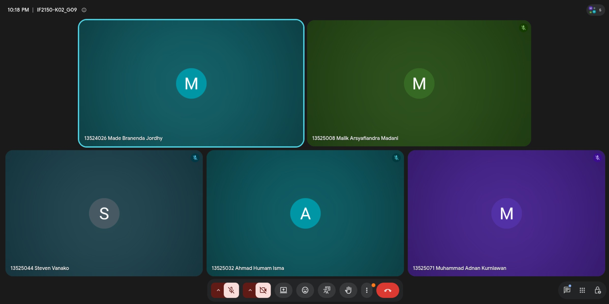

# Form Asistensi

## Tugas Besar IF2150 - Rekayasa Perangkat Lunak

| Informasi | Keterangan |
| --- | --- |
| **Hari** | Selasa |
| **Tanggal** | 27/10/2026 |
| **Kelas** | K02 |
| **Nomor Kelompok** | G09 |
| **Nama Kelompok** | Cumlaude |
| **Nama Perangkat Lunak** | SEHATI (Sistem Elektronik Pelayanan Kesehatan Terintegrasi) |
| **Dokumen** | K02_G09_DPPL2.md (Tugas 8 - Deskripsi Perancangan Perangkat Lunak 2) |

### Anggota Kelompok

| NIM | Nama |
| --- | --- |
| 13525008 | Malik Arsyafiandra Madani |
| 13525032 | Ahmad Humam Isma |
| 13525044 | Steven Vanako |
| 13525071 | Muhammad Adnan Kurniawan |
| 13525074 | Axeleon Justin Algianto |
| 13525110 | Fachry Azriel Fajdwani |

### Catatan

| Catatan |
| --- |
| 1. Pengerjaan milestone ini secara umum sudah sesuai. Cakupan dokumen sudah memadai karena SKPL kelompok cukup ramping, tetapi tetap boleh dirampingkan lagi sesuai kebutuhan. |
| 2. Tahap perancangan sudah semakin dekat dengan kode, sehingga detail rencana pengerjaan dan penyusunan setiap dokumen perlu lebih diperhatikan. |
| 3. Asisten menilai dokumen sudah aman dan mengapresiasi banyaknya fitur antarmuka yang rancangan implementasinya sudah terlihat pada tampilan, mulai dari letak, konfigurasi, hingga tampilan tombol. |
| 4. Saran: nama pada *pseudocode* harus sesuai dengan nama kelas, dan nama atribut serta metodenya diseragamkan dengan kelas yang bersangkutan. |
| 5. Bila kelompok menambah fitur baru yang ikut mengubah dokumen pada milestone sebelumnya, perubahan tersebut boleh diberi catatan (*notes*) pada dokumen terkait. |

## Dokumentasi

<!--  -->

  

  <i>Gambar 1. Dokumentasi kegiatan asistensi.</i>

